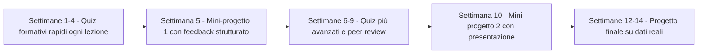

{/* geo-imprint: contesto:geografico, contesto:valuta */}

Nel 2011 Sebastian Thrun, professore di informatica a Stanford, mise online gratis il suo corso di Intelligenza Artificiale, aspettandosi qualche migliaio di iscritti. Se ne iscrissero 160.000, da 190 paesi. E la cosa più sorprendente fu che i migliori studenti non erano universitari americani, ma autodidatti di paesi senza accesso ad atenei di alto livello. Thrun lasciò Stanford per fondare Udacity, sostenendo che entro cinquant'anni resteranno solo dieci istituzioni di istruzione superiore davvero rilevanti. La storia mette il dito su un problema strutturale: l'università tradizionale poggia su vincoli che la tecnologia ha già superato, come la presenza fisica obbligatoria o la scarsità di esperti.
{/* GEO: claim senza fonte */}

Anche l'università italiana, con la sua storia lunga e la sua burocrazia, vive questa tensione. I dati recenti raccontano un ritardo strutturale: tassi di abbandono al primo anno tra il 15 e il 20%, laureati nella fascia 25-34 anni al 29% contro una media UE del 42%, soddisfazione più bassa per la didattica, uso limitato dei learning analytics, occupazione post-laurea più scarsa, tempi di laurea più lunghi e spesa per studente più bassa. Non sono i sintomi di un'emergenza improvvisa, ma di un problema vecchio e radicato.

## I 5 pilastri del professore innovativo

### 1. flipped classroom: invertire la dinamica tradizionale

Nel modello classico il docente trasmette la conoscenza in aula e lo studente la applica a casa, spesso da solo e senza aiuto. La flipped classroom ribalta lo schema: la trasmissione avviene a casa, con video o letture, mentre il tempo in aula va all'applicazione pratica e al confronto. Così il feedback è immediato e il supporto mirato. Perché funzioni i video devono essere brevi e accompagnati da domande di comprensione, e la lezione in aula deve dare per scontato che lo studente li abbia visti.

### 2. learning analytics: misurare ciò che conta

Le piattaforme di oggi raccolgono dati fitti sulle interazioni degli studenti: frequenza, visualizzazioni, esiti dei quiz, tempi di completamento, engagement. Sono dati che aiutano a individuare gli studenti a rischio e a migliorare materiali e metodi. Un caso concreto lo dimostra: rivedere più volte un video è un segnale di impegno, non di difficoltà.

### 3. project-based learning: partire da problemi reali

Sostituire gli esercizi astratti con problemi concreti costringe gli studenti a prendere decisioni vere, a scegliere metriche, dati e modo di comunicare i risultati. È un approccio che sviluppa le competenze che il mercato del lavoro chiede davvero, e rende la teoria subito utile e più facile da ricordare.

### 4. gamification: motivare con incentivi reali

La gamification che funziona cambia la struttura degli incentivi, non la sola superficie. Tra gli esempi efficaci ci sono le leaderboard anonime su quiz brevi, le sfide a squadre con valutazione tra pari e le simulazioni di business con conseguenze misurabili. Strumenti del genere alzano il coinvolgimento e il senso di responsabilità verso il gruppo.

### 5. feedback continuo: valutare prima dell'esame finale

L'esame finale arriva troppo tardi per rimediare alle incomprensioni profonde. Quiz formativi settimanali, mini-progetti intermedi e peer review strutturata permettono di scovare e correggere i problemi mentre stanno accadendo, riducendo l'ansia e migliorando i voti.

## Casi di successo

All'Università di Bologna il professor Carlo Moretti ha introdotto i learning analytics nei corsi di Gestione dei Processi, e l'abbandono è sceso dal 18% al 7% mentre il voto medio è salito da 22.1 a 24.8. Al Politecnico di Milano, il programma Executive MBA ha costruito un modello predittivo per individuare gli studenti a rischio sul fronte occupazionale: con interventi mirati ha portato il placement al 92% entro sei mesi dalla laurea.

## Gestire la resistenza

L'innovazione trova quasi sempre resistenze: colleghi tradizionalisti, burocrazia accademica, studenti abituati a un ruolo passivo. La strada è portare dati concreti, separare i contenuti dai metodi didattici e rinegoziare in modo esplicito il patto formativo con gli studenti, spiegando perché l'apprendimento attivo conviene anche a loro.

## Contesto nazionale e risorse

Il PNRR ha stanziato oltre 3 miliardi di euro per l'innovazione universitaria, tra infrastrutture digitali, formazione dei docenti e sviluppo di corsi online. I fondi Erasmus+ aggiungono risorse per scambi e innovazioni didattiche. L'ostacolo principale non è il denaro, ma sapere che queste risorse esistono e riuscire ad accedervi.

## Strumenti gratuiti per iniziare

Non serve investire subito. Strumenti come Google Colab, Moodle, Mentimeter, Kaggle, Slido e Notion sono gratuiti o open source e si integrano con gli LMS che già si usano. La scelta deve partire dalla domanda pedagogica, non dal tool.

## Framework per la digital transformation

Un percorso strutturato prevede una diagnosi iniziale (audit dei dati, individuazione dei docenti pionieri, setup degli strumenti), poi un pilot localizzato con 5-10 docenti e misurazione rigorosa, quindi uno scaling selettivo a 30-50 docenti con formazione sistematica, e infine la culturalizzazione, cioè i metodi innovativi che diventano lo standard e nascono centri di eccellenza.

## Il punto
Essere un professore innovativo significa usare dati e metodi moderni per un obiettivo antico: far imparare davvero gli studenti. L'università ha un vantaggio che nessuna piattaforma online sa replicare, il contatto umano e la comunità. La sfida è riconoscere che il cambiamento è possibile, strategico e conveniente, e poi muoversi con consapevolezza e metodo.

## Domande frequenti

1. **Perché le università italiane fanno fatica a innovare?**
Per incentivi (cattedra prima della ricerca applicata), finanziamenti (poco per l'impact), e struttura (poca collaborazione con il privato). Il PNRR ha stanziato 3 miliardi, ma la cultura cambia lenta.

2. **Cosa possono imparare le università dai data team aziendali?**
Adottare una cultura di misurazione: outcome chiari, metriche di successo, iterazioni rapide. Le università tendono a misurare input (papers, citationi), aziende misurano output (business value).

3. **Come si misura l'impact della ricerca?**
Non solo citations o papers. Impact = problemi reali risolti, tecnologie trasferite, startup nate, politiche influenzate. Il PNRR ha stanziato fondi con target di impact, non solo di output.
