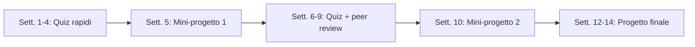

# Innovazione in Ateneo: Il Professore Rock 'n' Roll

L'università italiana è un'istituzione con 800 anni di storia. Lezioni frontali, slide lette ad alta voce, esami a crocette. Eppure, dentro le università ci sono docenti che stanno cambiando le cose.

## Lo Stato Attuale

| Metrica | Italia | Media UE | Gap |
|---|---|---|---|
| Tasso abbandono primo anno | 15-20% | 10-12% | -5/8% |
| Laureati 25-34 | 29% | 42% | -13% |
| Soddisfazione didattica | 6.2/10 | 7.1/10 | -0.9 |
| Docenti che usano analytics | ~5% | ~15% | -10% |

## I 5 Pilastri del Professore Innovativo

### 1. Flipped Classroom

**Tradizionale:** In aula = lezione passiva. A casa = esercizi da soli.
**Flipped:** A casa = video 20 min. In aula = esercizi pratici con il docente.

Lo studente guarda il video quando è fresco. Il tempo in aula diventa produttivo. Il docente identifica le difficoltà in tempo reale.

### 2. Learning Analytics

Se un e-commerce traccia ogni click, perché l'università no?

| Metrica | Come Raccoglierla | Insight |
|---|---|---|
| Frequenza | QR code / app check-in | Quali lezioni perdono studenti? |
| Visualizzazioni video | LMS (Moodle, Teams) | Quali argomenti vengono rivisti? |
| Risultati quiz intermedi | Google Forms | Dove faticano gli studenti? |
| Correlazione frequenza-voto | Gestionale | La frequenza predice il successo? |

### 3. Project-Based Learning

| Approccio Tradizionale | Approccio Rock 'n' Roll |
|---|---|
| "Calcola media e deviazione standard" | "Ecco i dati reali di un e-commerce. Quali prodotti eliminare dal magazzino?" |
| "Esegui un test t di Student" | "Il nuovo layout del sito ha funzionato? Convinci il CEO con 1 pagina." |
| "Disegna un istogramma" | "Analizza le recensioni TripAdvisor dei ristoranti di Bologna." |

### 4. Gamification

*   **Leaderboard settimanale:** Classifica anonima su quiz opzionali.
*   **Badge:** "Data Explorer", "Peer Teacher".
*   **Sfide a squadre:** Un caso di analisi dati a settimana, il team vincente presenta.
*   **Simulazioni:** Business game dove le decisioni hanno conseguenze misurabili.

### 5. Feedback Continuo

L'esame finale è come pesarsi solo il 31 dicembre. Se hai preso 10 kg, è troppo tardi.

## Gestire la Resistenza

### Il Collega Tradizionalista
"Ho sempre fatto così." → Porta i dati: tasso di abbandono, soddisfazione, impiego post-laurea.

### La Burocrazia
"Serve l'approvazione del Consiglio." → Cambia il **come**, non il **cosa**. Il metodo didattico è a discrezione del docente.

### Gli Studenti
"Ci dia le slide e ci dica cosa esce all'esame." → Spiega il patto formativo il primo giorno: "Vi chiederò di pensare, non memorizzare."

## Caso Pratico: Marketing Analytics a Milano

Un professore ha trasformato "Ricerche di Marketing" in chiave data-driven:

| Parametro | Prima | Dopo | Δ |
|---|---|---|---|
| Frequenza media | 45% | 78% | +33% |
| Tasso completamento | 72% | 91% | +19% |
| Soddisfazione (1-10) | 6.4 | 8.7 | +2.3 |
| Aziende che chiedono stagisti | 3 | 12 | +9 |

**Cosa ha fatto:** Caso aziendale ogni settimana. Python dalla prima lezione. Esame finale = progetto per un'azienda reale. Community alumni su LinkedIn.

## Strumenti Gratuiti

| Strumento | Uso | Costo |
|---|---|---|
| Google Colab | Notebook Python | Gratuito |
| Moodle | LMS completo | Open source |
| Mentimeter | Sondaggi in aula | Gratuito (base) |
| Kahoot! | Quiz gamificati | Gratuito (base) |
| Kaggle Datasets | Dataset reali | Gratuito |

## Conclusione

Essere Rock 'n' Roll non significa essere anticonformista per il gusto di farlo. Significa usare dati e metodi moderni per un obiettivo antico: far imparare davvero gli studenti. Bastano piccoli cambiamenti per fare una grande differenza.
