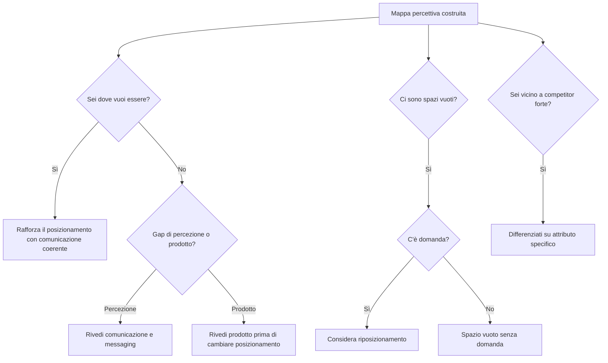

Nel 1983 Diet Coke arrivò con trent'anni di ritardo su Tab, la prima cola dietetica di Coca-Cola. Tab aveva un brand già forte e clienti affezionati, quindi un secondo prodotto dietetico sembrava superfluo. Eppure una mappa percettiva delle bevande mostrava uno spazio vuoto ben preciso: nel posizionamento "cola moderna + basse calorie + brand maschile" non c'era nessuno. Tab era percepita come femminile, le cole tradizionali come molto caloriche. Quello spazio mentale, libero, era enorme. <!-- GEO: claim senza fonte -->

Diet Coke fu lanciata esattamente lì e diventò il prodotto a crescita più rapida nella storia di Coca-Cola: 200 milioni di casse vendute nel primo anno e terza bevanda gassata più venduta negli Stati Uniti nel 1984.

La mappa percettiva non creò Diet Coke, ma individuò lo spazio in cui poteva vivere senza cannibalizzare Tab e senza scontrarsi direttamente con Pepsi o con la Coke tradizionale. Era una mappa dello spazio mentale dei consumatori, e mostrava i territori ancora inesplorati.

## Cos'è una mappa percettiva e perché è importante

Una mappa percettiva è un grafico bidimensionale in cui ogni asse rappresenta un attributo che conta per i consumatori, e i brand vengono collocati in base a come sono percepiti su quegli attributi.

La distinzione di fondo è questa: la mappa mostra la percezione dei consumatori, non la realtà oggettiva. Un prodotto tecnicamente superiore può finire percepito come di fascia media se la comunicazione non sostiene un posizionamento premium, e vale anche il contrario.

Il valore strategico di una mappa percettiva è:

- capire dove sei nella mente del consumatore rispetto ai competitor
- individuare gli spazi vuoti non presidiati
- diagnosticare i problemi di comunicazione
- guidare le decisioni di riposizionamento

### Esempio classico: il mercato automobilistico europeo

La mappa più nota usa due assi: economico-premium e sportivo-comfort.

|                | Sportivo           | Comfort            |
|----------------|--------------------|--------------------|
| Economico      | Alfa Romeo, Fiat, Dacia | Dacia, Volvo       |
| Premium        | Ferrari, BMW       | Mercedes           |

Alfa Romeo è sportiva e di prezzo intermedio, BMW sportiva e premium, Mercedes premium e orientata al comfort. Il quadrante sportivo-economico era uno spazio vuoto, che Renault e Toyota hanno provato a occupare.

## Come costruire una mappa percettiva: i 4 passaggi

### 1. scegliere gli attributi giusti

Gli attributi devono pesare nella decisione d'acquisto, devono differenziare e devono essere bipolari, cioè avere due estremi opposti chiari. La fonte migliore sono le ricerche qualitative coi consumatori, non le idee del team marketing.

| Settore           | Attributi tipici                        |
|-------------------|---------------------------------------|
| Fashion           | Prezzo vs Qualità, Classico vs Trendy |
| Food & Beverage   | Salutare vs Indulgente, Tradizionale vs Innovativo |
| SaaS              | Semplice vs Utile, Economico vs Enterprise |

### 2. raccolta dati percettivi

**Opzione A: sondaggio strutturato** con scala Likert (1-7) su ogni brand e attributo, su un campione rappresentativo che comprenda clienti e non clienti.

**Opzione B: analisi delle recensioni online** con NLP e sentiment analysis, utile per le analisi preliminari o per monitorare l'evoluzione nel tempo.

### 3. analisi statistica: MDS o PCA

Con pochi attributi puoi disegnare la mappa direttamente, con molti serve una riduzione dimensionale.

- MDS: proietta le distanze percettive in 2D, ottimo coi dati di similarità diretta
- PCA: combina gli attributi in due componenti principali che spiegano la varianza, più comune coi dati di punteggio

Un esempio pratico nel mercato SaaS italiano mostra come usare la PCA per costruire la mappa e scovare uno spazio vuoto "semplice + economico".

### 4. interpretare la mappa e definire la strategia

Le letture strategiche principali sono:

- confermare se sei dove vuoi essere nella mente del consumatore
- individuare gli spazi vuoti con potenziale domanda
- analizzare i cluster competitivi per differenziarti
- seguire l'evoluzione nel tempo con aggiornamenti regolari

## Errori da evitare

- scegliere attributi che ai consumatori non interessano
- confondere la percezione con la realtà tecnica
- lavorare su un campione distorto, fatto solo di clienti attuali
- lasciare la mappa invecchiare senza aggiornarla

## Caso pratico: mercato del caffè specialty in italia

Uno studio su 250 consumatori ha mappato brand come Illy, Lavazza, Blue Bottle, Intelligentsia e un tostatore artigianale italiano.

La PCA ha fatto emergere due dimensioni: "tradizione italiana vs modernità internazionale" e "accessibile vs premium".

Il tostatore si colloca vicino ai brand americani nel quadrante "moderno + premium", molto affollato. Lo spazio "moderno + accessibile" è quasi vuoto, e rappresenta l'occasione di offrire qualità e cool factor a un prezzo abbordabile.

La strategia suggerita è allargare la distribuzione online con abbonamenti competitivi, tenendo la comunicazione sull'artigianalità moderna e sulla sostenibilità.

## Applicazioni pratiche

Le mappe percettive guidano le decisioni su naming, pricing, sviluppo prodotto e investimenti pubblicitari, e tengono allineate percezione e strategia.

## Il punto
Come dice Jocelyn Wyatt di IDEO U, "design thinking starts with observation". Prima di decidere dove andare, devi sapere dove sei nella mente dei consumatori. Le mappe percettive sono strumenti decisionali concreti: ti dicono non solo quanto vendi, ma perché e dove puoi crescere.
