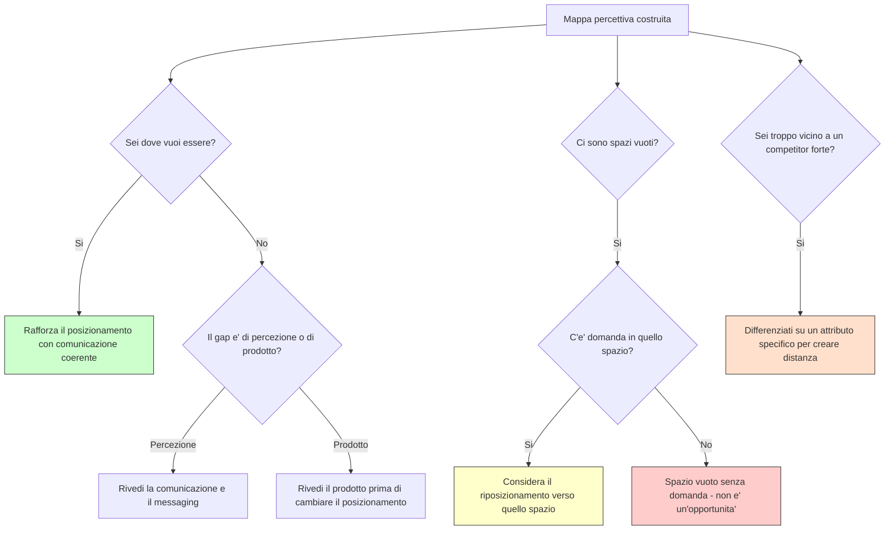

# Mappe Percettive: Vedere il tuo Brand con gli Occhi del Consumatore

Nel 1983, Diet Coke era in ritardo di 30 anni rispetto a Tab, la cola dietetica originale di Coca-Cola. Tab aveva un'ottima quota di mercato, un brand riconoscibile, e una base di clienti fedele. Non c'era nessun motivo ovvio per lanciare un secondo prodotto dietetico. Eppure i ricercatori di Coca-Cola avevano costruito una mappa percettiva del mercato delle bevande che mostrava una cosa precisa: nello spazio percettivo "cola moderna + basso calore + brand maschile", non c'era nessuno. Tab era percepita come femminile. Le cole tradizionali erano percepite come ad alto contenuto calorico. Quello spazio vuoto era enorme — e nessun competitor lo stava presidiando.

Diet Coke fu lanciata in quello spazio vuoto. Divento' il prodotto Coca-Cola con la crescita piu' rapida della storia dell'azienda — 200 milioni di casse vendute nel primo anno. Nel 1984 era diventata la terza bevanda gassata piu' venduta negli Stati Uniti.

La mappa percettiva non aveva creato Diet Coke. Aveva identificato lo spazio in cui Diet Coke poteva esistere senza cannibale Tab e senza competere frontalmente con le Pepsi e le Coke tradizionali. Era una mappa geografica dello spazio mentale dei consumatori, che mostrava esattamente dove c'erano territori inesplorati.

## Cos'e' una Mappa Percettiva e Perche' Importa

Una mappa percettiva (o Perceptual Map, o Brand Map) e' un grafico bidimensionale dove ogni asse rappresenta un attributo rilevante per i consumatori del tuo mercato, e i brand vengono posizionati in base a come i consumatori li percepiscono su quegli attributi.

La distinzione critica: la mappa non mostra dove i brand **sono** oggettivamente. Mostra dove i consumatori li **percepiscono**. Queste due cose possono essere molto diverse. Un prodotto tecnicamente superiore puo' essere percepito come "di fascia media" se la comunicazione non supporta il posizionamento premium. Un prodotto mediocre puo' essere percepito come premium se il brand equity e' forte. La mappa cattura la realta' percettiva, non quella oggettiva — ed e' la realta' percettiva che determina le decisioni d'acquisto.

Il valore strategico di una mappa percettiva e' multiplo:

- Vedere dove sei rispetto ai competitor nella mente del consumatore, non solo in termini di feature o prezzo
- Identificare spazi vuoti: posizionamenti non presidiati da nessun competitor, potenzialmente attrattivi
- Diagnosticare problemi di comunicazione: se sei posizionato dove non vuoi essere, sai dove intervenire
- Guidare le decisioni di riposizionamento: sapere dove si trova lo spazio meno competitivo

### Esempio Classico: il Mercato delle Auto

La mappa piu' citata nei testi di marketing e' quella del mercato automobilistico europeo, costruita attorno a due assi: economico-premium (asse orizzontale) e sportivo-comfort (asse verticale).

```
                     Sportiva
                        |
         Alfa Romeo     |    Ferrari
                        |
              Audi      |       BMW
                        |
   ────────────────────────────────────────
   Economica            |              Premium
                        |
         Fiat           |    Mercedes
                        |
               Dacia    |    Volvo
                        |
                     Comfort
```

Lettura: Alfa Romeo e' percepita come sportiva con un posizionamento di prezzo intermedio. BMW e' sportiva e premium. Mercedes e' premium e orientata al comfort. Dacia e' il posizionamento piu' economico, con scarso differenziazione su sportivo vs comfort. Ferrari e' nel quadrante estremo sportivo-premium — lo stesso quadrante ma con densita' diversa rispetto a BMW.

Lo spazio vuoto interessante in questa mappa storica era il quadrante "sportivo-economico": nessun brand mainstream lo presidiava efficacemente. E' quello spazio che Renault ha cercato di occupare con la Clio Sport, e che Toyota ha toccato con la GT86.

## Come Costruire una Mappa Percettiva: i 4 Step

### Step 1: Scegli gli Attributi Giusti

Questo e' il passo piu' critico e piu' spesso fatto male. Gli attributi devono essere:

1. **Rilevanti per la decisione d'acquisto:** non caratteristiche tecniche che nessuno considera quando compra, ma i criteri su cui i consumatori effettivamente valutano le opzioni
2. **Differenzianti:** se tutti i brand del mercato sono percepiti ugualmente su un attributo, quell'asse non separa niente
3. **Bipolari e coerenti:** ogni asse deve avere due estremi opposti chiari (economico vs premium, semplice vs complesso, tradizionale vs innovativo)

La fonte migliore per identificare gli attributi rilevanti non e' il tuo team di marketing — e' la ricerca qualitativa con i consumatori. Interviste, focus group, analisi delle recensioni online. Cosa dicono le persone quando scelgono un prodotto nella tua categoria? Quali criteri menzionano spontaneamente?

| Settore | Attributi tipicamente rilevanti |
|---|---|
| Fashion e abbigliamento | Prezzo vs Qualita', Classico vs Trendy, Accessibile vs Esclusivo |
| Food e bevande | Salutare vs Indulgente, Tradizionale vs Innovativo, Locale vs Internazionale |
| SaaS e software | Semplice da usare vs Potente/Flessibile, Economico vs Enterprise, Specialistico vs General Purpose |
| Hospitality e turismo | Budget vs Lusso, Business vs Leisure, Standard vs Esperienziale |
| Cosmetica | Naturale vs Performance, Accessibile vs Luxury, Mainstream vs Niche |

### Step 2: Raccolta dei Dati Percettivi

**Opzione A: Sondaggio strutturato (metodo classico)**

Chiedi a un campione rappresentativo di consumatori di valutare ogni brand su ogni attributo, usando una scala Likert (tipicamente 1-7).

```
"Su una scala da 1 a 7, quanto consideri [BRAND] come..."
1 = Molto economico  ---  7 = Molto premium
1 = Molto tradizionale --- 7 = Molto innovativo
1 = Molto semplice --- 7 = Molto sofisticato/complesso
```

Il campione minimo per una mappa affidabile e' 150-200 rispondenti per segmento di mercato che vuoi analizzare. Se vuoi separare la percezione tra i tuoi clienti e quella dei clienti dei competitor, ne servono di piu'.

Una nota critica: includi sempre non-clienti e clienti dei competitor nel campione. Se intervisti solo i tuoi clienti attuali, costruisci la mappa percettiva del tuo segmento di mercato, non del mercato totale — un bias di sopravvivenza che puo' distorcere significativamente il quadro.

**Opzione B: Analisi delle Review Online**

Strumenti di sentiment analysis e NLP possono estrarre le dimensioni percettive dalle review di Trustpilot, Google Reviews, App Store, e social media. Non sostituisce il sondaggio per precisione quantitativa, ma e' utile per un'analisi preliminare a basso costo e per monitorare come le percezioni evolvono nel tempo senza condurre nuovi sondaggi.

### Step 3: Analisi Statistica — MDS o PCA

Con 2 attributi, puoi disegnare la mappa direttamente. Con 4-8 attributi (il caso tipico), devi ridurre le dimensioni a 2 per poter visualizzare. Le tecniche standard sono:

**MDS (Multidimensional Scaling):** Prende le distanze percettive tra brand (quanto i consumatori li percepiscono come simili o diversi) e li proietta in 2D preservando quelle distanze il piu' possibile. E' ottimo quando hai dati di "similarita'" diretta tra brand (domande tipo "quanto sono simili Brand A e Brand B?").

**PCA (Principal Component Analysis):** Prende i punteggi su tutti gli attributi e trova le 2 combinazioni lineari di attributi che spiegano la massima varianza nel dataset. E' piu' comune quando hai dati di punteggio per attributo (come nel sondaggio Likert). Le due componenti principali diventano i due assi della mappa.

```python
import numpy as np
import matplotlib.pyplot as plt
from sklearn.decomposition import PCA
from sklearn.preprocessing import StandardScaler

# ---- Dati percettivi: valutazioni medie dei consumatori ----
# Scenario: mercato SaaS di project management in Italia
# Attributi: [Facilita' d'uso, Potenza feature, Prezzo conveniente, Qualita' supporto]
# Scala 1-7, dove 7 = molto alta su quell'attributo

brands = ['Notion', 'Asana', 'Monday.com', 'Trello', 'Jira', 'ClickUp', 'Il Nostro Tool']

# Punteggi medi da sondaggio su 300 decision-maker italiani
dati_percettivi = np.array([
    [6.5, 4.0, 5.5, 4.5],  # Notion: molto facile, medio-bassa potenza, medio prezzo
    [5.5, 6.0, 4.0, 6.0],  # Asana: facile, potente, non economico, supporto top
    [5.0, 6.5, 3.0, 5.5],  # Monday.com: medio, molto potente, caro, buon supporto
    [6.8, 3.5, 6.5, 3.5],  # Trello: semplicissimo, poco potente, economico, supporto base
    [3.0, 7.0, 3.5, 5.0],  # Jira: difficile, massima potenza, medio prezzo, buon supporto
    [5.5, 6.5, 5.0, 4.0],  # ClickUp: buona facilita', molto potente, ok prezzo, ok supporto
    [5.8, 4.5, 6.0, 5.8],  # Il Nostro Tool: facile, medio-alta, economico, ottimo supporto
])

# ---- Standardizzazione degli attributi ----
# Necessaria: senza standardizzazione, attributi con scala o varianza diversa
# dominerebbero erroneamente il calcolo delle componenti principali
scaler = StandardScaler()
dati_scalati = scaler.fit_transform(dati_percettivi)

# ---- PCA: riduzione a 2 componenti ----
pca = PCA(n_components=2)
coordinate_2d = pca.fit_transform(dati_scalati)

varianza_spiegata = pca.explained_variance_ratio_
print(f"Varianza spiegata da PC1: {varianza_spiegata[0]:.1%}")
print(f"Varianza spiegata da PC2: {varianza_spiegata[1]:.1%}")
print(f"Varianza totale spiegata: {sum(varianza_spiegata):.1%}")

# ---- Interpretazione delle componenti ----
# I loadings (contributi di ogni attributo alla componente) ci dicono
# cosa rappresenta ogni asse della mappa
nomi_attributi = ['Facilita_uso', 'Potenza_feature', 'Prezzo_conveniente', 'Qualita_supporto']
loadings = pd.DataFrame(
    pca.components_.T,
    index=nomi_attributi,
    columns=['PC1', 'PC2']
)
print("\n=== Loadings: contributo di ogni attributo agli assi della mappa ===")
print(loadings.round(3))
print("\nPC1 positivo = piu' potente/complesso (alto loading su Potenza, negativo su Facilita')")
print("PC2 positivo = piu' accessibile (alto loading su Prezzo conveniente)")

# ---- Visualizzazione della mappa percettiva ----
fig, ax = plt.subplots(figsize=(12, 9))

# Punti per ogni brand
colors = ['#2196F3'] * (len(brands) - 1) + ['#F44336']  # Rosso per il nostro brand
sizes = [150] * (len(brands) - 1) + [250]

for i, (brand, x, y, color, size) in enumerate(zip(
    brands, coordinate_2d[:, 0], coordinate_2d[:, 1], colors, sizes
)):
    ax.scatter(x, y, s=size, c=color, zorder=5, alpha=0.8)

    fontweight = 'bold' if brand == 'Il Nostro Tool' else 'normal'
    ax.annotate(
        brand,
        (x + 0.06, y + 0.06),
        fontsize=11,
        fontweight=fontweight,
        color=color
    )

# Linee di riferimento centrali
ax.axhline(y=0, color='gray', linestyle='--', alpha=0.4)
ax.axvline(x=0, color='gray', linestyle='--', alpha=0.4)

# Etichette degli assi con interpretazione
ax.set_xlabel(
    f'PC1: Potenza/Complessita\' ({varianza_spiegata[0]:.0%} varianza)\n'
    f'← Semplice / Accessibile             Potente / Complesso →',
    fontsize=11
)
ax.set_ylabel(
    f'PC2: Convenienza ({varianza_spiegata[1]:.0%} varianza)\n'
    f'↑ Piu\' economico / conveniente',
    fontsize=11
)
ax.set_title('Mappa Percettiva — Mercato SaaS Project Management (Italia)', fontsize=13, pad=15)

# Aggiungi zona evidenziata per lo "spazio vuoto"
from matplotlib.patches import Ellipse
spazio_vuoto = Ellipse((-1.5, 1.2), width=1.0, height=0.8,
                        angle=0, fill=True, facecolor='#E8F5E9',
                        edgecolor='#4CAF50', linewidth=2, linestyle='--', zorder=2)
ax.add_patch(spazio_vuoto)
ax.text(-1.5, 1.6, 'Spazio vuoto:\nSemplice + Economico', ha='center',
        fontsize=9, color='#2E7D32', style='italic')

plt.tight_layout()
plt.savefig('mappa_percettiva_saas.png', dpi=150, bbox_inches='tight')
plt.show()

print("\n=== Posizione dei brand nello spazio percettivo ===")
for brand, coord in zip(brands, coordinate_2d):
    print(f"  {brand:20s}: PC1={coord[0]:+.2f}, PC2={coord[1]:+.2f}")
```

### Step 4: Interpretare la Mappa e Definire la Strategia

Una volta costruita la mappa, ci sono quattro letture strategiche principali:

**Conferma o disconferma del posizionamento inteso:** Sei dove vuoi essere? Se la tua strategia di comunicazione punta a "premium innovativo" ma la mappa ti colloca nel quadrante "medio tradizionale", hai un problema di execution della strategia di brand — non di strategia stessa.

**Identificazione degli spazi vuoti:** I quadranti o le zone della mappa non presidiate da nessun competitor rappresentano opportunita' di posizionamento. L'analisi dello spazio vuoto deve pero' essere completata da una domanda di business: lo spazio vuoto e' vuoto perche' nessuno lo ha visto, o e' vuoto perche' non c'e' domanda li?

**Analisi del competitive cluster:** Se sei molto vicino a un competitor piu' grande o piu' forte nella mappa, stai combattendo una guerra di prezzo nel tuo stesso spazio percettivo. Differenziarti muovendoti verso una posizione meno affollata e' spesso piu' efficace che cercare di vincere sul terreno del competitor.

**Evoluzione nel tempo:** Le mappe percettive sono snapshot, non stati permanenti. Aggiornare la mappa ogni 12-18 mesi permette di vedere come le percezioni cambiano — sia per effetto delle tue campagne che per movimenti dei competitor.



## Errori che Invalidano la Mappa

**Attributi scelti dall'azienda, non dal consumatore:** Se costruisci la mappa con attributi che sembrano importanti al tuo team di marketing ma che i consumatori non usano per scegliere, stai mappando la tua prospettiva, non quella del mercato. Conduci sempre ricerca qualitativa preliminare per validare gli attributi.

**Confondere percezione con realta':** La mappa percettiva non e' una valutazione tecnica oggettiva dei prodotti. Se il tuo prodotto e' oggettivamente il piu' facile da usare ma e' percepito come complesso, hai un problema di comunicazione — non il prodotto e' nel posto sbagliato nella mappa, ma la percezione e' nel posto sbagliato rispetto alla realta'. Azioni diverse per problemi diversi.

**Campione distorto:** Se intervisti solo i tuoi clienti attuali, costruisci la mappa percettiva del tuo segmento, non del mercato. I tuoi clienti hanno gia' scelto te — la loro percezione dei competitor e' inevitabilmente colorata da quel fatto.

**La mappa non viene aggiornata:** Le campagne dei competitor cambiano le percezioni. Il tuo stesso investimento in brand building cambia la tua posizione percepita. Una mappa del 2022 e' quasi certamente obsoleta nel 2026. Pianifica aggiornamenti periodici (annuali o biennali) come parte della tua routine di brand tracking.

## Caso Pratico: Mercato del Caffe' Specialty in Italia

Un tostatore artigianale italiano ha commissionato uno studio percettivo sul mercato del caffe' specialty, con 250 interviste a consumatori che acquistano caffe' di qualita' superiore ai canali standard.

| Brand | Qualita' percepita (1-7) | Accessibilita' prezzo (1-7) | Tradizione (1-7) | Cool Factor/Modernita' (1-7) |
|---|---|---|---|---|
| Illy | 6.2 | 5.0 | 6.8 | 4.2 |
| Lavazza | 5.4 | 6.5 | 6.9 | 3.1 |
| Vergnano | 5.1 | 6.0 | 6.2 | 3.0 |
| Costadoro | 6.0 | 4.2 | 5.3 | 5.1 |
| Blue Bottle | 6.8 | 2.1 | 1.8 | 6.9 |
| Intelligentsia (US) | 6.9 | 2.4 | 2.1 | 6.8 |
| **Nostro Tostatore** | **6.1** | **3.2** | **3.4** | **6.2** |

La PCA su questi dati rivela due componenti principali: la prima cattura principalmente la dimensione "tradizione italiana vs modernita' internazionale" (oppone Illy e Lavazza a Blue Bottle e Intelligentsia). La seconda cattura la dimensione "accessibile vs premium/esclusivo".

**Insight chiave dalla mappa:**

Il tostatore si posiziona vicino a Blue Bottle e Intelligentsia nel quadrante "moderno + premium" — territorio affollato di brand americani percepiti come referenze globali del specialty coffee. La competizione in quel quadrante e' dura.

Lo spazio quasi vuoto e' il quadrante "moderno + accessibile": alta percezione di qualita' e cool factor, ma con un prezzo accessibile. Nessun competitor italiano presidia efficacemente quella posizione. Illy e' percepita come moderna ma non abbastanza, e il prezzo e' medio-alto. I brand americani sono moderni ma costosissimi e poco accessibili nella distribuzione italiana.

La strategia suggerita: espandere la distribuzione online con abbonamenti a prezzi competitivi (accessibilita'), mantenendo la comunicazione su artigianalita' moderna e sostenibilita' (cool factor). Non cercare di competere con Blue Bottle nello stesso spazio, ma presidiare il territorio "specialty coffee accessibile agli italiani" che nessuno ha ancora veramente occupato.

## Conclusione: Vedere Prima di Agire

Jocelyn Wyatt, cofondatrice di IDEO U, usa spesso una frase che si applica perfettamente alle mappe percettive: "Design thinking starts with observation." Prima di decidere dove vuoi andare, devi sapere dove sei — nella realta' percettiva dei consumatori, non nella realta' che immagini nella tua testa.

Le mappe percettive non sono un esercizio accademico: sono uno strumento decisionale che risponde a domande concrete su allocazione del budget di comunicazione, posizionamento del prodotto, scelte di pricing, e lancio di nuovi brand. Richiedono investimento in ricerca (sondaggi, analisi, elaborazione), ma il costo di lanciare un nuovo prodotto nel posto sbagliato del mercato — come avrebbe fatto Coca-Cola senza la ricerca che ha portato a Diet Coke — e' ordini di grandezza superiore.

I numeri di vendita ti dicono quanto stai vendendo. Le mappe percettive ti dicono perche', e dove c'e' spazio per vendere di piu'.
