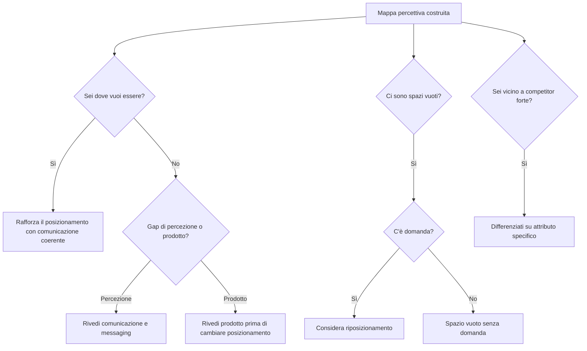

{/* geo-imprint: contesto:geografico, contesto:modello */}

Capita spesso di definire il posizionamento in sala riunioni, convinti di avere un'offerta unica, per poi scoprire che i clienti ti mettono nello stesso calderone dei concorrenti più economici o di quelli storici. Quando succede, ogni campagna fatica a convertire e finisci per competere sugli sconti. Una mappa percettiva costruita sui dati reali dei consumatori ti mostra esattamente quale posto occupi nella loro testa e dove esistono spazi ancora liberi. Qui trovi i quattro passaggi per costruirla, gli errori di campionamento da evitare e un caso studio sul mercato italiano del caffè specialty.

Per capire quanto conti questa vista d'insieme, basta guardare al lancio di Diet Coke nel 1983. Arrivò con trent'anni di ritardo rispetto a Tab, la prima cola dietetica di Coca-Cola, che aveva già un pubblico fedele e faceva sembrare inutile un secondo prodotto ipocalorico. Eppure una mappa percettiva delle bevande mostrava un vuoto netto: nel quadrante "cola moderna, basse calorie e brand maschile" mancava qualsiasi alternativa. Tab era associata a un pubblico femminile, mentre le cole tradizionali restavano legate a un alto contenuto calorico.
{/* GEO: claim senza fonte */}

Diet Coke entrò proprio in quello spazio vuoto e diventò il prodotto a crescita più rapida nella storia di Coca-Cola, raggiungendo 200 milioni di casse vendute nel primo anno e diventando la terza bevanda gassata più venduta negli Stati Uniti nel 1984. La mappa permise all'azienda di crescere senza cannibalizzare Tab e senza scontrarsi frontalmente con Pepsi o con la Coca-Cola classica.

## Come funziona una mappa percettiva e cosa ti permette di vedere

Una mappa percettiva è un grafico bidimensionale in cui ogni asse rappresenta un criterio importante per chi acquista, mentre i brand vengono posizionati in base alle opinioni raccolte sul mercato.

Il punto chiave è che la mappa fotografa la percezione dei consumatori, anche quando si discosta dalle caratteristiche tecniche reali del prodotto. Un software o un servizio eccellente sul piano ingegneristico può risultare di fascia media agli occhi del pubblico se la comunicazione non sostiene un posizionamento premium. Al contrario, un'azienda con un prodotto più semplice può occupare la fascia alta se presidia bene l'immaginario del cliente.

Con una mappa aggiornata riesci a fare quattro verifiche concrete:

- capire dove ti colloca il mercato rispetto ai concorrenti diretti
- individuare quadranti scoperti dove esiste domanda insoddisfatta
- diagnosticare eventuali scollamenti tra promessa di brand e percezione reale
- decidere se e come riposizionarti prima di investire in nuove campagne

### Un esempio concreto: il mercato automobilistico europeo

La rappresentazione più diffusa nel settore auto incrocia due assi: economico contro premium da un lato, sportivo contro comfort dall'altro.

|                | Sportivo           | Comfort            |
|-------------|--------------------|--------------------|
| Economico      | Alfa Romeo, Fiat, Dacia | Dacia, Volvo       |
| Premium        | Ferrari, BMW       | Mercedes           |

In questa distribuzione, Alfa Romeo occupa una fascia sportiva e di prezzo intermedio, BMW presidia il quadrante sportivo e premium, mentre Mercedes si concentra su lusso e comfort. Il quadrante sportivo ed economico restava in larga parte scoperto, ed è proprio lì che marchi come Renault e Toyota hanno cercato spazio.

## Costruire una mappa percettiva in 4 passaggi

### 1. Scegli attributi che guidano l'acquisto

Gli assi della mappa devono riflettere fattori che pesano davvero sulla scelta del cliente, devono distinguere un brand dall'altro e devono avere due estremi opposti chiari. Conviene ricavarli da interviste qualitative con i compratori, evitando di basarsi solo sulle ipotesi interne del team marketing.

| Settore           | Attributi tipici                        |
|-------------------|---------------------------------------|
| Fashion           | Prezzo vs Qualità, Classico vs Trendy |
| Food & Beverage   | Salutare vs Indulgente, Tradizionale vs Innovativo |
| SaaS              | Semplice vs Utile, Economico vs Enterprise |

### 2. Raccogli dati percettivi da clienti e non clienti

Una volta definiti gli attributi, ti servono valutazioni numeriche comparabili tra i diversi marchi. Hai due strade principali per ottenerle:

- **Sondaggio strutturato**: chiedi a un campione rappresentativo di valutare ogni brand su una scala Likert da 1 a 7 per ciascun attributo. Includi sia chi già compra da te sia chi sceglie i concorrenti.
- **Analisi delle recensioni online**: applichi tecniche di NLP e sentiment analysis alle recensioni pubbliche. È un metodo rapido per una prima bozza o per monitorare come cambiano le opinioni nel tempo.

### 3. Riduci le dimensioni con MDS o PCA

Se lavori con due soli attributi puoi disegnare il grafico direttamente. Nella pratica, tuttavia, i clienti valutano un prodotto su cinque, otto o dieci criteri diversi, e per portarli su un piano a due assi serve una tecnica di riduzione dimensionale.

In questi casi scegli tra due metodi statistici:

- **MDS (Multidimensional Scaling)**: proietta in 2D le distanze percettive complessive, ed è indicato quando raccogli giudizi diretti di similarità tra coppie di brand.
- **PCA (Principal Component Analysis)**: combina molti attributi in due componenti principali che spiegano la maggior parte della varianza nei dati, ed è la scelta più frequente quando parti da questionari a punteggio.

Per esempio, applicando la PCA a un insieme di software B2B italiani si possono sintetizzare decine di risposte in due assi leggibili e verificare subito se esiste uno spazio libero "semplice + economico".

### 4. Leggi la mappa e decidi la mossa successiva

Quando i brand compaiono sul grafico, l'analisi si trasforma in decisioni operative. Prima di cambiare strategia, verifica quattro scenari: conferma la tua posizione attuale rispetto agli obiettivi, cerca quadranti vuoti che abbiano una domanda reale, osserva i cluster più affollati per capire da chi allontanarti e programma un aggiornamento periodico per seguire l'evoluzione del mercato.

## Quattro errori che falsano la mappa

Anche una buona raccolta dati perde utilità se commetti uno di questi sbagli metodologici:

- **Scegliere attributi irrilevanti per chi compra**: se un criterio piace all'azienda ma non sposta la decisione d'acquisto, la mappa diventa un esercizio estetico.
- **Scambiare le schede tecniche per percezioni**: la mappa misura cosa pensa il mercato, quindi correggere un dato "sbagliato" a mano falsa la diagnosi.
- **Intervistare solo i clienti attuali**: chi ti ha già scelto tende a valutarti in modo più benevolo rispetto a chi compra altrove.
- **Usare la stessa mappa per anni**: i competitor cambiano prezzi e messaggi, e una fotografia vecchia porta a decisioni fuori tempo.

## Caso pratico: posizionamento nel caffè specialty italiano

Uno studio condotto su 250 consumatori ha mappato diversi attori del settore, tra cui Illy, Lavazza, Blue Bottle, Intelligentsia e un tostatore artigianale italiano.

Dall'analisi PCA sono emerse due dimensioni principali: "tradizione italiana contro modernità internazionale" e "accessibile contro premium". Il tostatore artigianale risultava schiacciato vicino ai brand americani nel quadrante "moderno + premium", una zona già molto affollata. Al contrario, l'area "moderno + accessibile" appariva quasi vuota, segnalando l'opportunità di proporre qualità e immagine contemporanea a un prezzo più abbordabile.

Di conseguenza, l'indicazione strategica è stata ampliare la distribuzione online attraverso abbonamenti a prezzo competitivo, mantenendo però una comunicazione centrata su artigianalità moderna e sostenibilità.

## Dove usare la mappa nelle decisioni quotidiane

Una volta validata, la mappa diventa un riferimento condiviso per più reparti. Ti aiuta a definire i prezzi in coerenza con il quadrante scelto, a orientare lo sviluppo prodotto verso le caratteristiche che i clienti associano a quello spazio e a verificare se il naming e le campagne pubblicitarie stanno spostando il brand nella direzione voluta.

Come ricorda Jocelyn Wyatt di IDEO U, "design thinking starts with observation". Prima di decidere dove portare il brand, ti serve sapere esattamente dove ti trovano oggi le persone.

## Il prossimo passo operativo

Prendi i tuoi concorrenti principali, raccogli le valutazioni di clienti e non clienti su due criteri indipendenti che guidano la scelta d'acquisto, e riporta le medie su un grafico cartesiano. Avrai subito una base concreta per capire se il tuo posizionamento regge alla prova del mercato o se conviene spostarti verso un quadrante meno affollato.

## Domande frequenti

1. **Cos'è una mappa percettiva?**
È un grafico a due assi che mostra come i clienti percepiscono il tuo brand rispetto ai concorrenti su due criteri decisivi per l'acquisto, come prezzo e qualità percepita.

2. **Come si costruisce una mappa percettiva?**
Scegli due dimensioni indipendenti rilevanti per chi compra, raccogli le valutazioni dei clienti su ciascun brand tramite sondaggi o recensioni, e riporti i punteggi su un grafico cartesiano.

3. **Qual è l'errore più comune quando si crea una mappa percettiva?**
Usare assi che non influenzano la scelta d'acquisto oppure scegliere dimensioni troppo correlate tra loro, come prezzo alto e qualità percepita, che schiacciano i brand su una diagonale.

4. **A cosa serve una mappa percettiva nella strategia aziendale?**
Serve a verificare se la tua comunicazione genera il posizionamento desiderato, individuare spazi di mercato scoperti e capire da quali concorrenti devi differenziarti.
