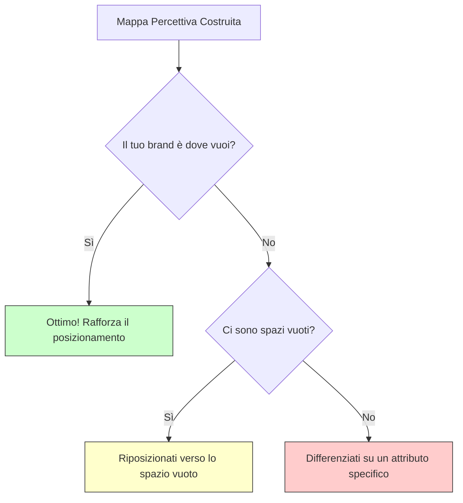

# Mappe Percettive: Il GPS del Tuo Brand

Dove si posiziona il tuo brand nella mente del consumatore? Se la risposta è "non lo so" o "dove credo io", hai un problema. Le **mappe percettive** (Perceptual Maps) sono lo strumento visivo più potente per capire esattamente dove i consumatori collocano il tuo brand rispetto ai competitor — e dove ci sono spazi vuoti da occupare.

## Cos'è una Mappa Percettiva?

È un grafico bidimensionale dove ogni asse rappresenta un attributo importante per il consumatore, e i brand vengono posizionati in base alla loro percezione su quegli attributi.

### Esempio Classico: Il Mercato delle Auto

```
                 Sportiva
                    │
        Alfa Romeo  │  Porsche
                    │
                    │       BMW
    ─────────────── ┼ ───────────────
  Economica         │           Premium
                    │
        Dacia       │  Audi
                    │
          Fiat      │  Mercedes
                    │
                 Comfort
```

**Lettura:** Alfa Romeo è percepita come sportiva ma non ultra-premium. BMW è sportiva e premium. Fiat è economica e orientata al comfort. Dacia è economica e... basta (nessun posizionamento forte sugli altri attributi).

## Come Costruire una Mappa Percettiva

### Step 1: Identifica gli Attributi

Scegli 4-6 attributi rilevanti per il tuo mercato. Non quelli che piacciono a te, quelli che contano **per il consumatore**.

| Settore | Attributi Tipici |
|---|---|
| Fashion | Prezzo vs Qualità, Classico vs Trendy |
| Food | Salutare vs Indulgente, Tradizionale vs Innovativo |
| Tech/SaaS | Semplice vs Potente, Economico vs Enterprise |
| Hospitality | Lusso vs Budget, Business vs Leisure |

### Step 2: Raccogli i Dati

Hai due opzioni:

**Opzione A: Sondaggio (metodo classico)**
Chiedi a 200+ consumatori di valutare ogni brand su ogni attributo (scala 1-7).

```
"Su una scala da 1 a 7, quanto consideri [BRAND] come..."
1 = Per niente innovativo  ──────  7 = Molto innovativo
1 = Molto costoso          ──────  7 = Molto economico
```

**Opzione B: Dati secondari**
Usa review online (Trustpilot, Google Reviews), social media sentiment, o dati di terze parti per stimare la percezione.

### Step 3: Analizza con MDS o PCA

Se hai molti attributi (più di 2), devi ridurli a 2 dimensioni per il grafico. Le tecniche:
*   **MDS (Multidimensional Scaling):** Proietta i brand in 2D preservando le distanze percettive.
*   **PCA (Principal Component Analysis):** Riduce gli attributi alle 2 componenti che spiegano più varianza.

### Codice Python: Mappa con PCA

```python
import numpy as np
import matplotlib.pyplot as plt
from sklearn.decomposition import PCA
from sklearn.preprocessing import StandardScaler

# Dati di esempio: 6 brand, 4 attributi
# Attributi: [Qualità_percepita, Prezzo, Innovazione, Servizio_clienti]
brands = ['Brand A', 'Brand B', 'Brand C', 'Brand D', 'Brand E', 'Il Tuo Brand']
data = np.array([
    [6, 7, 5, 6],   # Brand A: alta qualità, prezzo alto
    [3, 2, 4, 3],   # Brand B: bassa qualità, economico
    [5, 5, 7, 4],   # Brand C: medio, molto innovativo
    [7, 6, 3, 7],   # Brand D: alta qualità, servizio top
    [4, 3, 6, 2],   # Brand E: medio-basso con innovazione
    [5, 4, 5, 5],   # Il Tuo Brand: medio su tutto
])

# Standardizzazione
scaler = StandardScaler()
data_scaled = scaler.fit_transform(data)

# PCA a 2 componenti
pca = PCA(n_components=2)
coords = pca.fit_transform(data_scaled)

# Plot
fig, ax = plt.subplots(figsize=(10, 8))
ax.scatter(coords[:, 0], coords[:, 1], s=200, c='steelblue', zorder=5)

for i, brand in enumerate(brands):
    fontweight = 'bold' if brand == 'Il Tuo Brand' else 'normal'
    color = 'red' if brand == 'Il Tuo Brand' else 'black'
    ax.annotate(brand, (coords[i, 0] + 0.1, coords[i, 1] + 0.1),
                fontsize=12, fontweight=fontweight, color=color)

ax.axhline(y=0, color='gray', linestyle='--', alpha=0.5)
ax.axvline(x=0, color='gray', linestyle='--', alpha=0.5)
ax.set_xlabel(f'PC1 ({pca.explained_variance_ratio_[0]:.0%} varianza)')
ax.set_ylabel(f'PC2 ({pca.explained_variance_ratio_[1]:.0%} varianza)')
ax.set_title('Mappa Percettiva del Mercato')
plt.tight_layout()
plt.show()
```

## Interpretare la Mappa: Le 4 Strategie

Una volta costruita la mappa, le azioni strategiche sono:

### 1. Conferma del Posizionamento

Il tuo brand è dove vuoi che sia? Se ti posizioni come "premium innovativo" ma la mappa ti mette nel quadrante "medio tradizionale", c'è un problema di comunicazione.

### 2. Identificazione degli Spazi Vuoti

I quadranti vuoti sono **opportunità**. Se nessun competitor occupa la posizione "economico + innovativo", potresti posizionarti lì.

### 3. Riposizionamento

Se sei troppo vicino a un competitor più forte, stai combattendo una guerra persa. Muoviti verso uno spazio meno affollato.

### 4. Segmentazione

Brand diversi occupano posizioni diverse perché servono segmenti diversi. La mappa ti mostra quali segmenti sono sovra-serviti e quali sotto-serviti.



## Errori Comuni nella Costruzione delle Mappe

### 1. Scegliere Attributi Irrilevanti
Se scegli "innovazione tecnologica" come asse per un mercato di olio d'oliva, la mappa non ha senso. Gli attributi devono essere quelli che **guidano la scelta d'acquisto** del consumatore.

### 2. Confondere la Percezione con la Realtà
La mappa mostra come i consumatori **percepiscono** i brand, non come i brand **sono**. Se il tuo prodotto è oggettivamente il migliore ma è percepito come mediocre, il problema è nella comunicazione.

### 3. Campione Non Rappresentativo
Se chiedi ai tuoi clienti attuali, stai mappando la percezione del tuo segmento — non del mercato. Includi sempre non-clienti e clienti dei competitor.

### 4. Ignorare la Dimensione Temporale
Le percezioni cambiano. Una mappa costruita nel 2023 potrebbe essere obsoleta nel 2026. Aggiornala almeno una volta l'anno.

## Caso Pratico: Mercato del Caffè Specialty in Italia

Un tostatore artigianale italiano ha mappato il mercato del caffè specialty:

| Brand | Qualità (1-7) | Accessibilità (1-7) | Tradizione (1-7) | Cool Factor (1-7) |
|---|---|---|---|---|
| Illy | 6 | 5 | 7 | 4 |
| Lavazza | 5 | 7 | 7 | 3 |
| Vergnano | 5 | 6 | 6 | 3 |
| Costadoro | 6 | 4 | 5 | 5 |
| Blue Bottle (US) | 7 | 2 | 1 | 7 |
| **Nostro Tostatore** | **6** | **3** | **3** | **6** |

**Insight dalla mappa:** Il tostatore compete direttamente con Costadoro nella zona "alta qualità + cool". Ma il vero spazio vuoto è "alta qualità + accessibilità + cool" — nessuno lo occupa. Strategia: rendere il caffè specialty più accessibile (prezzo ed e-commerce) mantenendo il posizionamento premium e moderno.

## Conclusione

Le mappe percettive sono il GPS del posizionamento: ti mostrano dove sei, dove sono i competitor e dove ci sono strade libere. Non costano un capitale (bastano 200 rispondenti e una mezza giornata di analisi) e danno insight che nessuna dashboard di marketing può dare. Perché i numeri di vendita ti dicono il *quanto*, ma le mappe percettive ti dicono il *perché*.
