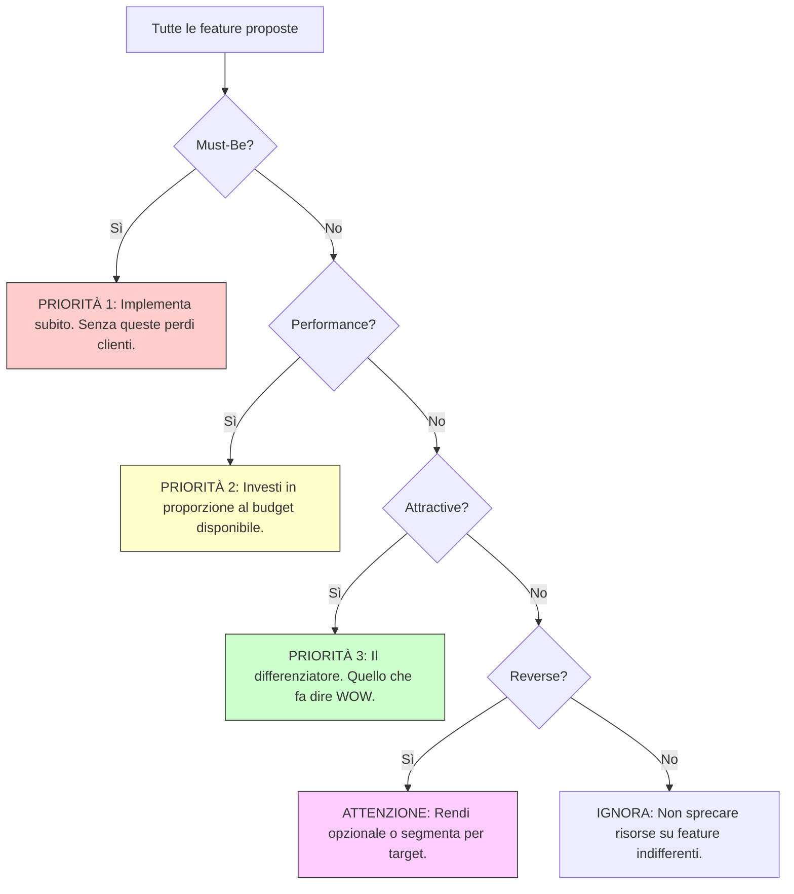

Nel 1984, un professore giapponese di nome Noriaki Kano fece una cosa strana per un accademico: andò a parlare con i clienti invece di stare in laboratorio a costruire teorie. Quello che scopri cambio per sempre il modo in cui le aziende pensano allo sviluppo prodotto.

La sua intuizione era semplice quanto rivoluzionaria: **non tutte le caratteristiche di un prodotto generano la stessa soddisfazione**. Alcune, se le togli, mandano il cliente su tutte le furie. Altre, se le aggiungi, lo lasciano del tutto indifferente. E alcune, quelle che Kano chiamava "attrattive", fanno succedere qualcosa di magico: il cliente non le aveva chieste, non le aspettava, e quando le trova resta a bocca aperta.

Toyota lo usava per sviluppare l'auto perfetta. Apple lo usa per decidere quali feature mettere nell'iPhone. Booking.com lo usa per testare nuove funzionalità dell'interfaccia. E tu puoi usarlo domani mattina per capire su cosa concentrare il budget di sviluppo.

L'analogia più efficace che conosco è quella del matrimonio. Immagina di tornare a casa dal lavoro. Se trovi la casa in ordine, non sei particolarmente felice: è il minimo sindacale. Ma se trovi la casa in disordine, sei frustrato. Ora immagina di tornare a casa e trovare la cena pronta con una bottiglia di vino aperta. Non te lo aspettavi, e sei felicissimo. Non hai detto a nessuno che avresti gradito quella sorpresa, eppure la soddisfazione è reale, immediata, memorabile.

Questa è l'essenza del Modello di Kano.

## Le 5 Categorie del Modello Kano

Il professor Noriaki Kano dell'Universita di Tokyo ha identificato 5 categorie di attributi del prodotto o servizio. Conoscerle cambia il modo in cui guardi il tuo roadmap.

### 1. Must-Be (Requisiti Base)

Caratteristiche che il cliente **da per scontate**. La loro presenza non genera soddisfazione, ma la loro assenza genera forte insoddisfazione. Il cliente non le menzionerebbe mai in una survey perché non gli verrebbe nemmeno in mente che potrebbero mancare.

**L'analogia del matrimonio:** La pulizia della casa. Se è pulita, nessun commento. Se è sporca, è un problema.

**Esempi nel business:**

Nel 2013, United Airlines perse un contratto da 1,3 miliardi di dollari con il governo americano in parte a causa dei ritardi cronici. I voli in orario non entusiasmano nessuno, ma volare in ritardo sistematicamente distrugge qualunque relazione commerciale. È un Must-be classico.

- E-commerce: il sito deve caricare in meno di 3 secondi. Amazon ha calcolato che ogni 100ms di ritardo nel caricamento costa lo 0,01% in vendite, ovvero circa 1,6 miliardi di dollari l'anno.
- Hotel: le lenzuola devono essere pulite. Un hotel con lenzuola sporche può avere il miglior ristorante del mondo: non importa.
- SaaS: il servizio deve essere disponibile il 99,9% del tempo. Slack ha avuto un outage nel 2021 che ha fatto perdere al titolo il 5% in un giorno.

### 2. Performance (Requisiti Lineari)

Più ne dai, più il cliente è soddisfatto. Relazione lineare e misurabile tra livello della feature e livello di soddisfazione. Queste sono le caratteristiche che compaiono nelle specifiche tecniche e nelle campagne marketing.

**L'analogia del matrimonio:** Il tempo passato insieme. Più tempo di qualità, più soddisfazione. Meno tempo, meno soddisfazione. Diretta.

**Esempi concreti con numeri:**

Amazon Prime ha migliorato i tempi di consegna da 5-7 giorni a 2 giorni, poi a 1 giorno, poi a same-day in alcune città. Ogni riduzione ha prodotto un aumento misurabile nella soddisfazione e nella retention. Secondo McKinsey, ridurre i tempi di consegna da 5 a 2 giorni aumenta la probabilità di riacquisto del 23%.

- E-commerce: velocità di consegna. 2 giorni soddisfa più di 5 giorni, che soddisfa più di 10 giorni.
- SaaS: spazio di archiviazione. Dropbox ha costruito un intero modello di business sulla versione gratuita a 2GB e sulla promessa che, pagando, lo spazio aumenta.
- Ristorante: freschezza degli ingredienti. Ogni punto in più sulla scala qualità corrisponde a una probabilità maggiore di tornare.

### 3. Attractive (Delizia)

Caratteristiche **inaspettate** che generano alta soddisfazione quando presenti, ma non causano insoddisfazione quando assenti, semplicemente perché il cliente non le aspettava. Sono le feature che il cliente non poteva chiederti perché non sapeva che esistessero.

**L'analogia del matrimonio:** Un mazzo di fiori a sorpresa un martedì qualsiasi. Non te lo aspettavi, quindi la felicita e sproporzionata al gesto. Se non arriva, non ci pensi nemmeno.

**Esempi reali:**

Zappos, l'e-commerce di scarpe poi acquisito da Amazon per 1,2 miliardi di dollari, aveva una politica ufficiale di reso a 365 giorni. Ma la vera magia erano le sorprese: il servizio clienti aveva l'autorizzazione a upgradare la spedizione a overnight **senza che il cliente lo chiedesse**. Nessun cliente si aspettava di ordinare martedì e ricevere mercoledì mattina pagando la spedizione normale. Il passaparola generato da queste sorprese è valso più di qualunque campagna pubblicitaria.

- Hotel: upgrade gratuito della camera senza averla richiesta. La catena Ritz-Carlton addestra i dipendenti a identificare "segnali di momento speciale" (anniversari, compleanni, honeymoon) e agire di conseguenza.
- SaaS: una nuova feature che risolve un problema che non sapevi di avere. Notion ha introdotto le database linked views senza annunciarle in modo prominente. Gli utenti le hanno scoperte e le hanno condivise organicamente sui social come se avessero trovato un tesoro.
- E-commerce di lusso: un biglietto scritto a mano nella confezione. Net-a-Porter fa questo sistematicamente, e i clienti fotografano il biglietto e lo postano su Instagram.

### 4. Indifferent (Indifferenti)

Caratteristiche a cui il cliente non tiene. La loro presenza o assenza non cambia nulla nella sua soddisfazione. Sono le feature che nascono da idee del team interno ma non corrispondono a nessun bisogno reale.

**L'analogia del matrimonio:** Il colore delle tende del soggiorno. Probabilmente non importa a nessuno dei due, o quantomeno non abbastanza da influenzare la qualità complessiva della relazione.

Queste feature sono insidiose perché costano risorse di sviluppo e spazio cognitivo nel roadmap. Identificarle e brutalmente eliminarle e uno dei compiti più importanti del product manager.

### 5. Reverse (Inversi)

Caratteristiche che **alcuni** clienti vogliono e **altri** odiano. Più ne dai, più un segmento specifico e insoddisfatto. Sono le feature che dividono il mercato.

**L'analogia del matrimonio:** La suocera che viene a cena ogni domenica. Per uno dei due può essere un piacere. Per l'altro, un problema serio.

**Esempi reali:**

Instagram ha introdotto la modalità Reels nel 2020 per competere con TikTok. Per la base utenti più giovane, era esattamente quello che cercavano. Per la base utenti che usava Instagram come portfolio fotografico professionale (fotografi, artisti, brand di moda), il feed algoritmico che privilegia i video è diventato una fonte di frustrazione. Lo stesso identico cambiamento ha avuto segni opposti su segmenti diversi.

- Notifiche push aggressive: irrinunciabili per chi vuole aggiornamenti in tempo reale, insopportabili per chi cerca focus.
- Gamification nell'app: coinvolgente per gli utenti che trovano valore nei punti e nei badge (tipicamente utenti più giovani), fastidiosa per chi usa l'app per scopi seri (medici che usano app cliniche, avvocati che usano software legale).
- Dark mode: per anni considerata una feature attractive, poi una performance feature, poi alcuni utenti senior hanno segnalato di preferire la modalità chiara per leggibilita. Oggi e chiaramente una feature da rendere opzionale.

## Come Fare un'Analisi Kano: Il Questionario

Kano ha disegnato una metodologia specifica per classificare le feature. Non è un sondaggio qualsiasi: la logica delle domande accoppiate è il cuore del sistema.

Per ogni feature, fai due domande:

**Domanda funzionale:** "Come ti sentiresti SE il prodotto avesse questa caratteristica?"

**Domanda disfunzionale:** "Come ti sentiresti SE il prodotto NON avesse questa caratteristica?"

Opzioni di risposta per entrambe:
1. Mi piacerebbe molto
2. Me lo aspetto / è il minimo
3. Mi e indifferente
4. Lo sopporterei
5. Non mi piacerebbe per niente

### La Matrice di Classificazione

La combinazione delle due risposte determina la categoria. Non basta sapere che una feature piace: devi sapere cosa succede quando non c'è.

| | **Disfunzionale: Mi piace** | **Me lo aspetto** | **Indifferente** | **Lo sopporterei** | **Non mi piace** |
|---|---|---|---|---|---|
| **Funzionale: Mi piace** | Questionable | Attractive | Attractive | Attractive | Performance |
| **Me lo aspetto** | Reverse | Indifferent | Indifferent | Indifferent | Must-be |
| **Indifferente** | Reverse | Indifferent | Indifferent | Indifferent | Must-be |
| **Lo sopporterei** | Reverse | Indifferent | Indifferent | Indifferent | Must-be |
| **Non mi piace** | Reverse | Reverse | Reverse | Reverse | Questionable |

La risposta "Questionable" (funzionale: mi piace + disfunzionale: mi piace, oppure non mi piace + non mi piace) segnala che il rispondente non ha capito la domanda o ha risposto in modo incoerente. Andrebbe eliminata dall'analisi o il rispondente andrebbe ricontattato.

## Applicazione Pratica: Prioritizzazione delle Feature

Una volta classificate le feature tramite il questionario (tipicamente su un campione di 100-300 rispondenti), puoi prioritizzare lo sviluppo in modo razionale invece di basarti su intuizioni o su chi urla di più nelle riunioni.



### L'Errore Più Comune nelle PMI Italiane

Ho visto decine di roadmap di prodotto. Il pattern è sempre lo stesso: il 70-80% del budget va su feature **Performance** (perché sono facili da misurare, da comunicare commercialmente e da inserire in una proposta tecnica), il 20% va su feature **Must-be** che spesso sono già soddisfatte, e praticamente zero va su feature **Attractive**.

Il risultato? Prodotti tecnicamente superiori alla concorrenza su metriche misurabili, ma che non generano passaparola, non creano fedeltà e non differenziano davvero sul mercato.

Le feature Attractive sono quelle che:
- Creano passaparola organico (Word of Mouth).
- Differenziano in modo impossibile da copiare immediatamente.
- Trasformano un cliente soddisfatto in un ambassador che ti porta altri clienti.
- Giustificano un premium price senza bisogno di una guerra sui dati tecnici.

Il paradosso di Kano e che le feature più preziose sono quelle che nessun cliente ti ha chiesto esplicitamente.

## Il Decadimento Kano: Le Attrazioni Diventano Must-Be

Un concetto cruciale che Kano stesso ha evidenziato: le categorie non sono statiche. Nel tempo, le feature Attractive diventano Performance, e le Performance diventano Must-be.

Il WiFi gratuito in hotel era una feature Attractive nel 2008. Era qualcosa di inaspettato, un plus che giustificava di scegliere un hotel sull'altro. Nel 2012 era diventata Performance: più banda, più soddisfazione. Nel 2016 era già Must-be: un hotel senza WiFi gratuito oggi prendeva una stella in meno su TripAdvisor quasi automaticamente. Nel 2026 e talmente scontato che un hotel che lo pubblicizza sembra anacronistico.

| Feature | 2010 | 2015 | 2020 | 2026 |
|---|---|---|---|---|
| WiFi gratis in hotel | Attractive | Performance | Must-be | Must-be |
| Consegna in 2 giorni | Attractive | Attractive | Performance | Must-be |
| AI assistant nel SaaS | Non esisteva | Non esisteva | Attractive | Performance |
| Same-day delivery | Non esisteva | Attractive | Attractive | Performance |
| Personalizzazione algoritmica | Non esisteva | Attractive | Performance | Must-be |

**Implicazione strategica concreta:** Non puoi sederti sulle feature che ti hanno differenziato tre anni fa. Amazon lo ha capito meglio di chiunque altro: Prime ha introdotto la consegna in 2 giorni come feature Attractive nel 2005. Quando quella è diventata Must-be per il mercato, ha aggiunto il same-day. Quando anche quello è diventato prevedibile, ha aggiunto Prime Video, Prime Music, Amazon Photos. La macchina della delizia non si ferma mai.

Devi continuamente esplorare nuove feature Attractive, perché quelle di oggi diventeranno il minimo sindacale di domani, e il mercato ti punirà se non sei pronto.

## Come Calcolare il Coefficiente di Soddisfazione (Raffinamento Quantitativo)

Una raffinazione del metodo Kano originale permette di calcolare due coefficienti per ogni feature:

**Coefficiente di Soddisfazione (CS):** quanto questa feature aumenta la soddisfazione se presente.

```
CS = (Attractive + Performance) / (Attractive + Performance + Must-be + Indifferent)
```

**Coefficiente di Insoddisfazione (CI):** quanto questa feature abbassa la soddisfazione se assente.

```
CI = -1 * (Must-be + Performance) / (Attractive + Performance + Must-be + Indifferent)
```

Una feature con CS alto e CI basso in valore assoluto è una feature Attractive: aggiungila e aumenti la soddisfazione, non aggiungerla e nessuno se ne accorge. Una feature con CS basso e CI alto in valore assoluto è una Must-be: devi averla, ma averla non ti porta nessun vantaggio competitivo.

## Caso Pratico: E-commerce di Cosmetica Italiana

Un e-commerce di cosmetica naturale italiana ha applicato il metodo Kano in modo sistematico. Con un questionario di 20 domande (10 feature, ognuna con la coppia funzionale/disfunzionale) distribuito a 300 clienti attivi, ha classificato le feature del sito e del servizio.

I risultati hanno sorpreso il team. Alcune feature su cui stavano per investire budget significativo erano Indifferenti per il 65% del campione. Una feature che nessuno aveva proposto, i campioni gratuiti personalizzati in base alla stagione della pelle, era Attractive per il 78% del campione.

| Feature | Categoria | Azione Intrapresa | Impatto |
|---|---|---|---|
| Sito veloce (&lt; 2s) | Must-be | Già OK, mantenuto | Baseline mantenuta |
| Reso gratuito entro 30 giorni | Must-be | Da implementare urgente | Eliminato frizione critica |
| Spedizione &lt; 3 giorni | Performance | Già OK | Competitive parity |
| Spedizione same-day a Milano | Attractive | Pilota attivato | +$50k/mese incremento |
| Campioni gratuiti personalizzati | Attractive | Implementato | +18% repeat purchase |
| Beauty quiz con raccomandazione prodotto | Attractive | In sviluppo | Miglioramento NPS atteso |
| Packaging eco-sostenibile | Performance | In corso di migrazione | Allineamento a trend |
| NFT di fedeltà digitale | Indifferent | Eliminato dal roadmap | Risparmiato ~€150k |
| Notifiche push giornaliere sulle offerte | Reverse | Reso opzionale | Ridotto opt-out 15% |

Il dato più significativo: i campioni gratuiti personalizzati sono costati circa 1,20 euro per ordine aggiuntivo in materiali. Il repeat purchase generato da questa feature ha prodotto un incremento del lifetime value medio del 34% nei clienti che hanno ricevuto i campioni rispetto al gruppo di controllo che non li aveva ricevuti.

In 18 mesi, l'impatto totale:
- Eliminazione del NFT (Indifferent): €150k risparmiati
- Implementazione campioni (Attractive): €300k spesi in materiali, €2.1M generati in incremento LTV
- ROI totale: +670%

## Integrazione del Kano con OKR e RICE Scoring

Per un approccio ancora più raffinato, integra il Metodo Kano con i framework di prioritizzazione (RICE, ICE) e di goal-setting (OKR). Una feature Attractive con RICE score basso (difficile da implementare) ha priorità inferiore di una feature Must-be con RICE score alto (facile da implementare ma critica).

Per approfondire la prioritizzazione e il goal-setting strategico, leggi il nostro [modulo su metriche fondamentali](/course/metriche-fondamenti/).

## Conclusione

Il Metodo Kano ti insegna una lezione fondamentale che va contro ogni intuizione manageriale: **non è importante quello che tu pensi sia importante per il cliente. È importante quello che il cliente pensa sia importante.** E la sorpresa? Spesso il cliente stesso non sa articolarlo in modo diretto.

Le feature Must-be non le menziona mai in una survey perché non gli verrebbe nemmeno in mente che potrebbero mancare. Le feature Attractive non le chiede perché non sa che esistono. Le feature Indifferenti le elenca entusiasticamente nei focus group perché suonano bene, ma non cambieranno mai un comportamento di acquisto.

Il tuo lavoro, come product manager, come fondatore, come responsabile marketing, è scavare oltre le dichiarazioni di superficie. Il Metodo Kano è lo strumento più efficace per farlo, ed è accessibile a qualsiasi dimensione aziendale: bastano 100 rispondenti è un foglio Google per iniziare.

I campioni di mercato non sono quelli che costruiscono il prodotto più ricco di feature. Sono quelli che costruiscono le feature giuste, al momento giusto, sapendo esattamente quali "wow" generare nel cliente.
