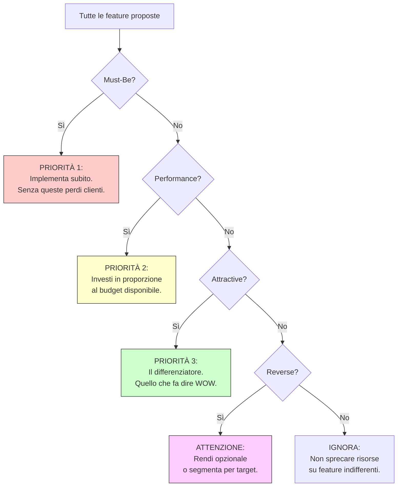

# Il Metodo Kano: L'Esempio di Marito e Moglie

Immagina di tornare a casa dal lavoro. Se trovi la casa in ordine, non sei particolarmente felice — è il minimo sindacale. Ma se trovi la casa in disordine, sei frustrato. Ora immagina di tornare a casa e trovare la cena pronta + una bottiglia di vino aperta. Non te lo aspettavi, e sei felicissimo.

Questa è l'essenza del **Modello di Kano**: non tutte le caratteristiche di un prodotto generano la stessa soddisfazione, e capirlo cambia radicalmente la strategia di sviluppo prodotto.

## Le 5 Categorie del Modello Kano

Il professor Noriaki Kano dell'Università di Tokyo ha identificato 5 categorie di attributi del prodotto/servizio:

### 1. Must-Be (Requisiti Base) 🔴

Caratteristiche che il cliente **dà per scontate**. La loro presenza non genera soddisfazione, ma la loro assenza genera forte insoddisfazione.

**L'analogia del matrimonio:** La pulizia della casa. Se è pulita → "ok, normale". Se è sporca → "inaccettabile!"

**Esempi nel business:**
*   E-commerce: il sito deve caricare in meno di 3 secondi.
*   Hotel: le lenzuola devono essere pulite.
*   SaaS: il servizio deve essere disponile il 99.9% del tempo.

### 2. Performance (Requisiti Lineari) 🟡

Più ne dai, più il cliente è soddisfatto. Relazione lineare tra performance e soddisfazione.

**L'analogia del matrimonio:** Il tempo passato insieme. Più tempo di qualità → più soddisfazione. Meno tempo → meno soddisfazione.

**Esempi nel business:**
*   E-commerce: velocità di consegna (2 giorni > 5 giorni > 10 giorni).
*   SaaS: spazio di archiviazione (100GB soddisfa più di 10GB).
*   Ristorante: qualità degli ingredienti.

### 3. Attractive (Delizia) 🟢

Caratteristiche **inaspettate** che generano alta soddisfazione quando presenti, ma non causano insoddisfazione quando assenti (perché il cliente non le aspettava).

**L'analogia del matrimonio:** Un mazzo di fiori a sorpresa un martedì qualsiasi. Non l'aspettavi → felicità! Non arriva → non ci pensi nemmeno.

**Esempi nel business:**
*   E-commerce: un biglietto scritto a mano nella confezione.
*   Hotel: upgrade gratuito della camera senza richiederlo.
*   SaaS: una nuova feature che risolve un problema che non sapevi di avere.

### 4. Indifferent (Indifferenti) ⚪

Caratteristiche a cui il cliente non tiene. La loro presenza o assenza non cambia nulla.

**L'analogia del matrimonio:** Il colore delle tende del soggiorno. Probabilmente non importa a nessuno dei due (o forse sì — dipende dal marito e dalla moglie).

### 5. Reverse (Inversi) ⚫

Caratteristiche che **alcuni** clienti vogliono e **altri** odiano. Più ne dai, più un segmento è insoddisfatto.

**L'analogia del matrimonio:** La suocera che viene a cena. Per la moglie potrebbe essere un piacere, per il marito... no.

**Esempi nel business:**
*   Notifiche push: utili per alcuni, invasive per altri.
*   Gamification nell'app: coinvolgente per i giovani, fastidiosa per i senior.

## Come Fare un'Analisi Kano: Il Questionario

Per ogni feature, fai due domande:

**Domanda funzionale:** "Come ti sentiresti SE il prodotto avesse questa caratteristica?"
**Domanda disfunzionale:** "Come ti sentiresti SE il prodotto NON avesse questa caratteristica?"

Opzioni di risposta per entrambe:
1.  Mi piacerebbe molto
2.  Me lo aspetto / È il minimo
3.  Mi è indifferente
4.  Lo sopporterei
5.  Non mi piacerebbe per niente

### La Matrice di Classificazione

La combinazione delle due risposte determina la categoria:

| | **Disfunzionale: Mi piace** | **Me lo aspetto** | **Indifferente** | **Lo sopporterei** | **Non mi piace** |
|---|---|---|---|---|---|
| **Funzionale: Mi piace** | Questionable | Attractive | Attractive | Attractive | Performance |
| **Me lo aspetto** | Reverse | Indifferent | Indifferent | Indifferent | Must-be |
| **Indifferente** | Reverse | Indifferent | Indifferent | Indifferent | Must-be |
| **Lo sopporterei** | Reverse | Indifferent | Indifferent | Indifferent | Must-be |
| **Non mi piace** | Reverse | Reverse | Reverse | Reverse | Questionable |

## Applicazione Pratica: Prioritizzazione delle Feature

Una volta classificate le feature, puoi prioritizzare lo sviluppo in modo razionale:

### L'Errore Comune

Molte aziende spendono tutto il budget sulle feature **Performance** (perché sono facili da misurare e da comunicare) e ignorano le feature **Attractive** (perché sono rischiose e non richieste esplicitamente dal cliente).

Ma sono le feature Attractive che:
*   Creano passaparola (WOM).
*   Differenziano dai competitor.
*   Generano la "delizia" che trasforma un cliente in un ambassador.

## Il Decadimento Kano: Le Attrazioni Diventano Must-Be

Un concetto cruciale: le categorie Kano **non sono statiche**. Nel tempo, le feature Attractive diventano Performance, e le Performance diventano Must-be.

| Feature | 2010 | 2015 | 2020 | 2026 |
|---|---|---|---|---|
| WiFi gratis in hotel | Attractive 🟢 | Performance 🟡 | Must-be 🔴 | Must-be 🔴 |
| Consegna in 2 giorni | Attractive 🟢 | Attractive 🟢 | Performance 🟡 | Must-be 🔴 |
| AI assistant nel SaaS | — | — | Attractive 🟢 | Performance 🟡 |
| Same-day delivery | — | Attractive 🟢 | Attractive 🟢 | Performance 🟡 |

**Implicazione strategica:** Devi continuamente innovare per trovare nuove feature Attractive, perché quelle di oggi diventeranno il minimo sindacale domani.

## Caso Pratico: E-commerce di Cosmetica

Un e-commerce di cosmetica italiana ha classificato 15 feature con il metodo Kano (300 rispondenti):

| Feature | Categoria | Azione |
|---|---|---|
| Sito veloce (< 2s) | Must-be | Già OK ✅ |
| Reso gratuito | Must-be | Da implementare 🔴 |
| Spedizione < 3 giorni | Performance | Già OK ✅ |
| Spedizione same-day | Attractive | Pilota solo a Milano |
| Campioni gratuiti nell'ordine | Attractive | Implementato → +18% repeat |
| Beauty quiz personalizzato | Attractive | In sviluppo |
| Packaging eco-sostenibile | Performance | In corso |
| NFT di fedeltà | Indifferent | Eliminato dal roadmap |
| Notifiche push giornaliere | Reverse | Reso opzionale |

## Conclusione

Il Metodo Kano ti insegna una lezione fondamentale: **non è importante quello che tu pensi sia importante per il cliente. È importante quello che il cliente pensa sia importante.** E la sorpresa? Spesso il cliente non sa articolarlo. Le feature Must-be non le menziona perché le dà per scontate. Le feature Attractive non le chiede perché non sa che esistono.

Il tuo lavoro è scoprirle. E il Metodo Kano è lo strumento migliore per farlo.
