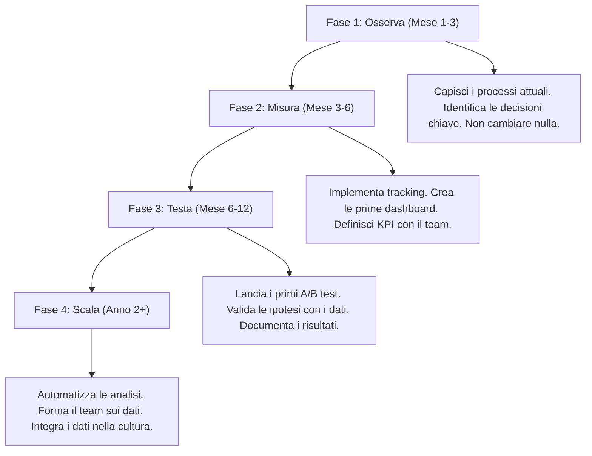

Nel cuore delle PMI italiane si sta consumando una trasformazione profonda, guidata da una nuova generazione di manager millennial che affrontano la disciplina di prendere decisioni in condizioni di incertezza con un approccio data-driven. Questo cambiamento non è soltanto tecnologico, ma epistemologico: si passa da un management basato sull'esperienza e l'intuizione a uno fondato su dati misurabili e sperimentazione continua.

## Problema reale

Molte aziende familiari italiane, soprattutto PMI, si trovano oggi ad affrontare un passaggio generazionale radicale. I nuovi manager, spesso figli dei fondatori, tornano con competenze in Business Analytics e esperienze internazionali, ma si scontrano con realtà gestionali arretrate, dove le decisioni si prendono ancora "a naso" e i dati sono relegati a report annuali o fogli Excel obsoleti.

## Modello concettuale

La generazione millennial si distingue per un approccio collaborativo e data-informed, che si traduce in cinque cambiamenti fondamentali nel management:

1. Da un atteggiamento difensivo verso il cambiamento a una cultura di sperimentazione continua.
2. Dalla gerarchia dell'informazione alla democratizzazione dei dati.
3. Dal reporting mensile al monitoraggio in tempo reale.
4. Dal rispetto basato sull'anzianità alla competenza dimostrata con dati.
5. Dall'ufficio fisico al lavoro ibrido con metriche di produttività basate sugli output.

Questi cambiamenti sono supportati da strumenti concreti come dashboard condivise, tool self-service per l'analisi dei dati e modelli di people analytics che trasformano la gestione delle risorse umane in una scienza predittiva.

## Formalizzazione rigorosa

La disciplina della decisione sotto incertezza si concretizza nel ciclo HADI (Hypothesis, Action, Data, Insights), un framework che consente di ridurre il costo dell'errore attraverso test rapidi e dati reali. Il processo di transizione data-driven si articola in quattro fasi:

- **Fase 1: Osserva (Mese 1-3)** - ascolto e mappatura dei processi esistenti senza modifiche immediate.
- **Fase 2: Misura (Mese 3-6)** - implementazione di tracking essenziale e definizione condivisa dei KPI.
- **Fase 3: Testa (Mese 6-12)** - lancio di esperimenti strutturati con documentazione rigorosa.
- **Fase 4: Scala (Anno 2+)** - automazione, formazione e integrazione culturale dei dati nelle decisioni quotidiane.

## Esempio o caso studio

Un distributore alimentare del Nord-Est ha trasformato il proprio sistema decisionale passando da report mensili a dashboard in tempo reale. Gli agenti, prima informati solo a fine mese, hanno potuto monitorare ogni sera le proprie performance rispetto ai target settimanali. In sei mesi, la varianza tra top e bottom performer si è ridotta del 40%, grazie alla possibilità di correggere tempestivamente le strategie.

Booking.com rappresenta un altro esempio estremo di sperimentazione continua, con oltre 25.000 A/B test annuali che riducono il rischio di decisioni errate basate sull'intuizione.

## Lab / esercizio

**Livello base:** Mappare i processi decisionali attuali della propria azienda senza modificarli, identificando le principali fonti di dati e le decisioni chiave.

**Livello intermedio:** Definire con il team 3-5 KPI rilevanti e implementare un sistema semplice di raccolta dati (es. Google Sheets condivisi).

**Livello research-grade:** Progettare e lanciare un esperimento A/B strutturato su una decisione commerciale, documentando ipotesi, gruppi di controllo e test, durata e metriche di successo.

**Dataset e materiali consigliati:** Dataset di vendite mensili, tool di dashboarding open source (Metabase, Apache Superset), risorse sul ciclo HADI e sperimentazione continua.

## Errore tipico da evitare

Confondere la quantità di dati con la qualità delle decisioni. Implementare troppi strumenti simultaneamente senza un piano chiaro genera caos e resistenza. Trasformare ogni attività in una metrica porta a un sistema di controllo che distrugge fiducia e creatività. È di base definire pochi KPI significativi e costruire una cultura condivisa.

## Quiz o checkpoint

- Qual è il principale vantaggio del ciclo HADI nella gestione dell'incertezza?
- Perché la democratizzazione dei dati migliora le decisioni a tutti i livelli aziendali?
- Quali sono i rischi di introdurre troppi tool tecnologici contemporaneamente?
- Come si può valorizzare l'esperienza tradizionale in un contesto data-driven?

## Il punto
Il futuro del management nelle PMI italiane passa per un equilibrio tra esperienza e dati, tra artigianalità e sperimentazione. I manager millennial non stanno solo portando nuove tecnologie, ma stanno disciplinando un modo nuovo di prendere decisioni sotto incertezza, basato su dati reali, test continui e trasparenza. Chi saprà guidare questa transizione con rispetto e metodo costruirà un vantaggio competitivo duraturo e inarrestabile.
