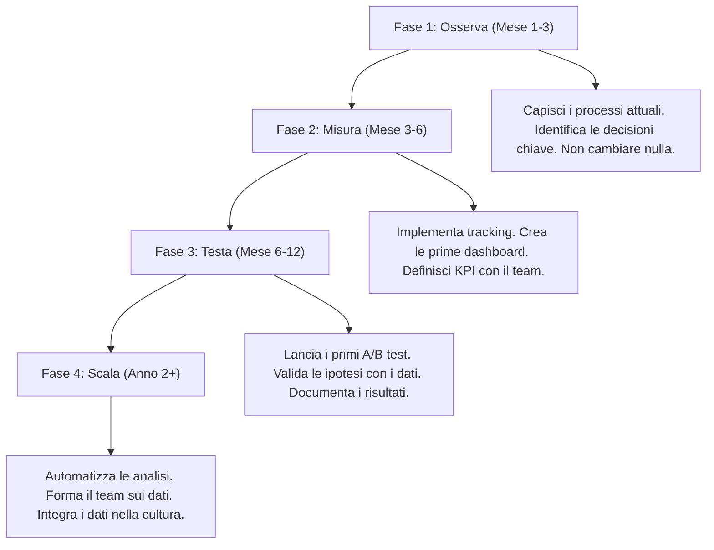

{/* geo-imprint: contesto:geografico */}

Entri in azienda dopo anni di studio o di esperienza fuori, apri il gestionale e scopri che le decisioni importanti si prendono ancora a sensazione. I numeri veri arrivano una volta al mese, se va bene, chiusi in un file Excel che nessuno aggiorna volentieri, mentre ogni tua proposta si scontra con la stessa frase: qui si è sempre fatto così.

Eppure gestire una PMI italiana con criteri verificabili è possibile, senza trasformare l'ufficio in un reparto informatico e senza buttare via l'esperienza di chi l'azienda l'ha costruita. Quando tutti vedono gli stessi indicatori in tempo reale, le discussioni smettono di essere scontri di opinioni e diventano scelte rapide su cui il team può correggere la rotta subito. Qui trovi il percorso completo per farlo: i cinque passaggi culturali necessari, la roadmap in quattro fasi basata sul ciclo HADI, due esempi concreti e tre esercizi graduali da applicare subito.

## Cosa cambia quando passi dall'intuito ai dati condivisi

Molte aziende familiari italiane stanno attraversando un passaggio generazionale delicato. I nuovi manager, spesso figli dei fondatori con formazione in Business Analytics o esperienze all'estero, rientrano con l'obiettivo di modernizzare la gestione, ma trovano processi opachi e informazioni frammentate.

Il punto è che in questi contesti l'informazione tende a restare concentrata in poche mani. Quando i dati di vendita, margine o produzione arrivano solo nei report annuali, chi opera sul campo naviga al buio e chi dirige decide basandosi sull'intuito accumulato negli anni. Passare a una gestione guidata dai dati risolve esattamente questo collo di bottiglia, perché rende visibile a tutti ciò che funziona e ciò che sta rallentando.

## I cinque passaggi dal management gerarchico al metodo data-driven

La generazione millennial porta un modello di lavoro collaborativo e basato sulle evidenze. Nella pratica quotidiana di una PMI, questo approccio produce cinque trasformazioni precise:

1. **Dalla difesa dello status quo alla sperimentazione continua:** invece di difendere le abitudini, si testano piccole modifiche ai processi e si misura l'effetto reale.
2. **Dalla gerarchia dell'informazione alla democratizzazione dei dati:** i numeri smettono di essere un privilegio della direzione e diventano accessibili a chi deve agire.
3. **Dal reporting mensile al monitoraggio in tempo reale:** aspettare la chiusura del mese significa accorgersi troppo tardi di un problema; vederlo ogni giorno permette di intervenire subito.
4. **Dall'anzianità alla competenza verificabile:** l'esperienza resta preziosa, ma le decisioni si valutano sui risultati misurati e non solo sul ruolo ricoperto.
5. **Dalla presenza fisica alle metriche di output:** nel lavoro ibrido conta ciò che il team produce e consegna, non le ore passate davanti a una scrivania.

Per sostenere questi cinque passaggi servono strumenti semplici e condivisi: dashboard accessibili a tutti, tool self-service per interrogare i numeri senza dipendere sempre dall'IT e modelli di people analytics per leggere in anticipo i segnali su carichi di lavoro e turnover.

## Applica il ciclo HADI in quattro fasi senza bloccare l'azienda

Decidere in condizioni di incertezza richiede un metodo disciplinato. Il ciclo HADI (Hypothesis, Action, Data, Insights) riduce il costo degli errori perché trasforma ogni grande cambiamento in una serie di test rapidi verificati sui dati reali.

Detto questo, introdurre tutto insieme genera rigetto. Conviene invece distribuire la transizione data-driven su quattro fasi progressive:

- **Fase 1: Osserva (Mese 1-3).** Ascolta le persone e mappa i processi esistenti, senza modificare ancora nulla nell'operatività quotidiana.
- **Fase 2: Misura (Mese 3-6).** Imposta il tracciamento essenziale, costruisci le prime dashboard e definisci i KPI insieme al team.
- **Fase 3: Testa (Mese 6-12).** Avvia esperimenti strutturati, come i primi A/B test, documentando ipotesi e risultati con rigore.
- **Fase 4: Scala (Anno 2+).** Automatizza le analisi ripetitive, forma le persone all'uso autonomo dei dati e integra il metodo nelle scelte di ogni giorno.

## Come funziona nella pratica: due casi reali a confronto

Per capire l'impatto di questo approccio, guarda cosa succede quando il dato passa dai cassetti della direzione alle mani di chi lavora.

Un distributore alimentare del Nord-Est ha sostituito i vecchi report mensili con dashboard aggiornate in tempo reale. Prima gli agenti commerciali ricevevano i numeri solo a fine mese, quando ormai non c'era margine di manovra; con il nuovo sistema hanno iniziato a verificare ogni sera il proprio andamento rispetto agli obiettivi settimanali. Di conseguenza, in sei mesi il divario di rendimento tra i migliori e i peggiori venditori si è ridotto del 40%, perché chi era indietro poteva correggere subito la propria attività.

Su tutt'altra scala, Booking.com applica lo stesso principio portandolo all'estremo: l'azienda esegue oltre 25.000 A/B test all'anno. Ogni modifica viene messa alla prova sui comportamenti reali degli utenti prima di essere adottata, riducendo al minimo il rischio di investire risorse su intuizioni sbagliate.

## Metti in pratica il metodo con tre esercizi progressivi

Passiamo ora alla parte operativa. Puoi iniziare a introdurre questo metodo nella tua organizzazione scegliendo il livello più adatto al punto in cui ti trovi oggi:

- **Livello base:** mappa i processi decisionali attuali dell'azienda senza cambiarli. Elenca quali scelte vengono prese ogni settimana, chi le prende e su quali fonti di dati si appoggia oggi.
- **Livello intermedio:** siediti con il team, scegliete insieme da 3 a 5 KPI davvero utili e create un sistema leggero per raccoglierli, partendo anche da un semplice Google Sheets condiviso.
- **Livello avanzato:** progetta ed esegui un A/B test su una decisione commerciale concreta, scrivendo prima l'ipotesi di partenza, la durata, il gruppo di controllo, il gruppo di test e la metrica che decreterà il successo.

Come base di partenza puoi usare i dataset delle vendite mensili già presenti in azienda, affiancati da strumenti di dashboarding open source come Metabase o Apache Superset per visualizzare i progressi senza costi di licenza elevati.

## Evita la trappola dei troppi strumenti e KPI inutili

L'errore più frequente nei progetti data-driven è scambiare la quantità di numeri con la qualità delle scelte. Installare decine di software contemporaneamente, senza aver chiarito prima quali decisioni devono supportare, crea confusione e alimenta la resistenza di chi già fatica con gli strumenti attuali.

Allo stesso modo, misurare ogni singolo gesto lavorativo trasforma l'analisi in sorveglianza, distruggendo la fiducia e l'iniziativa delle persone. Al contrario, selezionare pochi indicatori essenziali e condividerne il significato con il team permette di usare i dati come strumento di supporto e non di controllo.

## Verifica di aver fissato i concetti chiave

Prima di passare all'azione in azienda, prova a rispondere a queste quattro domande di controllo:

- Qual è il vantaggio principale del ciclo HADI quando devi decidere in condizioni di incertezza?
- Perché rendere accessibili i dati a tutto il team migliora le scelte operative rispetto al reporting riservato alla sola direzione?
- Che cosa succede se introduci troppi strumenti tecnologici nello stesso momento?
- In che modo puoi integrare l'esperienza storica dei fondatori dentro un processo decisionale basato sui dati?

Come prossimo passo concreto, prendi una sola decisione ricorrente della tua settimana lavorativa e applica la Fase 1: osserva per i prossimi giorni dove nascono i dati che la riguardano, senza cambiare ancora nessun flusso, e annota cosa manca per renderla più chiara.
