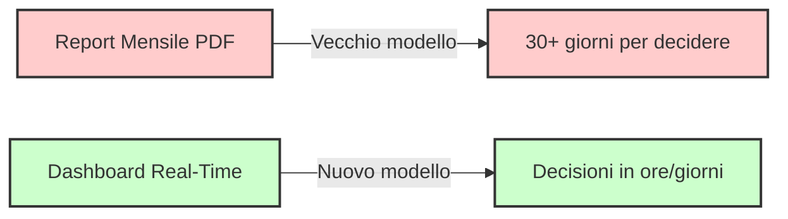
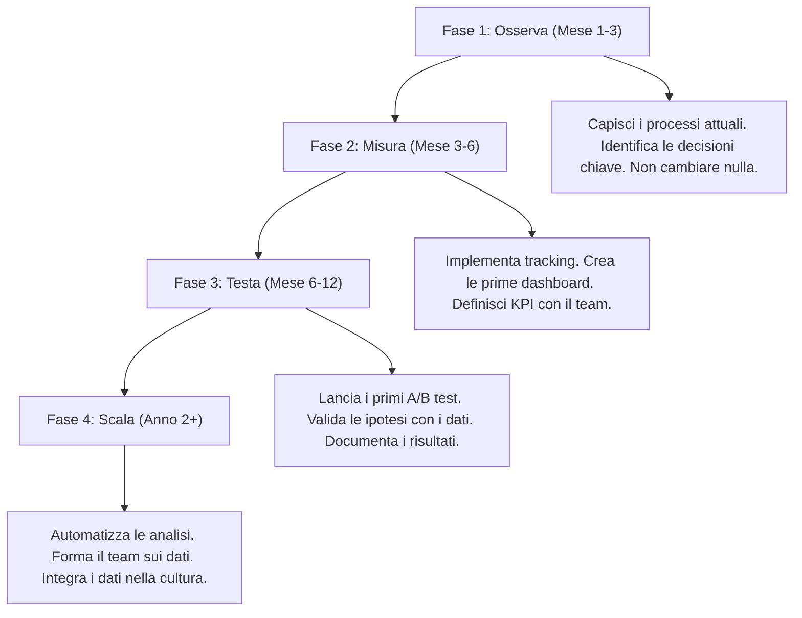

# Generazione Y al Comando: Il Nuovo Management Italiano

Nel 2019, Alessandro Benetton ha assunto la presidenza del Gruppo Benetton a 55 anni, rappresentando una generazione di transizione. Ma nelle PMI italiane, il cambio e molto piu radicale: i figli che prendono le redini a 32 anni con una laurea in Business Analytics e tre anni in una scaleup londinese. Tornano a Treviso, a Brescia, a Bari, e trovano un'azienda gestita con Excel del 2003, riunioni senza agenda e decisioni prese a "naso".

I millennial (nati tra il 1981 e il 1996) hanno tra i 30 e i 45 anni nel 2026. Non sono piu gli "stagisti digitali". Sono i **direttori commerciali**, i **CEO** di seconda generazione, i **responsabili marketing** che guidano migliaia di aziende italiane. E stanno cambiando le regole del gioco in modi che la generazione precedente fatica a riconoscere come progresso.

## Il Passaggio Generazionale nei Numeri

In Italia, il 65% delle PMI e familiare. Secondo la Camera di Commercio, nei prossimi 10 anni oltre 60.000 aziende familiari italiane affronteranno un passaggio generazionale. Molte sono gia in corso. Il profilo del nuovo manager e radicalmente diverso dal fondatore.

| Generazione | Eta nel 2026 | Stile decisionale | Rapporto con i dati |
|---|---|---|---|
| **Baby Boomer** (1946-64) | 62-80 | Intuitivo, gerarchico | "I numeri li guardo a fine anno" |
| **Gen X** (1965-80) | 46-61 | Pragmatico, cauto | "Excel e il mio migliore amico" |
| **Millennial** (1981-96) | 30-45 | Collaborativo, data-informed | "Se non e misurabile, non esiste" |
| **Gen Z** (1997-2012) | 14-29 | Digitale-nativo, veloce | "Un dashboard in tempo reale o niente" |

La differenza non e solo stilistica. E profondamente strutturale. Un manager boomer ha costruito la sua credibilita in decenni di relazioni personali, di telefonate, di cene. Un manager millennial la costruisce mostrando dati, costruendo dashboard condivise, lanciando esperimenti che producono risultati misurabili in settimane.

## 5 Modi in Cui i Millennial Stanno Cambiando il Management

### 1. Da "Perche Dovrei Cambiare?" a "Perche Non Stiamo Testando?"

Il manager boomer chiede prove che il cambiamento funzionera **prima** di provarlo. Il suo ragionamento e difensivo e comprensibile: ha investito anni a costruire un sistema che funziona, e il costo percepito dell'errore e altissimo.

Il manager millennial ribalta la domanda: "Quanto costa testare? Se il costo e basso, testiamo e i dati ci diranno la risposta."

Questo cambio di mentalita ha un nome preciso: **sperimentazione continua**, o nella sua versione piu strutturata, il ciclo HADI (Hypothesis, Action, Data, Insights) che ho descritto altrove nel corso. Non si tratta di essere temerari o di ignorare l'esperienza. Si tratta di ridurre il costo dell'errore attraverso test rapidi e dati reali, invece di dibattiti infiniti in sala riunioni.

Booking.com e l'esempio piu estremo: l'azienda esegue oltre 25.000 A/B test all'anno. Non perche siano pazzi, ma perche hanno capito che il costo di un test e inferiore al costo di una decisione sbagliata basata sull'intuizione.

### 2. Dalla Gerarchia alla Trasparenza dei Dati

Nelle aziende tradizionali italiane, l'informazione e potere. Il direttore commerciale tiene per se i numeri di vendita. Il controller condivide i bilanci solo con l'AD. Il responsabile acquisti custodisce gelosamente i margini sui singoli prodotti. I dati viaggiano verticalmente, dal basso verso l'alto, filtrati e interpretati ad ogni livello.

Questo sistema non e irrazionale: e un meccanismo di protezione del potere che ha funzionato per decenni in un contesto in cui le informazioni erano costose da raccogliere e difficili da distribuire.

I manager millennial **democratizzano l'accesso ai dati** per due ragioni:

La prima e pratica. Quando ogni analisi richiede di chiedere al "reparto IT" o di aspettare il report mensile, le decisioni rallentano. Un responsabile vendite che puo vedere in autonomia le proprie performance rispetto al budget prende decisioni corrective in giorni invece che in settimane.

La seconda e strategica. Le aziende con cultura data-democratica prendono decisioni migliori a tutti i livelli, non solo al vertice. Un operaio di linea che vede i dati di qualita in tempo reale puo segnalare un problema molto prima che arrivi al responsabile di reparto.

Strumenti concreti che stanno trasformando le PMI italiane:
- Dashboard condivise con tutto il team, non solo con il board (Looker Studio, Power BI).
- Riunioni settimanali in cui i numeri chiave sono visibili su uno schermo condiviso.
- Tool self-service (Metabase, Apache Superset) per permettere a chiunque di esplorare i dati senza intermediari.

### 3. Dal Foglio Excel al Real-Time

La generazione precedente gestiva l'azienda con report mensili in PDF, spesso ancora stampati e portati fisicamente in riunione. Il ciclo completo era: raccolta dati a fine mese, analisi nei primi giorni del mese successivo, report prodotto entro il 10, riunione di management entro il 15. Ogni decisione aveva una latenza di 30-45 giorni sulla realta.

In un mercato che cambia lentamente, questa latenza era gestibile. In un mercato digitale dove un competitor puo cambiare i prezzi in 10 minuti e dove le campagne pubblicitarie si ottimizzano in tempo reale, 45 giorni di latenza decisionale e un vantaggio competitivo regalato alla concorrenza.

**Un caso concreto:** Un distributore di prodotti alimentari del Nord-Est ha implementato nel 2023 un dashboard in tempo reale sulle vendite per zona e per agente. Prima, gli agenti sapevano come stavano andando solo a fine mese. Dopo, ogni agente poteva vedere ogni sera le sue performance rispetto al target settimanale. In 6 mesi, la varianza tra gli agenti top-performer e i bottom-performer si era ridotta del 40%, perche i bottom-performer potevano identificare e correggere i problemi in tempo reale invece di aspettare la "lavata di capo" mensile.

### 4. Dall'Autorita alla Competenza

Il rispetto nelle aziende tradizionali italiane si basa sull'anzianita: "Faccio questo lavoro da 25 anni, so io come si fa." Il manager millennial sposta il baricentro dalla seniority alla **competenza dimostrata con i dati**.

Questo e uno dei cambiamenti piu difficili da gestire perche tocca l'identita professionale delle persone. Un dipendente con 30 anni di esperienza si trova improvvisamente a dover giustificare le proprie intuizioni con dati che non ha mai dovuto raccogliere prima. E una sfida reale, non una questione di ego: quell'esperienza contiene valore autentico, ma va resa visibile e confrontabile.

I migliori manager millennial che ho visto navigare questo passaggio usano una tattica precisa: **valorizzano l'esperienza convertendola in ipotesi da testare**. "Tu dici che il mercato del Sud risponde diversamente alla promo del 20%: perfetto, facciamo un test pilota in Sicilia per 4 settimane e vediamo." Non stai sminuendo l'intuizione del veterano. Stai trasformandola in un esperimento che, se confermato dai dati, diventa una strategia codificata e replicabile.

### 5. Dall'Ufficio al Lavoro Ibrido (e le Metriche di Produttivita)

I millennial managers sono i primi a introdurre il lavoro ibrido nelle PMI italiane. Ma con il lavoro remoto, il vecchio sistema di misurazione della produttivita basato sulla presenza fisica diventa inutile. Non puoi contare le ore sedute alla scrivania quando la scrivania e a casa.

Serve un sistema di metriche di output. Non e una rivoluzione concettuale difficile, ma richiede un cambiamento culturale profondo: il manager deve definire **cosa** si aspetta, non **come** e **quando** il lavoro viene svolto.

| Vecchia metrica | Nuova metrica |
|---|---|
| Ore in ufficio | Deliverable completati nei tempi |
| Presenza alle riunioni | Decisioni prese e documentate |
| Anzianita nel ruolo | Impatto misurabile sui KPI |
| Report prodotti | Decisioni informate dai report |
| Lead contattati | Opportunita qualificate aperte |

Il rischio opposto esiste: trasformare ogni attivita in una metrica crea un sistema di controllo che distrugge la fiducia e la creativita. Il punto di equilibrio e definire 3-5 KPI per ruolo che siano davvero indicatori di impatto, e lasciare ampia autonomia su tutto il resto.

## Le Sfide del Manager Millennial in Italia

Non e tutto rose e fiori. Chi racconta che la trasformazione digitale delle PMI italiane sia facile o naturale non l'ha mai vissuta dall'interno.

### La Resistenza del "Vecchio Guardia"

Molti dipendenti senior vivono il cambio di management come una minaccia esistenziale. "Il figlio del padrone vuole rivoluzionare tutto" e una frase che si sente spesso nei corridoi. Ma la resistenza non e stupidita o immobilismo: e un meccanismo razionale di protezione in un contesto in cui le regole del gioco stanno cambiando.

La chiave e **coinvolgere prima di imporre**. I dati devono diventare un linguaggio comune, non un'arma con cui il nuovo manager dimostra che il vecchio si sbagliava. Un approccio che ho visto funzionare bene: nelle prime settimane, il nuovo manager chiede ai senior di spiegargli i processi, documentando tutto. Poi usa quei processi come punto di partenza per le prime analisi. Il senior si sente valorizzato, il nuovo manager capisce il contesto, e i dati diventano qualcosa che si costruisce insieme invece di qualcosa che arriva dall'esterno a giudicare.

### La Tentazione del Tool

I millennial amano la tecnologia, a volte troppo. Ho visto PMI italiane implementare Salesforce, HubSpot, Notion, Slack, Asana e Monday.com simultaneamente in un'azienda che fino a sei mesi prima usava WhatsApp e un quaderno per gli appunti.

Il risultato non e l'efficienza che si immaginava: e caos, frustrazione e resistenza. I dipendenti che non riescono a tenere il passo con i nuovi strumenti smettono di usarli, creando shadow processes paralleli ai tool ufficiali che rendono tutto meno trasparente di prima.

**La regola pratica:** un tool alla volta, partendo da quello che risolve il problema piu urgente e piu visibile. Se il problema e la perdita di opportunita di vendita, parti da un CRM semplice (anche HubSpot free). Se il problema e la mancanza di visibilita sulle performance, parti da un dashboard. Non fare tutto insieme.

### Il Dilemma della Velocita

I millennial vogliono risultati veloci. Ma molte aziende italiane, quelle manifatturiere, quelle agroalimentari, quelle nel B2B industriale, hanno cicli di vendita e cicli di produzione che non rispondono alla logica della Silicon Valley.

Non puoi applicare il "growth hacking" a un'azienda che produce macchinari per l'industria ceramica con cicli di vendita di 18 mesi e un parco clienti di 40 aziende nel mondo. I tool di growth hacking sono ottimizzati per volumi enormi e cicli brevi. In un contesto B2B complesso, l'analisi dei dati conta, ma conta diversamente: serve per capire quali clienti hanno maggiore potenziale, quali segnali precedono una crisi di relazione, dove si concentra il valore nel ciclo di vita.

## Framework: La Transizione Data-Driven in 4 Fasi

Per i manager millennial che vogliono trasformare l'azienda senza traumatizzarla, esiste un percorso in 4 fasi che riduce la resistenza e massimizza le probabilita di successo.

### Fase 1: Osserva (Mese 1-3)

Non cambiare nulla per i primi 3 mesi. Ascolta. Capisci perche le cose funzionano cosi. Mappa i processi esistenti senza giudicarli. Spesso scoprirai che pratiche apparentemente irrazionali hanno ragioni storiche valide: un processo strano nel gestionale e spesso la risposta a un problema che tu non hai ancora visto.

Questa fase serve anche a costruire la fiducia. Il nuovo manager che prima di tutto ascolta e osserva viene percepito come rispettoso dell'esperienza altrui. Quello che arriva con un piano di trasformazione gia pronto il primo giorno viene percepito come arrogante, anche se il piano fosse tecnicamente perfetto.

### Fase 2: Misura (Mese 3-6)

Implementa il tracking minimo essenziale. Google Analytics 4 per il sito. Un CRM basico, anche HubSpot free, per le opportunita di vendita. Un foglio Google condiviso per i 5-7 KPI settimanali piu importanti. Non servono strumenti costosi all'inizio: servono dati puliti e un processo per raccoglierli in modo consistente.

Definisci i KPI **con il team**, non per il team. Se le persone hanno partecipato alla scelta delle metriche, le sentono proprie. Se le ricevono dall'alto, le vivono come un meccanismo di controllo.

### Fase 3: Testa (Mese 6-12)

Lancia il primo esperimento documentato. Deve avere una struttura minima: ipotesi, gruppo di test, gruppo di controllo, durata, metrica di successo. Documenta tutto, anche se l'esperimento fallisce, anzi soprattutto se fallisce.

Un A/B test sull'oggetto delle email, un test su un nuovo formato di offerta commerciale, una campagna pilota su un nuovo canale: la dimensione dell'esperimento non conta quanto la disciplina nel documentarlo e nell'imparare dal risultato.

### Fase 4: Scala (Anno 2+)

Quando hai prove che l'approccio funziona, automatizza e forma il team. Assumi o forma un data analyst interno. Crea le condizioni culturali perche tutti usino i dati nelle decisioni quotidiane, non solo i manager. Questo e l'obiettivo finale: non un'azienda in cui il CEO guarda i dashboard, ma un'azienda in cui ogni persona che prende decisioni ha accesso ai dati rilevanti.

## Il Dato che Cambia Tutto: Retention e Crescita nelle PMI a Guida Millennial

Secondo uno studio di Deloitte del 2024 su 800 PMI europee, le aziende con un CEO o AD millennial o Gen X giovane che ha implementato una cultura data-driven nei primi due anni di mandato mostrano:

- +23% di tasso di retention dei dipendenti rispetto alla media di settore.
- +18% di crescita del fatturato nel secondo e terzo anno dopo la transizione.
- Tempi decisionali ridotti del 40% su decisioni operative.

Non e la tecnologia a fare la differenza: e la cultura. Le aziende che hanno comprato i tool piu costosi senza cambiare il modo in cui le persone si relazionano con i dati non mostrano miglioramenti significativi.

## Conclusione

Il passaggio generazionale nelle aziende italiane non e solo un cambio di persone, e un cambio di paradigma epistemologico: da "ci fido perche hai esperienza" a "ci fido perche i dati lo confermano". Questa transizione genera attrito reale, dolore reale, resistenza reale.

Ma i manager millennial che la gestiscono bene non sono quelli che impongono il "nuovo" sul "vecchio". Sono quelli che fondono l'esperienza artigianale italiana, quel saper fare che e un vantaggio competitivo globale, con la precisione e la velocita che i dati permettono.

L'artigiano che conosce ogni sfumatura del suo prodotto piu un sistema di dati che gli dice quali mercati stanno crescendo, quali clienti stanno per andarsene e quale pricing massimizza il margine: questo e il vantaggio competitivo del futuro delle PMI italiane. Chi lo costruisce per primo nei propri settori diventa inarrestabile.
