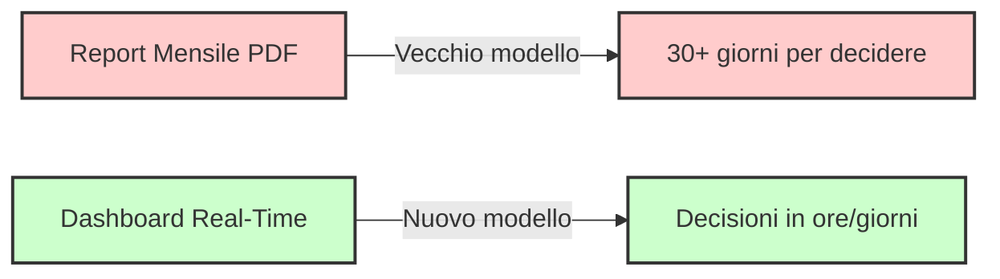
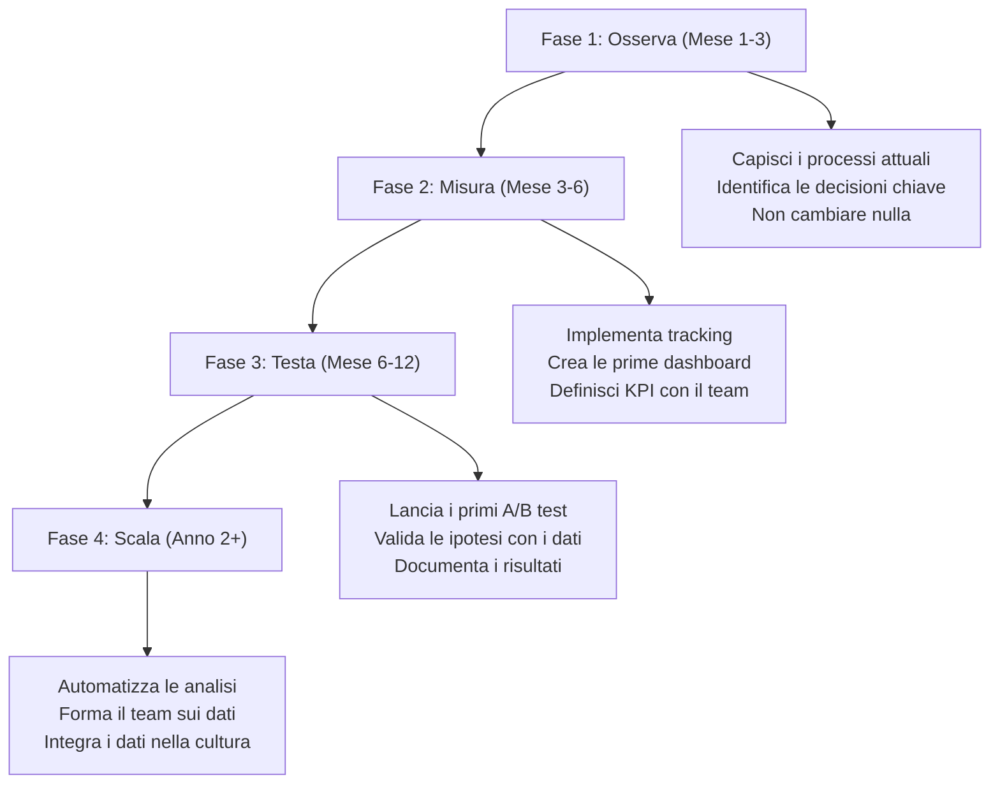

# Generazione Y al Comando: Il Nuovo Management Italiano

I millennial (nati tra il 1981 e il 1996) hanno tra i 30 e i 45 anni. Non sono più gli "stagisti digitali". Sono — o stanno diventando — i **direttori**, i **CEO**, i **manager** che guidano le aziende italiane. E stanno cambiando le regole del gioco.

## Il Passaggio Generazionale nei Numeri

In Italia, il 65% delle PMI è familiare. Negli ultimi 5 anni, migliaia di queste aziende hanno affrontato (o stanno affrontando) il passaggio generazionale dal fondatore boomer/Gen X al figlio o figlia millennial.

| Generazione | Età nel 2026 | Stile decisionale | Rapporto con i dati |
|---|---|---|---|
| **Baby Boomer** (1946-64) | 62-80 | Intuitivo, gerarchico | "I numeri li guardo a fine anno" |
| **Gen X** (1965-80) | 46-61 | Pragmatico, cauto | "Excel è il mio migliore amico" |
| **Millennial** (1981-96) | 30-45 | Collaborativo, data-informed | "Se non è misurabile, non esiste" |
| **Gen Z** (1997-2012) | 14-29 | Digitale-nativo, veloce | "Un dashboard in tempo reale o niente" |

## 5 Modi in Cui i Millennial Stanno Cambiando il Management

### 1. Da "Perché Dovrei Cambiare?" a "Perché Non Stiamo Testando?"

Il manager boomer chiede prove che il cambiamento funzionerà *prima* di provare. Il manager millennial chiede: "Quanto costa testare? Se poco, testiamo e vediamo i dati."

Questo cambio di mentalità ha un nome: **sperimentazione continua**. Non si tratta di essere temerari, ma di ridurre il costo dell'errore attraverso test rapidi e dati reali.

### 2. Dalla Gerarchia alla Trasparenza dei Dati

Nelle aziende tradizionali italiane, l'informazione è potere. Il direttore commerciale tiene per sé i numeri di vendita. Il controller condivide i bilanci solo con l'AD. I dati viaggiano verticalmente, dal basso verso l'alto.

I manager millennial **democratizzano l'accesso ai dati**:
*   Dashboard condivise con tutto il team (non solo con il board).
*   Riunioni settimanali dove i numeri sono visibili a tutti.
*   Strumenti self-service (Metabase, Looker Studio) per permettere a chiunque di esplorare i dati senza chiedere al "reparto IT".

### 3. Dal Foglio Excel al Real-Time

La generazione precedente gestiva l'azienda con report mensili in PDF (spesso stampati). Il ciclo era: raccolta dati → analisi → report → riunione → decisione. Tempo totale: 30-45 giorni.

Il manager millennial vuole il dato **in tempo reale** (o quasi):

### 4. Dall'Autorità alla Competenza

Il rispetto nelle aziende tradizionali italiane si basa sull'anzianità: "Faccio questo lavoro da 25 anni, so io come si fa." Il manager millennial sposta il baricentro dalla seniority alla **competenza dimostrata con i dati**.

Non significa mancare di rispetto all'esperienza. Significa che l'argomento "ho sempre fatto così" non è più sufficiente per giustificare una decisione strategica. Serve almeno un dato a supporto.

### 5. Dall'Ufficio al Lavoro Ibrido (e le Metriche di Produttività)

I millennial managers sono i primi a introdurre il lavoro ibrido nelle PMI italiane. Ma con il lavoro remoto serve un modo nuovo per misurare la produttività: non più "ore in ufficio" ma **output misurabili**.

| Vecchia metrica | Nuova metrica |
|---|---|
| Ore in ufficio | Deliverable completati |
| Presenza alle riunioni | Decisioni prese e documentate |
| Anzianità nel ruolo | Impatto misurabile sui KPI |

## Le Sfide del Manager Millennial in Italia

Non è tutto rose e fiori. I millennial al comando affrontano sfide specifiche nel contesto italiano:

### La Resistenza del "Vecchio Guardia"

Molti dipendenti senior vivono il cambio di management come una minaccia. "Il figlio del padrone vuole rivoluzionare tutto" è una frase che si sente spesso nei corridoi. La chiave è **coinvolgere**, non imporre. I dati devono essere un linguaggio comune, non un'arma.

### La Tentazione del Tool

I millennial amano la tecnologia, a volte troppo. Implementare Salesforce, HubSpot, Notion, Slack e Asana contemporaneamente in un'azienda che fino a ieri usava WhatsApp e il foglio di carta crea caos, non efficienza.

**La regola**: un tool alla volta, partendo da quello che risolve il problema più urgente.

### Il Dilemma della Velocità

I millennial vogliono tutto veloce. Ma molte aziende italiane (manifatturiere, agroalimentari, B2B industriale) hanno cicli di vendita lunghi. Non puoi applicare la mentalità "growth hacking" della Silicon Valley a un'azienda che vende macchinari industriali con cicli di 18 mesi.

## Framework: La Transizione Data-Driven in 4 Fasi

Per i manager millennial che vogliono trasformare l'azienda senza traumatizzarla:

### Fase 1: Osserva

Non cambiare nulla per i primi 3 mesi. Ascolta. Capisci perché le cose funzionano così. Spesso scoprirai che processi apparentemente irrazionali hanno ragioni storiche valide.

### Fase 2: Misura

Implementa il tracking minimo: Google Analytics, un CRM basico, un foglio Excel condiviso per i KPI settimanali. Non servono tool costosi all'inizio.

### Fase 3: Testa

Lancia il primo esperimento: un A/B test sulle email, un test sui prezzi di una singola categoria, una campagna pilota su un nuovo canale. Documenta **tutto**.

### Fase 4: Scala

Quando hai prove che l'approccio funziona, automatizza e forma il team. Assumi (o forma) un data analyst. Crea la cultura del dato.

## Conclusione

Il passaggio generazionale nelle aziende italiane non è solo un cambio di persone — è un cambio di paradigma. I millennial al comando portano strumenti, mentalità e aspettative diversi. Ma il successo non sta nell'imporre il "nuovo" sul "vecchio". Sta nel **fondere** l'esperienza artigianale italiana con la potenza dei dati. Chi ci riesce, diventa inarrestabile.
