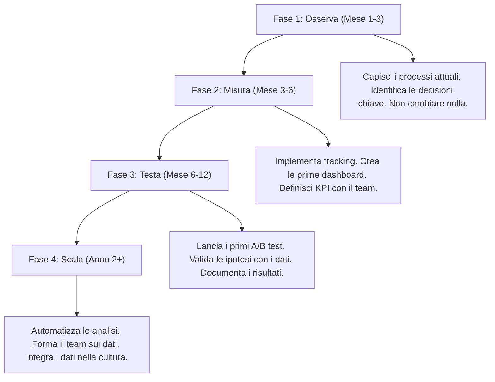

Dentro le PMI italiane sta avvenendo un cambiamento profondo, guidato da una nuova generazione di manager millennial che decidono in condizioni di incertezza con un approccio data-driven. Non è solo un cambiamento di tecnologia, è un cambiamento di metodo: si passa da un management fatto di esperienza e intuito a uno fondato su dati misurabili e sperimentazione continua.

## Problema reale

Molte aziende familiari italiane, soprattutto PMI, stanno vivendo un passaggio generazionale radicale. I nuovi manager, spesso figli dei fondatori, rientrano con competenze in Business Analytics ed esperienze internazionali, e si scontrano con una gestione arretrata, dove le decisioni si prendono ancora "a naso" e i dati restano relegati a report annuali o a fogli Excel ormai vecchi.

## Modello concettuale

La generazione millennial porta un approccio collaborativo e data-informed, che si traduce in cinque cambiamenti di fondo nel management:

1. Da un atteggiamento difensivo verso il cambiamento a una cultura di sperimentazione continua.
2. Dalla gerarchia dell'informazione alla democratizzazione dei dati.
3. Dal reporting mensile al monitoraggio in tempo reale.
4. Dal rispetto basato sull'anzianità alla competenza dimostrata con i dati.
5. Dall'ufficio fisico al lavoro ibrido con metriche di produttività basate sugli output.

A reggere questi cambiamenti ci sono strumenti concreti: dashboard condivise, tool self-service per l'analisi dei dati e modelli di people analytics che rendono la gestione delle risorse umane una scienza predittiva.

## Formalizzazione rigorosa

La disciplina della decisione sotto incertezza prende forma nel ciclo HADI (Hypothesis, Action, Data, Insights), un framework che abbassa il costo dell'errore grazie a test rapidi e dati reali. La transizione data-driven si articola in quattro fasi:

- **Fase 1: Osserva (Mese 1-3)** - ascolto e mappatura dei processi esistenti, senza modifiche immediate.
- **Fase 2: Misura (Mese 3-6)** - tracking essenziale e definizione condivisa dei KPI.
- **Fase 3: Testa (Mese 6-12)** - esperimenti strutturati con documentazione rigorosa.
- **Fase 4: Scala (Anno 2+)** - automazione, formazione e integrazione dei dati nelle decisioni di ogni giorno.

## Esempio o caso studio

Un distributore alimentare del Nord-Est ha cambiato il proprio sistema decisionale passando dai report mensili alle dashboard in tempo reale. Gli agenti, prima informati solo a fine mese, hanno potuto controllare ogni sera le proprie performance rispetto ai target settimanali. In sei mesi la varianza tra top e bottom performer si è ridotta del 40%, perché correggere la rotta era diventato possibile subito.

Booking.com è un altro caso estremo di sperimentazione continua: oltre 25.000 A/B test l'anno, che abbattono il rischio di decisioni sbagliate prese a intuito.

## Lab / esercizio

**Livello base:** mappare i processi decisionali attuali dell'azienda senza modificarli, individuando le principali fonti di dati e le decisioni chiave.

**Livello intermedio:** definire con il team 3-5 KPI rilevanti e mettere in piedi un sistema semplice di raccolta dati (per esempio Google Sheets condivisi).

**Livello research-grade:** progettare e lanciare un A/B test strutturato su una decisione commerciale, documentando ipotesi, gruppi di controllo e di test, durata e metriche di successo.

**Dataset e materiali consigliati:** dataset di vendite mensili, tool di dashboarding open source (Metabase, Apache Superset), risorse sul ciclo HADI e sulla sperimentazione continua.

## Errore tipico da evitare

Confondere la quantità di dati con la qualità delle decisioni. Mettere in piedi troppi strumenti tutti insieme, senza un piano, genera caos e resistenza. E trasformare ogni attività in una metrica costruisce un sistema di controllo che erode fiducia e creatività. Molto meglio scegliere pochi KPI che contano davvero e costruirci sopra una cultura condivisa.

## Quiz o checkpoint

- Qual è il principale vantaggio del ciclo HADI nella gestione dell'incertezza?
- Perché la democratizzazione dei dati migliora le decisioni a tutti i livelli aziendali?
- Quali sono i rischi di introdurre troppi tool tecnologici contemporaneamente?
- Come si può valorizzare l'esperienza tradizionale in un contesto data-driven?

## Il punto
Il futuro del management nelle PMI italiane passa da un equilibrio tra esperienza e dati, tra artigianalità e sperimentazione. I manager millennial non stanno solo portando nuove tecnologie: stanno costruendo un modo nuovo di decidere sotto incertezza, basato su dati reali, test continui e trasparenza. Chi guiderà questa transizione con rispetto e metodo si costruirà un vantaggio competitivo che dura nel tempo.
