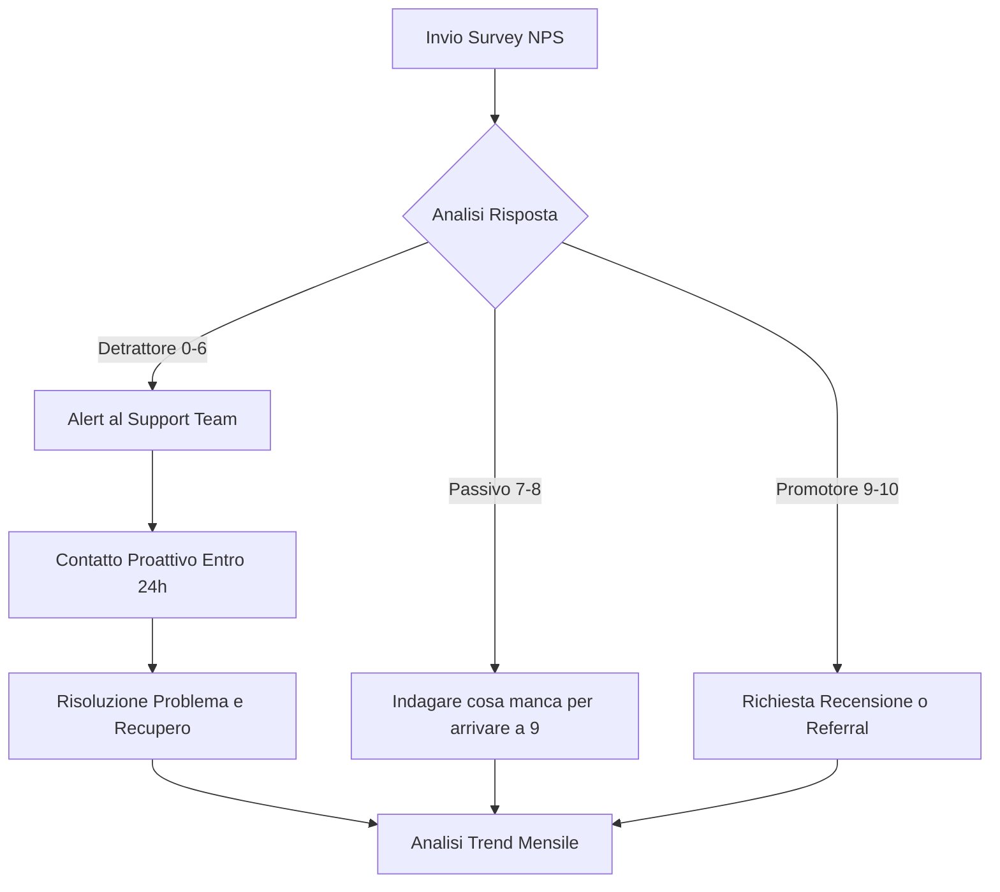

Nel 2003, Fred Reichheld pubblicò su Harvard Business Review un articolo intitolato "The One Number You Need to Grow". Era il lancio del Net Promoter Score, e la tesi era audace: di tutte le metriche di customer satisfaction esistenti, una sola correlava davvero con la crescita del business. Una domanda sola. Su una scala da 0 a 10. "Con quale probabilità consiglieresti la nostra azienda a un amico o collega?"

Reichheld aveva dalla sua i dati di Bain & Company, la societa di consulenza per cui lavorava, e li aveva presentati in modo convincente: le aziende con NPS più alto crescevano a tassi doppi rispetto alla media del settore.

La comunita di business lo adotto con entusiasmo. Apple, Tesla, Amazon, Netflix: tutti misurano l'NPS. La metrica è diventata onnipresente. Entri in una banca e all'uscita trovi il tablet con la domanda. Compri un paio di calzini online e due ore dopo arriva l'email. Chiudi un ticket di assistenza e c'è sempre quella schermata prima di poter chiudere la chat.

Oggi, a oltre vent'anni dall'introduzione, possiamo fare un bilancio onesto. L'NPS è uno strumento potente? Sì. È lo strumento che molte aziende pensano sia? Assolutamente no. E il divario tra questi due giudizi ha conseguenze pratiche significative.

## Come si Calcola l'NPS (La Matematica Dietro il Mito)

Prima di criticarlo, capiamolo a fondo. L'NPS divide i clienti in tre gruppi in base alla risposta alla domanda di raccomandazione:

- **Promotori (9-10):** Fan fedeli che continueranno a comprare e, secondo Reichheld, consiglieranno il brand attivamente.
- **Passivi (7-8):** Soddisfatti ma non entusiasti. Vulnerabili alle offerte della concorrenza.
- **Detrattori (0-6):** Clienti infelici che, secondo la teoria originale, possono danneggiare il brand con il passaparola negativo.

La formula è ingannevolmente semplice:

`NPS = % Promotori - % Detrattori`

```python
def calculate_nps(responses):
    """
    Calcola l'NPS da una lista di punteggi (0-10).

    I passivi (7-8) vengono ignorati nel calcolo: non vengono sommati
    al denominatore come nei calcoli di percentuale classici, ma vengono
    inclusi nel totale per calcolare le percentuali di promotori e detrattori.
    Questa è una scelta metodologica specifica di Reichheld, non un errore.
    """
    promoters = sum(1 for r in responses if r >= 9)
    detractors = sum(1 for r in responses if r <= 6)
    total = len(responses)

    if total == 0:
        return 0

    # Attenzione: si divide per il totale (inclusi i passivi),
    # non solo per promotori + detrattori
    nps_score = ((promoters - detractors) / total) * 100
    return round(nps_score, 2)

# Esempio realistico per un SaaS italiano B2B
# 10 risposte: mix di soddisfatti, entusiasti e insoddisfatti
scores = [10, 9, 8, 10, 5, 2, 7, 9, 10, 6]

# Promotori: 10, 9, 10, 9, 10 = 5 (50%)
# Detrattori: 5, 2, 6 = 3 (30%)
# Passivi: 8, 7 = 2 (non contano nel calcolo)
# NPS = 50% - 30% = 20
print(f"NPS Score: {calculate_nps(scores)}")  # Output: 20.0
```

Il risultato può andare da -100 (tutti i clienti sono detrattori) a +100 (tutti i clienti sono promotori). In pratica:
- NPS sotto 0: situazione critica.
- NPS 0-30: accettabile.
- NPS 30-70: buono.
- NPS sopra 70: eccellente (Apple ha raggiunto 89 nel 2022, Tesla si e attestata intorno a 96).

## I Problemi Scientifici dell'NPS

### 1. Intenzione vs Comportamento: La Critica Accademica Più Robusta

La critica più fondamentale, e quella meglio documentata dalla ricerca accademica, e che la domanda NPS misura un'**intenzione dichiarata**, non un comportamento reale.

"Con quale probabilità consiglieresti?" non è la stessa cosa di "quante volte hai effettivamente consigliato?"

Il professor Timothy Keiningham della St. John's University di New York ha condotto una delle analisi critiche più rigorose dell'NPS, pubblicata nel Journal of Marketing nel 2007. Analizzando i dati di 15.000 consumatori in diverse categorie, ha trovato che la correlazione tra NPS è crescita del fatturato era molto più debole di quanto Reichheld aveva sostenuto, e che altre metriche di soddisfazione avevano potere predittivo paragonabile o superiore.

Nella pratica, molti utenti danno un 10 perché sono gentili e vogliono "accontentare" il ricercatore, ma non hanno mai consigliato il prodotto a nessuno. Altri danno un 6 perché hanno standard alti o perché quella settimana hanno avuto un problema specifico, ma rinnovano l'abbonamento ogni anno e il prodotto è essenziale per il loro lavoro.

**La correlazione tra NPS e retention reale o crescita organica è spesso molto più debole di quanto si creda.**

### 2. Bias Culturale: Confrontare Mele con Pere

Un 7 in Italia è un buon voto. Nel sistema scolastico italiano, 7 su 10 e "discreto/buono", sopra la sufficienza. Molti italiani che sono realmente soddisfatti di un servizio daranno 7-8 per un misto di umiltà culturale ("non voglio esagerare") e per la convinzione che il 10 sia riservato alla perfezione assoluta.

In America, la cultura del feedback positivo è diversa: un 9 è quasi un insulto se sei soddisfatto, il 10 è la risposta normale. In Giappone, il 10 è per definizione irraggiungibile perché "la perfezione non appartiene all'uomo".

Se confronti l'NPS di Paese A con quello di Paese B, o persino di città A con città B all'interno dello stesso Paese, stai confrontando risposte che riflettono norme culturali diverse, non livelli di soddisfazione diversi.

Aziende multinazionali che usano l'NPS come metrica globale per confrontare performance di mercati diversi stanno prendendo decisioni su dati strutturalmente incomparabili. È un problema che nessun sistema di calcolo sofisticato può risolvere perché è insito nel design della domanda.

### 3. Mancanza di Causalità: Sai Che Hai la Febbre, Non Perché

Sapere che il tuo NPS è 45 non ti dice **cosa aggiustare**. È il customer service? Il prezzo? La UX del prodotto? La velocità di consegna? Il packaging? La qualità intrinseca?

Senza una domanda qualitativa di follow-up ("qual è il motivo principale del tuo voto?") e senza un sistema per analizzare le risposte testuali a quella domanda, l'NPS è come un termometro senza un medico. Ti dice che la temperatura e 38.5, ma non se hai un'influenza, un'infezione batterica o hai appena fatto una corsa.

Il paradosso è che molte aziende raccolgono migliaia di risposte NPS senza mai leggere un testo di follow-up. I dashboard mostrano il numero. Il CEO lo presenta al board. Ma nessuno sa perché il numero è quello che è, e quindi nessuno sa come muoverlo.

### 4. Timing e Contesto: La Stessa Persona, Due NPS Diversi

La stessa persona, sullo stesso prodotto, può dare un NPS di 9 se interrogata un'ora dopo un'esperienza positiva e un NPS di 4 se interrogata un'ora dopo aver aspettato 45 minuti al telefono con il customer service.

L'NPS non è una caratteristica stabile del cliente: è una fotografia istantanea influenzata dall'ultimo touchpoint. Se invii la survey immediatamente dopo un acquisto riuscito, stai misurando il "post-purchase high". Se la invii dopo una settimana, quando il prodotto potrebbe aver deluso, misuri qualcosa di diverso.

Molte aziende, consciamente o inconsciamente, ottimizzano il **timing** della survey per massimizzare l'NPS invece di misurare la soddisfazione reale.

### 5. Il Problema della Stabilità Statistica

L'NPS è estreemamente sensibile ai singoli rispondenti. Se hai 200 rispondenti e uno di loro cambia da 6 a 9, il tuo NPS sale di 3 punti interi (1.5% di movimento). Con numeri piccoli, la varianza casuale diventa immensa, rendendo difficile capire se il movimento è reale o rumore.

Per una startup con 50 clienti attivi, l'NPS è praticamente inutile come metrica: il movimento di un singolo cliente può creare oscillazioni che sembrano segnalare una crisi (o un grande successo) quando in realtà è solo rumore statistico.

## Le Metriche Alternative Migliori

Non buttare via l'NPS. Affiancalo a metriche più specifiche e più azionabili:

**CSAT (Customer Satisfaction Score):** "Quanto sei soddisfatto di questa specifica interazione?" Su una scala da 1 a 5. E ottimo per valutare touchpoint specifici: il processo di checkout, l'interazione col customer service, l'esperienza di onboarding. E azionabile perché e associato a un momento preciso.

| Vantaggio di CSAT | Perché e meglio di NPS |
|---|---|
| Specifico al touchpoint | Sai esattamente cosa misurare e migliorare |
| Scala 1-5 (più semplice) | Meno bias rispetto a 0-10 |
| Correlazione diretta con azione | Se il checkout ha CSAT basso, sai cosa aggiustare |
| Valido interculturalmente | Una valutazione a livello locale non risente di bias nazionali |

**CES (Customer Effort Score):** "Quanto è stato facile risolvere il tuo problema?" Questo misura la frizione. La ricerca di Matthew Dixon pubblicata su Harvard Business Review nel 2010 ha dimostrato che **ridurre lo sforzo** del cliente crea più fedeltà che non "deliziarlo". I clienti non restano fedeli a chi li emoziona: restano fedeli a chi non li fa penare. Il CES è spesso più predittivo della retention del NPS stesso.

**Product-Market Fit Survey (Sean Ellis):** "Come ti sentiresti se non potessi più usare questo prodotto?"
- Molto deluso
- Un po' deluso
- Non deluso (non è davvero necessario)

Se il 40% o più risponde "Molto deluso", hai il Product-Market Fit. Questo benchmark è stato validato da centinaia di startup. È una metrica di utilità percepita, non di soddisfazione: misura quanto il prodotto è davvero indispensabile.

**Behavioral Metrics:** Churn rate (% di clienti che escono ogni mese), Retention rate (% che restano), Expansion rate (% che aumentano la spesa). Queste metriche misurano cosa il cliente **fa** realmente, non cosa dice di fare.

## Tabella di Confronto: NPS vs Alternative

| Metrica | Misura | Predittività Churn | Azionabilità | Facilità Implementazione | Bias Culturale |
|---|---|---|---|---|---|
| **NPS** | Intenzione di recommendation | Media-Bassa | Bassa | Alta | Alta |
| **CSAT** | Soddisfazione per evento | Media | Alta | Media | Media |
| **CES** | Facilità nel risolvere problema | Alta | Alta | Media | Bassa |
| **Churn Rate** | Abbandono reale | Altissima | Alta | Alta | No |
| **Expansion Rate** | Aumento spesa | Altissima | Altissima | Alta | No |
| **PMF Survey** | Indispensabilita percepita | Altissima | Altissima | Media | Bassa |

## Chiudere il Cerchio (Closing the Loop)

La cosa più importante non è il voto, ma cosa ne fai. Un NPS raccolto e non usato e peggio di nessun NPS: crea aspettative di miglioramento nei clienti che non vengono mai soddisfatte.



Il processo di "chiudere il cerchio" con i detrattori è spesso più prezioso del numero NPS stesso. Un cliente insoddisfatto che viene contattato entro 24 ore e che vede il suo problema risolto ha, secondo la ricerca di Lee Resource, una probabilità del 70% di diventare un cliente fedele a lungo termine. Un cliente insoddisfatto a cui non risponde nessuno ha una probabilità del 90% di non tornare mai e di raccontare la sua esperienza negativa ad almeno 15 persone.

## Un Caso Reale: Come Apple Usa l'NPS (in Modo Corretto)

Apple non usa l'NPS come numero da massimizzare. Lo usa come sistema di allerta. Ogni negozio Apple Store misura l'NPS dopo ogni visita in negozio. Ma la metrica chiave non è la media: è il **trend settimanale per singolo store** e per **singolo Genius Bar advisor**.

Se un negozio di Milano mostra un calo di 10 punti in due settimane, il regional manager riceve un alert automatico e deve capire cosa è cambiato: un dipendente con problemi? Una procedura nuova che non funziona? Un prodotto con un difetto ricorrente?

Non è l'NPS alto che rende Apple diversa. È l'infrastruttura di risposta costruita attorno all'NPS. Il numero è solo il segnale. L'azione e ciò che conta.

## Driver Analysis: Rendere l'NPS Azionabile con Regressione

Se vuoi usare l'NPS in modo scientifico, puoi applicare una **driver analysis** con regressione. L'idea: il tuo NPS complessivo è la risultante di molteplici fattori (quality del prodotto, prezzo, customer service, spedizione, packaging). Puoi usare regressione lineare multipla per capire quale fattore ha il maggiore impatto sul tuo NPS.

```
NPS = b0 + b1*Quality + b2*Price + b3*CustomerService + b4*Speed + b5*Packaging + error
```

I coefficienti b1, b2, ecc, ti dicono l'impatto relativo. Se b1 (quality) e 2 volte più grande di b3 (customer service), significa che migliorare la quality di 1 punto causa un miglioramento di NPS doppio rispetto a migliorare il customer service di 1 punto.

Questo trasforma l'NPS da numero generico a mappa strategica. Sai esattamente su cosa investire.

## NPS Transazionale vs Relazionale

Una sofisticazione utile: misurare l'NPS in due contesti diversi:
- **Transazionale:** Subito dopo una transazione ("Quanto consiglieresti [prodotto specifico] a un amico?")
- **Relazionale:** Periodicamente, sul brand nel suo insieme ("Quanto consiglieresti [azienda] a un amico?")

L'NPS transazionale tende a essere più reattivo ai singoli episodi. L'NPS relazionale cattura la percezione consolidata. Confrontare i due da insight interessanti: se il transazionale e buono ma il relazionale e scarso, significa che il prodotto piace ma il brand in generale no. Potrebbe essere un problema di prezzo complessivo, di percezione di trasparenza, o di altre esperienze negative in altri touchpoint.

## Caso Studio: Azienda SaaS Che Ha Sostituito NPS con Sistema Ibrido

Un SaaS B2B italiano ha deciso di dismettere il puro NPS è adottare un sistema ibrido nel 2023. Il nuovo sistema raccoglieva:

1. **CSAT settimanale** sul support ticket appena chiuso (scala 1-5)
2. **CES mensile** su "quanto è stato facile risolvere il tuo problema?" (scala 1-7)
3. **Churn rate** monitorate in tempo reale (% of active customers who don't renew)
4. **NPS relazionale trimestrale** con driver analysis per capire cosa muove la percezione

Risultati dopo 18 mesi:

| Metrica | Prima | Dopo | Impatto |
|---|---|---|---|
| Churn rate | 8.2% mensile | 5.1% mensile | -37% churn |
| CSAT medio (support) | Non misurato | 4.2/5 | Benchmark: > 4.0 |
| Expansion rate | 12% | 18% | +50% upsell |
| NPS | 38 (generico, non azionabile) | N/A (rimosso come metrica primaria) | Miglior prediction via churn |

Il cambio chiave: invece di inseguire un numero di NPS, il team si focalizzo su metriche comportamentali (churn, expansion) che erano più predittive di crescita reale. Il NPS settimanale continuo a essere raccolto, ma non era il KPI principale: era uno tra tanti segnali.

## Conclusione: NPS è Uno Strumento, Non la Soluzione

L'NPS è un termometro, non una diagnosi. Ti dice se hai la febbre, ma non se hai l'influenza, un'infezione batterica o hai semplicemente corso troppo al sole.

Reichheld aveva ragione sul fatto che la raccomandazione è un segnale potente di soddisfazione. Aveva torto nel sostenere che un solo numero basta per capire e governare la salute del business. La versione onesta è questa: l'NPS è un buon punto di partenza, non un punto di arrivo.

Usalo come segnale di alto livello per capire se la direzione è quella giusta. Affiancalo a metriche comportamentali (churn, expansion, retention) e a driver analysis per capire cosa muove la soddisfazione. Monitora i comportamenti reali, non solo le intenzioni dichiarate. E costruisci un processo strutturato per rispondere ai detrattori entro 24 ore, perché quello, molto più del numero sul dashboard, e ciò che trasforma un cliente insoddisfatto in un cliente fedele.

Per approfondire come scegliere le giuste metriche per il tuo business, leggi il nostro [modulo su metriche fondamentali e significatività statistica](/course/metriche-fondamenti/).

La domanda non è "qual è il nostro NPSì" La domanda è "Che decisioni vogliamo prendere con questa metrica? Quali dati ci servono?" Il numero che viene dopo è solo uno strumento per rispondere a quella domanda.
