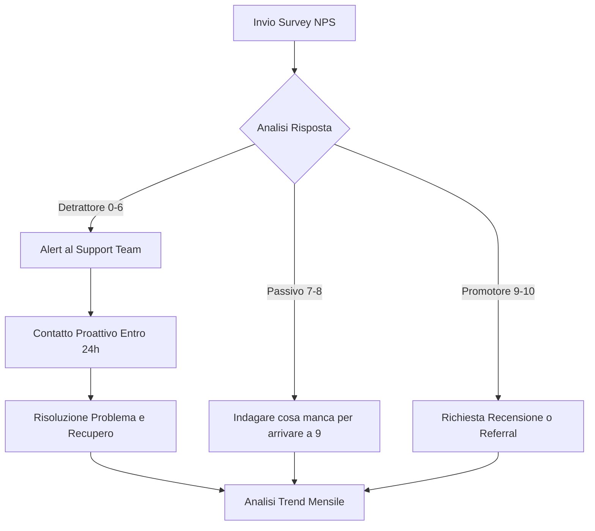

Nel 2003, Fred Reichheld propose il Net Promoter Score (NPS) come unica metrica capace di prevedere la crescita di un'azienda, basandosi su una domanda semplice: "Con quale probabilità consiglieresti la nostra azienda a un amico o collega?". Da allora, l'NPS è diventato uno standard diffuso, adottato da colossi come Apple, Tesla e Amazon. Ma a oltre vent'anni dall'introduzione, è il momento di un bilancio critico: l'NPS è potente, ma non è la bacchetta magica che molti credono.

## Come si Calcola l'NPS (La Matematica Dietro il Mito)

L'NPS si basa su una segmentazione dei clienti in promotori (9-10), passivi (7-8) e detrattori (0-6). La formula è semplice: NPS = % Promotori - % Detrattori. Tuttavia, la semplicità nasconde complessità metodologiche: i passivi sono inclusi nel denominatore, ma non nel numeratore, una scelta specifica che può confondere.

Un esempio pratico con risposte reali mostra come un NPS di 20 possa derivare da un mix di clienti entusiasti, soddisfatti e insoddisfatti, evidenziando la natura aggregata e sintetica della metrica.

## I Problemi Scientifici dell'NPS

### 1. Intenzione vs Comportamento

L'NPS misura l'intenzione dichiarata di raccomandare, non il comportamento reale. Studi accademici, come quello di Timothy Keiningham, mostrano che la correlazione tra NPS e crescita è più debole di quanto si pensi, e altre metriche possono essere altrettanto o più predittive.

### 2. Bias Culturale

Le risposte all'NPS variano per norme culturali: un 7 in Italia può significare soddisfazione, mentre in altri paesi no. Confrontare NPS tra culture diverse equivale a confrontare mele con pere, rendendo le decisioni basate su questi dati potenzialmente fuorvianti.

### 3. Mancanza di Causalità

Un punteggio NPS alto o basso non indica cosa correggere. Senza domande qualitative di follow-up, l'NPS è un termometro senza diagnosi: indica un problema ma non la causa.

### 4. Timing e Contesto

L'NPS è influenzato dal momento in cui viene raccolto. La stessa persona può dare punteggi molto diversi a seconda dell'esperienza immediata, rendendo la metrica volatile e sensibile al timing.

### 5. Stabilità Statistica

Con campioni piccoli, l'NPS è altamente volatile. Per startup o aziende con pochi clienti, un singolo cambiamento può alterare drasticamente il punteggio, rendendo difficile interpretare i dati.

## Le Metriche Alternative Migliori

L'NPS non va abbandonato, ma integrato con metriche più precise e azionabili:

- **CSAT (Customer Satisfaction Score):** misura la soddisfazione su specifici touchpoint, utile per interventi mirati.
- **CES (Customer Effort Score):** valuta la facilità con cui il cliente risolve un problema, spesso più predittivo della fedeltà.
- **Product-Market Fit Survey:** misura quanto un prodotto è indispensabile per il cliente.
- **Metriche Comportamentali:** churn rate, retention rate, expansion rate, che misurano azioni reali dei clienti.

| Metrica | Misura | Predittività Churn | Azionabilità | Facilità Implementazione | Bias Culturale |
|---|---|---|---|---|---|
| NPS | Intenzione di raccomandazione | Media-Bassa | Bassa | Alta | Alta |
| CSAT | Soddisfazione per evento | Media | Alta | Media | Media |
| CES | Facilità nel risolvere problema | Alta | Alta | Media | Bassa |
| Churn Rate | Abbandono reale | Altissima | Alta | Alta | No |
| Expansion Rate | Aumento spesa | Altissima | Altissima | Alta | No |
| PMF Survey | Indispensabilità percepita | Altissima | Altissima | Media | Bassa |

## Chiudere il Cerchio

Il valore dell'NPS sta nel processo di risposta ai clienti, non nel numero in sé. Ad esempio, contattare un detrattore entro 24 ore può trasformarlo in un cliente fedele, mentre ignorarlo può amplificare il danno.

## Caso Reale: Apple e l'NPS

Apple non punta a un NPS alto in senso assoluto, ma monitora i trend settimanali per negozio e per dipendente. Un calo improvviso genera un alert e un'indagine, trasformando l'NPS in un sistema di allerta e miglioramento continuo.

## Rendere l'NPS Azionabile con Driver Analysis

Attraverso la regressione multipla, è possibile decomporre l'NPS nei suoi fattori determinanti (qualità, prezzo, servizio, spedizione, packaging), ottenendo una mappa strategica per interventi mirati.

## NPS Transazionale vs Relazionale

Distinguere tra NPS raccolto subito dopo una transazione e NPS sul brand permette di capire se il problema è nel prodotto o nell'immagine complessiva dell'azienda.

## Caso Studio: SaaS Italiano

Un'azienda SaaS ha sostituito l'NPS come metrica primaria con un sistema ibrido che integra CSAT, CES, churn e NPS relazionale con driver analysis, ottenendo una riduzione del churn del 37% e un aumento dell'upsell del 50% in 18 mesi.

| Metrica | Prima | Dopo | Impatto |
|---|---|---|---|
| Churn rate | 8.2% mensile | 5.1% mensile | -37% |
| CSAT medio | Non misurato | 4.2/5 | Benchmark >4.0 |
| Expansion rate | 12% | 18% | +50% |
| NPS | 38 (non azionabile) | N/A | Miglior predizione via churn |

## Conclusione

L'NPS è uno strumento utile ma incompleto. È un termometro che indica la presenza di un problema, non la sua causa. Per prendere decisioni efficaci sotto incertezza, serve integrare l'NPS con metriche comportamentali, analisi dei driver e processi di risposta rapida ai clienti insoddisfatti. Solo così si trasforma un numero in un vantaggio competitivo reale.

Per approfondire, consulta il nostro [modulo su metriche fondamentali e significatività statistica](/course/metriche-fondamenti/).

La vera domanda non è "Qual è il nostro NPS?" ma "Quali decisioni vogliamo prendere con questa metrica?" Il numero è uno strumento, non il fine.
