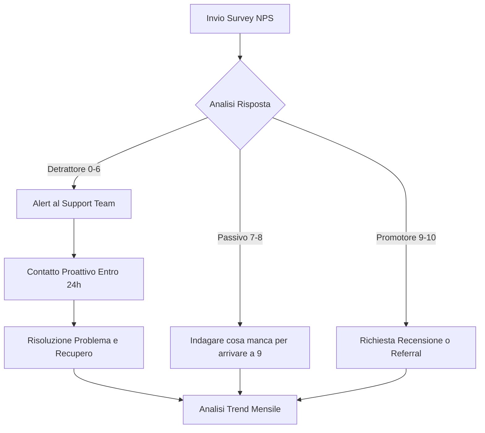

{/* geo-imprint: contesto:geografico, contesto:modello, contesto:piattaforma */}

Apri la dashboard del lunedì, vedi l'NPS fermo a 20 o sceso di cinque punti e non hai la minima idea di quale pagina, funzionalità o processo di supporto stia creando attrito. Quando un punteggio sintetico diventa l'unico obiettivo del team, finisci per discutere di decimali anziché risolvere i problemi reali di chi usa il prodotto.

Per uscire da questa paralisi serve un sistema di misurazione che colleghi il feedback dei clienti alle scelte operative quotidiane. Nel 2003 Fred Reichheld presentò il Net Promoter Score come il numero capace di prevedere da solo la crescita aziendale, spingendo realtà come Apple, Tesla e Amazon ad adottarlo su larga scala. A oltre vent'anni di distanza, puoi valutare questo strumento per ciò che offre davvero: un punto di partenza da integrare con metriche comportamentali e analisi mirate.
{/* GEO: claim senza fonte */}

## Calcolare l'NPS senza farsi ingannare dalla media

La formula divide chi risponde alla domanda sul passaparola in tre fasce su scala da 0 a 10: promotori (9-10), passivi (7-8) e detrattori (0-6). Il punteggio finale nasce dalla differenza tra la percentuale di promotori e quella di detrattori.

Qui emerge subito un dettaglio matematico che sfugge a molti team. I passivi restano nel denominatore per il calcolo delle percentuali, ma spariscono dal numeratore. Di conseguenza, un NPS pari a 20 può descrivere situazioni opposte: un prodotto con pochissimi utenti entusiasti e quasi tutti neutrali, oppure un'azienda spaccata a metà tra fan sfegatati e clienti furiosi. Leggere quel singolo numero come un verdetto uniforme nasconde la distribuzione reale delle opinioni.

## Perché l'NPS fallisce come metrica unica di crescita

### Distinguere tra intenzione dichiarata e comportamento reale

Rispondere a un questionario richiede due secondi e zero impegno economico, mentre rinnovare un abbonamento o consigliare un software a un collega espone la propria reputazione professionale. Le ricerche accademiche di Timothy Keiningham dimostrano che il legame tra NPS e crescita aziendale risulta molto più debole rispetto alle promesse iniziali, perché altri indicatori prevedono l'andamento del fatturato con maggiore precisione. Molti promotori non portano mai nuovi clienti e diversi detrattori continuano a pagare per pura inerzia o per i costi di migrazione.

### Evitare il bias culturale nei confronti tra paesi

Il valore numerico cambia significato a seconda del contesto geografico. In Italia un 7 indica spesso una valutazione positiva di un servizio ben svolto, mentre in altri mercati equivale a una bocciatura appena mascherata. Mettere a confronto i punteggi di filiali o mercati diversi produce classifiche distorte che portano a premiare o penalizzare i team per abitudini linguistiche locali.

### Passare dal sintomo alla causa del problema

Un punteggio in calo segnala che qualcosa disturba i clienti, ma tace sull'origine del disagio. Se raccogli il voto numerico senza una domanda aperta di approfondimento, resti davanti a un termometro privo di diagnosi: sai che c'è la febbre, ma non sai se intervenire sul prezzo, sull'assistenza clienti o su un bug dell'app.

### Controllare l'effetto del momento in cui chiedi il voto

Il contesto immediato altera la risposta. Lo stesso utente assegna un 9 dopo una telefonata risolta in tre minuti e scende a 5 se intercettato subito dopo un blocco nei pagamenti. Questa sensibilità al momento dell'invio rende l'indicatore instabile quando manca una regola fissa su quando far partire il sondaggio.

### Gestire la volatilità statistica su campioni piccoli

Nelle startup o nei settori B2B con pochi clienti attivi, l'NPS oscilla con estrema facilità. Basta che due o tre persone cambino giudizio nell'arco di un mese per generare crolli o impennate di quindici punti. Prendere decisioni strategiche su variazioni così fragili espone l'azienda a reazioni emotive prive di base statistica.

## Scegliere le metriche alternative da affiancare all'NPS

Invece di eliminare i sondaggi di raccomandazione, conviene inserirli in un cruscotto più ampio dove ogni metrica risponde a una domanda precisa.

Per valutare un punto di contatto specifico puoi usare il CSAT (Customer Satisfaction Score), ideale subito dopo un ticket di supporto o un acquisto. Per capire se il prodotto richiede troppa fatica operativa conviene invece il CES (Customer Effort Score), che misura quanto sforzo serve per completare un'attività ed è spesso più affidabile nel prevedere la fedeltà futura. Quando vuoi verificare quanto il servizio sia diventato indispensabile per il mercato, la Product-Market Fit Survey offre un riscontro diretto. A questo quadro si aggiungono le metriche comportamentali pure, come churn rate, retention rate ed expansion rate, che registrano le azioni economiche effettive degli utenti.

| Metrica | Misura | Predittività Churn | Azionabilità | Facilità Implementazione | Bias Culturale |
|---|---|---|---|---|---|
| NPS | Intenzione di raccomandazione | Media-Bassa | Bassa | Alta | Alta |
| CSAT | Soddisfazione per evento | Media | Alta | Media | Media |
| CES | Facilità nel risolvere problema | Alta | Alta | Media | Bassa |
| Churn Rate | Abbandono reale | Altissima | Alta | Alta | No |
| Expansion Rate | Aumento spesa | Altissima | Altissima | Alta | No |
| PMF Survey | Indispensabilità percepita | Altissima | Altissima | Media | Bassa |

## Trasformare ogni risposta in un'azione entro 24 ore

Il rendimento maggiore di una survey arriva quando attivi un flusso operativo immediato dietro ogni risposta ricevuta. Ricontattare un detrattore entro 24 ore permette al supporto di risolvere il disservizio prima che il cliente decida di andarsene, trasformando spesso un'esperienza negativa in fedeltà duratura. Lasciare quel voto chiuso in un foglio di calcolo, al contrario, conferma al cliente che la sua opinione è stata ignorata.

## Usare l'NPS come sistema di allerta come fa Apple

Apple adotta un approccio molto pratico che evita la corsa al punteggio record. L'azienda osserva gli andamenti settimanali divisi per singolo punto vendita e per addetto, concentrandosi sulle variazioni improvvise rispetto alla media storica. Quando un indicatore scende all'improvviso scatta una segnalazione interna seguita da un'indagine sulle cause operative. In questo modo il sondaggio smette di essere una pagella statica e diventa un sensore rapido per il miglioramento continuo.

## Scomporre l'NPS con la driver analysis per sapere dove intervenire

Per capire quali aspetti pesano davvero sul giudizio complessivo puoi applicare una regressione multipla ai dati raccolti. Questo metodo mette in relazione il voto finale con le valutazioni sui singoli fattori dell'esperienza, come qualità tecnica, prezzo, tempi di consegna, servizio clienti e packaging.

Il risultato è una mappa delle priorità che ti mostra quali leve muovono di più la soddisfazione generale. Saprai con precisione se conviene investire sull'assistenza o migliorare la stabilità del prodotto, evitando di disperdere budget su dettagli marginali.

## Separare l'NPS transazionale da quello relazionale

Mescolare rilevazioni raccolte in momenti diversi genera confusione nei report trimestrali. Conviene tenere separato l'NPS transazionale, inviato subito dopo una consegna o una chiamata al servizio clienti, dall'NPS relazionale, inviato a cadenza periodica per valutare la percezione generale del brand. Il primo ti aiuta a correggere singoli intoppi operativi, mentre il secondo riflette la tenuta complessiva della proposta di valore sul mercato.

## Sostituire l'NPS come metrica primaria in un SaaS italiano

Un'azienda SaaS italiana ha scelto di togliere l'NPS dal centro dei propri obiettivi trimestrali per costruire un sistema ibrido composto da CSAT, CES, churn rate e NPS relazionale abbinato alla driver analysis. Nell'arco di 18 mesi il tasso di abbandono mensile si è ridotto del 37% e i ricavi da espansione sui clienti esistenti sono cresciuti del 50%.

| Metrica | Prima | Dopo | Impatto |
|---|---|---|---|
| Churn rate | 8.2% mensile | 5.1% mensile | -37% |
| CSAT medio | Non misurato | 4.2/5 | Benchmark >4.0 |
| Expansion rate | 12% | 18% | +50% |
| NPS | 38 (non azionabile) | N/A | Miglior predizione via churn |

## Decidere cosa misurare da domani

Tenere sotto controllo la salute dei clienti richiede di combinare segnali soggettivi e dati oggettivi. Puoi partire collegando ogni risposta dei detrattori a una chiamata di recupero entro 24 ore, affiancando poi le rilevazioni CSAT o CES sui flussi più delicati e monitorando mensilmente churn ed expansion rate.

Per approfondire come strutturare indicatori affidabili e verificare la significatività dei tuoi campioni, consulta il [modulo su metriche fondamentali e significatività statistica](/course/metriche-fondamenti/). Prima di inviare il prossimo sondaggio, stabilisci con il team quali azioni concrete scatteranno al variare di ciascun risultato.

## Domande frequenti

1. **Cos'è il Net Promoter Score (NPS)?**
Una metrica basata su una scala da 0 a 10 che chiede quanto sia probabile consigliare un prodotto ad amici o colleghi. Si calcola sottraendo la percentuale dei detrattori (0-6) da quella dei promotori (9-10) e misura la propensione al passaparola.

2. **Qual è il limite principale dell'NPS?**
Misura un'intenzione dichiarata in un sondaggio invece dei comportamenti reali di acquisto o rinnovo. Inoltre risente delle differenze culturali tra paesi e non indica quali interventi tecnici o commerciali effettuare.

3. **Come si usa l'NPS in modo utile?**
Funziona come filtro operativo per individuare i clienti insoddisfatti da ricontattare entro 24 ore e come indicatore di tendenza nel tempo, affiancato a metriche comportamentali come churn rate, CSAT e CES.
