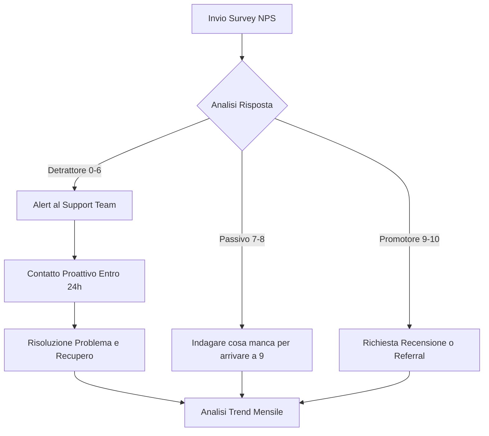

Nel 2003 Fred Reichheld propose il Net Promoter Score (NPS) come la metrica che, da sola, avrebbe previsto la crescita di un'azienda. Tutto poggiava su una domanda: "Con quale probabilità consiglieresti la nostra azienda a un amico o collega?". Da lì l'NPS è diventato uno standard, adottato da aziende come Apple, Tesla e Amazon. A oltre vent'anni di distanza conviene fare un bilancio onesto. L'NPS è utile, ma non è la bacchetta magica che molti credono.

## Come si calcola l'NPS (la matematica dietro il mito)

L'NPS divide i clienti in promotori (9-10), passivi (7-8) e detrattori (0-6). La formula è semplice: NPS = % Promotori meno % Detrattori. Qui si nasconde il primo punto delicato. I passivi entrano nel denominatore ma non nel numeratore, una scelta metodologica precisa che spesso confonde chi legge il risultato.

Prendi un caso concreto. Un NPS di 20 può nascere da un mix di clienti entusiasti, soddisfatti e scontenti messi insieme. Il numero finale è una sintesi che appiattisce queste differenze, e questa è già una prima ragione per non leggerlo come un verdetto.

## I problemi scientifici dell'NPS

### 1. Intenzione contro comportamento

L'NPS misura l'intenzione dichiarata di raccomandare, non quello che le persone fanno davvero. Gli studi accademici di Timothy Keiningham mostrano che la correlazione tra NPS e crescita è più debole di quanto si racconti, e che altre metriche predicono la crescita altrettanto bene o meglio.

### 2. Bias culturale

Le risposte cambiano con le norme culturali. Un 7 in Italia può indicare soddisfazione, in altri paesi no. Confrontare l'NPS tra culture diverse vuol dire confrontare mele con pere, e le decisioni prese su quel confronto rischiano di portare fuori strada.

### 3. Mancanza di causalità

Un punteggio alto o basso non dice cosa correggere. Senza domande qualitative di follow-up l'NPS resta un termometro senza diagnosi: segnala che c'è un problema, ma tace sulla causa.

### 4. Timing e contesto

Il momento in cui raccogli la risposta cambia il risultato. La stessa persona può dare punteggi molto diversi a seconda dell'esperienza appena vissuta, e questo rende la metrica volatile e sensibile a quando la misuri.

### 5. Stabilità statistica

Su campioni piccoli l'NPS oscilla parecchio. Per una startup o per chi ha pochi clienti basta un singolo cambiamento per spostare il punteggio in modo netto, e a quel punto interpretare il dato diventa difficile.

## Le metriche alternative migliori

L'NPS non va buttato, va affiancato a metriche più precise e su cui puoi agire. Il CSAT (Customer Satisfaction Score) misura la soddisfazione su singoli touchpoint, e serve quando vuoi intervenire su un punto specifico. Il CES (Customer Effort Score) valuta quanta fatica fa il cliente per risolvere un problema, e spesso predice la fedeltà meglio dell'NPS. La Product-Market Fit Survey misura quanto un prodotto risulti indispensabile. Poi ci sono le metriche comportamentali (churn rate, retention rate, expansion rate), che guardano le azioni reali dei clienti invece delle loro dichiarazioni.

| Metrica | Misura | Predittività Churn | Azionabilità | Facilità Implementazione | Bias Culturale |
|---|---|---|---|---|---|
| NPS | Intenzione di raccomandazione | Media-Bassa | Bassa | Alta | Alta |
| CSAT | Soddisfazione per evento | Media | Alta | Media | Media |
| CES | Facilità nel risolvere problema | Alta | Alta | Media | Bassa |
| Churn Rate | Abbandono reale | Altissima | Alta | Alta | No |
| Expansion Rate | Aumento spesa | Altissima | Altissima | Alta | No |
| PMF Survey | Indispensabilità percepita | Altissima | Altissima | Media | Bassa |

## Chiudere il cerchio

Il valore dell'NPS sta nel processo di risposta ai clienti, non nel numero. Contattare un detrattore entro 24 ore può recuperarlo e renderlo fedele. Ignorarlo, al contrario, amplifica il danno.

## Caso reale: apple e l'NPS

Apple non insegue un NPS alto in assoluto. Monitora i trend settimanali per negozio e per dipendente, e quando un punteggio cala all'improvviso parte un alert e un'indagine. Così l'NPS smette di essere un voto e diventa un sistema di allerta per il miglioramento continuo.

## Rendere l'NPS azionabile con driver analysis

Con la regressione multipla puoi scomporre l'NPS nei fattori che lo determinano: qualità, prezzo, servizio, spedizione, packaging. Il risultato è una mappa di dove intervenire, invece di un numero da fissare.

## NPS transazionale contro relazionale

Conviene distinguere l'NPS raccolto subito dopo una transazione da quello sul brand. Il primo dice se è andato storto un singolo episodio, il secondo se il problema riguarda l'immagine complessiva dell'azienda.

## Caso studio: SaaS italiano

Un'azienda SaaS ha smesso di usare l'NPS come metrica primaria e l'ha sostituito con un sistema ibrido: CSAT, CES, churn e NPS relazionale con driver analysis. In 18 mesi il churn è sceso del 37% e l'upsell è cresciuto del 50%.

| Metrica | Prima | Dopo | Impatto |
|---|---|---|---|
| Churn rate | 8.2% mensile | 5.1% mensile | -37% |
| CSAT medio | Non misurato | 4.2/5 | Benchmark >4.0 |
| Expansion rate | 12% | 18% | +50% |
| NPS | 38 (non azionabile) | N/A | Miglior predizione via churn |

## Il punto

L'NPS è uno strumento utile ma incompleto. È un termometro che segnala la presenza di un problema, non la sua causa. Per decidere bene sotto incertezza serve affiancarlo a metriche comportamentali, all'analisi dei driver e a un processo di risposta rapida ai clienti scontenti. È in quel passaggio che un numero diventa un vantaggio competitivo reale.

Per approfondire, consulta il nostro [modulo su metriche fondamentali e significatività statistica](/course/metriche-fondamenti/).

La domanda da farsi non è "Qual è il nostro NPS?" ma "Quali decisioni vogliamo prendere con questa metrica?". Il numero è uno strumento, non il fine.
