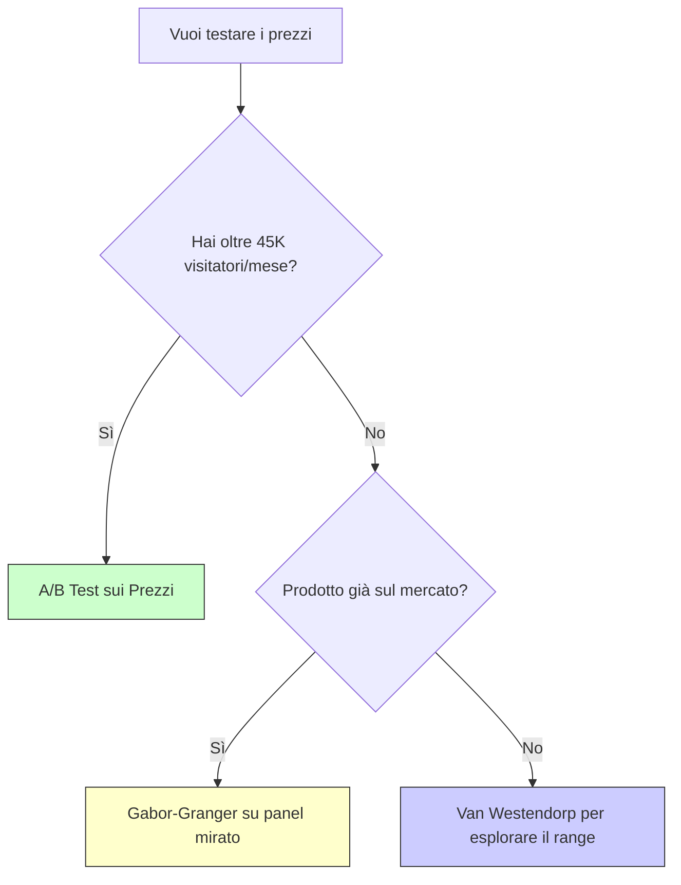

{/* geo-imprint: contesto:geografico, contesto:ricerca, contesto:modello, contesto:piattaforma */}

Stabilire un listino guardando solo i costi interni o copiando la pagina prezzi del concorrente più vicino lascia quasi sempre soldi sul tavolo. Spesso i founder giustificano una tariffa dicendo che "sembrava ragionevole", ma senza sapere quanto i clienti siano davvero disposti a spendere né dove inizi il rifiuto all'acquisto.

Al contrario, puoi trattare il prezzo come una variabile misurabile e testarlo prima di fissarlo in modo definitivo. Un aumento dell'1% del prezzo genera in media un incremento del 10% del profitto ([McKinsey](https://www.mckinsey.com), 2021), perché ogni euro in più sul listino finisce quasi per intero nel margine.

Nel 2006 Amazon prese una decisione che sembrava andare contro i conti immediati: azzerare il costo di spedizione per chi superava una certa soglia di spesa. Internamente la chiamarono "la mossa stupida", eppure tre anni dopo Prime era diventato il prodotto più redditizio dell'azienda grazie alla misurazione continua sui dati reali di acquisto.
{/* GEO: claim senza fonte */}

In questa guida vedrai tre metodi quantitativi per testare i prezzi in sequenza, dal sondaggio esplorativo fino alla validazione sul traffico reale.

## Trova la fascia di prezzo accettabile con Van Westendorp

Negli anni Settanta l'economista Peter van Westendorp sviluppò il Price Sensitivity Meter per individuare le soglie psicologiche oltre le quali un cliente giudica un prodotto sospetto perché troppo economico oppure fuori mercato perché troppo caro.

### Le quattro domande da fare al mercato

Il questionario si basa su quattro domande dirette da sottoporre al tuo target:

1. A quale prezzo il prodotto ti sembrerebbe troppo economico, tanto da farti dubitare della qualità?
2. A quale prezzo lo considereresti un affare, conveniente ma comunque affidabile?
3. A quale prezzo inizi a pensare che costi molto, pur essendo ancora disposto ad acquistarlo?
4. A quale prezzo lo considereresti troppo caro da rinunciare all'acquisto?

### Come leggere le curve e trovare i punti di incrocio

Una volta raccolte le risposte, tracci le curve cumulative delle quattro distribuzioni e osservi dove si incrociano:

| Intersezione | Significato |
|---|---|
| "Troppo economico" ∩ "Troppo caro" | Optimal Price Point (OPP): prezzo con minimo attrito psicologico |
| "Affare" ∩ "Costoso" | Indifference Price Point (IPP): prezzo percepito come normale |
| Range tra le intersezioni | Acceptable Price Range: zona di manovra |

### Caso studio: come una SaaS fiscale ha aumentato le conversioni del 23%

Per esempio, una startup italiana di compliance fiscale entrò sul mercato a 89€/mese copiando un competitor americano, senza svolgere alcun test preliminare. Dopo aver intervistato 230 decision-maker, l'analisi Van Westendorp mostrò un OPP a 67€/mese e un IPP a 95€/mese, con un intervallo accettabile compreso tra 45€ e 130€.

I dati rivelarono che 89€ veniva percepito ancora come una fascia economica e trasmetteva poco valore professionale. Alzando il piano a 110€ e adeguando il posizionamento, la conversione salì del 23% perché l'offerta risultava più credibile per chi doveva firmare il budget.

### Limiti e vantaggi del metodo Van Westendorp

| Pro | Contro |
|---|---|
| Facile e rapido (200 risposte bastano) | Basato su opinioni, non su acquisti reali |
| Fornisce un range, non un punto unico | Non segmenta per tipo di cliente |
| Economico da condurre | Non misura la reale disponibilità a pagare |
| Ottimo per prodotti nuovi | Sensibile alla formulazione delle domande |

## Costruisci la curva di domanda con Gabor-Granger

Mentre il metodo precedente individua i confini psicologici, la tecnica di Clive Granger e Andre Gabor stima la domanda attesa a ogni specifico livello di prezzo. In pratica mostri una cifra alla volta e chiedi se l'intervistato comprerebbe, adattando la proposta successiva alla sua risposta.

### I cinque passaggi dell'intervista adattiva

1. Seleziona da 5 a 7 prezzi all'interno dell'intervallo che vuoi esplorare.
2. Mostra al rispondente un prezzo estratto in modo casuale.
3. Se accetta, proponi il gradino di prezzo superiore; se rifiuta, scendi al gradino inferiore.
4. Prosegui fino a isolare il prezzo massimo che quella persona è disposta a pagare.
5. Aggrega tutte le risposte per disegnare la curva di domanda complessiva.

### Esempio pratico: trovare il picco di ricavi su un tool di project management

Immagina di testare sei fasce di prezzo tra 9€ e 29€ per un software di project management. Moltiplicando il prezzo per la percentuale di intervistati disposti ad acquistare ottieni il Revenue Index:

| Prezzo | % che compra | Revenue Index |
|---|---|---|
| 9€ | 85% | 765 |
| 12€ | 72% | 864 |
| 15€ | 58% | 870 |
| 19€ | 41% | 779 |
| 25€ | 22% | 550 |
| 29€ | 8% | 232 |

In questo scenario il picco si raggiunge a 15€, il punto in cui il calo delle conversioni viene compensato dal valore più alto di ogni singola vendita.

### Il caso Basecamp: passare a un prezzo unico da 99\$

Basecamp applicò una logica simile quando decise di eliminare il piano da 24\$, dopo aver verificato che la maggior parte della domanda reale si concentrava tra 49\$ e 99\$. Passando a una tariffa unica da 99\$, l'azienda ridusse il churn del 15% perché i clienti smisero di percepire costi aggiuntivi frammentati.

### Limiti e vantaggi del metodo Gabor-Granger

| Pro | Contro |
|---|---|
| Più realistico del Van Westendorp | Ancora basato su intenzioni dichiarate |
| Costruisce una curva di domanda vera | Richiede 300+ risposte affidabili |
| Trova prezzi ottimali per obiettivi diversi | Sensibile al framing delle domande |
| Quantifica elasticità della domanda | Non cattura dinamiche temporali |

## Valida il prezzo sul traffico reale con gli A/B test

I sondaggi aiutano a restringere il campo, ma solo il comportamento di acquisto con carta di credito alla mano conferma se un listino regge davvero. Nel 2014 Netflix testò un aumento di prezzo su un campione ristretto di nuovi iscritti e osservò che il tasso di abbandono restava stabile; quel risultato diede la sicurezza per estendere il nuovo listino l'anno successivo.

### Cinque regole per testare i prezzi in modo etico

Per evitare attriti con i clienti esistenti, applica queste regole operative:

1. Esegui il test solo sui nuovi visitatori, lasciando invariate le condizioni di chi è già abbonato.
2. Mantieni variazioni di prezzo contenute entro il ±15% tra una variante e l'altra.
3. Lascia girare l'esperimento per almeno due settimane complete, così da coprire cicli settimanali diversi.
4. Segmenta i risultati per canale di acquisizione, perché utenti da ricerca organica e campagne a pagamento reagiscono in modo diverso.
5. Gestisci con trasparenza eventuali richieste post-test del supporto clienti.

### Come assegnare gli utenti senza cambiare prezzo a metà visita

Dal punto di vista tecnico, l'assegnazione delle varianti deve restare stabile tra una pagina e l'altra. Un approccio standard usa l'hash MD5 dell'identificativo utente per associare sempre la stessa persona allo stesso gruppo di prezzo, evitando che la cifra cambi al ricaricamento della pagina.

### Risultati di un A/B test su tre fasce di prezzo SaaS

Ecco un esempio concreto di confronto su tre varianti di prezzo:

| Gruppo | Prezzo | CR (%) | Revenue per Visitor (RPV) | Margine per Visitor |
|---|---|---|---|---|
| price_low | 14.90€ | 2.80 | 0.42€ | 0.22€ |
| price_mid | 17.90€ | 2.33 | 0.42€ | 0.15€ |
| price_high | 19.90€ | 1.87 | 0.37€ | 0.09€ |

Nota come `price_low` e `price_mid` generino lo stesso Revenue per Visitor (0.42€), mentre il margine per visitatore cambia parecchio (0.22€ contro 0.15€) e `price_high` crolli su entrambi i fronti. Guardare solo al prezzo unitario o solo al fatturato lordo porta facilmente alla scelta sbagliata.

### Quanto traffico serve per avere dati affidabili

Prima di avviare un A/B test, verifica di avere abbastanza visite. Per rilevare una differenza di conversione dello 0.5% con significatività statistica al 95% e potenza all'80%, servono circa 22.000 visitatori per ciascuna variante. Chi ha volumi inferiori rischia di prendere decisioni sul rumore statistico.

### Limiti e vantaggi dell'A/B test sui prezzi

| Pro | Contro |
|---|---|
| Basato su pagamenti e comportamenti reali | Richiede molto traffico |
| Misura elasticità reale | Rischio reputazionale se mal gestito |
| Cattura effetti non visibili nei sondaggi | Richiede settimane |
| Gold standard del pricing | Difficile per prodotti con cicli lunghi |

## Calcola l'elasticità della domanda

Per interpretare i risultati di Gabor-Granger o di un A/B test ti serve un indicatore sintetico: l'elasticità della domanda rispetto al prezzo. Si calcola dividendo la variazione percentuale della quantità venduta per la variazione percentuale del prezzo.

Se il rapporto in valore assoluto è `> 1`, la domanda è elastica e un aumento di prezzo riduce i volumi più che proporzionalmente. Se invece resta `< 1`, la domanda è rigida e puoi alzare i prezzi perdendo poche vendite.

## Scegli il metodo adatto al tuo traffico e al tuo prodotto

Non serve applicare subito tutti e tre gli strumenti. Scegli da dove partire in base ai visitatori mensili e alla maturità dell'offerta:

Quando hai risorse per procedere per gradi, parti da Van Westendorp per definire i limiti di prezzo, passa a Gabor-Granger per stimare i ricavi attesi e usa infine l'A/B test sul traffico reale per la conferma definitiva.

## Perché alzare il prezzo senza cambiare posizionamento può far crollare le vendite

I numeri dei sondaggi vanno sempre letti insieme al contesto commerciale. Un'azienda HR italiana aveva fissato il proprio servizio a 199€ seguendo i listini dei concorrenti. Dai test emerse un OPP di 280€ con Van Westendorp e un picco di ricavi a 249€ con Gabor-Granger.

Quando però l'azienda alzò il prezzo a 249€, le conversioni crollarono del 40%. A quel livello di spesa i clienti si aspettavano un servizio con garanzie e supporto diversi da quelli comunicati sulla pagina. Spostare il prezzo sposta anche il segmento di clientela che attrai, quindi pagina, promessa e prova sociale devono essere coerenti con la nuova fascia.

## Prossimo passo per applicare questi modelli

Fissare il prezzo con i dati significa ottimizzare il margine complessivo sul tuo mercato specifico, tenendo allineati sondaggi, test sul campo e posizionamento dell'offerta.

Se vuoi padroneggiare il calcolo di elasticità, significatività statistica e margini dietro questi esperimenti, consulta il modulo [Matematica per l'Analisi dei Dati](/course/matematica-analisi-dati/) su GinnyTech.

## Domande frequenti

1. **Cos'è l'elasticità del prezzo?**
L'elasticità misura quanto varia la quantità venduta quando cambi il prezzo. Si calcola dividendo la variazione percentuale del volume per la variazione percentuale del prezzo. Se il valore supera 1, la domanda cala in modo più che proporzionale rispetto al rincaro; se resta sotto 1, hai margine per aumentare i prezzi.

2. **Come si trova il prezzo ottimale?**
Il prezzo ottimale è quello che massimizza il margine totale. Per individuarlo conviene testare fasce diverse su segmenti omogenei di clienti e misurare l'elasticità locale sui comportamenti reali, invece di affidarsi a una formula astratta.

3. **Quando ha senso alzare i prezzi?**
Ha senso quando l'elasticità è bassa e i clienti restano, quando il margine unitario assorbe l'eventuale calo di volumi e quando il valore percepito supera il costo. Se i clienti sono molto sensibili al prezzo, un aumento riduce le unità vendute ma può comunque migliorare il margine complessivo.

4. **Come si testa un nuovo prezzo?**
Con un A/B test su segmenti omogenei, tracciando conversione iniziale, churn nei mesi successivi e LTV. Un listino più alto che trattiene meglio i clienti nel tempo può rendere di più anche con meno vendite iniziali.
