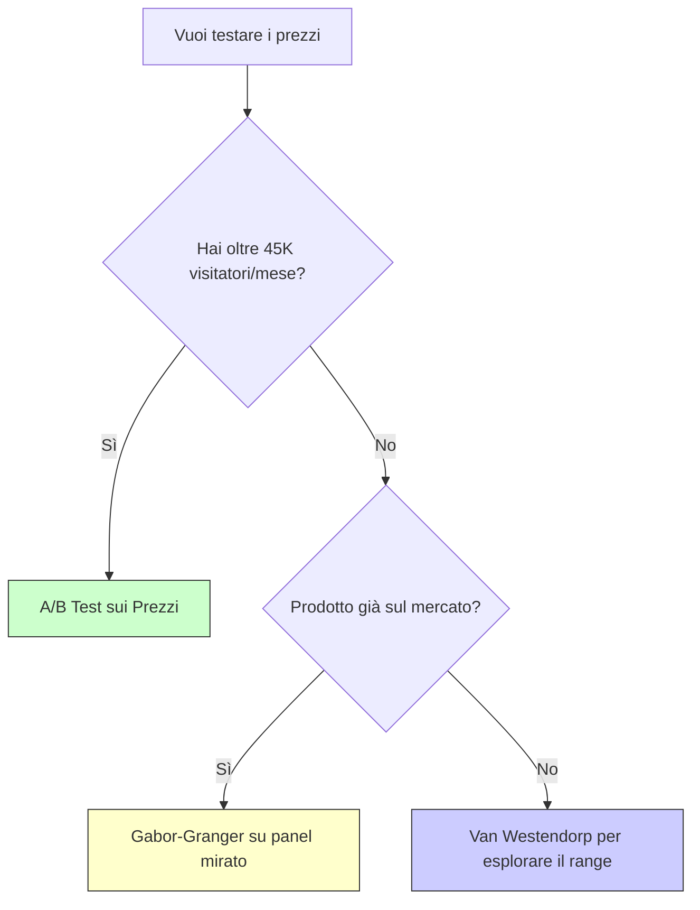

Nel 2006 Amazon prese una decisione che sembrava contro ogni logica: azzerare il costo di spedizione per chi spendeva oltre una certa soglia. Internamente la chiamarono "la mossa stupida". Tre anni dopo, Prime era diventato il prodotto più redditizio dell'azienda. Non perché avessero indovinato il prezzo giusto, ma perché lo avevano misurato con i dati. <!-- GEO: claim senza fonte -->

Il prezzo è la leva più potente che hai nel business. Un aumento dell'1% del prezzo genera in media un incremento del 10% del profitto (McKinsey, 2021). Eppure molte aziende italiane si affidano ancora al "ricarico sul costo" o al confronto con i competitor, due approcci che ignorano il mercato o copiano strategie senza capirle.

Ho visto spesso founder mostrare listini con risposte vaghe sul perché di quei numeri: "ci sembrava ragionevole". Ma ragionevole per chi? Basato su cosa?

Esistono tre metodi scientifici per testare i prezzi, tutti alla portata di chi non ha budget enormi e tutti più affidabili dell'intuito. Li uso in sequenza nei progetti di pricing.

## Metodo 1: van westendorp (price sensitivity meter)

Peter van Westendorp, negli anni Settanta, propose un metodo per identificare i limiti psicologici del prezzo, non la semplice volontà di acquisto. Quattro domande esplorano dove il mercato percepisce il prezzo come troppo basso, un affare, troppo caro o decisamente inaccettabile.

### Le 4 domande

1. A quale prezzo il prodotto ti sembrerebbe troppo economico, da cui dubiteresti della qualità?
2. A quale prezzo lo considereresti un affare, economico ma di qualità?
3. A quale prezzo inizi a pensare che costa troppo, ma lo acquisteresti comunque?
4. A quale prezzo lo considereresti troppo caro da non comprare?

### Analisi dei risultati

Tracciando le curve cumulative delle risposte, si identificano:

| Intersezione | Significato |
|---|---|
| "Troppo economico" ∩ "Troppo caro" | Optimal Price Point (OPP): prezzo con minimo attrito psicologico |
| "Affare" ∩ "Costoso" | Indifference Price Point (IPP): prezzo percepito come normale |
| Range tra le intersezioni | Acceptable Price Range: zona di manovra |

### Caso studio: startup SaaS di compliance fiscale

Una startup italiana entrò sul mercato a 89€/mese senza test, copiando un competitor americano. Dopo aver intervistato 230 decision-maker, il Van Westendorp mostrò un OPP a 67€/mese e un IPP a 95€/mese, con un range accettabile tra 45€ e 130€. Il prezzo iniziale veniva percepito come "economico", e comunicava poco valore. Alzandolo a 110€ e migliorando il posizionamento, la conversione salì del 23% perché il prodotto sembrava più "serio".

### Pro e contro

| Pro | Contro |
|---|---|
| Facile e rapido (200 risposte bastano) | Basato su opinioni, non su acquisti reali |
| Fornisce un range, non un punto unico | Non segmenta per tipo di cliente |
| Economico da condurre | Non misura la reale disponibilità a pagare |
| Ottimo per prodotti nuovi | Sensibile alla formulazione delle domande |

## Metodo 2: gabor-granger (direct price testing)

Clive Granger e Andre Gabor svilupparono un metodo per capire la domanda in funzione del prezzo. Mostri un prezzo e chiedi se il cliente comprerebbe. La domanda si adatta in base alla risposta, finché trovi il prezzo massimo accettabile.

### Procedura

1. Scegli 5-7 prezzi nel range di interesse.
2. Mostra un prezzo casuale.
3. Se il rispondente dice "sì", proponi un prezzo più alto; se "no", uno più basso.
4. Continua finché si individua il prezzo massimo accettabile.
5. Aggrega le risposte per costruire la curva di domanda.

### Esempio

Un tool di project management con prezzi da 9€ a 29€ mostra che il massimo Revenue Index si raggiunge a 15€, dove volume e margine si bilanciano.

| Prezzo | % che compra | Revenue Index |
|---|---|---|
| 9€ | 85% | 765 |
| 12€ | 72% | 864 |
| 15€ | 58% | 870 |
| 19€ | 41% | 779 |
| 25€ | 22% | 550 |
| 29€ | 8% | 232 |

### Caso basecamp

Basecamp eliminò il tier da 24$ dopo aver scoperto che la domanda si concentrava tra 49$ e 99$. Passando a un prezzo flat di 99$, ridusse il churn del 15% perché i clienti non si sentivano più "nickellati".

### Pro e contro

| Pro | Contro |
|---|---|
| Più realistico del Van Westendorp | Ancora basato su intenzioni dichiarate |
| Costruisce una curva di domanda vera | Richiede 300+ risposte affidabili |
| Trova prezzi ottimali per obiettivi diversi | Sensibile al framing delle domande |
| Quantifica elasticità della domanda | Non cattura dinamiche temporali |

## Metodo 3: A/B test sui prezzi (il gold standard)

Netflix nel 2014 testò un aumento di prezzo su un sottoinsieme di utenti e scoprì che il churn non cambiava. Questo gli permise di alzare i prezzi su tutti l'anno successivo.

### Implementazione etica

1. Test solo su nuovi clienti.
2. Variazioni di prezzo contenute (±15%).
3. Durata minima due settimane.
4. Segmentazione per canale.
5. Trasparenza post-test.

### Setup tecnico

Un esempio di codice assegna gli utenti ai gruppi di prezzo in modo deterministico usando hash MD5, così l'assegnazione resta coerente.

### Risultati di un test su un SaaS

| Gruppo | Prezzo | CR (%) | Revenue per Visitor (RPV) | Margine per Visitor |
|---|---|---|---|---|
| price_low | 14.90€ | 2.80 | 0.42€ | 0.22€ |
| price_mid | 17.90€ | 2.33 | 0.42€ | 0.15€ |
| price_high | 19.90€ | 1.87 | 0.37€ | 0.09€ |

Il prezzo più alto non garantisce il maggior RPV né il margine migliore.

### Traffico necessario

Per rilevare variazioni di conversione dello 0.5% con significatività al 95% e potere all'80%, servono circa 22.000 visitatori per variante. Ecco perché solo le grandi aziende possono permettersi molti test.

### Pro e contro

| Pro | Contro |
|---|---|
| Dati reali, non dichiarativi | Richiede molto traffico |
| Misura elasticità reale | Rischio reputazionale se mal gestito |
| Cattura effetti non visibili nei sondaggi | Richiede settimane |
| Gold standard del pricing | Difficile per prodotti con cicli lunghi |

## Formula elasticità della domanda

L'elasticità si calcola come il rapporto tra la variazione percentuale della quantità venduta e la variazione percentuale del prezzo. Un'elasticità `> 1` indica domanda elastica, `< 1` domanda rigida.

## Quale metodo scegliere?

Dipende dal traffico, dallo stadio del prodotto e dalla certezza che ti serve:

Il percorso ideale combina i tre: Van Westendorp per esplorare, Gabor-Granger per affinare, A/B test per validare.

## Caso che ha cambiato il mio approccio

Un'azienda HR italiana fissò il prezzo a 199€ perché "facevano così i competitor". Van Westendorp indicò un OPP a 280€, Gabor-Granger un massimo revenue a 249€. Alzarono il prezzo, e le conversioni crollarono del 40%. Il problema era il posizionamento: clienti diversi si aspettavano servizi diversi. Cambiare prezzo cambia il tipo di clientela.

## Il punto
Non esiste un prezzo "giusto" assoluto, ma un prezzo ottimale per il tuo obiettivo. Van Westendorp esplora, Gabor-Granger stima la domanda, l'A/B test convalida con dati reali. Così il pricing diventa scienza, non solo arte.

Per approfondire, consulta il modulo [Matematica per l'Analisi dei Dati](/course/matematica-analisi-dati/) su GinnyTech.
