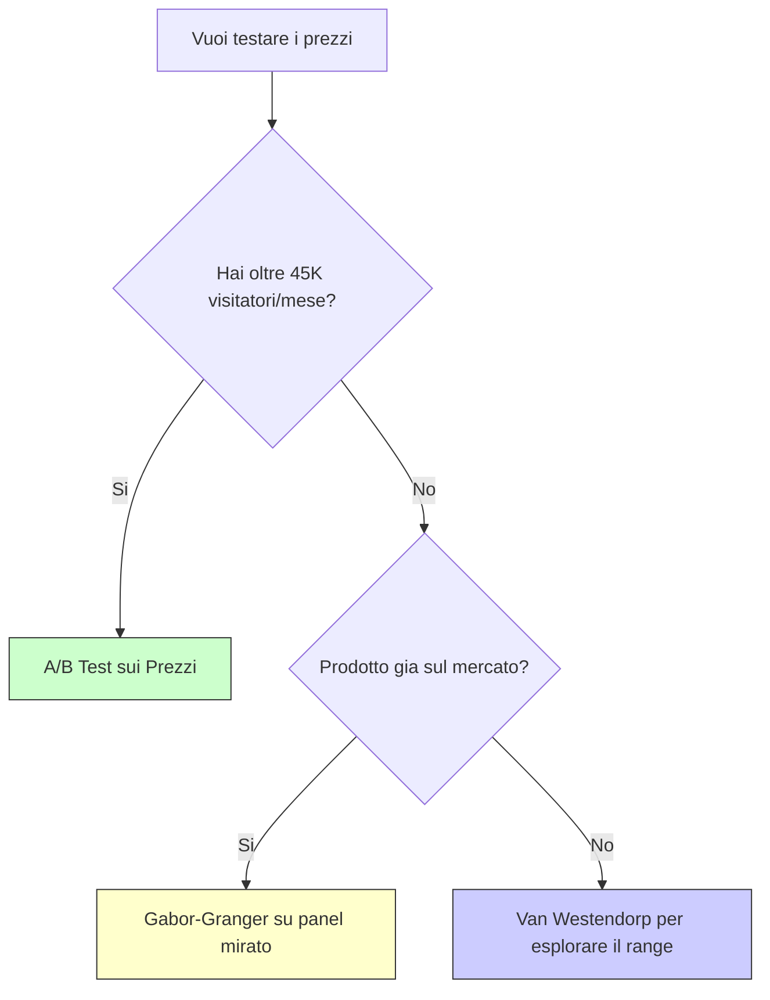

# Pricing Matematico: Come Testare i Prezzi Senza Indovinare

Nel 2006 Amazon prese una decisione apparentemente suicida: abbassare il prezzo di spedizione a zero per chi spendeva sopra una certa soglia. I dirigenti interni la chiamavano "la mossa stupida". Tre anni dopo, Prime era diventato il prodotto piu redditizio della storia dell'azienda — non perche Amazon avesse indovinato il prezzo giusto, ma perche lo aveva misurato con i dati.

Il prezzo e la leva piu potente del business. Un aumento del prezzo dell'1% genera in media un incremento del profitto del 10% (McKinsey, studio su 2.463 aziende globali, 2021). Eppure la stragrande maggioranza delle aziende italiane fissa i prezzi con il metodo del "ricarico sul costo" oppure guardando cosa fa il competitor piu vicino. Entrambi gli approcci sono disastrosi per motivi diversi: il primo ignora completamente il mercato, il secondo copia una strategia che potresti non capire.

Ho lavorato con decine di aziende italiane sul pricing. La scena si ripete sempre uguale: il founder mi mostra il listino, gli chiedo "come hai scelto questo numero?", e la risposta e quasi sempre una versione di "ci sembrava ragionevole". Ragionevole per chi? Basato su cosa?

Esistono tre metodi scientifici per testare i prezzi. Nessuno richiede un dottorato in econometria. Tutti danno risposte migliori dell'intuito. Li uso in sequenza su quasi tutti i progetti di pricing su cui lavoro.

## Metodo 1: Van Westendorp (Price Sensitivity Meter)

Peter van Westendorp era un ricercatore di mercato olandese che negli anni Settanta si pose una domanda semplice: invece di chiedere alle persone *quale* prezzo pagherebbero, perche non chiediamo dove si trovano i loro limiti psicologici? Il metodo che sviluppo nel 1976 e rimasto straordinariamente robusto per cinquant'anni.

Il Van Westendorp e il metodo piu elegante per capire la percezione del prezzo da parte del mercato. Funziona con un semplice questionario di quattro domande che esplorano la psicologia del prezzo, non la volonta di acquisto dichiarata.

### Le 4 Domande

Per il prodotto X:

1. A quale prezzo diresti che e **troppo economico** (e dubiteresti della qualita)?
2. A quale prezzo diresti che e **un affare** (economico ma di qualita)?
3. A quale prezzo diresti che **inizia a costare troppo** (ma lo considereresti ancora)?
4. A quale prezzo diresti che e **decisamente troppo caro** (e non lo compreresti mai)?

La brillantezza del metodo sta nel fatto che queste domande non chiedono "compreresti?" — chiedono dove si trovano i confini psicologici del prezzo. Le persone sono pessime a predire il proprio comportamento d'acquisto, ma sono sorprendentemente accurate nell'identificare i confini della propria percezione.

### Come Analizzare i Risultati

Tracci quattro curve cumulative e cerchi le intersezioni:

| Intersezione | Significato |
|---|---|
| "Troppo economico" ∩ "Troppo caro" | **Optimal Price Point (OPP):** il minimo attrito percepito |
| "Affare" ∩ "Costoso" | **Indifference Price Point (IPP):** il prezzo "normale" per il mercato |
| Range tra le quattro intersezioni | **Acceptable Price Range:** la tua zona di manovra |

### Caso Reale: Startup SaaS di Compliance Fiscale

Ho condotto questa analisi per una startup italiana che aveva sviluppato uno strumento di compliance fiscale per PMI. Erano entrati sul mercato a 89€/mese senza alcun test, basandosi su quanto costava lo strumento del competitor americano adattato al cambio.

Dopo aver intervistato 230 decision-maker di PMI italiane:

| Punto | Prezzo Trovato |
|---|---|
| Optimal Price Point | 67€/mese |
| Indifference Price Point | 95€/mese |
| Range accettabile | 45€ - 130€/mese |
| Soglia di resistenza dura | oltre 150€/mese |

Il risultato fu controintuitivo: erano entrati a 89€ che era tecnicamente nel range accettabile, ma sotto l'Indifference Price Point. Il mercato percepiva il prodotto come "economico" — il che suona bene ma in realta significava che i clienti si aspettavano meno valore. Quando alzarono il prezzo a 110€ e migliorarono il posizionamento, la conversion rate aumento del 23% perche il prodotto sembrava finalmente "serio". Il prezzo piu alto comunicava piu qualita.

Questo e il paradosso del pricing che Van Westendorp aiuta a identificare: a volte il problema non e essere troppo cari, e essere troppo economici.

### Pro e Contro

| Pro | Contro |
|---|---|
| Facile e veloce (200 risposte bastano) | Basato su opinioni, non su acquisti reali |
| Restituisce un range, non un punto singolo | Non distingue per segmento o use case |
| Economico da condurre | Non misura la willingness-to-pay reale |
| Ottimo per prodotti nuovi | Sensibile alla formulazione delle domande |

Il Van Westendorp e il punto di partenza ideale quando non hai ancora dati di transazione o stai lanciando qualcosa di nuovo. Non ti dira il prezzo perfetto, ma ti dira dove non andare.

## Metodo 2: Gabor-Granger (Direct Price Testing)

Clive Granger vinse il Nobel per l'Economia nel 2003 per il suo lavoro sulla previsione delle serie temporali. Ma negli anni Sessanta, insieme a Andre Gabor, aveva sviluppato un metodo molto piu semplice per capire la domanda in funzione del prezzo — un metodo che ancora oggi e il cavallo di battaglia delle ricerche di pricing professionali.

Il Gabor-Granger e piu diretto del Van Westendorp. Presenti un prezzo al rispondente e chiedi: "A questo prezzo, compreresti il prodotto?" La domanda e semplice. La magia e nella struttura sequenziale delle domande.

### Come Funziona

1. Scegli 5-7 punti prezzo che coprono il range che ti interessa (es. 9€, 12€, 15€, 19€, 25€, 29€).
2. Mostra un prezzo casuale al rispondente.
3. Se dice "Si", mostra il prezzo superiore. Se dice "No", mostra il prezzo inferiore.
4. Continua finche trovi il prezzo massimo accettabile per ogni rispondente.
5. Costruisci la curva di domanda aggregando le risposte.

La struttura adattiva elimina il bias di ancoraggio che si avrebbe se mostrassi sempre i prezzi nello stesso ordine.

### Costruire la Curva di Domanda

```python
import pandas as pd

# Simulazione: 500 rispondenti a un tool di project management
# Per ogni prezzo, percentuale che dichiara di comprare
dati_gabor = pd.DataFrame({
    'prezzo': [9, 12, 15, 19, 25, 29],
    'pct_acquisto': [85, 72, 58, 41, 22, 8]
})

# Revenue Index = Prezzo x % Acquisto
# Questo indice cattura il tradeoff tra volume e margine unitario
dati_gabor['revenue_index'] = dati_gabor['prezzo'] * dati_gabor['pct_acquisto']

print(dati_gabor.to_string(index=False))
```

| Prezzo | % che compra | Revenue Index |
|---|---|---|
| 9€ | 85% | 765 |
| 12€ | 72% | 864 |
| **15€** | **58%** | **870** |
| 19€ | 41% | 779 |
| 25€ | 22% | 550 |
| 29€ | 8% | 232 |

Il Revenue Index massimo a 15€ non significa necessariamente che 15€ sia il prezzo ottimale. Significa che e il prezzo ottimale se il tuo obiettivo e massimizzare il revenue totale. Se il tuo obiettivo e massimizzare il profitto, devi inserire i costi. Se il tuo obiettivo e conquistare quota di mercato, potresti scegliere il prezzo che massimizza il volume (9€).

### Il Caso Basecamp

Basecamp ha pubblicato nel 2021 una retrospettiva sul proprio pricing journey. Nei primi anni usavano una struttura a tier (24$/mese, 49$/mese, 99$/mese). Dopo aver condotto un'analisi simile al Gabor-Granger su oltre 1.200 clienti potenziali, scoprirono che il mercato si concentrava quasi interamente nella fascia 49-99$. Eliminarono il tier da 24$ e spostarono tutti su un prezzo flat di 99$ per utenti illimitati. Il churn scese del 15% nel trimestre successivo perche i clienti si sentivano meno "nichelati" ad ogni nuovo utente aggiunto.

### Pro e Contro

| Pro | Contro |
|---|---|
| Piu realistico del Van Westendorp | Ancora dichiarativo ("comprerei" non e "compro") |
| Costruisce una vera curva di domanda | Richiede 300+ rispondenti per essere affidabile |
| Trova il prezzo ottimale per diversi obiettivi | Sensibile al framing della domanda |
| Quantifica l'elasticita della domanda | Non cattura effetti dinamici nel tempo |

## Metodo 3: A/B Test sui Prezzi (Il Gold Standard)

Nell'ottobre 2014 Netflix invio un'email a un sottoinsieme dei propri abbonati americani: il prezzo stava salendo da 7.99$ a 8.99$, ma solo per loro. Non lo dissero esplicitamente — era un test. Quello che impararono in quelle sei settimane cambio per sempre la loro strategia di pricing: il churn a 8.99$ era statisticamente identico a quello a 7.99$. Un anno dopo, aumentarono il prezzo per tutti.

L'A/B test sui prezzi e il gold standard perche non misura intenzioni ma comportamenti reali. Mostri prezzi diversi a gruppi diversi di utenti reali e misuri chi compra davvero, chi resta, chi abbandona.

### Come Implementarlo in Modo Etico

L'A/B test sui prezzi e controverso. Se un cliente scopre di aver pagato piu di un altro per lo stesso prodotto identico, la fiducia e compromessa. Amazon ha subito un boicottaggio nel 2000 proprio per questo motivo, quando emerse che stava facendo price discrimination dinamica sugli stessi DVD.

Le regole per farlo correttamente:

1. **Test solo su nuovi clienti:** Non modificare i prezzi per chi ha gia acquistato.
2. **Variazioni contenute:** Rimani nel ±15% dal prezzo corrente per evitare shock percettivi.
3. **Durata minima due settimane:** Per catturare la variazione settimanale del comportamento.
4. **Segmentazione per canale:** Testa prezzi diversi su canali distinti (Google Ads vs Instagram) invece che sullo stesso canale, per ridurre il rischio che lo stesso utente veda prezzi diversi.
5. **Trasparenza post-test:** Se il test porta a un abbassamento del prezzo, non nasconderlo ai clienti che avevano pagato di piu.

### Setup Tecnico

```python
import hashlib

def assign_price_group(user_id: str, test_name: str) -> str:
    """
    Assegna un utente a un gruppo di prezzo in modo deterministico e riproducibile.

    L'uso dell'hash MD5 garantisce che lo stesso utente venga sempre assegnato
    allo stesso gruppo, anche se la funzione viene chiamata in momenti diversi.
    Questo evita che un utente veda prezzi diversi a ogni visita.

    Args:
        user_id: identificatore univoco dell'utente
        test_name: nome del test (serve per poter fare piu test in parallelo)

    Returns:
        stringa con il nome del gruppo assegnato
    """
    hash_input = f"{user_id}_{test_name}"
    hash_value = int(hashlib.md5(hash_input.encode()).hexdigest(), 16)

    # Divisione in tre gruppi di dimensione uguale
    if hash_value % 3 == 0:
        return "price_low"    # 14.90€ - gruppo controllo
    elif hash_value % 3 == 1:
        return "price_mid"    # 17.90€ - variante 1
    else:
        return "price_high"   # 19.90€ - variante 2

# Risultati dopo 30 giorni su un prodotto SaaS
# 15.000 visitatori per variante, sufficienti per significativita statistica
risultati = {
    'price_low':  {'prezzo': 14.90, 'conversioni': 420, 'visitatori': 15000, 'cr': 2.80},
    'price_mid':  {'prezzo': 17.90, 'conversioni': 350, 'visitatori': 15000, 'cr': 2.33},
    'price_high': {'prezzo': 19.90, 'conversioni': 280, 'visitatori': 15000, 'cr': 1.87},
}

# Revenue Per Visitor e la metrica decisionale corretta —
# combina conversion rate e prezzo in un unico numero confrontabile
print(f"{'Gruppo':<15} {'Prezzo':>8} {'CR':>6} {'RPV':>8} {'Margine/Visitor':>16}")
print("-" * 60)

cogs = 8.0  # Costo variabile per conversione (server, supporto, ecc.)

for group, data in risultati.items():
    rpv = data['prezzo'] * data['cr'] / 100
    margine_per_visitor = (data['prezzo'] - cogs) * data['cr'] / 100
    print(f"{group:<15} {data['prezzo']:>7.2f}€ {data['cr']:>5.2f}% {rpv:>7.2f}€ {margine_per_visitor:>15.3f}€")
```

Questo codice rivela qualcosa di non intuitivo: il prezzo piu alto non e necessariamente quello con il Revenue Per Visitor piu basso. Il gruppo a 19.90€ potrebbe avere un margine per visitor superiore al gruppo a 14.90€ anche con una conversion rate piu bassa, perche il margine unitario e molto piu alto. Devi fare i calcoli per il tuo specifico costo variabile.

### Quanto Traffico Ti Serve

Questa e la domanda che ogni volta viene posta a voce bassa, quasi con imbarazzo. La risposta onesta: molto piu di quanto pensi.

Per rilevare una differenza del 0.5% nel conversion rate (da 2.0% a 2.5%) con:
- Significativita statistica del 95%
- Potere statistico dell'80%

Ti servono circa 22.000 visitatori per variante. Se hai tre varianti, 66.000 visitatori totali. Se il tuo sito riceve 2.000 visitatori al giorno, stai parlando di un mese di test solo per un prodotto, con tutto il traffico concentrato sul test.

Questo spiega perche Amazon, Booking.com e Airbnb possono fare centinaia di A/B test in parallelo e la maggioranza delle startup non puo farne nemmeno uno statisticamente valido.

### Pro e Contro

| Pro | Contro |
|---|---|
| Dati comportamentali reali, non dichiarazioni | Richiede traffico elevato (15K+ per variante) |
| Misura l'elasticita reale della domanda | Rischio etico e reputazionale se mal gestito |
| Cattura effetti che i sondaggi non vedono | Richiede settimane, non giorni |
| Il gold standard della ricerca di pricing | Difficile da fare su prodotti con cicli lunghi |

## Quale Metodo Scegliere?

La risposta dipende da tre variabili: il traffico che hai, se il prodotto esiste gia sul mercato, e quanta certezza ti serve prima di decidere.



In pratica, questi tre metodi non si escludono — si integrano. Il percorso ideale e:

1. **Van Westendorp** nella fase di product discovery, per capire in quale range di prezzo ha senso operare. Costa poco, richiede 200 rispondenti, si fa in una settimana.

2. **Gabor-Granger** per affinare il punto ottimale all'interno del range identificato. Richiede piu rispondenti ma da una curva di domanda quantificabile.

3. **A/B test** per validare con dati reali il prezzo scelto, se hai il traffico necessario. Questo e il momento in cui scopri che la realta spesso sorprende i sondaggi.

## Il Caso che Cambio il Mio Modo di Pensare al Pricing

Nel 2019 stavo lavorando con un'azienda di software HR italiana. Avevano fissato il prezzo a 199€/mese "perche era quello che usavano tutti i competitor". Il Van Westendorp mostro che l'Optimal Price Point del loro mercato era 280€/mese. Il Gabor-Granger confermo che il Revenue Index era massimo a 249€/mese. Alzammo il prezzo.

Il mese successivo le conversioni crollarono del 40%.

Quello che scoprimmo era che il prodotto aveva un problema di posizionamento, non di prezzo. I clienti che convertivano a 199€ erano quelli che stavano cercando qualcosa di economico. Quelli che avrebbero pagato 249€ avevano aspettative diverse — si aspettavano un onboarding dedicato, un account manager, un'integrazione con i propri sistemi HR esistenti — cose che l'azienda non offriva.

Il pricing e un sistema, non un numero. Quando cambi il prezzo, cambi il tipo di cliente che attrai, e devi essere pronto a servire quel cliente diverso.

## Conclusione

Il prezzo "giusto" non esiste in assoluto — esiste il prezzo ottimale per il tuo obiettivo specifico (massimizzare revenue, profitto, quota di mercato, o qualita del cliente acquisito). Questi tre metodi ti danno i dati per decidere con cognizione di causa invece di indovinare.

Van Westendorp per esplorare il territorio. Gabor-Granger per stimare la curva di domanda. A/B test per validare con comportamenti reali. Usali in questa sequenza e il tuo pricing smette di essere un'arte e diventa una scienza applicata.

Ma ricorda sempre il caso che ti ho raccontato: i dati di pricing ti dicono dove il mercato vuole trovarti. Sta a te decidere se sei in grado di servire quel mercato a quel prezzo — e se vuoi farlo.
