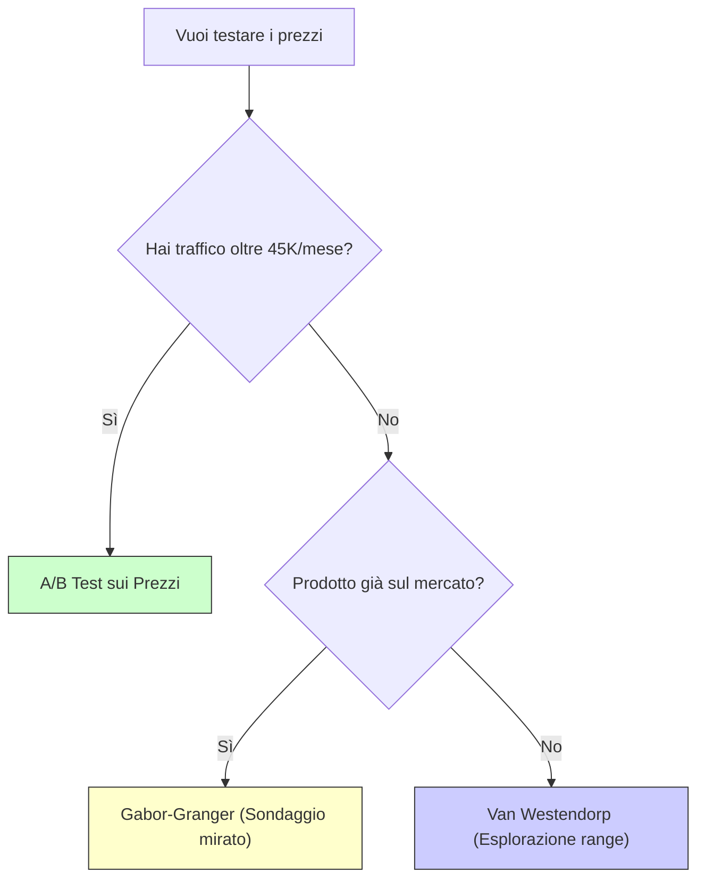

# Pricing Matematico: Come Testare i Prezzi Senza Indovinare

Il prezzo è la leva più potente del business. Un aumento del prezzo dell'1% genera in media un incremento del profitto del 10% (McKinsey). Eppure, la stragrande maggioranza delle aziende italiane fissa i prezzi con il metodo del "ricarico sul costo" o con il "vediamo cosa fa il competitor".

Esistono tre metodi scientifici per testare i prezzi. Nessuno richiede un dottorato. Tutti danno risposte migliori dell'intuito.

## Metodo 1: Van Westendorp (Price Sensitivity Meter)

Il metodo più elegante per capire la **percezione del prezzo** da parte del mercato. Funziona con un semplice questionario di 4 domande.

### Le 4 Domande Magiche

Per il prodotto X:
1.  A quale prezzo diresti che è **troppo economico** (e dubiteresti della qualità)?
2.  A quale prezzo diresti che è **un affare** (economico ma di qualità)?
3.  A quale prezzo diresti che **inizia a costare troppo** (ma lo considereresti ancora)?
4.  A quale prezzo diresti che è **decisamente troppo caro** (e non lo compreresti mai)?

### Come Analizzare i Risultati

Tracci 4 curve cumulative e cerchi le intersezioni:

| Intersezione | Significato |
|---|---|
| "Troppo economico" ∩ "Troppo caro" | **Optimal Price Point (OPP):** prezzi sotto questo punto resistono di più |
| "Affare" ∩ "Costoso" | **Indifference Price Point (IPP):** il prezzo che il mercato considera "normale" |
| Range tra le 4 intersezioni | **Acceptable Price Range:** la tua zona di manovra |

### Esempio Pratico: App di Fitness Premium

Chiedi a 200 utenti italiani. Risultati:

| Punto | Prezzo Trovato |
|---|---|
| Optimal Price Point | 9,90€/mese |
| Indifference Price Point | 14,90€/mese |
| Range accettabile | 7€ - 22€/mese |
| Punto di resistenza massima | > 25€/mese |

**Insight:** Il mercato vede 14,90€ come il prezzo "normale". Se stai vendendo a 19,90€, sei nella parte alta del range — accettabile, ma con attrito. Se stai a 29,90€, sei **fuori mercato** per la maggior parte dei potenziali clienti.

### Pro e Contro

| Pro | Contro |
|---|---|
| Facile e veloce (200 risposte bastano) | Basato su opinioni, non su acquisti reali |
| Dà un range, non un singolo punto | Non distingue per segmento |
| Poco costoso | Non misura la willingness-to-pay reale |

## Metodo 2: Gabor-Granger (Direct Price Testing)

Più diretto del Van Westendorp. Presenti un prezzo al rispondente e chiedi: "A questo prezzo, compreresti il prodotto?"

### Come Funziona

1.  Scegli 5-7 punti prezzo (es. 9€, 12€, 15€, 19€, 25€, 29€).
2.  Mostra un prezzo casuale al rispondente.
3.  Se dice "Sì", mostra il prezzo superiore. Se dice "No", mostra il prezzo inferiore.
4.  Continua finché trovi il prezzo massimo accettabile per ogni rispondente.

### Costruire la Curva di Domanda

```python
import pandas as pd

# Simulazione: 500 rispondenti
# Per ogni prezzo, % che dichiara di comprare
dati_gabor = pd.DataFrame({
    'prezzo': [9, 12, 15, 19, 25, 29],
    'pct_acquisto': [85, 72, 58, 41, 22, 8]
})

# Revenue Index = Prezzo × % Acquisto
dati_gabor['revenue_index'] = dati_gabor['prezzo'] * dati_gabor['pct_acquisto']
print(dati_gabor)
```

| Prezzo | % che compra | Revenue Index |
|---|---|---|
| 9€ | 85% | 765 |
| 12€ | 72% | 864 |
| **15€** | **58%** | **870** ← Massimo |
| 19€ | 41% | 779 |
| 25€ | 22% | 550 |
| 29€ | 8% | 232 |

**Risultato:** Il prezzo ottimale per massimizzare il revenue è **15€** (Revenue Index più alto). A 19€ guadagni meno per ordine più margine, ma perdi troppi clienti.

### Pro e Contro

| Pro | Contro |
|---|---|
| Più realistico del Van Westendorp | Ancora dichiarativo ("comprerei" ≠ "compro") |
| Costruisce una curva di domanda | Richiede 300+ rispondenti |
| Trova il prezzo ottimale per il revenue | Sensibile al framing della domanda |

## Metodo 3: A/B Test sui Prezzi (Il Gold Standard)

Niente opinioni. Niente dichiarazioni. Solo **comportamento reale**: mostri prezzi diversi a gruppi diversi di utenti e misuri chi compra davvero.

### Come Implementarlo in Modo Etico

L'A/B test sui prezzi è controverso. Se un cliente scopre di aver pagato più di un altro per lo stesso prodotto, perde fiducia. Ecco come farlo in modo etico:

1.  **Test su nuovi clienti:** Testa solo su utenti che non hanno mai visto il prezzo precedente.
2.  **Variazioni piccole:** Max ±15% dal prezzo corrente.
3.  **Durata minima 2 settimane:** Per catturare il ciclo settimanale.
4.  **Segmenta per canale:** Offri un prezzo diverso su un canale nuovo (es. prezzo X su Google Ads, prezzo Y su Instagram).
5.  **Post-rimborso:** Se un utente ha pagato il prezzo più alto e il test conferma il prezzo più basso, offri un rimborso della differenza (opzionale ma etico).

### Setup Tecnico (semplificato)

```python
# Logica di assegnazione al gruppo di test
import hashlib

def assign_price_group(user_id: str, test_name: str) -> str:
    """Assegna un utente a un gruppo di prezzo in modo deterministico."""
    hash_input = f"{user_id}_{test_name}"
    hash_value = int(hashlib.md5(hash_input.encode()).hexdigest(), 16)
    
    if hash_value % 3 == 0:
        return "price_low"    # 14.90€
    elif hash_value % 3 == 1:
        return "price_mid"    # 17.90€
    else:
        return "price_high"   # 19.90€

# Risultati dopo 30 giorni
risultati = {
    'price_low':  {'prezzo': 14.90, 'conversioni': 420, 'visitatori': 15000, 'cr': 2.80},
    'price_mid':  {'prezzo': 17.90, 'conversioni': 350, 'visitatori': 15000, 'cr': 2.33},
    'price_high': {'prezzo': 19.90, 'conversioni': 280, 'visitatori': 15000, 'cr': 1.87},
}

# Revenue per visitor (metrica decisionale)
for group, data in risultati.items():
    rpv = data['prezzo'] * data['cr'] / 100
    margine = (data['prezzo'] - 8) * data['cr'] / 100  # COGS = 8€
    print(f"{group}: RPV = {rpv:.2f}€, Margine/Visitor = {margine:.3f}€")
```

### Pro e Contro

| Pro | Contro |
|---|---|
| Dati reali, non opinioni | Richiede traffico elevato (~15K+ per variante) |
| Misura elasticità reale | Rischio etico/reputazionale |
| Il gold standard | Più lento (settimane) |

## Quale Metodo Scegliere?



## Conclusione

Il prezzo "giusto" non esiste in assoluto — esiste **il prezzo ottimale per il tuo obiettivo** (massimizzare revenue, profitto, o market share). Questi tre metodi ti danno i dati per decidere. Van Westendorp per esplorare, Gabor-Granger per stimare, A/B test per validare. Usali in sequenza e il tuo pricing diventerà una scienza, non un'arte.
