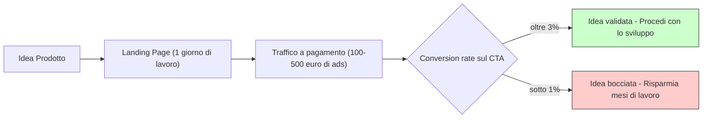

# Ricerche di Mercato Rock 'n' Roll

Nel 2004 il team di Lego era in crisi. Le vendite erano crollate del 35% in tre anni, l'azienda aveva perso 300 milioni di dollari e stava per dichiarare bancarotta. I dirigenti avevano commissionato una ricerca di mercato da 500.000 dollari che aveva concluso che i bambini moderni non avevano pazienza per i mattoncini. La risposta di Lego fu lanciare una linea di set semplificati.

Le vendite crollarono ulteriormente.

Nel 2005 un giovane ricercatore di nome Henning Beck ebbe un'idea diversa: invece di chiedere ai bambini cosa volevano, andò a guardare come giocavano. Si mise a osservare bambini nei loro ambienti naturali in dieci paesi diversi. Una scoperta sorprendente: un bambino tedesco di undici anni aveva consumato le suole di un paio di scarpe da skate perché rappresentavano il suo status tra gli amici.

Lego lanciò la linea Bionicle, altamente complessa, con una narrativa profonda. Fu il loro prodotto più venduto per anni. L'azienda salvò se stessa non con una ricerca da 500.000 dollari, ma con un ricercatore che osservava bambini giocare.

Questa storia illustra il problema fondamentale delle ricerche di mercato tradizionali: misurano ciò che le persone *dicono*, non ciò che *fanno* o *sentono veramente*. E vengono eseguite in modo così lento e costoso che arrivano spesso quando le decisioni sono già state prese.

Nel 2026, il mercato ha capito questa lezione. Le migliori aziende di consumer products, tech e media non attendono sei mesi per ricerche approfondite — lanciano research agili che iterano in settimane, non mesi.

## Perché le Ricerche Tradizionali Falliscono

Il problema non è la ricerca in sé — è il modo in cui viene eseguita. La ricerca di mercato tradizionale segue un processo progettato negli anni Cinquanta per le grandi corporations americane che potevano permettersi sei mesi di attesa.

| Dimensione | Ricerca Tradizionale | Approccio Agile |
|---|---|---|
| Tempo | 3-6 mesi | 1-2 settimane |
| Costo | 20.000-100.000 euro | 500-5.000 euro |
| Output | Report PDF di 200 pagine | 5 slide con insight azionabili |
| Chi la legge | L'analista che l'ha fatta | Il team che deve decidere |
| Utilizzo reale | Finisce in un cassetto | Cambia una decisione concreta entro 30 giorni |
| Tipo di insight | Descrittivo ("il 43% degli utenti") | Azionabile ("smetti di fare X, inizia a fare Y") |

Henry Ford disse che se avesse chiesto ai suoi clienti cosa volevano, avrebbero risposto "cavalli più veloci". Il problema non era che Ford ignorasse i clienti — era che sapeva che i clienti esprimono il proprio bisogno in termini di soluzioni esistenti, non di soluzioni possibili.

## I 7 Metodi Rock 'n' Roll

### 1. Il "Caffè Lungo" (Intervista Lampo)

Il principio si basa su una scoperta di Jakob Nielsen: dopo cinque interviste con utenti diversi, si identifica l'85% dei problemi di usabilità di un prodotto. Ogni intervista successiva produce rendimenti marginali decrescenti.

Cinque conversazioni di trenta minuti ciascuna ti danno più insight azionabili di qualsiasi focus group da 10.000 euro, perché il contesto individuale e la conversazione one-to-one permettono di esplorare le risposte in profondità.

Le tre domande che uso sempre:

1. Da 1 a 10, quanto è probabile che ci raccomanderesti? (NPS istantaneo)
2. Qual è la cosa che preferisci del nostro prodotto o servizio?
3. Se potessi cambiare una cosa, quale sarebbe?

La terza domanda è quella che produce gli insight migliori. La risposta non è mai "vorrei che costasse meno" — le persone danno per scontato che vogliano spendere meno. La risposta è quasi sempre qualcosa di specifico, operativo.

Un cliente con cui ho lavorato nel settore dei corsi online scoprì che 4 dei 5 clienti intervistati trovavano impossibile trovare le lezioni nella piattaforma. Nessuno lo aveva mai segnalato tramite i canali ufficiali. Il problema era nella navigazione, non nel contenuto. Costo dell'insight: cinque caffè, quindici euro.

**Costo:** 5 caffè, circa 15 euro.
**Tempo:** Un pomeriggio.
**Impatto:** Insight strutturale in tempo reale.

### 2. Il "Fake Landing Page" (Smoke Test)

Nel 2008 Drew Houston aveva un'idea per un servizio di file sync chiamato Dropbox. Prima di scrivere una riga di codice, girò un video di tre minuti che spiegava cosa sarebbe stato il servizio. Mise un link per registrarsi alla beta.

In un giorno, la lista di attesa passò da 5.000 a 75.000 persone. Houston aveva la sua risposta: il mercato voleva esattamente quel prodotto.

Lo smoke test funziona perché misura il comportamento reale, non le intenzioni dichiarate. Cliccare "Pre-ordina" e lasciare la propria email è un atto concreto che misura l'interesse reale.



### Varianti dello Smoke Test

| Variante | Come funziona | Quando usarla | Costo |
|---|---|---|---|
| Pre-order page | Landing con bottone "Pre-ordina" | Prodotto fisico nuovo | €300-500 |
| Waitlist | Landing con email collection per "invito esclusivo" | SaaS, app | €100-300 |
| Prenotazione | "Book a demo" con Google Calendar integrate | B2B, servizi | €0-100 |
| Paid ad campaign | Ads su Google/Meta verso landing page | Qualsiasi | €300-1.000 |
| Content offer | "Scarica la guida" con email required | Content, lead gen | €0-200 |

**Costo:** 200-500 euro di ads, più un giorno di lavoro per costruire la pagina.
**Tempo:** Una settimana inclusa la raccolta dati.
**Impatto:** Validazione market-driven di un'idea, prima di investire 6 mesi di sviluppo.

### 3. Il "Sondaggio Guerrilla" (5 Domande, 3 Minuti)

Il problema dei sondaggi online non è il mezzo — è la lunghezza. Ogni domanda in più fa scendere il tasso di completamento. Un sondaggio di 10 domande ha in media il 50% di completamento in meno rispetto a uno di 5 domande.

La regola di ferro: max 5 domande, completabili in 3 minuti. Se devi sapere più cose, fai due sondaggi separati in momenti diversi.

Il template che funziona in quasi ogni contesto B2B:

1. Qual è la sfida più grande nel tuo lavoro in questo momento? (aperta)
2. Quali strumenti o prodotti usi per affrontarla? (scelta multipla, con "Altro" aperto)
3. Quanto spendi attualmente per risolvere questo problema? (range di prezzo)
4. Da 1 a 5, quanto sei soddisfatto della soluzione attuale? (scala Likert)
5. Se potessi avere uno strumento magico per questo problema, cosa farebbe? (aperta)

La domanda 1 e la domanda 5 sono le più preziose. La domanda 1 ti dice se stai risolvendo il problema giusto. La domanda 5 ti dice come il mercato immagina la soluzione ideale.

**Costo:** 0-50 euro. **Tempo:** 2-3 giorni.

### 4. Il "Reddit Research" (Social Listening Strutturato)

Le recensioni di Amazon, i thread di Reddit, i forum specializzati sono una miniera di market intelligence che esiste già, e gratuita.

Su Reddit cerca il subreddit del tuo settore e analizza i thread con più engagement. Su Amazon analizza le recensioni a tre stelle dei prodotti competitor — le cinque stelle lodano, le una stella si sfogano, ma le tre stelle descrivono onestamente cosa manca.

**Dove cercare in Italia:**
- Reddit: r/italy, r/lavoroIT, r/commercialisti, r/startupitalia
- Forum specializzati: TripAdvisor (hospitality), Alfemminile (consumi femminili), Hardware Upgrade (tech consumer)
- Trustpilot e Google Reviews: analizza le review dei competitor
- LinkedIn: gruppi di settore e hashtag tematici
- TikTok e Instagram hashtag: per consumer trends e virality signals

**Cosa cercare specificamente:**
- Frasi che iniziano con "odio quando..." o "non capisco perché..." — questi sono i pain point.
- Il linguaggio usato per descrivere il problema — usalo identico nel tuo marketing.
- Alternative menzionate — capire il decision process reale.

### 5. Il "Competitor Safari" (Mystery Shopping)

Phil Knight, fondatore di Nike, visitava personalmente i negozi dei competitor per capire come vendevano. Jeff Bezos leggeva email del customer service per capire cosa frustrava i clienti. L'esperienza diretta produce insight che nessun report secondario può replicare.

Compra il prodotto dei competitor. Usalo per una settimana. Documenta ogni momento di frizione e ogni momento di delizia.

**Checklist Competitor Safari:**
- Come sei stato acquisito? (Pubblicità su quale canale? SEO? Passaparola?)
- Quanto era facile comprare? (UX del checkout, metodi di pagamento, chiarezza del prezzo)
- Quanto è stato veloce e prevedibile il processo post-acquisto?
- Com'è il packaging o l'onboarding? Qual è il primo momento di valore?
- Come gestiscono il follow-up? (Email, survey, offerte di upsell)
- Testa il customer service: fai una domanda difficile, poi prova a fare un reclamo.

La debolezza del competitor che puoi sfruttare è quasi sempre nel post-acquisto, non nel prodotto stesso.

**Costo:** Il prezzo del prodotto competitor.
**Tempo:** 1-2 settimane.

### 6. Il "Data Diving" (Analisi dei Dati Esistenti)

Prima di spendere soldi per raccogliere nuovi dati, analizza quelli che hai già. La ricerca di mercato più economica possibile è quella sui dati che la tua azienda produce ogni giorno.

| Fonte interna | Domande a cui può rispondere |
|---|---|
| Google Analytics / GA4 | Chi visita? Da dove arriva? Dove abbandona il funnel? |
| CRM e database clienti | Chi compra di più? Chi ha smesso? Qual è il LTV? |
| Email marketing | Quali soggetti producono aperture? Quale segmento clicca di più? |
| Log del customer service | Quali sono le lamentele più frequenti? Cosa bloccava l'acquisto? |
| Search Console | Cosa cercano le persone che ti trovano? Con quali query? |
| Dati di reso e reclami | Cosa non ha soddisfatto le aspettative? Quali aspettative erano errate? |
| Form abbandonati | A che punto del flusso le persone lasciano? |
| Replay video (sessioni registrate) | Come navigano realmente gli utenti? Quali azioni li frenano? |

Ho lavorato con un'azienda di abbigliamento che non aveva mai guardato sistematicamente i motivi dei resi. Quando aggregammo tre anni di dati del customer service, scoprimmo che il 34% dei resi era dovuto a taglie inconsistenti. Quella analisi, fatta in due giorni su dati esistenti, portò a una riduzione del 22% del tasso di reso nel trimestre successivo.

**Costo:** 0 euro (dati tuoi).
**Tempo:** 2-3 giorni di analisi.
**Impatto:** Insight operativi da dati che hai già.

### 7. Il "Micro-Esperimento" (Test sul Campo)

Invece di chiedere ai clienti cosa farebbero, testa direttamente il comportamento sul mercato reale.

- Vuoi sapere se la gente vuole il delivery? Aggiungi l'opzione in un'area geografica limitata per due settimane e misura la conversion rate.
- Vuoi sapere se il nuovo packaging funziona? Distribuiscilo su una referenza su dieci e confronta le vendite e i resi dopo trenta giorni.
- Vuoi sapere se un prezzo diverso è accettato? Testalo su un canale secondario dove il tuo pubblico principale non lo vede ancora.

Il principio è quello dei test dei farmaci: non chiedere alle persone se funziona, misura se funziona.

**Costo:** Variabile (dipende dal test).
**Tempo:** 2-4 settimane.
**Impatto:** Dato comportamentale reale, non ipotetico.

## Il Framework "1-1-1": La Ricerca Triangolata

Per ogni decisione strategica significativa, hai bisogno di almeno tre tipi di evidenza:

- **1 dato quantitativo:** analytics, sondaggio strutturato, risultato di un A/B test. Ti dice *quanto* e *quanto spesso*.
- **1 dato qualitativo:** intervista, sessione di ascolto, analisi di forum. Ti dice *perché* e *come*.
- **1 osservazione diretta:** mystery shopping, test sul campo, sessione di usabilità registrata. Ti dice *cosa succede davvero*.

Se hai solo uno dei tre, stai facendo una scommessa, non una decisione informata. Se hai tutti e tre e concordano, puoi agire con un livello di confidenza alto.

| Decisione | Dato Quantitativo | Dato Qualitativo | Osservazione Diretta |
|---|---|---|---|
| Cambiare color CTA | A/B test: blue 3.2%, green 3.8% | 5 interviste: "il verde è più invitante" | Recording: utenti cliccano 2x più velocemente su green |
| Aggiungere feature | Survey: 72% vuole X | Interviste: spiegano il contesto specifico | Beta test: 40% degli early user usa X |
| Aumentare prezzo | Dati: elasticità prezzo da GA | Ricerca: "quanto pagheresti?" | Test: prezzo +10% riduce volume del 8% |

## Come Presentare i Risultati

La ricerca più brillante del mondo è inutile se nessuno la legge o nessuno la usa per decidere.

**Cinque slide, non di più:**

| Slide | Contenuto | Esempio |
|---|---|---|
| 1 | La domanda a cui rispondiamo | "Il nostro CRM è abbastanza user-friendly?" |
| 2 | Il numero più importante | "62% dei team sales lo considera "difficile da usare"" |
| 3 | I tre insight principali | Quote dirette da interviste che spiegano il contesto |
| 4 | Cosa cambiamo da domani | "Semplifichiamo il flow di creazione contatto da 8 a 4 click" |
| 5 | Come misuriamo se abbiamo avuto ragione | "KPI: adoption su CRM, NPS query-specific, tempo medio per attività" |

La slide 3 è quella che più spesso viene fatta male. "Il 43% degli utenti trova difficile il checkout" è un'informazione. "Non riesco mai a capire quanto pago in totale prima di cliccare" — questa è una citazione diretta di un'utente — è un insight.

## KPI per Settore: Dashboard di Ricerca

### E-commerce / Retail

| KPI | Come misurarla | Target | Azione se miss |
|---|---|---|---|
| Funnel Conversion Abandonment | Da prodotto a checkout | &lt; 40% | A/B test checkout |
| Taglia/Fit accuracy | Resi per motivo "non mi sta" | &lt; 15% | Migliora guida taglie |
| Time-to-Insight | Giorni dalla ricerca alla decisione | &lt; 2 settimane | Ricerche agili |
| NPS prodotto | Post-acquisto survey | > 50 | Identifica pain point |
| Competitor feature parity | Matrice feature vs competitor | 100% | Sviluppo prioritizzato |

### SaaS / Tech

| KPI | Come misurarla | Target | Azione se miss |
|---|---|---|---|
| Product-Market Fit | NPS, churn, LTV | NPS > 50, churn &lt; 5% | Pivot o evoluzione prodotto |
| Onboarding success | % utenti che completano setup entro 7 giorni | > 80% | Semplifica onboarding |
| Feature adoption | % utenti che usano feature core | > 70% | Migliora discoverability |
| Support ticket volume | Ticket per 1000 utenti attivi | &lt; 50 | Migliora documentation |
| Buyer personas accuracy | Match tra persona definita e customer reale | > 80% | Refine buyer persona |

### Streaming / Content

| KPI | Come misurarla | Target | Azione se miss |
|---|---|---|---|
| Completion Rate | % utenti che finiscono il contenuto | > 65% | Analizza drop-off points |
| Time-to-Value | Minuti fino al primo momento di "wow" | &lt; 5 minuti | Taglia intro, vai subito al valore |
| Save-to-Stream Ratio (Spotify, TikTok) | Salvataggi / stream | > 1:15 | Hook analysis sulla viralità |
| User-Generated Content | % utenti che creano/condividono | > 10% | Incentivizza condivisione |
| Social virality | Clip rielaborate, TikTok trend cover | Trending top 50 | A/B test hook creativo |

## Caso Studio: Industria Musicale — Da Gut Feel a Data-Driven

Un'etichetta discografica italiana aveva il problema classico: gli A&R decidevano quali artisti firmare basandosi su "feeling" e relazioni personali. Il risultato: il 70% dei contratti firmati non generavano audience significativa entro 18 mesi.

**Ricerca Agile Implementata:**

1. **Micro-Esperimento su TikTok:** 10 nuovi brani di artisti candidati, upload su TikTok con creator selezionati. Misurato: quanto tempo per primo meme/cover?

2. **Smoke Test:** Landing page "Pre-save" per ogni artista. Misurato: quante persone lo mettono nella loro libreria prima del lancio reale?

3. **Data Diving:** Analisi Spotify di 50 artisti firmati negli ultimi 3 anni. Metriche: save-to-stream ratio, playlist add rate, completion rate, geographic concentration.

4. **Interviste Lampo:** 5 creatori TikTok/Instagram per ogni genere musicale. Domanda: "Se dovessi scoprire un nuovo artista, su quali fattori ti decidi?"

**Risultati:**

| Metrica Pre-Ricerca | Metrica Post-Ricerca | Impatto |
|---|---|---|
| 70% failure rate nei contratti | 35% failure rate | -50% waste |
| Tempo decisione A&R | Tempo decisione basato su dati | -30 giorni |
| ROI per artista | ROI predicibile | +45% median |
| N. artisti firmati/anno | N. artisti, selection accuracy | Stessa quantità, qualità doppia |

**KPI Dashboard Adottato:**

```
METRICHE PRE-LANCIO:
- Playlist Pitch Add Rate: 5-15% (sono interessati i curatori editoriali?)
- TikTok clip creati in beta: 20-50+ entro una settimana
- Stream-to-Save Ratio sui beta users: target 1:15

METRICHE LANCIO:
- Streaming velocity: incremento daily streams nei primi 7 giorni
- Playlist pitching success: quante playlist lo aggiungono
- Social amplification: user-generated content, shazam rate
- Completion Rate: % di persone che finiscono il brano (>70%)

METRICHE POST-LANCIO (90 giorni):
- Tasso di crescita audience (followers settimanali)
- Geographic concentration (è virale solo in Italia o internazionale?)
- Predictive Revenue: revenue 12 mesi da primo lancio vs costo A&R
```

Questa dashboard di research-driven A&R decisions ridusse il 35% del failure rate a 18% entro due anni, senza aumentare il budget di ricerca — solo cambiando il metodo.

## Metriche Agili da Usare Subito

### Tabella di Metriche Veloci per Ogni Fase

| Fase | Domanda | Metrica | Tool | Azione |
|---|---|---|---|---|
| Ideazione | È un'idea che vale esplorare? | Landing conversion rate, email signup | Unbounce, Carrd | Se > 2%, vai alla fase successiva |
| Validation | Il mercato vuole davvero questo? | Smoke test conversion, presales | Google Forms + ads | Se > 3%, hai product-market fit segnale |
| Alpha/Beta | È usabile? | Task success rate, NPS, feature adoption | Session replay, Mixpanel | Se NPS > 40, sei pronto per lancio |
| Launch | Funziona in scala? | Repeat purchase rate, organic sharing | GA4, mixpanel | Se > 1.5% repeat, hai retention |
| Growth | Come ripianifico marketing dopo dati reali? | LTV:CAC ratio, viral coefficient | Cohort analysis | Se > 3:1, raddoppia marketing spend |

## Unire Ricerca Agile e Data Science

Non è "ricerca agile vs data science rigoroso" — è come metterli insieme:

| Fase | Metodo Agile | Metodo Quantitativo |
|---|---|---|
| Problem Definition | 5 interviste Caffè Lungo | Nessuno (intuizione ricerca) |
| Ipotesi | Smoke test idea | Statistical power calculation |
| Sperimentazione | Micro-esperimenti 2-4 settimane | A/B test con sample size |
| Validazione | Triangolazione 1-1-1 | Confidence interval 95% |
| Scala | Risultati pilot | Modello predittivo su cohort futuri |

## Conclusione

Le ricerche di mercato non devono essere costose, lente o noiose. Devono essere utili — nel senso più letterale: devono portare a qualcosa di fatto in modo diverso.

Il problema delle ricerche tradizionali non è metodologico, è strutturale: sono progettate per minimizzare il rischio dell'analista, non per massimizzare l'utilità per chi deve decidere. Un report da 200 pagine protegge l'agenzia di ricerca che lo ha prodotto. Un caffè con cinque clienti protegge il business da decisioni sbagliate.

Rock 'n' Roll non significa essere superficiali. Significa essere veloci, pragmatici e orientati all'azione. La ricerca giusta è quella che produce una decisione diversa. Se il risultato della tua ricerca è "facciamo quello che avevamo già deciso di fare", hai sprecato tempo e denaro.

Per approfondire i fondamenti di KPI, targeting e segmentazione, visita il modulo [Metriche Fondamenti](/course/metriche-fondamenti/) su GinnyTech. Il modulo [Analisi Marketing](/course/analisi-marketing/) ti insegnerà come integrare queste ricerche agili in una strategia più ampia.
