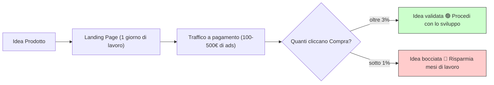

# Ricerche di Mercato Rock 'n' Roll

Le ricerche di mercato hanno un problema di reputazione. La parola stessa evoca immagini di report di 200 pagine che nessuno legge, questionari interminavili e presentazioni PowerPoint con 47 slide di grafici a torta. Il risultato? Manager che preferiscono l'intuito ("io il mercato lo conosco") a dati che arrivano troppo tardi e costano troppo.

Ma non deve essere così. Le ricerche di mercato possono essere **veloci, economiche e perfino divertenti**. Ecco come.

## Perché le Ricerche Tradizionali Falliscono

| Problema | Ricerca Tradizionale | Ricerca Rock 'n' Roll |
|---|---|---|
| **Tempo** | 3-6 mesi | 1-2 settimane |
| **Costo** | 20.000-100.000€ | 500-5.000€ |
| **Output** | Report PDF di 200 pagine | Dashboard + 5 slide con insight azionabili |
| **Chi la legge** | L'analista che l'ha fatta | Il CEO il lunedì mattina |
| **Utilizzo** | Finisce in un cassetto | Cambia una decisione concreta |

## I 7 Metodi Rock 'n' Roll

### 1. Il "Caffè Lungo" (Intervista Lampo)

Invece di organizzare focus group costosi, invita **5 clienti** a prendere un caffè. Fai solo 3 domande:

1.  Da 1 a 10, quanto è probabile che ci raccomanderesti? (NPS rapido)
2.  Qual è la cosa che preferisci del nostro prodotto/servizio?
3.  Se potessi cambiare una cosa, quale sarebbe?

**Costo:** 5 caffè = 15€.
**Tempo:** Un pomeriggio.
**Valore:** Più di qualsiasi focus group da 10.000€, perché senti il **linguaggio reale** dei clienti.

### 2. Il "Fake Landing Page" (Smoke Test)

Vuoi sapere se un nuovo prodotto funzionerebbe? Non "Saresti interessato?" (tutti dicono sì). Costruisci una **landing page finta** con un pulsante "Compra Ora" o "Pre-ordina". Misura quanti cliccano.

*   **Costo:** 200-500€ + 1 giorno di lavoro.
*   **Tempo:** 1 settimana (inclusa raccolta dati).
*   **Valore:** Scopri se il mercato vuole il prodotto **prima** di costruirlo.

### 3. Il "Sondaggio Guerrilla" (5 Domande, 3 Minuti)

Niente questionari di 40 domande. Max **5 domande**, completabili in 3 minuti. Invia via email alla tua lista clienti o su social media.

**Template universale:**
1.  Qual è la sfida più grande nel tuo lavoro in questo momento? (aperta)
2.  Quali strumenti/prodotti usi per affrontarla? (scelta multipla)
3.  Quanto spendi attualmente per risolvere questo problema? (range)
4.  Da 1 a 5, quanto sei soddisfatto della soluzione attuale? (scala)
5.  Se potessi avere uno strumento magico, cosa farebbe? (aperta)

**Tool:** Google Forms (gratis) o Typeform (per UX migliore).
**Costo:** 0-50€.
**Tempo:** 2-3 giorni di raccolta.

### 4. Il "Reddit Research" (Social Listening)

I tuoi clienti parlano **già** dei tuoi prodotti (e di quelli dei competitor) online. Devi solo ascoltare.

**Dove cercare in Italia:**
*   **Reddit:** subreddit italiani di settore (r/italy, r/commercialisti, r/ItaliaPersonalFinance).
*   **Forum specializzati:** TripAdvisor (hospitality), Alfemminile (consumi femminili), Hardware Upgrade (tech).
*   **LinkedIn:** Cerca hashtag e gruppi di settore.
*   **Trustpilot / Google Reviews:** Analizza le review dei competitor.

**Cosa cercare:**
*   Pain point ricorrenti ("odio quando...").
*   Linguaggio usato per descrivere il problema (usa queste parole nel tuo marketing!).
*   Alternative menzionate ("ho provato X ma alla fine uso Y").

### 5. Il "Competitor Safari" (Mystery Shopping)

Compra il prodotto dei competitor. Usalo. Documenta l'esperienza. Nessun report accademico equivale all'**esperienza diretta**.

**Checklist Competitor Safari:**
*   Come ti hanno acquisito? (Pubblicità? SEO? Passaparola?)
*   Quanto è stato facile comprare? (Checkout, pagamento, UX)
*   Quanto è veloce la consegna?
*   Com'è il packaging/unboxing?
*   Com'è il follow-up? (Email, survey, offerte)
*   Come gestiscono un reclamo? (Testa il customer service)

**Costo:** Il prezzo del prodotto competitor.
**Tempo:** 1-2 settimane.
**Valore:** Inestimabile. Scopri le debolezze del competitor che nessun report ti dirà.

### 6. Il "Data Diving" (Analisi Dati Esistenti)

La ricerca di mercato più economica è quella sui dati che **hai già**. Prima di spendere soldi per raccogliere nuovi dati, analizza quelli che possiedi:

| Fonte Interna | Insight Possibile |
|---|---|
| Google Analytics | Chi sono i tuoi visitatori? Da dove arrivano? Dove abbandonano? |
| CRM / Database Clienti | Chi compra di più? Chi ha smesso? Qual è la frequenza? |
| Email Marketing | Quali soggetti funzionano? Quali segmenti aprono di più? |
| Customer Service Log | Quali sono le lamentele più frequenti? |
| Search Console | Cosa cercano le persone quando ti trovano? |

### 7. Il "Micro-Esperimento" (Test sul Campo)

Invece di chiedere ai clienti cosa farebbero (le persone mentono sui sondaggi), **testa direttamente** sul mercato.

*   Vuoi sapere se la gente vuole il delivery? Aggiungi l'opzione in un'area limitata per 2 settimane.
*   Vuoi sapere se il nuovo packaging funziona? Mettilo su 1 referenza su 10 e confronta le vendite.
*   Vuoi sapere se un prezzo diverso è accettato? Testalo su un canale secondario.

## Il Framework "1-1-1"

Per ogni decisione strategica, serve almeno:
*   **1 dato quantitativo** (analytics, sondaggio, test).
*   **1 dato qualitativo** (intervista, review, social listening).
*   **1 osservazione diretta** (mystery shopping, test sul campo).

Se hai tutti e tre, la tua decisione è solida. Se ne hai solo uno, stai tossendo nel buio.

## Come Presentare i Risultati (Senza Annoiare)

La ricerca più brillante del mondo è inutile se nessuno la legge. Ecco le regole:

### 1. Max 5 Slide

| Slide | Contenuto |
|---|---|
| 1 | La domanda a cui rispondiamo |
| 2 | Il numero più importante (grande, al centro) |
| 3 | I 3 insight principali |
| 4 | Cosa facciamo diversamente da domani |
| 5 | Prossimi passi |

### 2. Niente Bullet Point

Usa **immagini, grafici e citazioni dirette** dei clienti al posto dei bullet point.

### 3. Il "So What?" Test

Per ogni dato nel report, chiediti: "E quindi?" Se non c'è un'azione concreta collegata al dato, eliminalo.

## Conclusione

Le ricerche di mercato non devono essere costose, lunghe o noiose. Devono essere **utili**. Un caffè con 5 clienti vale più di un report da 80.000€ che nessuno legge. Un test di 2 settimane vale più di 6 mesi di analisi teorica.

Il Rock 'n' Roll non è essere superficiali — è essere **veloci, pragmatici e orientati all'azione**. I dati esistono per prendere decisioni migliori, non per riempire cassetti.
