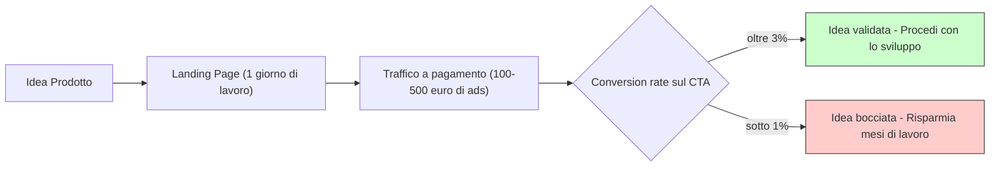

# Ricerche di Mercato Rock 'n' Roll

Nel 2004 il team di Lego era in crisi. Le vendite erano crollate del 35% in tre anni, l'azienda aveva perso 300 milioni di dollari e stava per dichiarare bancarotta. I dirigenti avevano commissionato una ricerca di mercato da 500.000 dollari che aveva concluso che i bambini moderni non avevano pazienza per i mattoncini — l'era dei giochi complessi era finita. La risposta di Lego fu lanciare una linea di set semplificati e ridurre il numero di mattoncini unici da 12.000 a 6.000.

Le vendite crollarono ulteriormente.

Nel 2005 un giovane ricercatore di nome Henning Beck ebbe un'idea diversa: invece di chiedere ai bambini cosa volevano, andare a guardare come giocavano. Si mise a osservare bambini nei loro ambienti naturali in dieci paesi diversi. Una delle scoperte piu sorprendenti: un bambino tedesco di undici anni aveva consumato le suole di un paio di scarpe da skate. Quando Beck chiese perche, il bambino spiego che quelle scarpe consumate erano il suo trofeo piu prezioso — la prova tangibile della sua competenza, del suo status tra gli amici.

Lego lancio la linea Bionicle, altamente complessa, con una narrativa profonda e una community di fan. Fu il loro prodotto piu venduto per anni. L'azienda salvo se stessa non con una ricerca da 500.000 dollari, ma con un ricercatore che osservava bambini giocare.

Questa storia illustra il problema fondamentale delle ricerche di mercato tradizionali: misurano cio che le persone *dicono*, non cio che *fanno* o *sentono veramente*. E vengono eseguite in modo cosi lento e costoso che arrivano spesso quando le decisioni sono gia state prese.

## Perche le Ricerche Tradizionali Falliscono

Il problema non e la ricerca in se — e il modo in cui viene eseguita. La ricerca di mercato tradizionale segue un processo progettato negli anni Cinquanta per le grandi corporations americane che potevano permettersi sei mesi di attesa e budget da centinaia di migliaia di dollari.

| Dimensione | Ricerca Tradizionale | Approccio Agile |
|---|---|---|
| Tempo | 3-6 mesi | 1-2 settimane |
| Costo | 20.000-100.000 euro | 500-5.000 euro |
| Output | Report PDF di 200 pagine | 5 slide con insight azionabili |
| Chi la legge | L'analista che l'ha fatta | Il team che deve decidere |
| Utilizzo reale | Finisce in un cassetto | Cambia una decisione concreta entro 30 giorni |
| Tipo di insight | Descrittivo ("il 43% degli utenti") | Azionabile ("smetti di fare X, inizia a fare Y") |

Henry Ford disse che se avesse chiesto ai suoi clienti cosa volevano, avrebbero risposto "cavalli piu veloci". Il problema non era che Ford ignorasse i clienti — era che sapeva che i clienti esprimono il proprio bisogno in termini di soluzioni esistenti, non di soluzioni possibili. La ricerca di mercato funziona quando riesce ad arrivare al bisogno sottostante, non alla soluzione richiesta.

## I 7 Metodi Rock 'n' Roll

### 1. Il "Caffe Lungo" (Intervista Lampo)

Il principio delle interviste utente si basa su una scoperta di Jakob Nielsen del NN/g Research Group: dopo cinque interviste con utenti diversi, si identifica il 85% dei problemi di usabilita di un prodotto. Ogni intervista successiva produce rendimenti marginali decrescenti.

Cinque conversazioni di trenta minuti ciascuna ti danno piu insight azionabili di qualsiasi focus group da 10.000 euro, perche il contesto individuale e la conversazione one-to-one permettono di esplorare le risposte in profondita.

Le tre domande che uso sempre:

1. Da 1 a 10, quanto e probabile che ci raccomanderesti? (NPS istantaneo)
2. Qual e la cosa che preferisci del nostro prodotto o servizio?
3. Se potessi cambiare una cosa, quale sarebbe?

La terza domanda e quella che produce gli insight migliori. La risposta non e mai "vorrei che costasse meno" — le persone danno per scontato che vogliano spendere meno. La risposta e quasi sempre qualcosa di specifico, operativo, che non avresti mai immaginato dall'interno.

Un cliente con cui ho lavorato nel settore dei corsi online scopri che il 4 dei 5 clienti intervistati trovava impossibile trovare le lezioni che cercavano nella piattaforma. Nessuno lo aveva mai segnalato tramite i canali ufficiali. Il problema era nella navigazione, non nel contenuto. Costo dell'insight: cinque caffe, quindici euro.

**Costo:** 5 caffe, circa 15 euro.
**Tempo:** Un pomeriggio.
**Valore:** Specifico, actionable, nel linguaggio reale del cliente.

### 2. Il "Fake Landing Page" (Smoke Test)

Nel 2008 Drew Houston aveva un'idea per un servizio di file sync chiamato Dropbox. Prima di scrivere una riga di codice, giro un video di tre minuti che spiegava cosa sarebbe stato il servizio — come funzionava, che problema risolveva. Poi messe un link per registrarsi alla beta.

In un giorno, la lista di attesa passo da 5.000 a 75.000 persone. Houston aveva la sua risposta: il mercato voleva esattamente quel prodotto. Poi scrisse il codice.

Lo smoke test funziona perche misura il comportamento reale, non le intenzioni dichiarate. "Saresti interessato a questo prodotto?" produce sempre risposte distorte verso il si — le persone non vogliono deludere il ricercatore, e soprattutto non costano nulla dire si. Ma cliccare "Pre-ordina" e lasciare la propria email e un atto concreto che misura l'interesse reale.

Il parametro critico e la conversion rate sul Call To Action principale — non il traffico totale, non il tempo sulla pagina. Se stai testando un prodotto SaaS B2B, il 2-3% e un segnale positivo. Per un prodotto consumer, il 5-8%.

**Costo:** 200-500 euro di ads, piu un giorno di lavoro per costruire la pagina.
**Tempo:** Una settimana inclusa la raccolta dati.
**Valore:** Scopri se il mercato vuole il prodotto prima di costruirlo.

### 3. Il "Sondaggio Guerrilla" (5 Domande, 3 Minuti)

Il problema dei sondaggi online non e il mezzo — e la lunghezza. Ogni domanda in piu fa scendere il tasso di completamento. Un sondaggio di 10 domande ha in media il 50% di completamento in meno rispetto a uno di 5 domande.

La regola di ferro: max 5 domande, completabili in 3 minuti. Se devi sapere piu cose, fai due sondaggi separati in momenti diversi.

Il template che funziona in quasi ogni contesto B2B:

1. Qual e la sfida piu grande nel tuo lavoro in questo momento? (aperta)
2. Quali strumenti o prodotti usi per affrontarla? (scelta multipla, con "Altro" aperto)
3. Quanto spendi attualmente per risolvere questo problema? (range di prezzo)
4. Da 1 a 5, quanto sei soddisfatto della soluzione attuale? (scala Likert)
5. Se potessi avere uno strumento magico per questo problema, cosa farebbe? (aperta)

La domanda 1 e la domanda 5 sono le piu preziose. La domanda 1 ti dice se stai risolvendo il problema giusto. La domanda 5 ti dice come il mercato immagina la soluzione ideale — e spesso e molto diversa da quello che hai gia costruito o stai costruendo.

**Tool:** Google Forms (gratuito) o Typeform per una UX migliore.
**Costo:** 0-50 euro.
**Tempo:** 2-3 giorni di raccolta per avere risposte sufficienti dalla tua lista.

### 4. Il "Reddit Research" (Social Listening Strutturato)

Le recensioni di Amazon, i thread di Reddit, i forum specializzati sono una miniera di market intelligence che esiste gia, e gratuita, e completamente ignorata dalla maggior parte dei brand.

L'insight chiave di Clayton Christensen sulla metodologia Jobs to Be Done viene spesso applicata alle interviste, ma funziona altrettanto bene sui forum online: le persone che chiedono consigli su prodotti stanno descrivendo il job che vogliono fare, e le alternative che stanno considerando.

Su Reddit cerca il subreddit del tuo settore e analizza i thread con piu engagement. Su Amazon analizza le recensioni a tre stelle dei prodotti competitor — le cinque stelle lodano, le una stella si sfogano, ma le tre stelle descrivono onestamente cosa manca.

**Dove cercare in Italia:**
- Reddit: r/italy, r/lavoroIT, r/commercialisti, r/ItaliaPersonalFinance, r/startupitalia
- Forum specializzati: TripAdvisor (hospitality), Alfemminile (consumi femminili), Hardware Upgrade (tech consumer)
- Trustpilot e Google Reviews: analizza le review dei competitor, non solo le tue
- LinkedIn: gruppi di settore e hashtag tematici

**Cosa cercare specificamente:**
- Frasi che iniziano con "odio quando..." o "non capisco perche..." — questi sono i pain point.
- Il linguaggio usato per descrivere il problema — usalo identico nel tuo marketing, e il linguaggio del cliente.
- Alternative menzionate ("ho provato X ma alla fine uso Y perche...") — capisce il decision process reale.

### 5. Il "Competitor Safari" (Mystery Shopping)

Phil Knight, fondatore di Nike, visitava personalmente i negozi dei competitor per capire come vendevano le scarpe. Jeff Bezos leggeva personalmente alcune email del customer service di Amazon per capire cosa frustrava i clienti. L'esperienza diretta produce insight che nessun report secondario puo replicare.

Compra il prodotto dei competitor. Usalo per una settimana. Documenta ogni momento di frizione e ogni momento di delizia.

**Checklist Competitor Safari:**
- Come sei stato acquisito? (Pubblicita su quale canale? SEO? Passaparola?)
- Quanto era facile comprare? (UX del checkout, metodi di pagamento, chiarezza del prezzo)
- Quanto e stato veloce e prevedibile il processo post-acquisto?
- Com'e il packaging o l'onboarding? Qual e il primo momento di valore?
- Come gestiscono il follow-up? (Email, survey, offerte di upsell)
- Testa il customer service: fai una domanda difficile, poi prova a fare un reclamo.

La debolezza del competitor che puoi sfruttare e quasi sempre nel post-acquisto, non nel prodotto stesso. La maggioranza delle aziende tratta il customer service come un costo da minimizzare — per te e un'opportunita di differenziazione.

**Costo:** Il prezzo del prodotto competitor.
**Tempo:** 1-2 settimane.
**Valore:** Inestimabile. Scopri le debolezze che nessun report di mercato rivela.

### 6. Il "Data Diving" (Analisi dei Dati Esistenti)

Prima di spendere soldi per raccogliere nuovi dati, analizza quelli che hai gia. La ricerca di mercato piu economica possibile e quella sui dati che la tua azienda produce ogni giorno e non ha mai guardato sistematicamente.

| Fonte interna | Domande a cui puo rispondere |
|---|---|
| Google Analytics / GA4 | Chi visita? Da dove arriva? Dove abbandona il funnel? |
| CRM e database clienti | Chi compra di piu? Chi ha smesso? Qual e la frequenza? Qual e il LTV? |
| Email marketing | Quali soggetti producono aperture? Quale segmento clicca di piu? |
| Log del customer service | Quali sono le lamentele piu frequenti? Cosa bloccava l'acquisto? |
| Search Console | Cosa cercano le persone che ti trovano? Con quali query? |
| Dati di reso e reclami | Cosa non ha soddisfatto le aspettative? Quali aspettative erano errate? |

Ho lavorato con un'azienda di abbigliamento che non aveva mai guardato sistematicamente i motivi dei resi. Quando aggregammo tre anni di dati del customer service, scoprimmo che il 34% dei resi era dovuto a taglie inconsistenti tra le linee di prodotto. Il problema era noto a chiunque gestisse i resi, ma non era mai salito all'attenzione del product team. Quella analisi, fatta in due giorni su dati esistenti, porto a una riduzione del 22% del tasso di reso nel trimestre successivo.

### 7. Il "Micro-Esperimento" (Test sul Campo)

Invece di chiedere ai clienti cosa farebbero (le persone mentono sui sondaggi, non per malafede ma per bias cognitivi documentati da Kahneman in avanti), testa direttamente il comportamento sul mercato reale.

- Vuoi sapere se la gente vuole il delivery? Aggiungi l'opzione in un'area geografica limitata per due settimane e misura la conversion rate.
- Vuoi sapere se il nuovo packaging funziona? Distribuiscilo su una referenza su dieci e confronta le vendite e i resi dopo trenta giorni.
- Vuoi sapere se un prezzo diverso e accettato? Testalo su un canale secondario dove il tuo pubblico principale non lo vede ancora.

Il principio e quello dei test dei farmaci: non chiedere alle persone se funziona, misura se funziona. L'esperimento sul campo elimina il bias dichiarativo che invalida i sondaggi.

## Il Framework "1-1-1"

Per ogni decisione strategica significativa — lancio di un prodotto, cambiamento di prezzo, entrata in un nuovo mercato — hai bisogno di almeno tre tipi di evidenza:

- **1 dato quantitativo:** analytics, sondaggio strutturato, risultato di un A/B test. Ti dice *quanto* e *quanto spesso*.
- **1 dato qualitativo:** intervista, sessione di ascolto, analisi di forum. Ti dice *perche* e *come*.
- **1 osservazione diretta:** mystery shopping, test sul campo, sessione di usabilita registrata. Ti dice *cosa succede davvero* invece di quello che le persone dicono che succede.

Se hai solo uno dei tre, stai facendo una scommessa, non una decisione informata. Se hai tutti e tre e concordano, puoi agire con un livello di confidenza alto. Se contraddicono — se il sondaggio dice X ma le osservazioni dirette dicono Y — hai trovato qualcosa di molto interessante che vale la pena investigare piu a fondo.

## Come Presentare i Risultati Senza Annoiare

La ricerca piu brillante del mondo e inutile se nessuno la legge o nessuno la usa per decidere. Il problema delle presentazioni di ricerca e che riproducono il processo di raccolta dati invece di comunicare le conclusioni.

Cinque slide, non di piu:

| Slide | Contenuto | Formato |
|---|---|---|
| 1 | La domanda a cui rispondiamo | Una frase |
| 2 | Il numero piu importante | Grande, al centro, senza decorazioni |
| 3 | I tre insight principali | Citazioni dirette dei clienti, non bullet point |
| 4 | Cosa cambiamo da domani | Decisioni concrete, non raccomandazioni vaghe |
| 5 | Come misuriamo se abbiamo avuto ragione | Metriche e timeline |

La slide 3 e quella che piu spesso viene fatta male. "Il 43% degli utenti trova difficile il checkout" e un'informazione. "Non riesco mai a capire quanto pago in totale prima di cliccare" — questa e una citazione diretta di un'utente — e un insight. Le citazioni dirette hanno un potere di persuasione che i numeri aggregati non hanno, perche attivano l'empatia.

Il "So What Test": per ogni dato nel report, chiediti "e quindi?". Se non c'e una risposta concreta — una decisione, un'azione, un cambiamento — il dato non dovrebbe essere nella presentazione. I dati esistono per servire le decisioni, non per documentare la complessita del mondo.

## Il Caso Airbnb

Nel 2009 Airbnb aveva un problema: le persone visitavano il sito ma non prenotavano. Brian Chesky e Joe Gebbia, i fondatori, andarono a parlare con i proprietari di case a New York. Scoprirono il problema in trenta minuti di conversazioni: le foto degli appartamenti erano pessime. Gli host facevano le foto con il telefono, con luce scarsa, senza mostrare i dettagli che avrebbero convinto un potenziale ospite.

La soluzione? Airbnb affitto macchine fotografiche professionali e fotografo personalmente gli appartamenti di New York. Non era scalabile. Non era nel piano di business. Non lo avrebbe mai suggerito nessuna ricerca di mercato tradizionale.

In una settimana il revenue di New York raddoppio. La fotografia professionale divento una feature ufficiale di Airbnb, poi esternalizzata a una rete di fotografi, e contribui in modo significativo alla crescita dell'azienda nei mercati successivi.

Chesky usa questa storia per spiegare il suo approccio alla ricerca: "Fai cose che non scalano per capire cosa funziona, poi scala quello che funziona."

## Conclusione

Le ricerche di mercato non devono essere costose, lente o noiose. Devono essere utili — nel senso piu letterale: devono portare a qualcosa di fatto in modo diverso.

Il problema delle ricerche tradizionali non e metodologico, e strutturale: sono progettate per minimizzare il rischio dell'analista, non per massimizzare l'utilita per chi deve decidere. Un report da 200 pagine protegge l'agenzia di ricerca che lo ha prodotto. Un caffe con cinque clienti protegge il business da decisioni sbagliate.

Rock 'n' Roll non significa essere superficiali. Significa essere veloci, pragmatici e orientati all'azione. La ricerca giusta e quella che produce una decisione diversa. Se il risultato della tua ricerca e "facciamo quello che avevamo gia deciso di fare", hai sprecato tempo e denaro.
