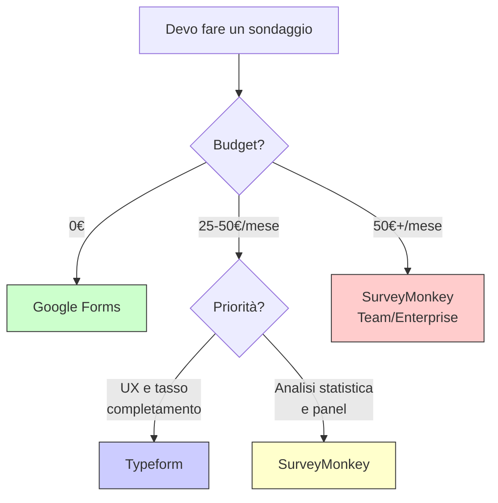

# Sondaggi Online: Quale Strumento Scegliere?

Devi lanciare un sondaggio per una ricerca di mercato, misurare la soddisfazione dei clienti o raccogliere feedback sui prodotti. Apri il browser e ti trovi davanti tre opzioni: **Google Forms** (gratis), **Typeform** (bello) e **SurveyMonkey** (il veterano). Quale scegli?

La risposta dipende da cosa devi fare, quanto devi spendere e a chi lo mandi. Vediamo.

## Confronto Rapido

| Caratteristica | Google Forms | Typeform | SurveyMonkey |
|---|---|---|---|
| **Prezzo** | Gratuito | Da 25€/mese | Da 30€/mese |
| **Max risposte (free)** | Illimitate | 10/mese | 40/sondaggio |
| **UX del rispondente** | Funzionale | Eccellente | Buona |
| **Logica condizionale** | Base | Avanzata | Avanzata |
| **Analisi integrate** | Base | Media | Avanzata |
| **Export dati** | CSV, Google Sheets | CSV, Excel, API | CSV, Excel, SPSS, API |
| **GDPR compliance** | Sì (server EU) | Sì (opzione EU) | Sì (opzione EU) |
| **Branding** | Limitato | Completo | Completo (a pagamento) |
| **Integrazioni** | Google Workspace | Zapier, HubSpot, Slack | Salesforce, HubSpot, Zapier |
| **Lingua italiana** | Sì | Sì | Sì |

## Google Forms: Il Coltellino Svizzero Gratuito

### Quando Sceglierlo

*   Budget zero o quasi.
*   Sondaggi interni (satisfaction dipendenti, feedback team).
*   Raccolte dati semplici (iscrizioni eventi, ordini, prenotazioni).
*   Progetti accademici (tesi, ricerche universitarie).

### Punti di Forza

*   **100% gratuito**, risposte illimitate, nessun limite di domande.
*   Integrazione nativa con Google Sheets (i dati vanno direttamente nel foglio).
*   Si impara in 10 minuti.
*   Collaborazione in tempo reale (come Google Docs).

### Limiti

*   Design basico — non puoi personalizzare veramente l'aspetto.
*   Logica condizionale limitata (solo "vai alla sezione X se rispondi Y").
*   Nessun tipo di domanda avanzata (NPS, Likert scale, rating stelle).
*   Analisi dei risultati molto basiche (solo grafici a torta e barre).
*   Nessun A/B test tra versioni del sondaggio.

### Trucco da Pro

Collega Google Forms a Google Sheets e usa **Google Apps Script** per creare analisi automatiche:

```javascript
// Esempio: Ricevi una notifica email quando arrivano 100 risposte
function checkResponses() {
  var form = FormApp.openById('ID_DEL_TUO_FORM');
  var responses = form.getResponses();
  
  if (responses.length >= 100) {
    MailApp.sendEmail(
      'tuo@email.it',
      'Obiettivo raggiunto!',
      'Il sondaggio ha raggiunto ' + responses.length + ' risposte.'
    );
  }
}
```

## Typeform: L'Esperienza Premium

### Quando Sceglierlo

*   Sondaggi rivolti ai clienti (NPS, CSAT, product feedback).
*   Ricerche di mercato B2C dove il tasso di completamento conta.
*   Lead generation (il sondaggio come strumento di acquisizione).
*   Quando l'estetica del brand è importante.

### Punti di Forza

*   **UX eccezionale:** una domanda alla volta, animazioni fluide, responsive perfetto.
*   Tasso di completamento **medio 57%** (vs 33% della media del settore).
*   Logica condizionale avanzata (if/then, variabili, calcoli).
*   Tipi di domanda ricchi: NPS, rating, scale opinioni, video.
*   Calculator quiz (puoi creare esperienze interattive tipo "scopri il tuo profilo").

### Limiti

*   **Solo 10 risposte/mese nel piano gratuito** — essenzialmente inutile.
*   Costo significativo (25€/mese per il Basic, 50€/mese per il Plus).
*   Analisi dei risultati non eccezionali (meglio esportare in Excel o Google Sheets).
*   Il formato "una domanda alla volta" allunga il tempo percepito per sondaggi con 30+ domande.

### Trucco da Pro

Usa le **variabili nascoste** (hidden fields) per passare dati dall'URL al sondaggio:

```
https://tuoform.typeform.com/to/XXXXX?utm_source=newsletter&segmento=premium
```

Questo ti permette di segmentare le risposte senza chiedere nulla al rispondente.

## SurveyMonkey: Il Veterano della Ricerca

### Quando Sceglierlo

*   Ricerche di mercato strutturate (Conjoint, MaxDiff, Van Westendorp).
*   Indagini con esigenze di analisi statistica avanzata (cross-tab, significatività).
*   Aziende con Salesforce o CRM enterprise.
*   Progetti che richiedono un panel di rispondenti (SurveyMonkey Audience).

### Punti di Forza

*   **Analisi statistiche integrate**: cross-tab, filtri, benchmark di settore.
*   Modelli pre-costruiti per NPS, CSAT, ricerca di mercato.
*   **SurveyMonkey Audience:** puoi comprare risposte da un panel panel qualificato (filtri per età, genere, reddito, area geografica).
*   Export in formato **SPSS** — se devi passare i dati a un ricercatore o statistico.
*   Supporto per sondaggi multilingua.

### Limiti

*   Il piano gratuito è molto limitato (max 10 domande, 40 risposte, nessun export).
*   UX del rispondente datata (molto "form tradizionale").
*   Costi che salgono rapidamente: il piano Team parte da 30€/utente/mese.
*   L'interfaccia di progettazione è funzionale ma non intuitiva come Typeform.

## Matrice Decisionale: Quale Scegliere?



## I 5 Errori da Evitare (Qualunque Tool Tu Scelga)

### 1. Domande Doppie
❌ "Quanto sei soddisfatto del prezzo e della qualità del servizio?"
✅ Fai due domande separate: una sul prezzo, una sulla qualità.

### 2. Leading Questions (Domande Orientate)
❌ "Quanto ti è piaciuto il nostro fantastico nuovo prodotto?"
✅ "Come valuteresti il nuovo prodotto?"

### 3. Troppi Campi Obbligatori
Se ogni domanda è obbligatoria, il tasso di abbandono esplode. Rendi obbligatorie solo le domande critiche per la tua analisi.

### 4. Nessun Test Prima del Lancio
Testa il sondaggio su 5-10 persone prima di lanciarlo. Cronometra il tempo di completamento. Se supera i 7 minuti, taglia.

### 5. Non Comunicare la Durata
"Questo sondaggio richiede circa 3 minuti" al primo screen aumenta il tasso di completamento del 15-20%.

## Consigli per il Mercato Italiano

*   **Lingua:** Usa sempre il "Lei" formale nei sondaggi B2B e il "tu" per i B2C consumer.
*   **Privacy:** Cita sempre il GDPR e la privacy policy. I rispondenti italiani sono più sensibili della media europea.
*   **Timing:** Invia i sondaggi il **martedì o mercoledì mattina** (10:00-11:00). Il lunedì la gente è sommersa di email, il venerdì pensa al weekend.
*   **Incentivo:** Un buono Amazon da 5€ o un caffè gratis aumenta il response rate del 30-50% in Italia.

## Conclusione

Non esiste lo strumento perfetto — esiste lo strumento giusto per il tuo caso. Se hai zero budget e un'esigenza semplice, Google Forms. Se devi stupire il rispondente e massimizzare il completamento, Typeform. Se devi fare ricerca seria con analisi statistiche, SurveyMonkey. In tutti i casi, ricorda: lo strumento conta meno delle domande. Un sondaggio con domande sbagliate su Typeform dà risultati peggiori di un sondaggio con domande giuste su Google Forms.
