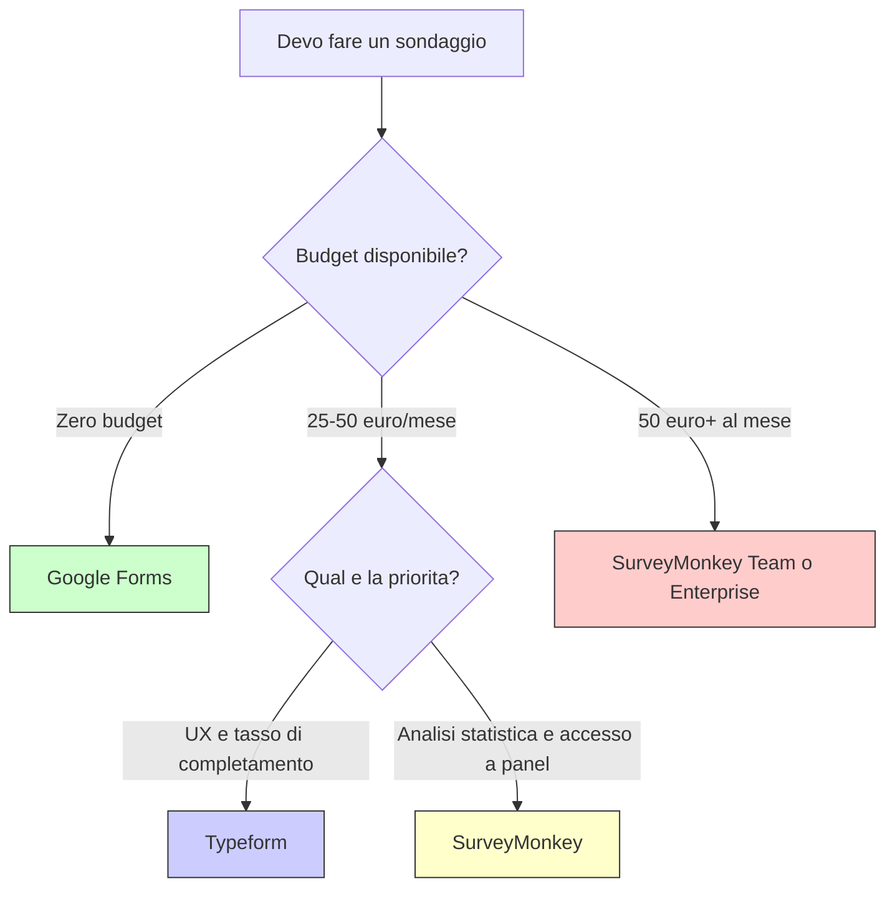

# Sondaggi Online: Quale Strumento Scegliere?

Nel 2011 il team di Airbnb aveva un problema: sapevano che il tasso di conversione era basso, ma non capivano perche. Avevano GA, avevano le heatmap, avevano i dati di funnel — ma i dati non dicevano il perche. Decisero di inviare un sondaggio agli utenti che avevano visitato una scheda appartamento senza prenotare. Il sondaggio aveva una sola domanda: "Cosa ti ha impedito di prenotare?"

Le risposte piu frequenti furono sorprendenti: le foto erano scarse, era difficile capire cosa includeva il prezzo, e le recensioni erano troppo poche per fidarsi. Nessuna di queste risposte era visibile nei dati quantitativi. Airbnb agi su tutti e tre i punti nei successivi sei mesi. Il resto e storia.

Questo episodio illustra perche i sondaggi online esistono ancora nell'era del big data: i dati comportamentali ti dicono *cosa* fanno le persone, ma solo le parole delle persone ti dicono *perche*. Un sondaggio ben costruito chiude quel gap.

Il problema pratico che affronta chiunque voglia fare un sondaggio oggi e pero la scelta dello strumento. Apri il browser e ti trovi davanti tre opzioni dominanti: Google Forms (gratuito), Typeform (bello) e SurveyMonkey (il veterano della ricerca di mercato). La scelta sbagliata non rovina necessariamente il sondaggio, ma la scelta giusta puo aumentare il tasso di completamento del 30-40% — che su campioni piccoli e la differenza tra dati utilizzabili e dati inutili.

## Confronto Strutturato

| Caratteristica | Google Forms | Typeform | SurveyMonkey |
|---|---|---|---|
| Prezzo base | Gratuito | Da 25 euro/mese | Da 30 euro/mese |
| Risposte piano gratuito | Illimitate | 10 al mese | 40 per sondaggio |
| UX del rispondente | Funzionale ma datata | Eccellente | Buona ma classica |
| Logica condizionale | Base (sezioni) | Avanzata (variabili, calcoli) | Avanzata |
| Analisi integrate | Basica | Media | Avanzata (cross-tab, benchmark) |
| Export dati | CSV, Google Sheets | CSV, Excel, API | CSV, Excel, SPSS, API |
| GDPR compliance | Si (server EU disponibili) | Si (opzione EU) | Si (opzione EU) |
| Personalizzazione brand | Limitata | Completa | Completa (a pagamento) |
| Integrazioni principali | Google Workspace | Zapier, HubSpot, Slack | Salesforce, HubSpot, Zapier |

## Google Forms: Il Coltellino Svizzero Gratuito

Google Forms e probabilmente lo strumento piu usato in Italia per i sondaggi interni, i progetti accademici e le raccolte dati semplici. Non perche sia il migliore — ma perche e gratuito, tutti sanno come usarlo, e fa il suo lavoro senza fronzoli.

### Quando Sceglierlo

- Budget zero o quasi, con nessuna prospettiva di investimento nel breve termine.
- Sondaggi interni: satisfaction dei dipendenti, feedback team, raccolta disponibilita per riunioni.
- Raccolte dati operative: iscrizioni eventi, ordini semplici, prenotazioni.
- Progetti accademici dove il destinatario non ha aspettative estetiche.
- Quando hai gia tutto l'ecosistema Google Workspace e vuoi integrazione nativa con Sheets.

### Punti di Forza

**Gratuito e senza limiti di risposta.** Non stai pagando per le risposte, non hai un tetto mensile che ti costringe ad aggiornare il piano. Se lanci un sondaggio virale che riceve 50.000 risposte, va bene lo stesso.

**Integrazione diretta con Google Sheets.** Ogni risposta va in tempo reale in un foglio di calcolo che puoi analizzare, condividere, collegare ad altre fonti dati. Se lavori gia in Google Workspace, questo elimina completamente il problema dell'export.

**Curva di apprendimento quasi nulla.** Chiunque abbia usato un Google Doc impara a creare un form in dieci minuti.

**Collaborazione in tempo reale.** Piu persone possono lavorare allo stesso form contemporaneamente, come su un documento condiviso.

### Limiti Reali

**Design basico.** Non puoi personalizzare veramente l'aspetto del form oltre al colore dell'header e a un'immagine di sfondo. Su un sondaggio B2C rivolto a clienti, questo comunica meno professionalita rispetto a un Typeform brandizzato.

**Logica condizionale limitata.** Puoi solo mandare il rispondente a una sezione diversa basandoti su una risposta, ma non puoi nascondere/mostrare singole domande, fare calcoli, o usare variabili. Questo e sufficiente per l'80% dei casi, ma non per i sondaggi piu complessi.

**Nessun tipo di domanda NPS nativo.** Puoi simulare un NPS con una scala lineare, ma non e esattamente uguale. Se stai misurando NPS in modo serio, Typeform o SurveyMonkey gestiscono meglio la visualizzazione e la logica di questa specifica domanda.

**Analisi integrate molto basiche.** Il pannello di risposta di Google Forms ti mostra grafici a torta e a barre, ma non puoi fare cross-tab, filtrare per segmento, o confrontare coorti diverse. Devi esportare in Sheets e fare l'analisi da zero.

### Trucco da Pro: Automazione con Apps Script

Collega Google Forms a Google Sheets e usa Google Apps Script per automatizzare notifiche e analisi:

```javascript
// Questo script invia una notifica email quando il sondaggio
// raggiunge 100 risposte — utile per sondaggi dove hai
// definito in anticipo la dimensione del campione minima

function checkResponses() {
  // Sostituisci con l'ID del tuo specifico form
  var form = FormApp.openById('ID_DEL_TUO_FORM');
  var responses = form.getResponses();

  // Trigger: quando si raggiunge il numero minimo di risposte
  // imposta questo script come "trigger basato su tempo" (ogni ora)
  if (responses.length >= 100) {
    MailApp.sendEmail(
      'tuo@email.it',
      'Campione raggiunto: ' + responses.length + ' risposte',
      'Il sondaggio ha raggiunto la dimensione minima del campione. ' +
      'Puoi procedere con l analisi.'
    );
  }
}
```

Puoi configurare questo script come trigger orario nelle impostazioni di Apps Script, cosi il controllo avviene automaticamente senza che tu debba monitorare manualmente.

## Typeform: L'Esperienza Premium

Typeform e stato fondato a Barcellona nel 2012 con una tesi precisa: il problema dei sondaggi online non e il contenuto ma il formato. Mostrare tutte le domande in una pagina unica e lo stesso che fare un colloquio di lavoro distribuendo un questionario cartaceo invece di conversare. La conversazione produce piu engagement, piu risposte oneste, e meno abbandoni.

La tesi ha retto la prova dei dati: il tasso di completamento medio su Typeform e del 57%, contro il 33% della media del settore. Su sondaggi con 10+ domande, la differenza e ancora piu marcata.

### Quando Sceglierlo

- Sondaggi rivolti ai clienti — NPS, CSAT, product feedback — dove il tasso di completamento e critico.
- Ricerche di mercato B2C dove l'esperienza del rispondente riflette la percezione del brand.
- Lead generation tramite quiz: "Scopri il profilo di rischio del tuo portafoglio" o "Trova il piano giusto per te".
- Quando l'estetica del brand e importante e vuoi che il sondaggio sia indistinguibile dal resto del sito.

### Punti di Forza

**UX eccezionale, una domanda alla volta.** Il formato conversazionale elimina l'effetto di overwhelm che si ha guardando 20 domande tutte insieme. L'animazione fluida tra una domanda e l'altra mantiene l'attenzione senza distrarre.

**Logica condizionale avanzata.** Puoi mostrare o nascondere domande singole basandoti su risposte precedenti, usare variabili dinamiche, fare calcoli, e personalizzare il messaggio finale. Questo permette di costruire quiz interattivi sofisticati che sembrano personalizzati per ogni rispondente.

**Domanda NPS nativa.** Il formato NPS e gestito nativamente con la visualizzazione corretta a 11 punti, la logica di calcolo automatica, e la possibilita di aggiungere domande di follow-up diverse per promoter, passivi e detrattori.

### Limiti da Conoscere

**Il piano gratuito e quasi inutile.** 10 risposte al mese non bastano per nessun uso reale. Il piano Basic parte da 25 euro al mese — un investimento ragionevole se usi Typeform regolarmente, ma significativo se lo usi per un sondaggio ogni sei mesi.

**L'analisi dei risultati non e il punto di forza.** Typeform mostra i risultati in modo piu visivo di Google Forms, ma per analisi serie devi esportare in Excel o Google Sheets. Il prodotto e ottimizzato per la raccolta, non per l'analisi.

**Il formato "una domanda alla volta" puo allungare la percezione del tempo** su sondaggi molto lunghi (30+ domande). L'animazione che aiuta su sondaggi brevi diventa frustrante quando il rispondente non vede quanto manca alla fine.

### Trucco da Pro: Hidden Fields per la Segmentazione

Usa i campi nascosti per passare informazioni dal contesto di invio al sondaggio, senza chiedere nulla al rispondente:

```
https://tuoform.typeform.com/to/XXXXX?utm_source=newsletter&segmento=premium&user_id=12345
```

Questo parametro `segmento=premium` viene registrato automaticamente insieme alle risposte. Quando poi esporti i dati, puoi segmentare le risposte per provenienza (newsletter vs social), tipo di cliente (free vs premium), o qualsiasi altra variabile che hai passato nell'URL. Questo trasforma un sondaggio generico in uno strumento di analisi segmentata senza nessuna modifica al sondaggio stesso.

## SurveyMonkey: Il Veterano della Ricerca di Mercato

SurveyMonkey esiste dal 1999 — un'eternita nel tempo internet. In ventisei anni ha costruito quello che nessun competitor ha ancora replicato completamente: un sistema di analisi statistica integrato e un panel di rispondenti acquistabili direttamente dalla piattaforma.

Questo lo rende la scelta obbligata per certi casi d'uso specifici, e la scelta sbagliata per tutti gli altri.

### Quando Sceglierlo

- Ricerche di mercato strutturate che richiedono metodi avanzati: Conjoint Analysis, MaxDiff, Van Westendorp, test di concepto.
- Quando hai bisogno di cross-tab, significativita statistica e benchmark di settore integrati nell'interfaccia.
- Aziende con Salesforce o CRM enterprise che richiedono integrazione nativa certificata.
- Quando non hai una lista di rispondenti e devi comprare accesso a un panel qualificato.

### Il Vantaggio Strutturale: SurveyMonkey Audience

L'accesso a un panel di rispondenti qualificati e cio che separa SurveyMonkey dai competitor per la ricerca di mercato professionale. Puoi comprare risposte filtrate per eta, genere, reddito, area geografica, settore lavorativo, e decine di altri criteri.

Un esempio concreto: vuoi capire come le donne tra 35 e 50 anni nel nord Italia percepiscono il tuo brand rispetto ai competitor. Con Google Forms o Typeform, devi trovare tu queste persone. Con SurveyMonkey Audience, compri 200 risposte con queste caratteristiche demografiche esatte — e le hai in 48 ore. Il costo e significativo (tipicamente 2-5 euro per risposta), ma per alcune ricerche e l'unica opzione praticabile.

### Limiti Strutturali

**Il piano gratuito e quasi inutile.** Massimo 10 domande, 40 risposte, nessun export dei dati. E un piano che serve solo per capire il prodotto, non per usarlo.

**L'UX del rispondente e datata.** Il formato tradizionale con tutte le domande visibili e meno coinvolgente di Typeform. Su sondaggi B2C rivolti a consumatori, questo si traduce in tassi di completamento inferiori.

**L'interfaccia di progettazione e funzionale ma poco intuitiva.** Le funzionalita avanzate richiedono una curva di apprendimento piu ripida rispetto agli altri due strumenti.

**I costi salgono rapidamente.** Il piano Team parte da 30 euro per utente al mese. Per un team di cinque persone, e 150 euro al mese — confronto con i 25 euro di Typeform per un singolo account.

## Matrice Decisionale



## I 5 Errori che Invalidano i Tuoi Dati

Lo strumento conta meno delle domande. Un sondaggio con domande mal costruite su Typeform produce dati peggiori di un sondaggio con domande corrette su Google Forms. Questi sono gli errori che ho visto piu spesso nei sondaggi di clienti e studenti.

### 1. Domande Doppie (Double-barreled Questions)

"Quanto sei soddisfatto del prezzo e della qualita del servizio?" e due domande in una. Il rispondente non sa se valutare il prezzo o la qualita, e tu non sai cosa sta valutando. Ogni domanda deve misurare una sola cosa.

Sbagliato: "Quanto ti e piaciuta la velocita e la completezza della risposta?"
Corretto: domanda separata sulla velocita, domanda separata sulla completezza.

### 2. Leading Questions

Le domande che suggeriscono la risposta "corretta" distorcono i dati verso la direzione che il ricercatore si aspetta — il che rende i dati inutilizzabili per prendere decisioni reali.

Sbagliato: "Quanto ti e piaciuto il nostro eccellente servizio clienti?"
Corretto: "Come valuteresti la qualita del nostro servizio clienti?"

### 3. Troppi Campi Obbligatori

Se ogni domanda e obbligatoria, il tasso di abbandono aumenta significativamente sulle domande aperte dove il rispondente deve scrivere del testo. Rendi obbligatorie solo le domande che non puoi permetterti di avere mancanti. Tutto il resto e preferibilmente facoltativo.

### 4. Nessun Test Pre-Lancio

Testa il sondaggio su 5-10 persone del tuo team o network prima di inviarlo al campione reale. Cronometra il tempo di completamento. Se supera i 7 minuti, taglia. Chiedi ai tester se qualche domanda era ambigua o confusa — le ambiguita che tu non vedi sono ovvie a chi non conosce il contesto.

### 5. Non Comunicare la Durata Stimata

"Questo sondaggio richiede circa 3 minuti" nella prima schermata aumenta il tasso di completamento del 15-20%. Le persone non vogliono impegnarsi in qualcosa senza sapere quanto dura. Dagli le informazioni per decidere consapevolmente se hanno il tempo adesso.

## Consigli per il Contesto Italiano

Il mercato italiano ha alcune particolarita che influenzano la struttura e l'invio dei sondaggi.

**Formalita del linguaggio.** Nei sondaggi B2B usa sempre il "Lei" formale — anche se la comunicazione via email del brand usa il "tu", il sondaggio formale con "tu" puo sembrare inappropriato a certi segmenti professionali. Nel B2C consumer il "tu" e generalmente accettato e piu caldo.

**Sensibilita alla privacy.** I rispondenti italiani sono statisticamente piu sensibili alla privacy rispetto alla media europea. Cita esplicitamente il GDPR, specifica come verranno usati i dati, e offri la possibilita di rimanere anonimi anche se hai gia l'indirizzo email del rispondente. Questo aumenta la fiducia e il tasso di completamento.

**Timing di invio.** I martedi e mercoledi mattina tra le 10:00 e le 11:30 producono i tassi di apertura piu alti per i sondaggi B2B in Italia. Il lunedi le persone sono travolte dalle email accumulate nel weekend. Il venerdi la concentrazione cala nel pomeriggio. Evita agosto completamente — i tassi di risposta crollano a valori che rendono i dati non rappresentativi.

**Incentivi.** Un buono Amazon da 5-10 euro o un piccolo incentivo concreto aumenta il response rate del 30-50% in media. Per i sondaggi B2B, condividere i risultati aggregati con i partecipanti e un incentivo altrettanto efficace e piu scalabile.

## Conclusione

Non esiste lo strumento perfetto — esiste lo strumento giusto per il tuo caso specifico.

Google Forms se hai zero budget e devi fare qualcosa di semplice e veloce. Typeform se vuoi massimizzare il tasso di completamento e l'esperienza del rispondente conta. SurveyMonkey se fai ricerca di mercato strutturata e hai bisogno di analisi statistiche o di un panel qualificato.

Ma ricorda quello che Airbnb scopri nel 2011: il valore di un sondaggio non sta nello strumento, sta nelle domande. Un sondaggio con una sola domanda giusta puo valere di piu di un questionario di 40 domande mal costruite. La domanda giusta e quella che produce un insight che cambia una decisione — non quella che conferma quello che pensavi gia di sapere.
