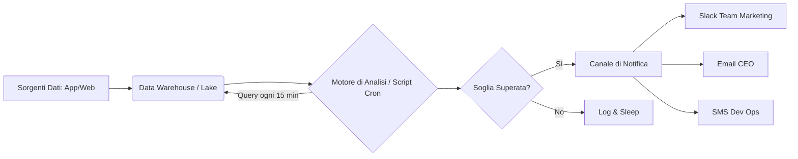

# Trigger Analytics: L'Antidoto alla Dashboard Fatigue

In un mondo ideale, avremmo il tempo di controllare tutte le nostre dashboard ogni mattina, sorseggiando un caffè e notando ogni piccola variazione. Ma la realtà è diversa: siamo sommersi di dati, riunioni e urgenze. Spesso le informazioni critiche si perdono nel rumore, e ce ne accorgiamo solo quando è troppo tardi (es. "Perché le vendite sono crollate martedì scorso?").

Ecco dove entra in gioco la **Trigger Analytics** (o Push Analytics).

## Cos'è la Trigger Analytics?

Non si tratta di guardare i dati (Pull), ma di far sì che i dati "guardino" noi (Push). È un sistema di monitoraggio attivo che invia notifiche quando una metrica supera o scende sotto una certa soglia, o quando si verifica un pattern specifico.

### Perché è il Futuro?
1.  **Reattività:** Intervieni in minuti, non giorni.
2.  **Focus:** Ti concentri solo su ciò che richiede attenzione.
3.  **Scalabilità:** Puoi monitorare 1000 metriche senza dover aprire 1000 grafici.

## Esempi Pratici di Trigger

### 1. Calo Improvviso del Tasso di Conversione
Se il Conversion Rate (CR) scende del 20% rispetto alla media degli ultimi 7 giorni, invia un alert su Slack al team tecnico. Potrebbe essere un bug nel checkout o un problema con il gateway di pagamento.

### 2. Picco di Traffico Anomalo
Se le visite aumentano del 50% in un'ora, potrebbe essere un attacco bot (DDoS) o un contenuto virale. In entrambi i casi, devi saperlo subito per scalare i server o bloccare l'attacco.

### 3. Churn Risk (Rischio Abbandono)
Se un cliente "High Value" (che paga > 500€/mese) non effettua il login per 14 giorni, invia una mail automatica al suo Account Manager: "Chiama Mario Rossi, rischio churn elevato!".

## Come Implementarlo: Dallo Strumento allo Script Custom

La maggior parte degli strumenti moderni supporta questa funzionalità nativamente:

*   **Google Analytics 4:** Utilizza gli "Insights" personalizzati per rilevare anomalie.
*   **PostHog / Mixpanel:** Offrono alert basati su trend o coorti specifici.
*   **Grafana / Prometheus:** Lo standard de facto per il monitoraggio infrastrutturale, ma utilissimo anche per metriche di business.

### Soluzione Custom: Python + SQL + Slack
Per chi vuole il controllo totale, uno script Python che esegue query sul database (es. PostgreSQL, BigQuery, ClickHouse) e invia webhook è la soluzione più flessibile.

```python
import requests
import psycopg2

# Configurazione
DB_PARAMS = "dbname='analytics' user='dbuser' host='localhost' password='secretpassword'"
SLACK_WEBHOOK = "https://hooks.slack.com/services/T00000/B00000/XXXXXXXX"
THRESHOLD = 0.02 # 2% Conversion Rate

def check_conversion_rate():
    conn = psycopg2.connect(DB_PARAMS)
    cur = conn.cursor()
    # Query: Calcola il CR dell'ultima ora
    cur.execute("""
        SELECT count(CASE WHEN event='purchase' THEN 1 END) * 1.0 / count(distinct user_id)
        FROM events
        WHERE timestamp > NOW() - INTERVAL '1 hour'
    """)
    cr = cur.fetchone()[0]
    conn.close()

    if cr < THRESHOLD:
        send_slack_alert(f"⚠️ ALLARME CRITICO: Conversion Rate sceso a {cr:.2%}")

def send_slack_alert(message):
    payload = {"text": message}
    requests.post(SLACK_WEBHOOK, json=payload)

if __name__ == "__main__":
    check_conversion_rate()
```

## Architettura di un Sistema di Alerting

Ecco come fluiscono i dati in un sistema di Trigger Analytics moderno:



## Conclusione

Smetti di cercare l'ago nel pagliaio. Lascia che sia l'ago a pungerti. Implementare la Trigger Analytics trasforma il tuo team da "reattivo" (che spegne incendi dopo che sono divampati) a "proattivo" (che interviene al primo fumo).
