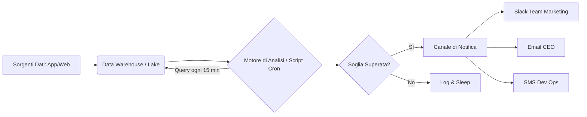

# Trigger Analytics: L'Antidoto alla Dashboard Fatigue

Il 14 agosto 2003, alle 16:09 ora locale, un bug software nel sistema di allarme di FirstEnergy in Ohio silenziò gli alert che avrebbero dovuto notificare i tecnici di un sovraccarico sulla rete elettrica. Nelle quattro ore successive, nessuno guardò le dashboard abbastanza attentamente. Risultato: il blackout del nordest americano, 55 milioni di persone senza corrente, 6 miliardi di dollari di danni.

Non stai gestendo una rete elettrica, ma il principio è identico: la differenza tra un problema contenuto e un disastro è quasi sempre la velocità di rilevamento. E la velocità di rilevamento dipende da un sistema che ti avvisa — non da te che ricordi di andare a guardare le dashboard.

Questo è esattamente il problema che la Trigger Analytics (chiamata anche Push Analytics o Alert-Driven Analytics) risolve.

## Il Costo Reale della Dashboard Fatigue

Secondo una ricerca di Gartner del 2024, il 65% dei dipendenti in ruoli analitici descrive la "dashboard fatigue" come uno dei principali ostacoli alla loro produttività. Non è pigrizia: è un problema strutturale. Le aziende moderne producono più dati di quanto qualsiasi team possa monitorare attivamente.

Un growth team di una media azienda SaaS gestisce tipicamente tra 30 e 80 metriche chiave distribuite su GA4, Mixpanel, Stripe, HubSpot, Looker. Monitorarle tutte ogni mattina richiederebbe ore. Nella pratica, vengono guardate quando ci si ricorda, o quando qualcuno urla in una riunione che "le conversioni sono crollate".

Il problema non è la mancanza di dati. Il problema è che i dati sono "pull": li vai a prendere tu. La Trigger Analytics inverte il paradigma: i dati "push" arrivano a te quando c'è qualcosa che merita attenzione.

## Cos'e la Trigger Analytics

La definizione è semplice: un sistema che monitora continuamente metriche definite e notifica automaticamente quando si verifica un pattern significativo — soglia superata, anomalia statistica, variazione rispetto a una baseline.

La distinzione fondamentale è tra:

**Pull Analytics** — Tu guardi i dati. Apri Looker, scorri le dashboard, noti o non noti le anomalie. Dipende da quando ti ricordi di guardare e da quanto sei attento quel giorno.

**Push Analytics (Trigger)** — I dati guardano te. Un sistema automatizzato esegue controlli periodici e ti notifica solo quando c'è qualcosa di rilevante. Tu intervieni quando serve, non quando ti ricordi.

L'analogia più calzante è quella degli alert bancari: la tua banca non ti aspetta che tu controlli il saldo ogni mattina per notarti una transazione sospetta alle 3 di notte. Ti manda un SMS. I tuoi dati di business dovrebbero fare lo stesso.

## Tre Esempi Concreti dal Campo

### LinkedIn e il Trigger di Engagement

LinkedIn usa un sistema interno di trigger analytics per il team che gestisce il feed dell'algoritmo. Quando il dwell time medio (il tempo che gli utenti passano su un contenuto prima di scrollare) scende del 15% rispetto alla media mobile a 7 giorni, parte automaticamente un alert al team di prodotto. Questo ha permesso loro di identificare in ore, non giorni, quando un cambio algoritmico stava degradando la qualità del feed.

Non hai le risorse di LinkedIn, ma il principio si replica con strumenti accessibili a qualsiasi team.

### Gorillas e il Crash del Conversion Rate

Gorillas, il servizio di grocery delivery ultra-rapido, ha documentato (in un case study presentato alla DataTalks.Club Conference nel 2022) come un bug nel sistema di pagamento mobile passasse inosservato per 18 ore nel 2021, causando una perdita stimata di 140.000 euro in ordini non completati. Dopo l'incidente, hanno implementato alert automatici sul conversion rate per device type: se il CR su iOS scende del 20% rispetto alla media delle ultime 6 ore, parte immediatamente un alert su Slack al team tecnico.

Il bug, nelle settimane successive, fu rilevato in 23 minuti invece di 18 ore.

### Shopify e il Churn Anticipato

Shopify ha pubblicato nel 2023 una nota tecnica sul loro sistema di early churn detection per i merchant sulla piattaforma. Uno dei trigger più efficaci non era il numero di vendite (troppo rumoroso), ma la frequenza di accesso al pannello di amministrazione. Un merchant che passa da 12 accessi settimanali a 3 in due settimane consecutive ha una probabilità di churning nei successivi 30 giorni significativamente più alta della media. Questo trigger attiva automaticamente un contatto proattivo da parte del team di customer success.

## Come Implementarlo: Dallo Strumento allo Script Custom

### Strumenti Nativi: il Percorso Rapido

La maggior parte degli strumenti moderni supporta questa funzionalità senza scrivere una riga di codice:

**Google Analytics 4:** Gli "Insights" personalizzati permettono di impostare alert su variazioni percentuali di qualsiasi metrica rispetto a periodi precedenti. Vai in GA4 → Insights → Crea → Personalizzato. Puoi ricevere notifiche via email quando, ad esempio, il tasso di conversione scende del 20% rispetto alla settimana precedente.

**Mixpanel / Amplitude:** Offrono alert basati su trend, soglie assolute o variazioni percentuali su qualsiasi evento o proprietà. Mixpanel chiama questa funzionalità "Alerts", Amplitude la chiama "Monitors". Entrambi supportano notifiche via email, Slack e webhook.

**Grafana:** Lo standard per il monitoraggio infrastrutturale, ma eccellente anche per metriche di business connettendo fonti come BigQuery, PostgreSQL o ClickHouse. Il sistema di alerting di Grafana è molto maturo e supporta logica complessa (AND/OR su multiple condizioni).

### Soluzione Custom: Python + PostgreSQL + Slack

Per chi vuole controllo totale sulla logica degli alert — soglie dinamiche, alert multipli, arricchimento con contesto — uno script Python che interroga il database e invia notifiche via webhook Slack è la soluzione più flessibile.

```python
import requests
import psycopg2
from datetime import datetime, timedelta

# Configurazione: in produzione, usa variabili d'ambiente invece di hardcode
DB_PARAMS = {
    "dbname": "analytics",
    "user": "dbuser",
    "host": "localhost",
    "password": "secretpassword"
}
SLACK_WEBHOOK = "https://hooks.slack.com/services/T00000/B00000/XXXXXXXX"

# Soglia: se il CR scende sotto il 2%, è un'anomalia.
# In sistemi avanzati, questa soglia sarebbe calcolata dinamicamente (media - 2*sigma)
THRESHOLD_CR = 0.02  # 2% Conversion Rate minimo accettabile


def get_db_connection():
    """Crea una connessione al database con gestione degli errori."""
    return psycopg2.connect(**DB_PARAMS)


def check_conversion_rate():
    """
    Calcola il Conversion Rate dell'ultima ora.
    Confronta utenti unici che hanno fatto 'purchase' vs. totale utenti attivi.
    """
    conn = get_db_connection()
    cur = conn.cursor()

    cur.execute("""
        SELECT
            COUNT(CASE WHEN event = 'purchase' THEN 1 END) * 1.0
                / NULLIF(COUNT(DISTINCT user_id), 0) AS conversion_rate,
            COUNT(DISTINCT user_id) AS utenti_attivi,
            COUNT(CASE WHEN event = 'purchase' THEN 1 END) AS acquisti
        FROM events
        WHERE timestamp > NOW() - INTERVAL '1 hour'
    """)

    result = cur.fetchone()
    conn.close()

    cr, utenti_attivi, acquisti = result

    # Aggiungiamo contesto all'alert: quanti utenti ci sono? CR di 2% su 10 utenti è rumore
    if utenti_attivi < 50:
        return  # Volume troppo basso per essere statisticamente significativo

    if cr is not None and cr < THRESHOLD_CR:
        message = (
            f"*ALLARME CONVERSION RATE*\n"
            f"CR ultima ora: *{cr:.2%}* (soglia: {THRESHOLD_CR:.2%})\n"
            f"Utenti attivi: {utenti_attivi} | Acquisti: {acquisti}\n"
            f"Timestamp: {datetime.now().strftime('%H:%M del %d/%m/%Y')}\n"
            f"_Verifica: bug nel checkout? problemi con i gateway di pagamento?_"
        )
        send_slack_alert(message)


def check_traffic_spike():
    """
    Rileva picchi di traffico anomalo nell'ultima ora rispetto alla media delle ultime 2 settimane.
    Un +50% improvviso potrebbe essere traffico bot, press coverage, o un contenuto virale.
    """
    conn = get_db_connection()
    cur = conn.cursor()

    cur.execute("""
        WITH baseline AS (
            -- Media oraria delle ultime 2 settimane alla stessa ora del giorno
            SELECT AVG(hourly_sessions) AS avg_sessions
            FROM (
                SELECT
                    DATE_TRUNC('hour', timestamp) AS ora,
                    COUNT(DISTINCT session_id) AS hourly_sessions
                FROM events
                WHERE timestamp BETWEEN NOW() - INTERVAL '2 weeks' AND NOW() - INTERVAL '1 hour'
                  AND EXTRACT(HOUR FROM timestamp) = EXTRACT(HOUR FROM NOW())
                GROUP BY 1
            ) sub
        ),
        current_hour AS (
            SELECT COUNT(DISTINCT session_id) AS sessions_now
            FROM events
            WHERE timestamp > NOW() - INTERVAL '1 hour'
        )
        SELECT
            c.sessions_now,
            b.avg_sessions,
            c.sessions_now / NULLIF(b.avg_sessions, 0) AS ratio
        FROM current_hour c, baseline b
    """)

    result = cur.fetchone()
    conn.close()

    if result and result[2] and result[2] > 1.5:  # +50% rispetto alla baseline
        sessions_now, avg_sessions, ratio = result
        message = (
            f"*PICCO DI TRAFFICO ANOMALO*\n"
            f"Sessioni ultima ora: *{int(sessions_now)}* "
            f"(media stessa ora: {int(avg_sessions or 0)})\n"
            f"Ratio: *{ratio:.1f}x* la baseline\n"
            f"_Potrebbe essere: traffico virale, press mention, o attacco bot. Verifica subito._"
        )
        send_slack_alert(message)


def send_slack_alert(message: str, channel: str = "#analytics-alerts"):
    """
    Invia notifica su Slack via webhook.
    In produzione, aggiungi retry logic e logging per garantire la delivery.
    """
    payload = {
        "text": message,
        "channel": channel,
        "username": "Analytics Bot",
    }
    response = requests.post(SLACK_WEBHOOK, json=payload, timeout=10)
    response.raise_for_status()


if __name__ == "__main__":
    # Questo script gira ogni 15 minuti via cron job o GitHub Actions
    check_conversion_rate()
    check_traffic_spike()
```

Questo script è un punto di partenza. In produzione dovresti aggiungere: logging strutturato, retry logic per i webhook, gestione delle eccezioni, e soglie dinamiche calcolate statisticamente (media mobile ± 2 deviazioni standard) invece di soglie fisse hardcoded.

## Architettura di un Sistema di Alerting

Ecco come i dati fluiscono in un sistema di Trigger Analytics moderno:



Il componente critico è il "Motore di Analisi": può essere un semplice cron job Python, uno strumento come dbt con una suite di tests, o una piattaforma dedicata come Monte Carlo Data o Bigeye per ambienti enterprise.

## Tre Livelli di Sofisticazione

A seconda delle risorse disponibili, puoi implementare la trigger analytics a tre livelli di complessità crescente:

**Livello 1 — Soglie Fisse (1-2 ore di lavoro):** Alert se il CR scende sotto il 2%. Semplice, immediato, ma produce molti falsi positivi nei giorni con basso traffico o durante eventi attesi (fine settimana, festività).

**Livello 2 — Soglie Relative (1-2 giorni di lavoro):** Alert se il CR di oggi è inferiore del 25% rispetto alla media degli stessi giorni della settimana precedente. Riduce i falsi positivi, ma richiede un minimo di SQL o Python.

**Livello 3 — Anomaly Detection Statistica (1-2 settimane di lavoro):** Alert basati su modelli statistici (es. media mobile ± 2 deviazioni standard, o modelli SARIMA per cogliere stagionalità). Falsi positivi minimi, ma richiede competenze analitiche più avanzate. Amazon, Google e Netflix lavorano a questo livello, ma strumenti come Prophet di Meta rendono questo approccio accessibile anche a team più piccoli.

## Il Paradosso degli Alert

C'è un rischio di cui parlano poco: l'alert fatigue. Se il tuo sistema invia 50 notifiche al giorno, le prime 10 vengono lette con attenzione, le successive 40 vengono ignorate riflesso. Questo è esattamente il problema che si voleva risolvere.

La regola d'oro è: un alert deve essere azionabile. Se non sai cosa fare quando ricevi la notifica, l'alert non dovrebbe esistere. Ogni notifica dovrebbe rispondere a tre domande: cosa è successo, perché potrebbe essere un problema, e qual è il passo immediato da compiere.

Un buon alert dice: "Il conversion rate su mobile è sceso del 30% nell'ultima ora su iOS. Ultimi 15 minuti: 3 acquisti su 200 sessioni iOS. Verifica: app crash su iPhone 15? Problema con Apple Pay?". Un alert inutile dice: "Anomalia rilevata nelle conversioni."

## Dove Iniziare

La maggior parte dei team dovrebbe iniziare con due alert soltanto. Il primo: conversion rate per device/canale con soglia relativa rispetto alla media a 7 giorni. Il secondo: calo del traffico superiore al 40% rispetto alla media oraria della stessa fascia nelle ultime 2 settimane.

Questi due alert coprono il 70% dei problemi critici che vale la pena sapere immediatamente: un bug nel checkout e un problema tecnico che blocca il traffico. Una volta che questi funzionano e hai calibrato le soglie per ridurre i falsi positivi, aggiungi il terzo alert. Poi il quarto. Non costruire un sistema di 30 alert in un weekend — costruirai solo rumore.

Il vero vantaggio competitivo non è avere il sistema di alerting più sofisticato. È avere un sistema affidabile che il team rispetta e usa. Un alert su Slack a cui segue un'azione in 30 minuti vale cento dashboard che nessuno guarda.
