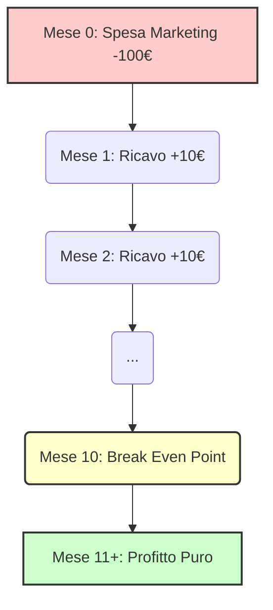

Nel 2015, il CEO di Rocket Internet, Oliver Samwer, era considerato il "clonatore di startup" più efficace al mondo. Il modello era semplice: copia il business model di un'azienda americana, eseguilo in Europa e nei mercati emergenti, fai crescere i numeri di acquisizione a qualsiasi costo, poi quotati in borsa. Il problema era che nessuno controllava le unit economics.

Zalando spendeva 40 euro per acquisire clienti che compravano scarpe da 50 euro, le restituivano al 70%, e sparivano. Il costo di acquisizione era reale; il revenue, al netto dei resi, era quasi zero. Quando i mercati finanziari iniziarono a fare le domande giuste sui fondamentali, le valutazioni collassero. La lezione rimasta: i numeri in cima al funnel possono essere ottimizzati all'infinito, ma se non torna la matematica di base su ogni singolo cliente, stai costruendo su sabbia.

La unit economics non è contabilità. È la domanda più onesta che puoi fare al tuo business: guadagno soldi su ogni vendita, o li perdo?

## Perché Quasi Tutti Sbagliano il Calcolo

Prima di definire le formule, è necessario capire perché la maggior parte dei team di marketing lavora con numeri sbagliati.

**Errore 1: Confondere fatturato con margine.** Se vendi scarpe a 100 euro che ti costano 60 euro di produzione e 10 euro di logistica, il tuo guadagno per transazione non è 100 euro — è 30 euro. Usare il fatturato lordo gonfia il numero del 300%.

**Errore 2: Blended CAC.** Dividere il totale della spesa marketing per il totale dei nuovi clienti, mescolando clienti acquisiti organicamente (costo zero) con clienti da paid ads (costo reale). Il risultato è un numero che sembra ottimistico e non dice nulla di azionabile.

**Errore 3: Ignorare il tempo.** Un LTV di 1.000 euro con un CAC di 100 euro sembra magnifico — ma se il cliente impiega 3 anni a generare quei 1.000 euro, e tu hai bisogno di cassa oggi, il conto non torna.

## LTV (Lifetime Value): La Formula Corretta

La formula che circola sui blog di marketing è:

`LTV = Valore Medio Ordine x Frequenza Acquisto Annuale x Anni di Vita Media`

È corretta ma incompleta. La versione che dovresti usare è:

`LTV = Margine di Contribuzione per Transazione x Frequenza Acquisto Annuale x Anni di Vita Media`

Il margine di contribuzione è il revenue al netto di tutti i costi variabili: costo del prodotto, logistica, costo resi, costi di processing del pagamento. Non i costi fissi (affitto, stipendi), quelli vengono dopo, ma tutti i costi che variano proporzionalmente al numero di transazioni.

### Esempio Concreto

Un e-commerce di abbigliamento ha:
- AOV: 90 euro
- Costo merce: 30 euro
- Costo logistica andata: 8 euro
- Tasso di reso: 25% con costo di gestione reso: 12 euro per reso
- Costo processing pagamento: 2% = 1,80 euro

Margine di contribuzione = 90 - 30 - 8 - (0.25 x 12) - 1,80 = **47,20 euro**

Se il cliente compra 3 volte all'anno e rimane cliente per 2 anni in media:

`LTV = 47,20 x 3 x 2 = 283,20 euro`

Non 90 x 3 x 2 = 540 euro. La differenza è quasi il doppio. Pianificare le campagne di acquisizione usando 540 euro come base porta a CAC target molto più alti di quanto il business possa permettersi.

## CAC: Blended vs Paid, e Perché Contano Entrambi

**CAC Blended** = Totale spesa marketing e vendite / Totale nuovi clienti nel periodo

Utile per il board e per la reportistica generale. Include tutto: paid ads, SEO, PR, stipendi del team commerciale, tool e software. Rappresenta il costo reale di acquisizione visto dall'intera azienda.

**CAC Paid** = Spesa in paid advertising / Nuovi clienti attribuiti ai paid channels

Utile per ottimizzare le campagne. Se il tuo CAC Blended è 50 euro ma il CAC Paid è 180 euro, hai un problema di scalabilità serio: sei dipendente da canali organici che non puoi controllare (SEO, referral, passaparola). Se decidi di crescere accelerando il paid, il tuo CAC reale esploderà.

Il gap tra CAC Blended e CAC Paid racconta la storia della tua dipendenza dall'organico. Le aziende con un organico forte (HubSpot, Moz, Neil Patel) possono permettersi un Paid CAC molto alto. Le aziende senza canone organico devono tenere il Paid CAC molto vicino al Blended.

## La Regola d'Oro: LTV:CAC > 3:1

Il benchmark dell'industria, diffuso da David Skok di Matrix Partners nei suoi pionieristici post sul SaaS Metrics, stabilisce che un rapporto LTV:CAC superiore a 3:1 è il segnale di un business sano.

**Sotto 1:1:** Stai perdendo soldi su ogni cliente acquisito. Ogni campagna che scala accelera le perdite. Fermati, ricalcola, riposiziona.

**Tra 1:1 e 2:1:** Zona di pericolo. Copri i costi variabili ma hai margine zero per i costi fissi, per gli imprevisti. Qualsiasi shock — un aumento del CAC, un calo della retention — ti porta in perdita.

**3:1:** Sweet spot. Il business è sano e scalabile. Hai margine per investire nella crescita, assorbire volatilità e finanziare i costi fissi.

**Sopra 5:1:** Controintuitivo, ma è un segnale di underinvestment. Stai lasciando sul tavolo quota di mercato. Airbnb, nei suoi anni di crescita esplosiva, manteneva deliberatamente un LTV:CAC vicino a 3:1 — non più alto, perché avrebbe significato non stare accelerando abbastanza l'acquisizione.

### Benchmark per Settore (2025-2026)

| Settore | LTV:CAC Ideale | Payback Period | Margin Lordo |
|---------|---|---|---|
| SaaS B2B | 5:1 - 7:1 | 12-18 mesi | 75%+ |
| SaaS B2C | 3:1 - 4:1 | 6-12 mesi | 70%+ |
| E-commerce | 2:1 - 3:1 | 4-8 mesi | 40-50% |
| Marketplace | 2:1 - 3:1 | 6-12 mesi | 20-30% (take rate) |
| Fintech | 4:1 - 6:1 | 18-24 mesi | 60%+ |

Questi benchmark sono stati originariamente sviluppati per il SaaS, ma si applicano con gli opportuni aggiustamenti a qualsiasi modello di business con clienti ricorrenti.

## Il Payback Period: Cash is King

LTV e CAC sono numeri di lungo periodo. Il Payback Period è la domanda di sopravvivenza: quanti mesi impiego per recuperare quello che ho speso per acquisire un cliente?

`Payback Period = CAC / Margine di Contribuzione Mensile`

Se il tuo CAC è 120 euro e ogni mese guadagni 20 euro di margine per cliente, il Payback Period è 6 mesi. In quei 6 mesi, quel denaro è uscito dalle tue casse e non è tornato. Se stai acquisendo 1.000 nuovi clienti al mese, hai 120.000 euro di cassa impegnata in clienti che non hanno ancora "pagato" il loro costo di acquisizione.

### Benchmark di Settore per Payback Period

- Sotto 6 mesi: eccellente. Puoi scalare aggressivamente senza esaurire la liquidità.
- Tra 6 e 12 mesi: accettabile per la maggior parte dei business.
- Tra 12 e 18 mesi: rischioso. Richiede capitali significativi per sostenere la crescita.
- Oltre 18 mesi: tipico del SaaS enterprise. Richiede un capital raise dedicato.

Molte startup brillanti sono fallite non perché il business model fosse sbagliato, ma perché il Payback Period era 18+ mesi e sono rimaste senza cassa prima di raggiungere il punto di equilibrio.

## Visualizzare il Flusso di Cassa

Immagina di spendere 100 euro oggi per acquisire un cliente SaaS che paga 10 euro al mese di abbonamento:



Il grafico sembra semplice, ma nasconde la complessità reale: quei 10 mesi di payback si moltiplicano per ogni nuovo cliente acquisito ogni mese. Se acquisisci 100 clienti a gennaio, altri 120 a febbraio, altri 140 a marzo — il "buco" di cassa si accumula rapidamente.

## Come Calcolare le Tue Unit Economics in Pratica

Il calcolo non richiede strumenti sofisticati. Richiede onestà sui numeri.

**Step 1 — Calcola il margine di contribuzione per transazione.**
Prendi una transazione media. Sottrai il costo del prodotto (COGS), i costi di consegna/fulfillment, il tasso di reso moltiplicato per il costo di gestione reso, le commissioni di pagamento. Il numero che rimane è la tua base per l'LTV.

**Step 2 — Misura la frequenza di acquisto reale.**
Non quella che stimi, quella reale dal tuo database. Quanti ordini fa in media un cliente nel primo anno? Nel secondo anno? I clienti acquisiti da Google Ads hanno una frequenza diversa da quelli acquisiti via email? Quasi sempre sì, e la differenza è enorme.

**Step 3 — Calcola la vita media del cliente.**
Il modo più preciso è guardare le coorti storiche: dei clienti acquisiti 36 mesi fa, quanti sono ancora attivi? Questo ti dà il churn rate storico, che puoi usare per calcolare la vita media: `Vita Media = 1 / Churn Rate Mensile`.

**Step 4 — Separa il CAC per canale.**
Il CAC di Google Search è diverso dal CAC di Meta Ads, che è diverso dal CAC del referral. Trattarli come un numero unico è come calcolare la media di temperature in città diverse.

**Step 5 — Calcola il rapporto LTV:CAC per canale.**
Questo è il numero che ti dice dove investire il prossimo euro di budget.

## Il Caso Dropbox: Unit Economics Come Leva Strategica

Nel 2008, Dropbox spendeva 388 dollari per acquisire un cliente via Google Ads per un prodotto che costava 99 dollari all'anno. LTV:CAC = disastroso. La risposta di Drew Houston non fu ottimizzare le campagne — fu eliminare quasi completamente il paid acquisition e costruire un programma referral che regalava storage sia a chi invitava che a chi veniva invitato.

Il costo di acquisizione via referral era essenzialmente zero (il costo marginale di storage era trascurabile). L'LTV rimaneva invariato. Il rapporto LTV:CAC esplose. In 15 mesi, Dropbox passò da 100.000 a 4 milioni di utenti. La lezione non è "usa il referral" — è che le unit economics ti costringono a trovare soluzioni creative che l'ottimizzazione incrementale non avrebbe mai suggerito.

## SQL per Calcolare CAC e LTV

```sql
-- CAC Storico per Canale con Blended vs Paid
WITH new_customers_blended AS (
  SELECT
    DATE_TRUNC(MIN(order_date), MONTH) as cohort_month,
    COUNT(DISTINCT user_id) as new_customers,
    -- Blended: tutti i canali
    SUM(total_marketing_spend) / COUNT(DISTINCT user_id) as cac_blended
  FROM customers_with_spend
  GROUP BY cohort_month
),

new_customers_paid_only AS (
  SELECT
    DATE_TRUNC(MIN(order_date), MONTH) as cohort_month,
    utm_source,
    COUNT(DISTINCT user_id) as new_customers_paid,
    SUM(paid_spend) / COUNT(DISTINCT user_id) as cac_paid
  FROM customers_with_spend
  WHERE utm_source IN ('google_ads', 'facebook_ads', 'tiktok_ads')
  GROUP BY cohort_month, utm_source
),

ltv_calculation AS (
  SELECT
    DATE_TRUNC(MIN(order_date), MONTH) as cohort_month,
    COUNT(DISTINCT user_id) as cohort_size,
    ROUND(SUM(total_revenue) / COUNT(DISTINCT user_id), 2) as ltv_storico
  FROM customers_full_history
  WHERE acquisition_date >= DATE_SUB(CURRENT_DATE(), INTERVAL 36 MONTH)
    AND current_date >= DATE_ADD(acquisition_date, INTERVAL 24 MONTH)
  GROUP BY cohort_month
)

SELECT
  nc.cohort_month,
  nc.new_customers,
  nc.cac_blended,
  ncpo.cac_paid,
  ltv.ltv_storico,
  ROUND(ltv.ltv_storico / nc.cac_blended, 2) as ltv_cac_blended_ratio,
  ROUND(ltv.ltv_storico / ncpo.cac_paid, 2) as ltv_cac_paid_ratio
FROM new_customers_blended nc
LEFT JOIN new_customers_paid_only ncpo USING (cohort_month)
LEFT JOIN ltv_calculation ltv USING (cohort_month)
ORDER BY nc.cohort_month DESC;
```

## Le Domande Che Dovresti Farti Ogni Mese

Le unit economics non sono un calcolo da fare una volta e dimenticare. Sono un processo di monitoraggio continuo. Ogni mese, dovresti avere risposta a:

1. **Il mio LTV:CAC per canale paid è sopra 3:1?** Se no, qual è il canale che trascina la media in basso e perché?

2. **Il mio Payback Period si sta allungando o accorciando?** Un allungamento segnala che il business sta diventando meno efficiente — occorre capire se è un aumento del CAC, un calo della retention, o entrambi.

3. **La mia coorte più recente ha un LTV proiettato superiore a quella di 12 mesi fa?** Se stai migliorando il prodotto e l'onboarding, le coorti recenti dovrebbero avere una retention migliore e quindi un LTV più alto.

4. **qual è il canale con il miglior LTV:CAC assoluto?** Quel canale merita più budget, anche se il volume attuale è piccolo. La scalabilità si raggiunge aumentando il budget sui canali già efficienti, non sperando che quelli inefficienti migliorino.

5. **Sto investendo di più nei canali con LTV:CAC > 3:1?** Se hai diversi canali con rapporti superiori a 3:1, dovresti spostare budget dai canali sotto 2:1 a quelli sopra 4:1.

## Benchmark LTV:CAC per Settore (Aggiornato 2026)

| Settore | LTV:CAC Minimo Sostenibile | LTV:CAC Sano | LTV:CAC Targets Aggressivi |
|---------|---|---|---|
| **SaaS B2B** | 2.5:1 | 5:1 | 8:1+ |
| **SaaS B2C** | 2:1 | 3.5:1 | 5:1+ |
| **E-commerce Moda** | 1.5:1 | 2.5:1 | 3.5:1 |
| **E-commerce Grocery** | 1.2:1 | 2:1 | 2.5:1 |
| **Marketplace** | 1.5:1 | 2.5:1 | 3.5:1 |
| **Fintech** | 3:1 | 5:1 | 7:1+ |
| **Creator Economy** | 2:1 | 3.5:1 | 5:1+ |

## Conclusione

Le unit economics non mentono. Se i tuoi numeri non tornano, non c'è storytelling, pitch al board, o campagna creativa che possa compensare. Ma se i numeri tornano, hai una delle risorse più preziose nel business: la certezza matematica che ogni euro investito nell'acquisizione genera un ritorno positivo e misurabile.

La bellezza delle unit economics è che sono brutalmente oneste. Non permettono l'illusione di stare bene quando in realtà stai male. Sono il termometro che ti dice la vera temperatura del tuo business — non quella che vuoi che sia, ma quella che è davvero.

Approfondisci il modulo [Metriche Fondamentali](/course/metriche-fondamenti/) su GinnyTech per comprendere come queste metriche si inseriscono nella strategia di growth più ampia.
