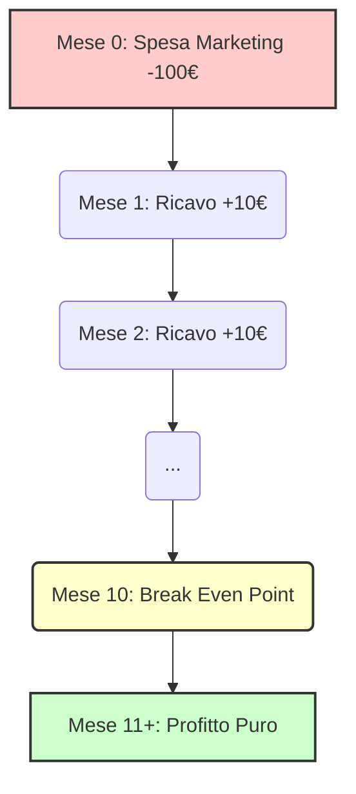

{/* geo-imprint: contesto:valuta, contesto:piattaforma, contesto:modello */}

Vedi crescere il fatturato, aumenti il budget sulle campagne, eppure a fine mese la cassa scende invece di salire. Quando acquisisci nuovi clienti senza sapere quanto margine lasciano davvero in azienda, ogni vendita rischia di amplificare una perdita.

Calcolare le unit economics ti permette di rispondere con precisione a una domanda semplice: su ogni singolo cliente guadagni o perdi soldi? In questa guida impari a calcolare il Lifetime Value sul margine reale, a separare il CAC paid da quello organico e a gestire il payback period prima che la liquidità si esaurisca.

Un caso noto chiarisce subito cosa succede quando si ignora questa matematica. Nel 2015 Oliver Samwer, CEO di Rocket Internet, era considerato il "clonatore di startup" più efficace al mondo. Il suo modello consisteva nel replicare business model americani in Europa e nei mercati emergenti, spingere sulla crescita e puntare alla quotazione in borsa, trascurando però la sostenibilità del singolo cliente.
{/* GEO: claim senza fonte */}

Zalando, per esempio, spendeva 40 euro per acquisire clienti che compravano scarpe da 50 euro, le restituivano nel 70% dei casi e poi non tornavano più. Il costo di acquisizione usciva subito dalla cassa, mentre il ricavo netto restava vicino allo zero. Quando i mercati finanziari iniziarono a verificare i fondamentali, le valutazioni crollarono. Ottimizzare i numeri in cima al funnel diventa inutile se l'economia del singolo ordine non regge.

## Evita i tre errori che falsano il calcolo

Prima di impostare il foglio di calcolo, conviene eliminare tre abitudini molto diffuse nei team di marketing:

- Confondere fatturato e margine. Vendere a 100 euro un prodotto che ne costa 70 significa generare 30 euro di margine, non 100 euro di guadagno disponibile.
- Usare solo un CAC "blended" che mescola i clienti arrivati in organico a costo zero con quelli acquisiti tramite annunci a pagamento. La media che ottieni sembra rassicurante, ma nasconde il costo reale della scalabilità.
- Ignorare il fattore tempo. Un LTV elevato che si concretizza solo dopo diversi anni crea problemi seri se hai bisogno di liquidità oggi per pagare fornitori e stipendi.

## Calcola il LTV reale partendo dal margine

La formula più diffusa online per il Lifetime Value è questa:

`LTV = Valore Medio Ordine x Frequenza Acquisto Annuale x Anni di Vita Media`

Questa versione è incompleta perché usa il prezzo di vendita lordo. Per ottenere un dato affidabile devi sostituire il valore dell'ordine con il margine:

`LTV = Margine di Contribuzione per Transazione x Frequenza Acquisto Annuale x Anni di Vita Media`

Il margine di contribuzione corrisponde al ricavo al netto di tutti i costi variabili diretti (produzione, logistica, gestione resi, commissioni di pagamento), escludendo i costi fissi aziendali.

### Applica la formula a un e-commerce reale

Prendiamo un e-commerce di abbigliamento con questi parametri medi:

- AOV (valore medio ordine): 90 euro
- Costo merce: 30 euro
- Logistica: 8 euro
- Resi al 25% con costo gestione reso di 12 euro
- Commissioni pagamento al 2% (1,80 euro)

Il margine di contribuzione per singolo ordine risulta: `90 - 30 - 8 - (0,25 x 12) - 1,80 = 47,20 euro`.

Se il cliente acquista 3 volte l'anno e rimane attivo per 2 anni, il calcolo diventa:

`LTV = 47,20 x 3 x 2 = 283,20 euro`

Se invece ignorassi i costi variabili, il conto ti darebbe 540 euro. Impostare i limiti di spesa pubblicitaria su 540 euro ti porterebbe a tollerare un CAC insostenibile per il bilancio reale.

## Separa il CAC paid dal CAC blended

Il CAC blended divide la spesa marketing totale per tutti i nuovi clienti acquisiti, includendo traffico organico, passaparola e campagne a pagamento. Il CAC paid, al contrario, divide il solo investimento pubblicitario per i nuovi clienti generati direttamente da quegli annunci.

Osservare la distanza tra questi due valori ti mostra quanto l'azienda dipenda dal traffico gratuito. Se il CAC paid supera di molto il CAC blended, aumentare il budget pubblicitario per accelerare la crescita eroderà rapidamente i margini.

## Valuta la salute del modello con il rapporto LTV:CAC

Una volta calcolati entrambi i valori, il rapporto tra LTV e CAC ti indica in quale fascia si trova il tuo business:

- Sotto 1:1: perdi denaro su ogni nuovo cliente acquisito.
- Tra 1:1 e 2:1: il margine basta appena a coprire i costi diretti e lascia pochissimo spazio per i costi fissi, rendendo l'azienda fragile.
- 3:1: il modello è sano, sostenibile e pronto per scalare.
- Sopra 5:1: probabilmente stai investendo troppo poco in acquisizione e stai lasciando quote di mercato ai concorrenti.

### Benchmark per settore (2025-2026)

| Settore       | LTV:CAC Ideale | Payback Period | Margine Lordo |
|---------------|----------------|----------------|---------------|
| SaaS B2B      | 5:1 - 7:1      | 12-18 mesi     | 75%+          |
| SaaS B2C      | 3:1 - 4:1      | 6-12 mesi      | 70%+          |
| E-commerce    | 2:1 - 3:1      | 4-8 mesi       | 40-50%        |
| Marketplace   | 2:1 - 3:1      | 6-12 mesi      | 20-30% (take rate) |
| Fintech       | 4:1 - 6:1      | 18-24 mesi     | 60%+          |

## Misura il payback period per proteggere la cassa

Sapere che un cliente renderà bene nell'arco di tre anni serve a poco se finisci la liquidità al sesto mese. Il payback period misura esattamente quanti mesi occorrono per recuperare il CAC tramite il margine mensile generato dal cliente:

`Payback Period = CAC / Margine di Contribuzione Mensile`

Per esempio, con un CAC di 120 euro e un margine mensile di 20 euro, il payback è di 6 mesi. Durante tutto questo semestre il capitale investito resta bloccato prima di generare profitto netto.

### Soglie di riferimento per il payback

- `<6` mesi: eccellente
- 6-12 mesi: accettabile
- 12-18 mesi: rischioso
- >18 mesi: tipico del SaaS enterprise, sostenibile solo con capitali adeguati

Spesso una startup chiude per un payback troppo lungo e la cassa che finisce prima, anche quando il prodotto e il modello di fondo funzionano.

## Visualizza l'impatto del payback sul flusso di cassa

Questo disavanzo iniziale si moltiplica per ogni nuovo cliente acquisito nello stesso mese. Più acceleri le acquisizioni, più il fabbisogno di cassa cresce nel breve periodo.

## Applica il metodo in cinque passaggi

Per portare questi calcoli nella gestione quotidiana della tua azienda, segui questa sequenza:

1. Calcola il margine di contribuzione per transazione sottraendo tutti i costi variabili.
2. Misura la frequenza di acquisto reale suddivisa per coorti mensili e canali.
3. Stima la vita media del cliente partendo dal churn rate storico.
4. Separa il CAC per singolo canale di acquisizione.
5. Confronta il rapporto LTV:CAC di ciascun canale per decidere dove spostare il budget.

## Come Dropbox ha risolto un LTV:CAC insostenibile

Quando i numeri non tornano, ritoccare le creatività pubblicitarie spesso non basta. Nel 2008 Dropbox spendeva 388 dollari per acquisire un cliente che pagava 99 dollari all'anno, un rapporto chiaramente insostenibile nel breve e medio periodo.

Invece di insistere sulle campagne a pagamento, il team costruì un programma di referral basato sullo spazio gratuito condiviso, con costi marginali bassissimi. Di conseguenza il rapporto LTV:CAC migliorò drasticamente e gli utenti passarono da 100.000 a 4 milioni in 15 mesi. Quando la matematica di base è sfavorevole, cambiare canale o meccanismo di crescita produce effetti molto più grandi di qualsiasi ottimizzazione incrementale.

## Imposta il monitoraggio per coorti mensili

Un controllo efficace richiede di tracciare ogni mese CAC blended, CAC paid e LTV suddivisi per coorte di acquisizione. Aggiornare queste tre metriche in un database o in un report SQL ti permette di accorgerti subito se l'efficienza di un canale si sta degradando prima che il problema pesi sul conto economico.

## Controlla questi cinque indicatori ogni mese

Durante la revisione mensile dei numeri, verifica sempre questi cinque punti:

- Il rapporto LTV:CAC sul canale paid supera la soglia di 3:1?
- Il payback period si sta accorciando o allungando rispetto al trimestre precedente?
- La coorte più recente genera un LTV più alto rispetto a quella di 12 mesi fa?
- Quale canale registra il miglior rapporto LTV:CAC a parità di volume?
- Il budget mensile si sta spostando verso i canali con LTV:CAC superiore a 3:1?

## Confronta i tuoi numeri con i benchmark 2026

| Settore           | Minimo Sostenibile | Business Sano | Target Aggressivi |
|-------------------|--------------------|---------------|-------------------|
| SaaS B2B          | 2.5:1              | 5:1           | 8:1+              |
| SaaS B2C          | 2:1                | 3.5:1         | 5:1+              |
| E-commerce Moda   | 1.5:1              | 2.5:1         | 3.5:1             |
| E-commerce Grocery| 1.2:1              | 2:1           | 2.5:1             |
| Marketplace       | 1.5:1              | 2.5:1         | 3.5:1             |
| Fintech           | 3:1                | 5:1           | 7:1+              |
| Creator Economy   | 2:1                | 3.5:1         | 5:1+              |

## Verifica oggi i tuoi numeri

Le unit economics ti danno un riscontro diretto sulla tenuta del tuo modello di business. Se i conti tornano, sai con precisione matematica che ogni euro investito in acquisizione rientra con un margine positivo.

Apri i dati dell'ultimo trimestre, sottrai tutti i costi variabili dal valore medio degli ordini e calcola il tuo LTV:CAC sul canale paid. Da quel singolo numero capirai subito se è il momento di scalare la spesa pubblicitaria o di correggere prima margini e ritenzione.

## Domande frequenti

1. **Cos'è il CAC?**
Il CAC (Customer Acquisition Cost) è il costo totale sostenuto per acquisire nuovi clienti diviso per il numero di clienti acquisiti nello stesso periodo. Include spesa pubblicitaria, costi di marketing e costi commerciali diretti.

2. **Cos'è il LTV?**
Il LTV (Lifetime Value) è il margine di contribuzione totale che un cliente genera durante l'intera relazione con l'azienda. Si calcola moltiplicando il margine medio per transazione per la frequenza di acquisto e la durata media del cliente.

3. **Quando il rapporto LTV:CAC è troppo basso?**
Sotto la soglia di 3:1 il modello inizia a mostrare fragilità, perché ogni euro investito in acquisizione genera meno di tre euro di margine nel lungo periodo. Sotto 1:1 l'azienda perde denaro su ogni nuovo cliente.

4. **Come si riduce il payback period?**
Puoi accorciare il payback period aumentando il margine di contribuzione per ordine, incrementando la frequenza di acquisto nei primi mesi o abbassando il CAC per singolo canale.
