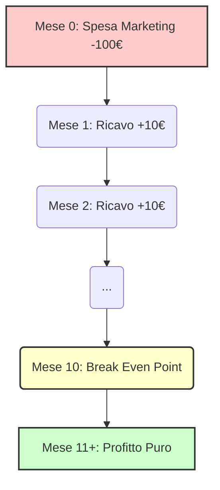

{/* geo-imprint: contesto:valuta, contesto:piattaforma, contesto:modello */}

Nel 2015 Oliver Samwer, CEO di Rocket Internet, era considerato il "clonatore di startup" più efficace al mondo. Il suo modello era semplice: prendere business model americani, replicarli in Europa e nei mercati emergenti, crescere a ogni costo e arrivare in borsa. Il problema? Nessuno teneva d'occhio le unit economics.
{/* GEO: claim senza fonte */}

Zalando, per dire, spendeva 40 euro per acquisire clienti che compravano scarpe da 50 euro, le restituivano nel 70% dei casi e poi sparivano. Il costo di acquisizione era reale, il ricavo netto quasi zero. Quando i mercati finanziari iniziarono a guardare i fondamentali, le valutazioni crollarono. La morale è chiara: ottimizzare i numeri in cima al funnel non serve a niente se la matematica del singolo cliente non torna.

Le unit economics non sono contabilità. Sono la domanda più onesta che puoi rivolgere al tuo business: su ogni vendita ci guadagno o ci perdo?

## Perché quasi tutti sbagliano il calcolo

Gli errori che vedo più spesso nei team di marketing sono tre.

- Confondere fatturato e margine. Vendere a 100 euro un prodotto che ne costa 70 non significa guadagnare 100 euro, ma 30.
- Usare un CAC "blended" che mescola i clienti arrivati in organico (a costo zero) con quelli da paid ads. Il dato che ne esce è ottimista ma serve a poco.
- Dimenticare il fattore tempo. Un LTV alto ma spalmato su anni può diventare insostenibile se la liquidità ti serve adesso.

## LTV (Lifetime value): la formula corretta

La formula che gira di solito è questa:

`LTV = Valore Medio Ordine x Frequenza Acquisto Annuale x Anni di Vita Media`

Ma è incompleta. Quella corretta sostituisce il valore dell'ordine con il margine:

`LTV = Margine di Contribuzione per Transazione x Frequenza Acquisto Annuale x Anni di Vita Media`

Il margine di contribuzione è il ricavo al netto di tutti i costi variabili (produzione, logistica, resi, commissioni di pagamento), non dei costi fissi.

### Esempio concreto

Un e-commerce di abbigliamento con:
- AOV: 90 euro
- Costo merce: 30 euro
- Logistica: 8 euro
- Resi al 25% con costo gestione reso di 12 euro
- Commissioni pagamento 2% (1,80 euro)

Margine di contribuzione = 90 - 30 - 8 - (0,25 x 12) - 1,80 = 47,20 euro

Se il cliente compra 3 volte l'anno e resta per 2 anni:

`LTV = 47,20 x 3 x 2 = 283,20 euro`

Non 540 euro, come verrebbe fuori ignorando i margini. Pianificare le campagne sulla base di 540 euro porta dritto a CAC target che non potrai mai sostenere.

## CAC: blended vs paid

Il CAC blended è la spesa marketing totale divisa per i nuovi clienti: include tutti i canali e tutti i costi. Il CAC paid, invece, prende solo la spesa in paid advertising e la divide per i clienti arrivati da lì. La distanza tra i due ti dice quanto dipendi dall'organico. Se il CAC paid è molto più alto del blended, scalare a colpi di paid diventa rischioso.

## La regola d'oro: ltv:cac > 3:1

- Sotto 1:1: perdi soldi su ogni cliente.
- Tra 1:1 e 2:1: margine zero per coprire i costi fissi, business fragile.
- 3:1: business sano e scalabile.
- Sopra 5:1: probabile underinvestment, stai lasciando per strada occasioni di crescita.

### Benchmark per settore (2025-2026)

| Settore       | LTV:CAC Ideale | Payback Period | Margine Lordo |
|---------------|----------------|----------------|---------------|
| SaaS B2B      | 5:1 - 7:1      | 12-18 mesi     | 75%+          |
| SaaS B2C      | 3:1 - 4:1      | 6-12 mesi      | 70%+          |
| E-commerce    | 2:1 - 3:1      | 4-8 mesi       | 40-50%        |
| Marketplace   | 2:1 - 3:1      | 6-12 mesi      | 20-30% (take rate) |
| Fintech       | 4:1 - 6:1      | 18-24 mesi     | 60%+          |

## Payback period: quanto tempo per recuperare il CAC

Il payback period misura quanti mesi servono per recuperare il CAC con il margine mensile:

`Payback Period = CAC / Margine di Contribuzione Mensile`

Se il CAC è 120 euro e il margine mensile 20 euro, il payback è di 6 mesi. Per tutto quel periodo il capitale resta bloccato senza ritorno.

### Benchmark payback

- `<6` mesi: eccellente
- 6-12 mesi: accettabile
- 12-18 mesi: rischioso
- >18 mesi: tipico del SaaS enterprise, richiede capitale significativo

Molte startup non falliscono per un modello sbagliato, ma per un payback troppo lungo e cassa che finisce prima.

## Visualizzare il flusso di cassa

Quel buco si moltiplica per ogni cliente che acquisisci, e cresce in fretta.

## Come calcolare le tue unit economics in pratica

1. Calcola il margine di contribuzione per transazione sottraendo tutti i costi variabili.
2. Misura la frequenza di acquisto reale per coorti e canali.
3. Stima la vita media del cliente partendo dal churn rate storico.
4. Separa il CAC per canale.
5. Calcola il rapporto LTV:CAC per canale e usalo per decidere dove investire.

## Il caso dropbox: le unit economics guidano la strategia

Nel 2008 Dropbox spendeva 388 dollari per acquisire un cliente che pagava 99 dollari all'anno: un rapporto disastroso. Invece di limarsi le campagne, costruirono un programma referral con costi marginali bassissimi. Il rapporto LTV:CAC esplose e gli utenti passarono da 100.000 a 4 milioni in 15 mesi.

La lezione è che le unit economics, quando non tornano, ti spingono verso soluzioni creative invece dell'ennesima ottimizzazione incrementale.

## SQL per calcolare CAC e LTV

La query mostra come ricavare CAC blended, CAC paid e LTV per coorti mensili, comodo per tenere sotto controllo l'efficienza dei canali nel tempo.

## Domande da fare ogni mese

- Il mio LTV:CAC sul canale paid è sopra 3:1?
- Il payback period si sta allungando o accorciando?
- La coorte più recente ha un LTV più alto di quella di 12 mesi fa?
- Qual è il canale con il miglior LTV:CAC?
- Sto spostando budget verso i canali con LTV:CAC > 3:1?

## Benchmark aggiornati 2026

| Settore          | Minimo Sostenibile | Business Sano | Target Aggressivi |
|------------------|--------------------|---------------|-------------------|
| SaaS B2B         | 2.5:1              | 5:1           | 8:1+              |
| SaaS B2C         | 2:1                | 3.5:1         | 5:1+              |
| E-commerce Moda  | 1.5:1              | 2.5:1         | 3.5:1             |
| E-commerce Grocery| 1.2:1              | 2:1           | 2.5:1             |
| Marketplace      | 1.5:1              | 2.5:1         | 3.5:1             |
| Fintech          | 3:1                | 5:1           | 7:1+              |
| Creator Economy  | 2:1                | 3.5:1         | 5:1+              |

## Il punto
Le unit economics sono il termometro vero del tuo business. Se i numeri non tornano, nessuna narrazione e nessuna campagna ti salvano. Se tornano, hai la certezza matematica che ogni euro investito torna indietro con un margine. Sono spietatamente oneste, e ti obbligano a decidere sui dati invece che sulle speranze. Monitorale con disciplina e lascia che siano queste metriche a indirizzare la crescita.

## Domande frequenti

1. **Cos'è il CAC?**
CAC (Customer Acquisition Cost) è il costo totale di acquisizione diviso per i nuovi clienti acquisiti. Include marketing, pubblicità e costi di vendita diretti.

2. **Cos'è il LTV?**
LTV (Lifetime Value) è il margine che un cliente genera durante tutta la sua vita. Si calcola come margine medio per ordine × frequenza di acquisto × durata di vita del cliente.

3. **Quando il LTV/CAC è troppo basso?**
Quando è sotto 3:1. Significa che ogni euro speso per acquisire un cliente restituisce meno di tre euro di margine nel lungo periodo. Sotto questo livello, il modello non scala senza bruciare cassa.

4. **Come si riduce il payback period?**
Si riduce aumentando il margine per transazione, aumentando la frequenza di acquisto, o riducendo il CAC. La combinazione più potente è aumentare il margine mantenendo il CAC stabile.
