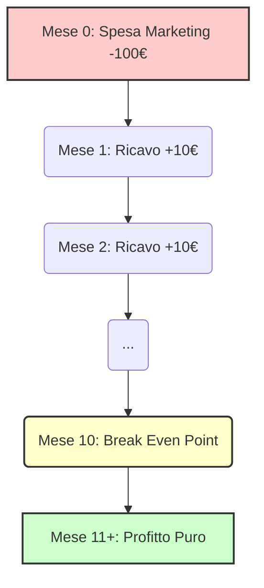

# Unit Economics: La Bussola della Sostenibilità

Se spendi 50€ per acquisire un cliente che te ne porta 30€, stai fallendo velocemente. Sembra ovvio, ma molte startup (e aziende consolidate) ignorano la matematica di base fino a quando non finiscono i soldi.

La **Unit Economics** è l'analisi della profittabilità di una singola unità di business (di solito, un cliente). È la risposta alla domanda: "Guadagniamo soldi su ogni vendita, o ne perdiamo?".

## LTV (Lifetime Value): Quanto Vale Davvero un Cliente?

L'LTV non è solo il primo acquisto. È il valore totale che un cliente genera durante tutta la sua relazione con te.

La formula base:
`LTV = (Valore Medio Ordine) x (Frequenza Acquisto Annuale) x (Vita Media Cliente in Anni)`

Ma attenzione! Molti dimenticano di sottrarre i costi variabili. L'LTV *reale* dovrebbe basarsi sul **Margine di Contribuzione**, non sul fatturato lordo. Se vendi scarpe a 100€ ma ti costano 60€, il tuo LTV si basa sui 40€ di margine.

## CAC (Customer Acquisition Cost): Quanto Costa Davvero?

Il calcolo del CAC è spesso manipolato per sembrare migliore.
`CAC = Spesa Totale Marketing / Nuovi Clienti Acquisiti`

### Blended CAC vs Paid CAC
*   **Blended CAC:** Include tutto il traffico (organico, referral, paid). È utile per il board, ma nasconde l'efficienza delle campagne.
*   **Paid CAC:** Considera solo la spesa pubblicitaria diviso i clienti acquisiti *da quella spesa*. Se il tuo Blended CAC è 20€ ma il Paid CAC è 150€, hai un problema di scalabilità.

## La Regola d'Oro: LTV:CAC > 3:1

Una buona regola empirica per la sostenibilità è che il valore di un cliente deve essere almeno tre volte il costo per acquisirlo.
*   **&lt; 1:1:** Stai perdendo soldi su ogni vendita. Fermati subito.
*   **1:1 - 3:1:** Sei in zona pericolo. Hai poco margine per costi fissi e imprevisti.
*   **3:1:** Sweet Spot. Hai un business sano.
*   **> 5:1:** Stai spendendo troppo poco per crescere. Accelera!

## Il Payback Period: "Cash is King"

Anche se hai un LTV di 1000€ e un CAC di 100€ (10:1!), potresti fallire se il cliente impiega 2 anni per pagarti quei 1000€.
Il **Payback Period** è il tempo necessario per recuperare il costo di acquisizione.
*   **Ideale:** &lt; 6 mesi.
*   **Accettabile:** &lt; 12 mesi.
*   **Rischioso:** > 18 mesi (richiede molti capitali esterni).

## Visualizzare il Flusso di Cassa

Immagina di spendere 100€ oggi (CAC) per ottenere 10€ al mese (Abbonamento).

## Conclusione

La Unit Economics non è solo contabilità. È strategia pura. Se conosci i tuoi numeri, sai esattamente quanto puoi permetterti di spendere per acquisire un cliente e quali canali tagliare. Non indovinare, calcola.
