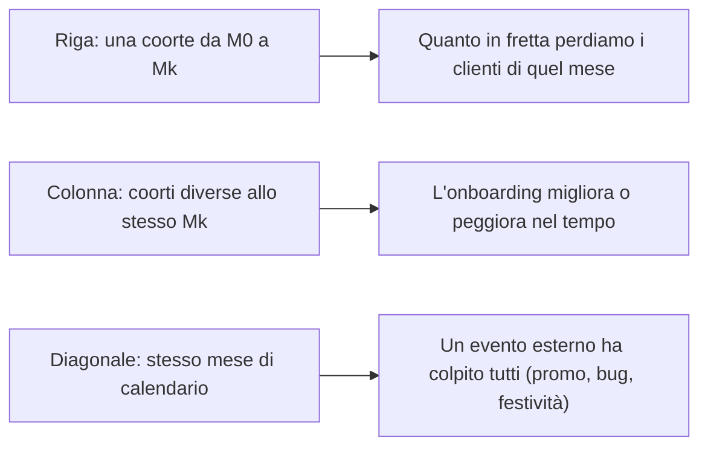

Scenario costruito con numeri di esempio: un negozio online guarda ogni mese la quota di clienti attivi nel mese precedente che comprano ancora. Da gennaio a febbraio la quota è del 60%, da febbraio a marzo sale al 62,5%, e il team commenta che l'onboarding sta funzionando. Poi qualcuno costruisce la matrice per coorte di ingresso e scopre che i clienti arrivati a febbraio tornano nel 50% dei casi, contro il 60% di quelli arrivati a gennaio. L'indicatore aggregato è salito perché dentro il totale c'è un cliente storico, iscritto a novembre, che compra ogni mese e tiene alta la media.

> **Idea chiave:** la retention si misura dentro una coorte, cioè tra persone nate nello stesso mese, dividendo sempre per la dimensione della coorte a M0; una media su tutti i clienti attivi mescola età diverse e nasconde il peggioramento delle ultime acquisizioni.

## Perché la media aggregata inganna

Prima di scrivere SQL conviene rifare il conto dell'esempio a mano, perché mostra bene il meccanismo. In gennaio comprano 5 clienti (numerati da 1 a 5). In febbraio gli ordini pagati arrivano da 8 clienti: 1, 2, 5, 6, 7, 8, 9 e il cliente 13, quello storico. Dei 5 clienti di gennaio ne ritroviamo 3 (1, 2 e 5), quindi la quota di riacquisto è 3 / 5 = 60%. In marzo risultano attivi 9 clienti; degli 8 clienti attivi in febbraio ne tornano 5 (1, 5, 6, 8 e 13), quindi 5 / 8 = 62,5%.

Il rialzo di 2,5 punti percentuali sembra una buona notizia. Se però togli il cliente 13 dal calcolo di febbraio, i clienti attivi diventano 7 e quelli che tornano a marzo sono 4: 4 / 7 = 57,1%. Senza il cliente storico la quota scende sotto il 60%. La quota totale è stata spinta da un solo cliente fedele, mentre la matrice di coorte separa le persone per mese di nascita e rende visibile quello che succede ai nuovi arrivati.

| Cosa guardi | Valore | Come si calcola | Cosa nasconde |
| :--- | ---: | :--- | :--- |
| Quota di riacquisto gen → feb | 60% | 3 clienti su 5 attivi a gennaio | Niente: è tutta coorte di gennaio |
| Quota di riacquisto feb → mar, totale | 62,5% | 5 clienti su 8 attivi a febbraio | Il cliente 13 iscritto a novembre pesa 1 su 8 |
| Quota feb → mar senza il cliente 13 | 57,1% | 4 clienti su 7 | Mostra il calo reale |
| Retention M1 della coorte di febbraio | 50% | 2 clienti su 4 nati a febbraio | Nulla da nascondere: ogni cliente ha la stessa età |

## Tre assi per leggere una matrice

Una matrice di coorte ha una riga per ogni mese di nascita e una colonna per ogni distanza dal mese di nascita, chiamata `period_number`: M0 è il mese del primo acquisto, M1 il mese successivo, e così via. Le stesse celle si leggono in tre direzioni, ciascuna con una domanda diversa.



Lungo la riga confronti la stessa popolazione con se stessa nel tempo, quindi il denominatore resta lo stesso. Lungo la colonna confronti popolazioni diverse alla stessa età, ed è la lettura giusta per capire se un cambio di prodotto o di canale ha cambiato la qualità dei nuovi clienti. Lungo la diagonale controlli il calendario: se tutte le coorti perdono punti nello stesso mese solare, la causa è probabilmente esterna, e non l'invecchiamento dei clienti.

## La coorte si fissa sull'intera storia

Il primo requisito è che ogni cliente appartenga a una sola coorte, per sempre. La coorte è il mese del primo ordine pagato, calcolato con `min(order_date)` su tutta la storia disponibile. Per provarlo usiamo una tabella di 24 ordini di 13 clienti. Nota il cliente 13: ha ordinato a novembre 2025, poi a febbraio e marzo 2026. Nota anche l'ordine 7 del cliente 3, che è `refunded` e non deve contare come attività.

```sql
-- Tabella ordini di esempio: 13 clienti, novembre 2025 - marzo 2026
CREATE TABLE fct_orders
(
    order_id UInt32,
    customer_id UInt32,
    order_date Date,
    status String
) ENGINE = MergeTree ORDER BY (customer_id, order_date);

INSERT INTO fct_orders VALUES
(1, 1, '2026-01-05', 'paid'), (2, 1, '2026-02-10', 'paid'), (3, 1, '2026-03-12', 'paid'),
(4, 2, '2026-01-09', 'paid'), (5, 2, '2026-02-20', 'paid'),
(6, 3, '2026-01-15', 'paid'), (7, 3, '2026-02-18', 'refunded'),
(8, 4, '2026-01-20', 'paid'), (9, 4, '2026-03-03', 'paid'),
(10, 5, '2026-01-28', 'paid'), (11, 5, '2026-02-02', 'paid'), (12, 5, '2026-03-30', 'paid'),
(13, 6, '2026-02-03', 'paid'), (14, 6, '2026-03-08', 'paid'),
(15, 7, '2026-02-11', 'paid'),
(16, 8, '2026-02-14', 'paid'), (17, 8, '2026-03-01', 'paid'),
(18, 9, '2026-02-25', 'paid'),
(19, 10, '2026-03-02', 'paid'),
(20, 11, '2026-03-09', 'paid'),
(21, 12, '2026-03-18', 'paid'),
(22, 13, '2025-11-20', 'paid'), (23, 13, '2026-02-07', 'paid'), (24, 13, '2026-03-14', 'paid');
```

Ora la query che sembra ragionevole ma sbaglia: il filtro sulle date arriva prima del calcolo del primo acquisto.

```sql
-- ERRORE: la coorte è calcolata solo sugli ordini dal 2026-01-01 in poi
SELECT
    toStartOfMonth(first_order) AS wrong_cohort_month,
    count() AS customers
FROM
(
    SELECT customer_id, min(order_date) AS first_order
    FROM fct_orders
    WHERE status = 'paid' AND order_date >= '2026-01-01'
    GROUP BY customer_id
)
GROUP BY wrong_cohort_month
ORDER BY wrong_cohort_month;
```

Il risultato è gennaio 5, febbraio 5, marzo 3. Febbraio dovrebbe avere 4 clienti: il quinto è il cliente 13, che il filtro ha privato del suo ordine di novembre e che ora sembra nato a febbraio. La coorte corretta si calcola prima di qualunque filtro temporale:

```sql
-- Passo 1: coorte immutabile, calcolata sull'intera storia dei soli ordini pagati
SELECT customer_id, toStartOfMonth(min(order_date)) AS cohort_month
FROM fct_orders
WHERE status = 'paid'
GROUP BY customer_id
ORDER BY customer_id;
```

L'output assegna i clienti da 1 a 5 a gennaio, da 6 a 9 a febbraio, da 10 a 12 a marzo e il cliente 13 a novembre 2025. Solo a questo punto puoi decidere quali coorti mostrare, per esempio quelle dal 2026-01-01 in poi.

## Dalle righe di attività a period_number

Il secondo passo unisce ogni ordine pagato alla coorte del suo cliente e calcola la distanza in mesi con `dateDiff('month', ...)`. Conta i clienti distinti con `uniqExact`, perché un cliente che ordina due volte nello stesso mese deve pesare una volta sola. Questo è l'output intermedio che conviene ispezionare a occhio prima di costruire la matrice.

```sql
-- Passo 2: attività per coorte e distanza dal mese di nascita
WITH customer_cohorts AS (
    SELECT customer_id, toStartOfMonth(min(order_date)) AS cohort_month
    FROM fct_orders
    WHERE status = 'paid'
    GROUP BY customer_id
)
SELECT
    c.cohort_month AS cohort_month,
    dateDiff('month', c.cohort_month, toStartOfMonth(o.order_date)) AS period_number,
    uniqExact(o.customer_id) AS active_customers
FROM fct_orders AS o
INNER JOIN customer_cohorts AS c ON o.customer_id = c.customer_id
WHERE o.status = 'paid'
GROUP BY cohort_month, period_number
ORDER BY cohort_month, period_number;
```

Le righe restituite sono nove: la coorte di novembre 2025 compare a M0 (1 cliente), M3 (1) e M4 (1); gennaio a M0 con 5, M1 con 3, M2 con 3; febbraio a M0 con 4 e M1 con 2; marzo a M0 con 3. La coorte di novembre mostra che il cliente 13 ha un buco di due mesi (M1 e M2 mancano): in una matrice per periodo è del tutto normale, e non va colmato.

Controlla ora due quadrature. La somma delle attività a M0 deve eguagliare i clienti con almeno un ordine pagato: 1 + 5 + 4 + 3 = 13. Inoltre la cella di gennaio a M1 vale 3 perché il cliente 3 ha solo un ordine rimborsato a febbraio, che il filtro `status = 'paid'` ha escluso.

## Denominatore fisso con una finestra e matrice finale

La retention della cella (coorte, k) è `active_customers / cohort_size_m0`, dove `cohort_size_m0` è il valore della riga M0 della stessa coorte. Per portarlo su tutte le righe senza un secondo join usi una window function: `maxIf(active_customers, period_number = 0) OVER (PARTITION BY cohort_month)`. La finestra raggruppa le righe della coorte, `maxIf` isola il valore della riga a M0 e lo ripete su ogni riga.

```sql
-- Passo 3: denominatore M0 propagato con finestra e retention per cella
WITH customer_cohorts AS (
    SELECT customer_id, toStartOfMonth(min(order_date)) AS cohort_month
    FROM fct_orders
    WHERE status = 'paid'
    GROUP BY customer_id
),
monthly_activity AS (
    SELECT
        c.cohort_month AS cohort_month,
        dateDiff('month', c.cohort_month, toStartOfMonth(o.order_date)) AS period_number,
        uniqExact(o.customer_id) AS active_customers
    FROM fct_orders AS o
    INNER JOIN customer_cohorts AS c ON o.customer_id = c.customer_id
    WHERE o.status = 'paid'
      AND c.cohort_month >= '2026-01-01'
    GROUP BY cohort_month, period_number
),
with_size AS (
    SELECT
        cohort_month,
        period_number,
        active_customers,
        maxIf(active_customers, period_number = 0) OVER (PARTITION BY cohort_month) AS cohort_size_m0
    FROM monthly_activity
)
SELECT
    cohort_month,
    cohort_size_m0,
    period_number,
    active_customers,
    round(active_customers * 100.0 / cohort_size_m0, 1) AS retention_pct
FROM with_size
WHERE addMonths(cohort_month, period_number) <= toStartOfMonth(toDate('2026-03-31'))
ORDER BY cohort_month, period_number;
```

Ecco le sei righe di output, lette come una matrice.

| Coorte | Dimensione M0 | M0 | M1 | M2 |
| :--- | ---: | ---: | ---: | ---: |
| 2026-01 | 5 | 100,0% (5) | 60,0% (3) | 60,0% (3) |
| 2026-02 | 4 | 100,0% (4) | 50,0% (2) | non matura |
| 2026-03 | 3 | 100,0% (3) | non matura | non matura |

Esempio numerico svolto per la cella di gennaio a M2: i clienti attivi sono 3 (1, 4 e 5), il denominatore è 5, quindi 3 / 5 = 60%. Si noti che il cliente 4 non ha comprato a febbraio ed è tornato a marzo: la sua assenza in M1 non lo toglie dalla coorte, ed è per questo che la retention può restare stabile o persino risalire tra due periodi. Il rapporto tra i conteggi di due periodi consecutivi (3 clienti a M2 diviso 3 clienti a M1 = 100%) sembra una retention perfetta ma non lo è: dei 3 clienti di M1 ne tornano a M2 solo 2 (1 e 5), perché il terzo posto è occupato dal cliente 4 che rientra. La retention per passo vera vale 2 / 3 = 66,7%, è una metrica diversa, utile per un'altra domanda, e non va mescolata nella stessa tabella.

## Periodi maturi e celle future

Il filtro finale `addMonths(cohort_month, period_number) <= toStartOfMonth(toDate('2026-03-31'))` esclude le celle che non hanno ancora avuto il tempo di esistere. Nella matrice precedente la coorte di febbraio non ha ancora M2 e quella di marzo non ha M1: se lasciassi quelle celle a zero, il lettore leggerebbe un abbandono totale dove in realtà manca solo il calendario. In produzione sostituisci la data fissa con `today()`; in una lezione conviene una data costante, così il risultato si riproduce uguale.

Se ti serve il formato largo, adatto a un foglio di calcolo o a un grafico a mappa di calore, trasforma i periodi in colonne con `sumIf` e restituisci `NULL` per le celle non mature, così il tool di visualizzazione le lascia vuote.

```sql
-- Matrice in formato largo con celle non mature a NULL
WITH customer_cohorts AS (
    SELECT customer_id, toStartOfMonth(min(order_date)) AS cohort_month
    FROM fct_orders
    WHERE status = 'paid'
    GROUP BY customer_id
),
monthly_activity AS (
    SELECT
        c.cohort_month AS cohort_month,
        dateDiff('month', c.cohort_month, toStartOfMonth(o.order_date)) AS period_number,
        uniqExact(o.customer_id) AS active_customers
    FROM fct_orders AS o
    INNER JOIN customer_cohorts AS c ON o.customer_id = c.customer_id
    WHERE o.status = 'paid' AND c.cohort_month >= '2026-01-01'
    GROUP BY cohort_month, period_number
)
SELECT
    cohort_month,
    sumIf(active_customers, period_number = 0) AS m0,
    sumIf(active_customers, period_number = 1) AS m1,
    sumIf(active_customers, period_number = 2) AS m2,
    if(addMonths(cohort_month, 1) <= toDate('2026-03-31'), round(m1 * 100.0 / m0, 1), NULL) AS ret_m1_pct,
    if(addMonths(cohort_month, 2) <= toDate('2026-03-31'), round(m2 * 100.0 / m0, 1), NULL) AS ret_m2_pct
FROM monthly_activity
GROUP BY cohort_month
ORDER BY cohort_month;
```

La verifica automatica che conviene tenere in ogni esecuzione è semplice: a M0 ogni coorte deve valere il 100%, la somma dei M0 deve coincidere con il numero di nuovi clienti dello stesso periodo, e nessuna cella può superare il 100%.

## Tre errori che falsano la matrice

### Coorte calcolata dopo il filtro temporale

Sintomo: la coorte di febbraio ha 5 clienti invece di 4 e la sua retention sembra migliore del reale. Succede perché `WHERE order_date >= '2026-01-01'` taglia la storia prima di `min(order_date)`, e un cliente di novembre che ordina a febbraio viene scambiato per un cliente nuovo. La correzione è calcolare la coorte su tutti gli ordini pagati, oppure leggerla da una colonna già persistita come `first_order_month`, e filtrare le coorti da mostrare solo dopo.

### Denominatore mobile al posto della dimensione a M0

Sintomo: celle che superano il 100% o curve che risalgono senza motivo. Succede quando dividi i clienti di M3 per quelli di M2, che è una retention per passo: un cliente che salta un mese e torna il successivo entra nel numeratore senza essere nel denominatore. La correzione è usare sempre `cohort_size_m0`, propagato con la finestra, e riservare il rapporto tra periodi consecutivi a una colonna con un nome diverso.

### Coorte per iscrizione, attività per acquisto

Sintomo: la retention di M1 supera il 100%, o M0 non vale 100%. Succede quando la coorte è definita dalla data di registrazione e l'attività dalla data di acquisto, ma il denominatore conta solo chi ha comprato a M0: chi si è iscritto a gennaio e ha comprato per la prima volta a febbraio compare nel numeratore di M1 senza stare nel denominatore. La correzione è contare nel denominatore tutti gli iscritti della coorte, oppure usare la stessa definizione, il primo acquisto pagato, sia per la nascita sia per l'attività.

## Registrazione o primo acquisto: dove mettere M0

La scelta di M0 dipende dalla domanda. Se misuri il riacquisto e il valore economico (e-commerce, B2B transazionale, LTV) usa `first_order_month`, perché chi non ha mai comprato non appartiene ancora a nessuna coorte economica. Se misuri attivazione e uso del prodotto (SaaS con prova gratuita, app freemium) usa `signup_month` e definisci l'attività con un evento d'uso, non con un pagamento. La regola da non violare è la coerenza: la stessa identità del cliente e la stessa definizione di evento devono servire sia a M0 sia ai periodi successivi.

Per i modelli ad abbonamento la retention numerica da sola può ingannare in senso opposto: un 80% di clienti ancora attivi può convivere con un fatturato di coorte superiore al 110% dell'iniziale, perché chi resta aumenta il piano. In quel caso affianca alla colonna dei clienti una colonna di ricavo di coorte, con lo stesso denominatore fisso a M0, così le due letture si controllano a vicenda.

## Verifica prima di pubblicare la matrice

1. Un cliente compare nelle coorti di gennaio e di febbraio; quale parte della query cerchi per prima, e perché?

<details>
<summary>Mostra risposta</summary>

Cerchi il punto in cui è calcolato `min(order_date)`. La coorte deve essere un valore per cliente, ottenuto con `GROUP BY customer_id` sull'intera storia. Se compare in due coorti, il calcolo avviene dopo un filtro o dentro una finestra temporale che cambia con la query, oppure l'identità del cliente non è la stessa tra le sorgenti.

</details>

2. La coorte di marzo 2026 ha 3 clienti a M0 e 0 a M1, valutata il 31 marzo 2026. Quale retention riporti a M1 e perché?

<details>
<summary>Mostra risposta</summary>

Nessuna: la cella è non matura e va esclusa o resa `NULL`. Il mese successivo a marzo è aprile, che non è ancora iniziato; riportare 0 / 3 = 0% direbbe che tutti i clienti sono persi, mentre non esiste ancora un dato.

</details>

3. Nella coorte di gennaio 3 clienti su 5 sono attivi a M1 e 3 su 5 a M2, ma i due gruppi non coincidono del tutto. Come lo spieghi e quale retention per passo ricavi?

<details>
<summary>Mostra risposta</summary>

Il cliente 2 è attivo a M1 ma non a M2, mentre il cliente 4 non compra a M1 e torna a M2. Il saldo tra chi esce e chi rientra è zero, quindi la retention di coorte resta 3 / 5 = 60%. Dei 3 attivi a M1 ne tornano a M2 solo 2 (1 e 5), quindi la retention per passo vale 2 / 3 = 66,7%, mentre il rapporto tra i conteggi, 3 / 3 = 100%, sarebbe ingannevole. Le due misure rispondono a domande diverse e vanno dichiarate a parte.

</details>

4. La somma dei M0 della matrice è 12 ma i nuovi clienti registrati dal CRM nello stesso periodo sono 13. Dove cerchi la differenza?

<details>
<summary>Mostra risposta</summary>

Cerchi un cliente con soli ordini non pagati (rimborsati, annullati) che il filtro `status = 'paid'` esclude dalla coorte, oppure un cliente la cui coorte cade prima del periodo mostrato come il cliente 13, nato a novembre 2025. Verifichi entrambi con una query che elenca i clienti del CRM senza riga in `customer_cohorts`.

</details>
