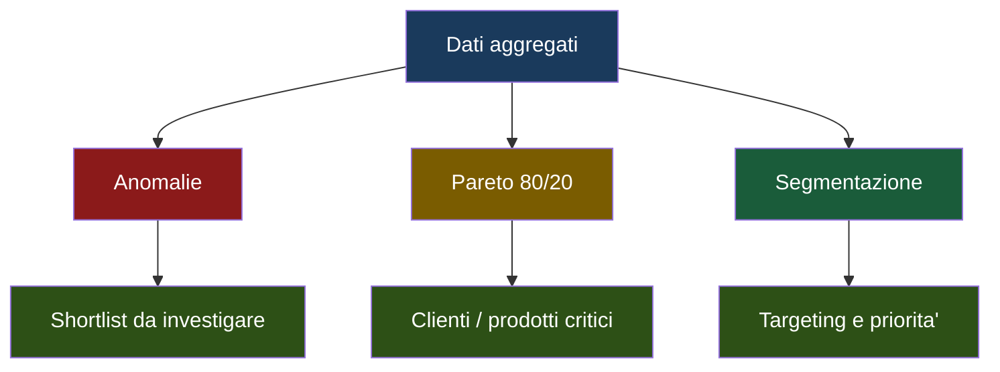
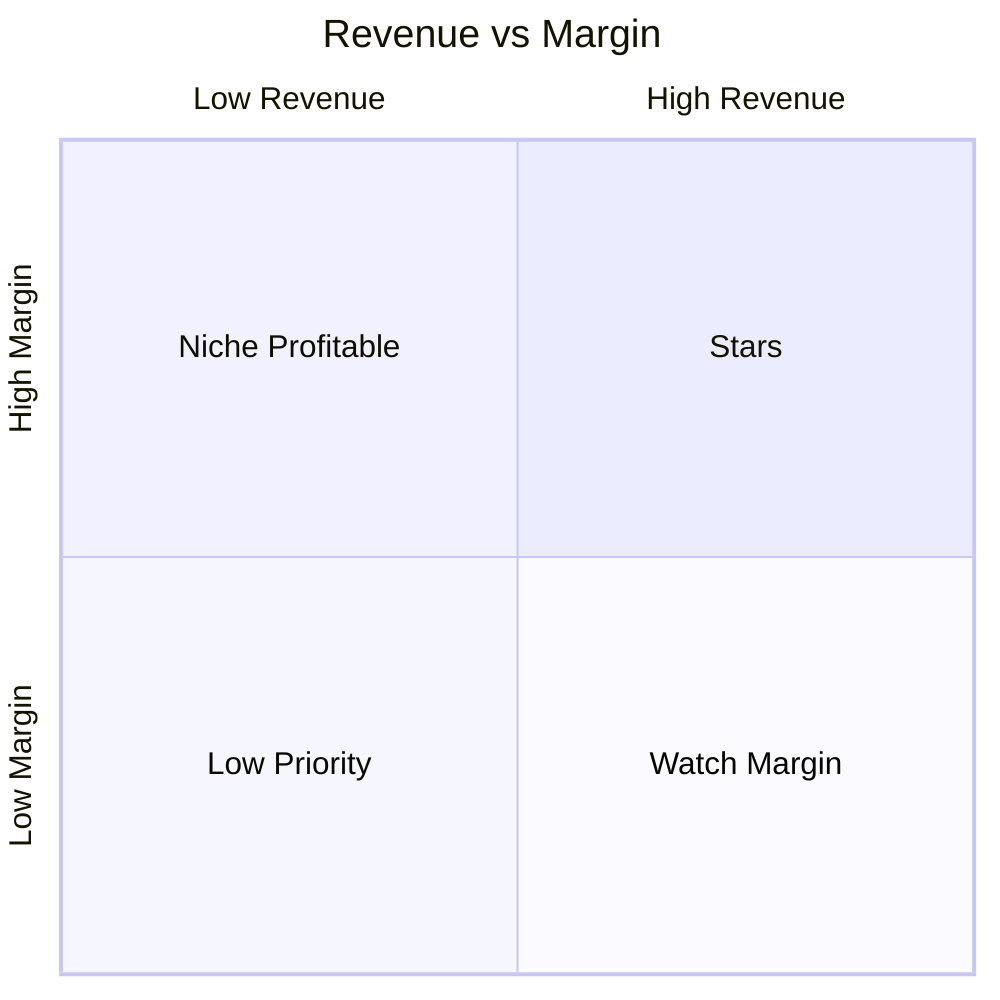

import { Aside } from '@astrojs/starlight/components'

Quando una dashboard si limita a mostrare medie, nasconde due cose decisive: gli outlier e i segmenti. In molti casi il problema non e' il valore medio, ma pochi clienti che valgono tantissimo, pochi prodotti che distruggono il margine o pochi giorni che indicano un'anomalia operativa.

## Perche' questa lezione conta

Qui non cerchiamo il "dato medio". Cerchiamo il dato che spiega cosa merita attenzione.

Tre domande tipiche:

- quali clienti generano la gran parte del fatturato?
- quali prodotti hanno revenue alta ma marginalita' bassa?
- quali giorni o canali sono fuori pattern?



## Anomaly detection semplice con z-score

```sql
WITH daily_revenue AS (
    SELECT
        toDate(order_time) AS day,
        sum(amount) AS revenue
    FROM orders
    WHERE status = 'completed'
      AND order_time >= toDateTime('2025-01-01 00:00:00')
    GROUP BY day
),
stats AS (
    SELECT
        avg(revenue) AS avg_revenue,
        stddevPop(revenue) AS std_revenue
    FROM daily_revenue
)
SELECT
    d.day,
    d.revenue,
    s.avg_revenue,
    s.std_revenue,
    round((d.revenue - s.avg_revenue) / nullIf(s.std_revenue, 0), 2) AS z_score
FROM daily_revenue d
CROSS JOIN stats s
WHERE abs((d.revenue - s.avg_revenue) / nullIf(s.std_revenue, 0)) >= 3
ORDER BY abs(z_score) DESC;
```

Questo pattern e' semplice ma utile per una prima shortlist di anomalie.

## Variante piu' robusta: deviazione dalla media mobile

Uno z-score globale e' utile, ma puo' confondere anomalie vere con stagionalita' o trend. Una variante piu' realistica confronta ogni giorno con la media mobile recente.

```sql
WITH daily_revenue AS (
    SELECT
        toDate(order_time) AS day,
        sum(amount) AS revenue
    FROM orders
    WHERE status = 'completed'
      AND order_time >= toDateTime('2025-01-01 00:00:00')
    GROUP BY day
),
with_baseline AS (
    SELECT
        day,
        revenue,
        avg(revenue) OVER (
            ORDER BY day
            ROWS BETWEEN 6 PRECEDING AND 1 PRECEDING
        ) AS prev_7d_avg
    FROM daily_revenue
)
SELECT
    day,
    revenue,
    prev_7d_avg,
    round((revenue - prev_7d_avg) / nullIf(prev_7d_avg, 0), 4) AS deviation_vs_prev_7d
FROM with_baseline
WHERE abs((revenue - prev_7d_avg) / nullIf(prev_7d_avg, 0)) >= 0.4
ORDER BY abs(deviation_vs_prev_7d) DESC;
```

Questa versione e' spesso piu' utile per alerting operativo.

## Pareto 80/20 sui clienti

```sql
WITH customer_revenue AS (
    SELECT
        user_id,
        sum(amount) AS total_revenue
    FROM orders
    WHERE status = 'completed'
    GROUP BY user_id
),
ordered AS (
    SELECT
        user_id,
        total_revenue,
        sum(total_revenue) OVER (
            ORDER BY total_revenue DESC
            ROWS BETWEEN UNBOUNDED PRECEDING AND CURRENT ROW
        ) AS cumulative_revenue,
        sum(total_revenue) OVER () AS grand_total
    FROM customer_revenue
)
SELECT
    user_id,
    total_revenue,
    cumulative_revenue,
    round(cumulative_revenue / nullIf(grand_total, 0), 4) AS cumulative_share
FROM ordered
ORDER BY total_revenue DESC;
```

Questa tabella ti dice esattamente dove si chiude il famoso 80/20.

## Segmentazione per decili

```sql
WITH customer_revenue AS (
    SELECT
        user_id,
        sum(amount) AS total_revenue
    FROM orders
    WHERE status = 'completed'
    GROUP BY user_id
)
SELECT
    user_id,
    total_revenue,
    ntile(10) OVER (ORDER BY total_revenue DESC) AS revenue_decile
FROM customer_revenue
ORDER BY total_revenue DESC;
```

I decili sono utili quando vuoi costruire:

- target list per CRM
- segmenti high / medium / low value
- benchmark interni

## RFM light in puro SQL

```sql
WITH customer_base AS (
    SELECT
        user_id,
        dateDiff('day', max(order_time), now()) AS recency_days,
        count() AS frequency_orders,
        sum(amount) AS monetary_value
    FROM orders
    WHERE status = 'completed'
    GROUP BY user_id
)
SELECT
    user_id,
    recency_days,
    frequency_orders,
    monetary_value,
    ntile(5) OVER (ORDER BY recency_days ASC) AS recency_score,
    ntile(5) OVER (ORDER BY frequency_orders DESC) AS frequency_score,
    ntile(5) OVER (ORDER BY monetary_value DESC) AS monetary_score
FROM customer_base;
```

Da qui puoi derivare segmenti rules-based:

- champions
- at risk
- high value recent
- low value inactive

## Scatter-style analysis: revenue alta, margine basso

Questo e' il tipo di output che poi puoi visualizzare in uno scatter plot o in una matrice a quadranti.

```sql
WITH product_profitability AS (
    SELECT
        product_id,
        sum(net_revenue) AS total_revenue,
        sum(margin) AS total_margin
    FROM order_items
    GROUP BY product_id
),
stats AS (
    SELECT
        avg(total_revenue) AS avg_revenue,
        avg(total_margin) AS avg_margin
    FROM product_profitability
)
SELECT
    p.product_id,
    p.total_revenue,
    p.total_margin,
    CASE
        WHEN p.total_revenue >= s.avg_revenue AND p.total_margin >= s.avg_margin THEN 'star'
        WHEN p.total_revenue >= s.avg_revenue AND p.total_margin < s.avg_margin THEN 'watch_margin'
        WHEN p.total_revenue < s.avg_revenue AND p.total_margin >= s.avg_margin THEN 'niche_profitable'
        ELSE 'low_priority'
    END AS quadrant
FROM product_profitability p
CROSS JOIN stats s
ORDER BY total_revenue DESC;
```

Questo output e' immediatamente utile per merchandising, pricing e assortment review.



<Aside type="tip">
Non tutto cio' che appare come anomalia e' un problema. Alcune anomalie sono successi inattesi. La query deve trovare il segnale; l'analyst deve interpretarlo.
</Aside>

## Errori comuni e anti-pattern

### Cercare anomalie su dati non normalizzati

Se stai confrontando giorni feriali e weekend insieme, alcune "anomalie" sono solo stagionalita' non modellata.

### Usare il Pareto senza ordinare correttamente

La cumulata ha senso solo su righe ordinate per contributo decrescente.

### Segmentazione troppo complessa troppo presto

Prima di parlare di clustering, spesso bastano decili o RFM light per ottenere valore operativo.

### Leggere i quadranti senza baseline

Uno scatter senza medie o benchmark e' solo un insieme di punti.

## Output atteso

Dovresti saper produrre:

- shortlist di giorni anomali
- tabella Pareto clienti
- segmenti per decili o RFM
- tabella a quadranti revenue vs margin

## Riepilogo operativo

- La media nasconde i casi che meritano attenzione.
- Z-score, Pareto, decili e quadranti sono strumenti semplici ma molto efficaci.
- Il vero obiettivo non e' classificare tutto: e' dare priorita' a cio' che richiede un'azione.
- SQL avanzato per analytics significa anche costruire shortlist decisionabili, non solo metriche aggregate.

## Mini esercizio

Costruisci una tabella clienti con:

1. revenue totale
2. rank per revenue
3. quota cumulata sul totale
4. decile
5. flag `is_top_20_pct` per i clienti che rientrano nel primo 20% della revenue cumulata
