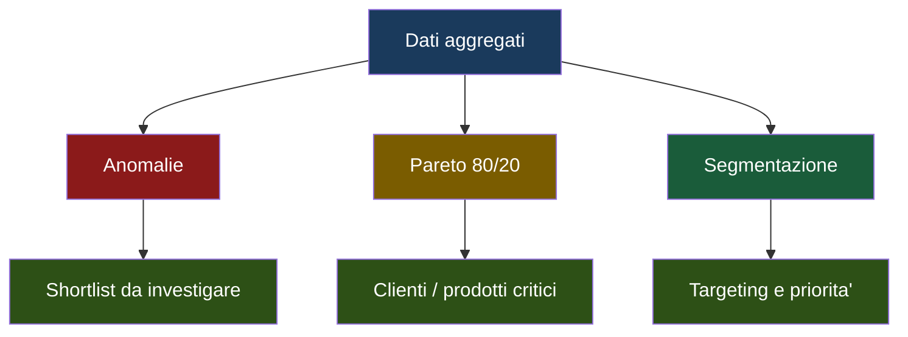
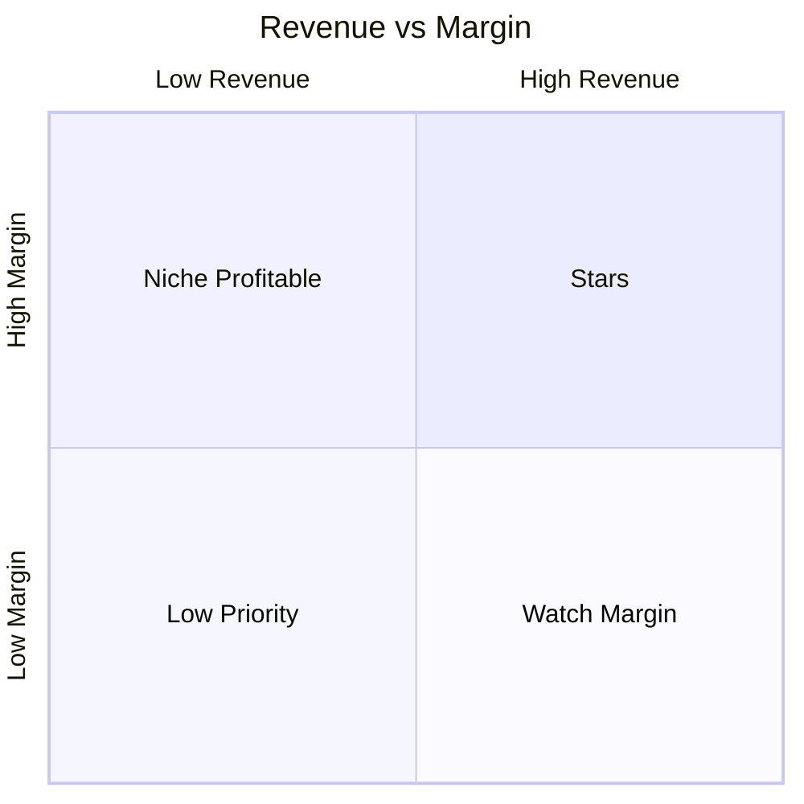

import { Aside } from '@astrojs/starlight/components'

Nel 1896 Vilfredo Pareto, economista italiano, pubblicò un'osservazione che avrebbe cambiato il modo in cui pensiamo alla distribuzione del valore: il 20% dei proprietari terrieri italiani possedeva l'80% della terra. Pareto era convinto si trattasse di una legge universale, e nei decenni successivi la scoperta si ripeté in contesti del tutto diversi: il 20% dei clienti genera l'80% del revenue, il 20% dei bug causa l'80% dei crash, il 20% dei prodotti genera l'80% del margine.

Il problema è che senza una query che lo dimostri sui tuoi dati, la regola 80/20 rimane intuizione. E l'intuizione non informa una decisione di repricing, una campagna retention o un'ottimizzazione del catalogo.

Quando una dashboard si limita a mostrare medie, nasconde due cose decisive: gli outlier e i segmenti. In molti casi il problema non è il valore medio, ma pochi clienti che valgono tantissimo, pochi prodotti che distruggono il margine o pochi giorni che indicano un'anomalia operativa. Questa lezione ti insegna a costruire le query che rendono tutto questo visibile.

## Perche' questa lezione conta

Qui non cerchiamo il "dato medio". Cerchiamo il dato che spiega cosa merita attenzione.

Tre domande tipiche:

- quali clienti generano la gran parte del fatturato?
- quali prodotti hanno revenue alta ma marginalita' bassa?
- quali giorni o canali sono fuori pattern?



## La curva di Pareto in SQL: revenue cumulata per cliente

Prima di segmentare, è utile vedere la distribuzione completa: quanto revenue è concentrato nei top N clienti? La risposta arriva da una curva di Pareto costruita con window functions.

```sql
WITH customer_revenue AS (
    SELECT
        user_id,
        sum(amount) AS total_revenue
    FROM orders
    WHERE status = 'completed'
    GROUP BY user_id
),
ordered AS (
    SELECT
        user_id,
        total_revenue,
        row_number() OVER (ORDER BY total_revenue DESC) AS rk,
        count() OVER ()                                  AS total_customers,
        sum(total_revenue) OVER (
            ORDER BY total_revenue DESC
            ROWS BETWEEN UNBOUNDED PRECEDING AND CURRENT ROW
        ) AS cumulative_revenue,
        sum(total_revenue) OVER () AS grand_total
    FROM customer_revenue
)
SELECT
    user_id,
    total_revenue,
    rk,
    round(rk / total_customers, 4)                              AS customer_pct,
    round(cumulative_revenue / nullIf(grand_total, 0), 4)       AS cumulative_revenue_pct
FROM ordered
ORDER BY rk;
```

Il risultato è una tabella con due colonne chiave: la percentuale di clienti (ordinata) e la percentuale cumulata di revenue. Graficando queste due colonne ottieni la curva di Pareto. Trova la riga dove `cumulative_revenue_pct >= 0.80` e guarda il corrispondente `customer_pct`: in un e-commerce B2C tipico, quel valore si trova tra il 15% e il 25% della clientela.

**Benchmark reale**: in e-commerce B2C, il top 10% dei clienti genera generalmente tra il 50% e il 70% del revenue totale. Il top 20% arriva spesso all'80-85%. Se nel tuo dataset il top 10% genera solo il 30%, la distribuzione è insolita e vale la pena indagare (potrebbe indicare una base clienti molto frammentata, o acquisizione in corso).

Per identificare direttamente i clienti che rientrano nel primo 20% della cumulata:

```sql
WITH customer_revenue AS (
    SELECT
        user_id,
        sum(amount) AS total_revenue
    FROM orders
    WHERE status = 'completed'
    GROUP BY user_id
),
ordered AS (
    SELECT
        user_id,
        total_revenue,
        sum(total_revenue) OVER (
            ORDER BY total_revenue DESC
            ROWS BETWEEN UNBOUNDED PRECEDING AND CURRENT ROW
        ) AS cumulative_revenue,
        sum(total_revenue) OVER () AS grand_total
    FROM customer_revenue
)
SELECT
    user_id,
    total_revenue,
    round(cumulative_revenue / nullIf(grand_total, 0), 4) AS cumulative_share,
    cumulative_revenue <= grand_total * 0.80              AS is_in_top80_revenue
FROM ordered
ORDER BY total_revenue DESC;
```

Questa è la shortlist da portare al CRM: i clienti da proteggere ad ogni costo perché senza di loro si perde l'80% del business.

## Segmentazione per decili

Una volta calcolato il revenue per cliente, la segmentazione per decili è il passo naturale. `NTILE(10)` divide la clientela in 10 gruppi di uguale numerosità, ordinati per revenue decrescente.

```sql
WITH customer_revenue AS (
    SELECT
        user_id,
        sum(amount) AS total_revenue
    FROM orders
    WHERE status = 'completed'
    GROUP BY user_id
)
SELECT
    user_id,
    total_revenue,
    ntile(10) OVER (ORDER BY total_revenue DESC) AS revenue_decile
FROM customer_revenue
ORDER BY total_revenue DESC;
```

I decili sono utili quando vuoi costruire:

- target list per CRM
- segmenti high / medium / low value
- benchmark interni

Il decile 1 (top 10% per revenue) è la tua fascia VIP. Il decile 10 è la clientela che ha acquistato una volta e potrebbe non tornare. La strategia di retention per il decile 1 e quella per il decile 10 sono completamente diverse: il primo richiede programmi di fidelizzazione personalizzati, il secondo può rispondere bene a offerte di riattivazione a basso costo.

## Segmentazione RFM in SQL

Il modello RFM (Recency, Frequency, Monetary) è uno dei framework di segmentazione clienti più longevi e affidabili nel marketing diretto. Nato negli anni '70 nel direct mail marketing, si è dimostrato efficace in contesti digitali perché cattura tre dimensioni comportamentali complementari:

- **Recency**: quanto tempo è passato dall'ultimo acquisto. Un cliente che ha comprato ieri è più propenso a riacquistare rispetto a uno che non acquista da sei mesi.
- **Frequency**: quante volte ha acquistato nel periodo. Chi acquista spesso è già un cliente abitudinario.
- **Monetary**: quanto ha speso in totale. Indica il valore economico già generato.

La versione SQL con `NTILE()` assegna uno score da 1 a 5 su ciascuna dimensione, poi combina i tre score in un label di segmento.

```sql
WITH customer_base AS (
    SELECT
        user_id,
        dateDiff('day', max(order_time), now()) AS recency_days,
        count()                                  AS frequency_orders,
        sum(amount)                              AS monetary_value
    FROM orders
    WHERE status = 'completed'
    GROUP BY user_id
),
rfm_scores AS (
    SELECT
        user_id,
        recency_days,
        frequency_orders,
        monetary_value,
        -- Recency: score alto = acquisto recente (ordine ASC: meno giorni fa = score alto)
        ntile(5) OVER (ORDER BY recency_days ASC)     AS r_score,
        -- Frequency: score alto = molti acquisti
        ntile(5) OVER (ORDER BY frequency_orders DESC) AS f_score,
        -- Monetary: score alto = alto speso
        ntile(5) OVER (ORDER BY monetary_value DESC)   AS m_score
    FROM customer_base
)
SELECT
    user_id,
    recency_days,
    frequency_orders,
    monetary_value,
    r_score,
    f_score,
    m_score,
    CASE
        WHEN r_score >= 4 AND f_score >= 4 AND m_score >= 4 THEN 'champions'
        WHEN r_score >= 3 AND f_score >= 3                  THEN 'loyal'
        WHEN r_score >= 4 AND f_score <= 2                  THEN 'new_promising'
        WHEN r_score <= 2 AND f_score >= 3 AND m_score >= 3 THEN 'at_risk_highvalue'
        WHEN r_score <= 2 AND f_score >= 3                  THEN 'at_risk'
        WHEN r_score <= 2 AND f_score <= 2                  THEN 'lost'
        ELSE 'mid_tier'
    END AS rfm_segment
FROM rfm_scores
ORDER BY m_score DESC, r_score DESC;
```

Il `CASE` di segmentazione è la parte più critica e anche quella più personalizzabile. Non esiste una definizione universale di "champions": dipende dal contesto. In un SaaS con abbonamento mensile, la frequency potrebbe essere irrilevante (tutti gli utenti attivi hanno frequency 1 per mese). In un marketplace con acquisti multipli, la frequency è centrale.

Per aggregare e vedere la distribuzione dei segmenti:

```sql
-- Distribuzione segmenti RFM
WITH customer_base AS (
    SELECT
        user_id,
        dateDiff('day', max(order_time), now()) AS recency_days,
        count()                                  AS frequency_orders,
        sum(amount)                              AS monetary_value
    FROM orders
    WHERE status = 'completed'
    GROUP BY user_id
),
rfm_scores AS (
    SELECT
        user_id,
        recency_days,
        frequency_orders,
        monetary_value,
        ntile(5) OVER (ORDER BY recency_days ASC)      AS r_score,
        ntile(5) OVER (ORDER BY frequency_orders DESC) AS f_score,
        ntile(5) OVER (ORDER BY monetary_value DESC)   AS m_score
    FROM customer_base
),
rfm_labeled AS (
    SELECT
        user_id,
        monetary_value,
        CASE
            WHEN r_score >= 4 AND f_score >= 4 AND m_score >= 4 THEN 'champions'
            WHEN r_score >= 3 AND f_score >= 3                  THEN 'loyal'
            WHEN r_score >= 4 AND f_score <= 2                  THEN 'new_promising'
            WHEN r_score <= 2 AND f_score >= 3 AND m_score >= 3 THEN 'at_risk_highvalue'
            WHEN r_score <= 2 AND f_score >= 3                  THEN 'at_risk'
            WHEN r_score <= 2 AND f_score <= 2                  THEN 'lost'
            ELSE 'mid_tier'
        END AS rfm_segment
    FROM rfm_scores
)
SELECT
    rfm_segment,
    count()                             AS num_customers,
    round(sum(monetary_value), 2)       AS total_revenue,
    round(avg(monetary_value), 2)       AS avg_revenue_per_customer,
    round(count() * 100.0 / sum(count()) OVER (), 2) AS pct_customers
FROM rfm_labeled
GROUP BY rfm_segment
ORDER BY total_revenue DESC;
```

Questo output risponde a una domanda semplice ma ad alto impatto: quanto vale ogni segmento e quanti clienti contiene? È la base per decidere dove allocare il budget marketing.

<Aside type="tip">
RFM con NTILE ha un limite: i segmenti hanno la stessa numerosità, non lo stesso comportamento. Se il 50% della base ha effettuato un solo acquisto, molti "mid_tier" potrebbero essere di fatto clienti inattivi. Verifica sempre la distribuzione reale prima di usare i segmenti per campagne.
</Aside>

## Anomaly detection in SQL: approccio statistico

L'anomaly detection in SQL segue due approcci principali: z-score su distribuzione globale e scarto dalla media mobile. Ognuno ha il suo campo di applicazione.

### Z-score con media e deviazione standard

Lo z-score misura quante deviazioni standard un valore si trova dalla media. Un valore con `|z| >= 2` è fuori dal 95% della distribuzione; con `|z| >= 3` è fuori dal 99.7%. In pratica, `|z| >= 2` è già un segnale che vale la pena guardare.

```sql
WITH daily_revenue AS (
    SELECT
        toDate(order_time) AS day,
        sum(amount) AS revenue
    FROM orders
    WHERE status = 'completed'
      AND order_time >= toDateTime('2025-01-01 00:00:00')
    GROUP BY day
),
stats AS (
    SELECT
        avg(revenue) AS avg_revenue,
        stddevPop(revenue) AS std_revenue
    FROM daily_revenue
)
SELECT
    d.day,
    d.revenue,
    s.avg_revenue,
    s.std_revenue,
    round((d.revenue - s.avg_revenue) / nullIf(s.std_revenue, 0), 2) AS z_score
FROM daily_revenue d
CROSS JOIN stats s
WHERE abs((d.revenue - s.avg_revenue) / nullIf(s.std_revenue, 0)) >= 2
ORDER BY abs(z_score) DESC;
```

### Approccio con quantili per distribuzioni non normali

Il revenue giornaliero raramente segue una distribuzione normale: ha code lunghe a destra, picchi durante promozioni, stagionalità. In questi casi, `mean ± 2σ` può dare molti falsi positivi nei picchi e pochi segnali reali nei cali. I quantili sono più robusti.

ClickHouse fornisce funzioni `quantile()` e `quantiles()` che calcolano percentili in modo efficiente anche su dataset grandi:

```sql
WITH daily_revenue AS (
    SELECT
        toDate(order_time) AS day,
        sum(amount) AS revenue
    FROM orders
    WHERE status = 'completed'
      AND order_time >= toDateTime('2025-01-01 00:00:00')
    GROUP BY day
),
bounds AS (
    SELECT
        quantile(0.10)(revenue) AS p10,
        quantile(0.25)(revenue) AS p25,
        quantile(0.75)(revenue) AS p75,
        quantile(0.90)(revenue) AS p90,
        -- IQR fence: metodo box-plot
        quantile(0.25)(revenue) - 1.5 * (quantile(0.75)(revenue) - quantile(0.25)(revenue)) AS lower_fence,
        quantile(0.75)(revenue) + 1.5 * (quantile(0.75)(revenue) - quantile(0.25)(revenue)) AS upper_fence
    FROM daily_revenue
)
SELECT
    d.day,
    d.revenue,
    b.lower_fence,
    b.upper_fence,
    CASE
        WHEN d.revenue < b.lower_fence THEN 'outlier_low'
        WHEN d.revenue > b.upper_fence THEN 'outlier_high'
        ELSE 'normal'
    END AS anomaly_flag
FROM daily_revenue d
CROSS JOIN bounds b
WHERE d.revenue < b.lower_fence OR d.revenue > b.upper_fence
ORDER BY d.day;
```

Il metodo IQR (Interquartile Range) è meno sensibile agli outlier stessi: calcola il "recinto" in base alla dispersione centrale (dal 25° al 75° percentile) e considera anomali i valori che vanno oltre 1.5 volte quella distanza. È lo stesso metodo usato nei box-plot.

## Spike detection: confronto con la media mobile

Uno z-score globale è utile, ma può confondere anomalie vere con stagionalità o trend crescenti. Se il revenue cresce del 30% in sei mesi, i mesi recenti appariranno sistematicamente come outlier rispetto alla media storica, anche se la crescita è intenzionale e positiva.

La soluzione è confrontare ogni giorno con la media dei giorni immediatamente precedenti, non con la media di tutto il periodo.

```sql
WITH daily_revenue AS (
    SELECT
        toDate(order_time) AS day,
        sum(amount) AS revenue
    FROM orders
    WHERE status = 'completed'
      AND order_time >= toDateTime('2025-01-01 00:00:00')
    GROUP BY day
),
with_baseline AS (
    SELECT
        day,
        revenue,
        avg(revenue) OVER (
            ORDER BY day
            ROWS BETWEEN 6 PRECEDING AND 1 PRECEDING
        ) AS prev_7d_avg,
        stddevPop(revenue) OVER (
            ORDER BY day
            ROWS BETWEEN 6 PRECEDING AND 1 PRECEDING
        ) AS prev_7d_std
    FROM daily_revenue
)
SELECT
    day,
    revenue,
    round(prev_7d_avg, 2)                                                  AS baseline_avg,
    round((revenue - prev_7d_avg) / nullIf(prev_7d_avg, 0), 4)            AS deviation_pct,
    CASE
        WHEN revenue < prev_7d_avg * 0.80 THEN 'drop_alert'
        WHEN revenue > prev_7d_avg * 1.40 THEN 'spike_alert'
        ELSE 'normal'
    END AS alert_type
FROM with_baseline
WHERE revenue < prev_7d_avg * 0.80
   OR revenue > prev_7d_avg * 1.40
ORDER BY day DESC;
```

La soglia `±20%/40%` è indicativa. In un business con alta volatilità stagionale (es. e-commerce con promozioni frequenti), potresti alzarla al 50%. In un SaaS con revenue ricorrente stabile, anche un -10% è un segnale serio.

## Revenue monitoring: alert quando il giorno cala oltre il 20%

Il pattern più comune in operational analytics è il monitoraggio del revenue giornaliero con alert automatici. Questa query è pensata per essere eseguita ogni mattina e flaggare il giorno precedente:

```sql
WITH daily_revenue AS (
    SELECT
        toDate(order_time) AS day,
        sum(amount)        AS revenue
    FROM orders
    WHERE status = 'completed'
      AND order_time >= today() - INTERVAL 30 DAY
    GROUP BY day
),
yesterday_vs_baseline AS (
    SELECT
        day,
        revenue,
        avg(revenue) OVER (
            ORDER BY day
            ROWS BETWEEN 7 PRECEDING AND 1 PRECEDING
        ) AS rolling_7d_avg
    FROM daily_revenue
)
SELECT
    day,
    revenue,
    round(rolling_7d_avg, 2)                                     AS rolling_avg,
    round((revenue - rolling_7d_avg) / nullIf(rolling_7d_avg, 0) * 100, 1) AS change_pct,
    CASE
        WHEN (revenue - rolling_7d_avg) / nullIf(rolling_7d_avg, 0) <= -0.20
             THEN concat('ALERT: revenue calo ', toString(round((revenue - rolling_7d_avg) / nullIf(rolling_7d_avg, 0) * 100, 1)), '%')
        ELSE 'OK'
    END AS alert_status
FROM yesterday_vs_baseline
WHERE day = yesterday()
ORDER BY day DESC;
```

Questa query può essere schedulata via cron, integrata in un notebook Jupyter o alimentare un canale Slack tramite webhook. Il valore non è nella query in sé, ma nel fatto che il team riceve un segnale entro le 9 del mattino invece di scoprire il calo a fine giornata durante la review settimanale.

## SQL anomaly detection vs strumenti dedicati

SQL non è l'unico modo per fare anomaly detection. Capire quando usarlo e quando passare a strumenti dedicati è una competenza di seniorità.

| Dimensione | SQL (ClickHouse) | Grafana + Alerting | Monte Carlo / Soda |
|---|---|---|---|
| Setup time | Basso | Medio | Alto |
| Flessibilità logica | Alta | Media | Media |
| Copertura automatica | Manuale (per tabella) | Semi-automatica | Automatica su tutto il DW |
| Soglie adattive | Solo se codificate | Disponibili | Disponibili |
| Alerting real-time | Con scheduling esterno | Nativo | Nativo |
| Data quality monitoring | Limitato | No | Sì (focus principale) |
| Costo | Solo compute | Incluso in Grafana | Costoso ($$$) |
| Curva di apprendimento | Bassa per chi conosce SQL | Media | Alta |

**Quando usare SQL**: team piccoli, monitoring su metriche specifiche già note, quando vuoi capire la logica prima di automatizzare, quando il budget non permette strumenti dedicati.

**Quando passare a strumenti dedicati**: quando le tabelle da monitorare sono decine, quando vuoi anomaly detection automatica su nuove colonne, quando hai bisogno di alerting real-time su streaming data.

<Aside type="note">
Strumenti come Monte Carlo o Soda applicano modelli statistici automaticamente su ogni metrica di ogni tabella. Ma il vantaggio dello SQL è che capisci esattamente cosa stai cercando. Un analista che sa scrivere queste query è in grado di valutare criticamente anche gli alert automatici.
</Aside>

## Anomaly detection per z-score originale

```sql
WITH daily_revenue AS (
    SELECT
        toDate(order_time) AS day,
        sum(amount) AS revenue
    FROM orders
    WHERE status = 'completed'
      AND order_time >= toDateTime('2025-01-01 00:00:00')
    GROUP BY day
),
stats AS (
    SELECT
        avg(revenue) AS avg_revenue,
        stddevPop(revenue) AS std_revenue
    FROM daily_revenue
)
SELECT
    d.day,
    d.revenue,
    s.avg_revenue,
    s.std_revenue,
    round((d.revenue - s.avg_revenue) / nullIf(s.std_revenue, 0), 2) AS z_score
FROM daily_revenue d
CROSS JOIN stats s
WHERE abs((d.revenue - s.avg_revenue) / nullIf(s.std_revenue, 0)) >= 3
ORDER BY abs(z_score) DESC;
```

Questo pattern è semplice ma utile per una prima shortlist di anomalie.

## Segment stability: tracciare se i segmenti cambiano nel tempo

Un segmento RFM non è statico. I "champions" di sei mesi fa possono essere diventati "at_risk" oggi. Monitorare la stabilità dei segmenti nel tempo permette di intercettare questi spostamenti prima che diventino perdite.

La tecnica base è calcolare RFM per due periodi distinti e confrontare il segmento assegnato:

```sql
-- Segmento periodo corrente
WITH current_period AS (
    SELECT
        user_id,
        dateDiff('day', max(order_time), toDateTime('2025-06-30 23:59:59')) AS recency_days,
        count()                                                              AS frequency_orders,
        sum(amount)                                                          AS monetary_value
    FROM orders
    WHERE status = 'completed'
      AND order_time BETWEEN toDateTime('2025-01-01 00:00:00')
                         AND toDateTime('2025-06-30 23:59:59')
    GROUP BY user_id
),
prev_period AS (
    SELECT
        user_id,
        dateDiff('day', max(order_time), toDateTime('2024-12-31 23:59:59')) AS recency_days,
        count()                                                              AS frequency_orders,
        sum(amount)                                                          AS monetary_value
    FROM orders
    WHERE status = 'completed'
      AND order_time BETWEEN toDateTime('2024-07-01 00:00:00')
                         AND toDateTime('2024-12-31 23:59:59')
    GROUP BY user_id
),
current_scored AS (
    SELECT
        user_id,
        ntile(5) OVER (ORDER BY recency_days ASC)      AS r,
        ntile(5) OVER (ORDER BY frequency_orders DESC) AS f,
        ntile(5) OVER (ORDER BY monetary_value DESC)   AS m
    FROM current_period
),
prev_scored AS (
    SELECT
        user_id,
        ntile(5) OVER (ORDER BY recency_days ASC)      AS r,
        ntile(5) OVER (ORDER BY frequency_orders DESC) AS f,
        ntile(5) OVER (ORDER BY monetary_value DESC)   AS m
    FROM prev_period
),
current_seg AS (
    SELECT user_id,
        CASE
            WHEN r >= 4 AND f >= 4 AND m >= 4 THEN 'champions'
            WHEN r >= 3 AND f >= 3             THEN 'loyal'
            WHEN r >= 4 AND f <= 2             THEN 'new_promising'
            WHEN r <= 2 AND f >= 3 AND m >= 3  THEN 'at_risk_highvalue'
            WHEN r <= 2 AND f >= 3             THEN 'at_risk'
            WHEN r <= 2 AND f <= 2             THEN 'lost'
            ELSE 'mid_tier'
        END AS segment_current
    FROM current_scored
),
prev_seg AS (
    SELECT user_id,
        CASE
            WHEN r >= 4 AND f >= 4 AND m >= 4 THEN 'champions'
            WHEN r >= 3 AND f >= 3             THEN 'loyal'
            WHEN r >= 4 AND f <= 2             THEN 'new_promising'
            WHEN r <= 2 AND f >= 3 AND m >= 3  THEN 'at_risk_highvalue'
            WHEN r <= 2 AND f >= 3             THEN 'at_risk'
            WHEN r <= 2 AND f <= 2             THEN 'lost'
            ELSE 'mid_tier'
        END AS segment_prev
    FROM prev_scored
)
SELECT
    c.user_id,
    p.segment_prev,
    c.segment_current,
    CASE
        WHEN p.segment_prev = c.segment_current THEN 'stable'
        WHEN p.segment_prev IN ('champions', 'loyal') AND c.segment_current IN ('at_risk', 'at_risk_highvalue', 'lost') THEN 'downgrade_critical'
        WHEN p.segment_prev IN ('at_risk', 'lost') AND c.segment_current IN ('champions', 'loyal') THEN 'upgrade'
        ELSE 'shift'
    END AS movement
FROM current_seg c
INNER JOIN prev_seg p ON c.user_id = p.user_id
ORDER BY movement, c.user_id;
```

Il `movement = 'downgrade_critical'` è il segnale più importante: clienti che erano tra i migliori e ora sono a rischio. Sono candidati prioritari per interventi di retention personalizzati.

Per avere una vista aggregata dei movimenti:

```sql
-- Aggregazione movimenti di segmento
SELECT
    segment_prev,
    segment_current,
    count() AS num_customers
-- (inserire la query precedente come subquery o CTE)
GROUP BY segment_prev, segment_current
ORDER BY segment_prev, num_customers DESC;
```

## Scatter-style analysis: revenue alta, margine basso

Questo è il tipo di output che poi puoi visualizzare in uno scatter plot o in una matrice a quadranti.

```sql
WITH product_profitability AS (
    SELECT
        product_id,
        sum(net_revenue) AS total_revenue,
        sum(margin) AS total_margin
    FROM order_items
    GROUP BY product_id
),
stats AS (
    SELECT
        avg(total_revenue) AS avg_revenue,
        avg(total_margin) AS avg_margin
    FROM product_profitability
)
SELECT
    p.product_id,
    p.total_revenue,
    p.total_margin,
    CASE
        WHEN p.total_revenue >= s.avg_revenue AND p.total_margin >= s.avg_margin THEN 'star'
        WHEN p.total_revenue >= s.avg_revenue AND p.total_margin < s.avg_margin THEN 'watch_margin'
        WHEN p.total_revenue < s.avg_revenue AND p.total_margin >= s.avg_margin THEN 'niche_profitable'
        ELSE 'low_priority'
    END AS quadrant
FROM product_profitability p
CROSS JOIN stats s
ORDER BY total_revenue DESC;
```

Questo output è immediatamente utile per merchandising, pricing e assortment review.



<Aside type="tip">
Non tutto ciò che appare come anomalia è un problema. Alcune anomalie sono successi inattesi. La query deve trovare il segnale; l'analyst deve interpretarlo.
</Aside>

## Errori comuni e anti-pattern

### Cercare anomalie su dati non normalizzati

Se stai confrontando giorni feriali e weekend insieme, alcune "anomalie" sono solo stagionalità non modellata. Un lunedì con revenue basso non è un'anomalia se i lunedì sono sempre bassi. Valuta di aggiungere `dayOfWeek(day) AS dow` e fare anomaly detection separata per giorno della settimana, oppure usa una media mobile che cattura già la stagionalità settimanale.

### Usare il Pareto senza ordinare correttamente

La cumulata ha senso solo su righe ordinate per contributo decrescente. Se la `ORDER BY` nella window function è ascendente invece che discendente, la curva di Pareto risultante è invertita e porta a conclusioni errate su chi sono i top clienti.

### Segmentazione troppo complessa troppo presto

Prima di parlare di clustering K-means o modelli propensity, spesso bastano decili o RFM light per ottenere valore operativo. Uno z-score semplice che individua i 5 giorni più anomali dell'anno è più azionabile di un modello di machine learning che classifica ogni giorno in 8 cluster.

### Leggere i quadranti senza baseline

Uno scatter senza medie o benchmark è solo un insieme di punti. La matrice a quadranti funziona perché la media divide lo spazio in zone significative. Se usi una soglia arbitraria invece della media, i quadranti perdono significato comparativo.

### Confondere segmento con comportamento futuro

RFM descrive il comportamento passato. Un cliente nel segmento "at_risk" non ha necessariamente intenzione di abbandonare: potrebbe semplicemente avere una frequenza di acquisto stagionale. Usa i segmenti come punti di partenza per l'analisi, non come certezze.

## Mini esercizio

Costruisci una tabella clienti con:

1. revenue totale
2. rank per revenue
3. quota cumulata sul totale
4. decile
5. flag `is_top_20_pct` per i clienti che rientrano nel primo 20% della revenue cumulata

Poi estendi la query per aggiungere:

6. `r_score`, `f_score`, `m_score` calcolati con `NTILE(5)`
7. colonna `rfm_segment` con almeno 4 segmenti distinti
8. colonna `is_champion` che vale 1 se tutti e tre gli score sono >= 4

Infine, calcola il revenue totale dei soli `is_champion = 1` e verifica che percentuale rappresenta sul revenue complessivo. Nei dataset reali, i "champions" sono spesso il 3-8% della base clienti ma generano il 25-40% del revenue.

## Riepilogo operativo

- La media nasconde i casi che meritano attenzione. Pareto, decili, RFM e z-score sono strumenti per rendere visibile quello che la media occulta.
- La curva di Pareto in SQL si costruisce con una window function cumulativa ordinata per revenue decrescente. Cerca la riga dove la quota cumulata supera 0.80.
- RFM con `NTILE(5)` assegna score su tre dimensioni comportamentali e permette di costruire segmenti rules-based azionabili senza ML.
- Per anomaly detection, lo z-score globale funziona su distribuzioni stabili. La media mobile è più robusta in presenza di trend o stagionalità.
- Le funzioni `quantile()` di ClickHouse permettono di usare il metodo IQR (box-plot fence) per identificare outlier in distribuzioni non normali.
- La segment stability tracking confronta lo stesso cliente in due periodi e identifica i `downgrade_critical`: ex top-clienti ora a rischio abbandono.
- SQL anomaly detection è appropriato per team piccoli e metriche specifiche. Strumenti come Monte Carlo o Soda sono più indicati quando le tabelle da monitorare sono decine e si vuole copertura automatica.
- Il vero obiettivo non è classificare tutto: è dare priorità a ciò che richiede un'azione.
