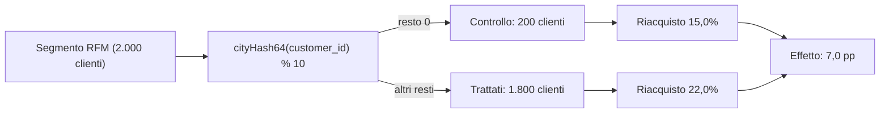

Scenario costruito con numeri di esempio: un direttore commerciale guarda il fatturato mensile, lo trova stabile e decide uno sconto del 15% su tutti i clienti attivi. Prima di lanciare la campagna un analista ordina i clienti per margine netto e fa la somma cumulata: sui 10 clienti dell'estratto che useremo qui, i primi 2 (il 20%) producono il 68% del margine, i primi 3 il 79%. Quei clienti comprano già a prezzo pieno, e lo sconto sarebbe un costo senza nessun ricavo aggiuntivo, mentre i 4 clienti in coda, con il 3,5% del margine, assorbirebbero la maggior parte del budget promozionale.

> **Idea chiave:** prima di agire su una base clienti ordina i clienti per valore reale (margine netto) e confronta ogni giorno con la sua storia recente; le medie aggregate nascondono sia la concentrazione sia le anomalie.

## Tre tecniche, tre domande

Le tre tecniche della lezione rispondono a domande operative diverse e condividono lo stesso strumento, la window function. La tabella mette in ordine che cosa misura ciascuna e dove di solito si sbaglia.

| Tecnica | Cosa calcola | Domanda a cui risponde | Errore tipico |
| :--- | :--- | :--- | :--- |
| Curva di Pareto | Quota cumulata di margine ordinando i clienti dal più al meno redditizio | Quanti clienti servono per arrivare all'80% del margine | Ordinare per fatturato lordo e ignorare resi e costi |
| Z-score su baseline mobile | Scarto del giorno rispetto alla media dei giorni precedenti, in unità di deviazione standard | Il calo di oggi è rumore o un'anomalia | Includere il giorno corrente nella baseline |
| Segmentazione RFM | Recency, Frequency, Monetary trasformate in punteggi da 1 a 5 | Chi sono i migliori clienti e chi sta scivolando via | Dare punteggio alto a chi non compra da più tempo |

Usate insieme, le tre lenti permettono di decidere dove mettere il budget: la curva dice quanto pesa ciascun cliente, lo z-score dice se il ritmo giornaliero si è rotto, e RFM dice che tipo di azione serve a ciascun gruppo.

## Pareto sul margine netto con una somma su finestra

I dati di partenza sono un riepilogo per cliente: data dell'ultimo ordine, numero di ordini e margine netto in euro (ricavo meno costo, resi e sconti). In produzione lo ottieni aggregando la tabella ordini; qui lo inseriamo direttamente per poter controllare ogni numero.

```sql
-- Riepilogo per cliente: ultimo ordine, numero di ordini, margine netto in euro
CREATE TABLE customer_metrics
(
    customer_id UInt32,
    last_order_date Date,
    orders_count UInt32,
    net_margin_eur Decimal(10,2)
) ENGINE = MergeTree ORDER BY customer_id;

INSERT INTO customer_metrics VALUES
(1, '2026-11-10', 14, 4200.00), (2, '2026-11-02', 9, 2600.00), (3, '2026-03-02', 5, 1100.00),
(4, '2026-10-20', 6, 700.00), (5, '2026-06-30', 3, 500.00), (6, '2026-11-05', 4, 400.00),
(7, '2026-03-12', 2, 200.00), (8, '2026-08-01', 2, 150.00), (9, '2026-02-20', 1, 100.00),
(10, '2026-11-12', 1, 50.00);
```

La curva si ottiene ordinando per margine decrescente e sommando dalla prima riga fino alla riga corrente. Il frame `ROWS BETWEEN UNBOUNDED PRECEDING AND CURRENT ROW` va dichiarato in modo esplicito, e l'ordinamento ha un secondo criterio (`customer_id`) che rende il risultato deterministico anche quando due clienti hanno lo stesso margine.

```sql
-- Curva di Pareto: somma cumulata del margine in ordine decrescente
SELECT
    customer_id,
    net_margin_eur,
    sum(net_margin_eur) OVER (
        ORDER BY net_margin_eur DESC, customer_id ASC
        ROWS BETWEEN UNBOUNDED PRECEDING AND CURRENT ROW
    ) AS cum_margin_eur,
    round(cum_margin_eur * 100.0 / sum(net_margin_eur) OVER (), 1) AS cumulative_margin_pct,
    round(row_number() OVER (ORDER BY net_margin_eur DESC, customer_id ASC) * 100.0 / count() OVER (), 0) AS customers_pct
FROM customer_metrics
ORDER BY net_margin_eur DESC, customer_id ASC;
```

Ecco le righe restituite, lette dall'alto in basso.

| Cliente | Margine netto | Somma cumulata | Margine cumulato | Clienti cumulati |
| ---: | ---: | ---: | ---: | ---: |
| 1 | 4.200 € | 4.200 € | 42,0% | 10% |
| 2 | 2.600 € | 6.800 € | 68,0% | 20% |
| 3 | 1.100 € | 7.900 € | 79,0% | 30% |
| 4 | 700 € | 8.600 € | 86,0% | 40% |
| 5 | 500 € | 9.100 € | 91,0% | 50% |
| 6 | 400 € | 9.500 € | 95,0% | 60% |
| 7 | 200 € | 9.700 € | 97,0% | 70% |
| 8 | 150 € | 9.850 € | 98,5% | 80% |
| 9 | 100 € | 9.950 € | 99,5% | 90% |
| 10 | 50 € | 10.000 € | 100,0% | 100% |

Leggi la tabella con una domanda precisa: dove la curva smette di salire in fretta. Qui i primi due clienti aggiungono 42 e 26 punti, il terzo 11, e dal sesto in poi ogni cliente vale meno di 5 punti. Questa forma, con un gomito marcato, è tipica delle basi clienti reali e giustifica trattamenti diversi per la testa e per la coda.

Esempio numerico svolto: il margine totale è 4.200 + 2.600 + 1.100 + 700 + 500 + 400 + 200 + 150 + 100 + 50 = 10.000 €. Alla seconda riga la somma cumulata è 4.200 + 2.600 = 6.800 €, quindi 6.800 / 10.000 = 68%. Per superare l'80% servono 4 clienti, cioè il 40% della base, perché a 3 clienti ci si ferma al 79%. L'ultima riga vale esattamente 100,0%: è il controllo di chiusura, e se non torna significa che una riga è stata esclusa o che il margine contiene valori `NULL`.

## Z-score su una baseline che esclude oggi

Lo z-score risponde alla domanda se il valore di oggi sia compatibile con quello che è successo nei giorni scorsi. Si calcola come (valore di oggi meno media della baseline) diviso deviazione standard della baseline. La baseline non può contenere il giorno che stai giudicando: se lo includi, il valore anomalo trascina la media e gonfia la deviazione, e l'anomalia si attenua da sola.

```sql
-- Ricavi giornalieri: l'8 novembre un bug al checkout dimezza le vendite
CREATE TABLE daily_revenue (day Date, revenue_eur Float64) ENGINE = MergeTree ORDER BY day;
INSERT INTO daily_revenue VALUES
('2026-11-01', 1000), ('2026-11-02', 1040), ('2026-11-03', 980), ('2026-11-04', 1020),
('2026-11-05', 1010), ('2026-11-06', 990), ('2026-11-07', 1060), ('2026-11-08', 540), ('2026-11-09', 1030);
```

La query confronta due finestre con nome: `w_prev`, che arriva fino alla riga precedente, e `w_curr`, che include la riga corrente. In produzione la baseline è di 28 giorni; qui è di 7 per tenere la tabella leggibile.

```sql
-- Z-score con baseline corretta (w_prev) e con baseline contaminata (w_curr)
SELECT
    day,
    revenue_eur,
    round(avg(revenue_eur) OVER w_prev, 2) AS baseline_avg,
    round(stddevPop(revenue_eur) OVER w_prev, 2) AS baseline_std,
    round((revenue_eur - avg(revenue_eur) OVER w_prev) / nullIf(stddevPop(revenue_eur) OVER w_prev, 0), 2) AS z_score,
    round((revenue_eur - avg(revenue_eur) OVER w_curr) / nullIf(stddevPop(revenue_eur) OVER w_curr, 0), 2) AS wrong_z
FROM daily_revenue
WINDOW w_prev AS (ORDER BY day ROWS BETWEEN 7 PRECEDING AND 1 PRECEDING),
       w_curr AS (ORDER BY day ROWS BETWEEN 7 PRECEDING AND CURRENT ROW)
ORDER BY day;
```

| Giorno | Ricavo | Media baseline | Dev. standard | Z-score corretto | Z-score contaminato |
| :--- | ---: | ---: | ---: | ---: | ---: |
| 2026-11-06 | 990 € | 1.010,00 | 20,00 | -1,00 | -0,85 |
| 2026-11-07 | 1.060 € | 1.006,67 | 19,72 | 2,70 | 1,75 |
| 2026-11-08 | 540 € | 1.014,29 | 26,11 | -18,17 | -2,61 |
| 2026-11-09 | 1.030 € | 948,57 | 168,73 | 0,48 | 0,45 |

Esempio numerico svolto per l'8 novembre: la baseline è la media dei 7 giorni precedenti, (1.000 + 1.040 + 980 + 1.020 + 1.010 + 990 + 1.060) / 7 = 7.100 / 7 = 1.014,29 €, con deviazione standard 26,11 €. Lo scarto è 540 - 1.014,29 = -474,29 €, e -474,29 / 26,11 = -18,17 deviazioni standard: un blocco evidente. Con la baseline contaminata la media scende a 955 € e la deviazione sale, quindi lo z-score si ferma a -2,61: ancora sotto una soglia di -2,5, ma di poco, e una soglia più prudente lo lascerebbe passare.

La lettura operativa è semplice: sotto una soglia di allarme prefissata, per esempio -3 o +3, il giorno finisce in una lista da controllare; sopra, il rumore normale non disturba nessuno. Quello che conta è che la soglia sia applicata su una baseline pulita.

Due cautele che la tabella rende visibili. La prima: il 7 novembre lo z-score corretto vale 2,70 per un ricavo di 1.060 €, appena 53 € sopra la media, perché la baseline ha solo 6 righe e una dispersione piccola. Con una finestra di 28 giorni questa oscillazione si assorbe, e comunque conviene richiedere un numero minimo di punti, per esempio `count() OVER w_prev >= 14`, prima di emettere un allarme. La seconda: il 9 novembre la baseline contiene il giorno del guasto, quindi la deviazione standard salta da 26 a 169 €, e un secondo crollo pochi giorni dopo risulterebbe poco visibile. Una pratica comune è marcare i giorni già riconosciuti come anomalie ed escluderli dalla baseline con una media condizionale (`avgIf`).

## RFM con NTILE e direzione dei punteggi

La segmentazione RFM descrive ogni cliente con tre numeri: Recency, i giorni dall'ultimo ordine; Frequency, il numero di ordini; Monetary, la spesa o il margine totale. `NTILE(5)` divide i clienti in cinque fasce di uguale numerosità, numerate da 1 a 5 secondo l'ordinamento della finestra, e la fascia 5 è l'ultima nell'ordine. Questo fissa la direzione: per Frequency e Monetary, dove un valore alto è buono, ordini in modo crescente così che i migliori ricevano 5; per Recency, dove un valore basso è buono, devi ordinare in modo decrescente.

```sql
-- RFM con NTILE(5): Recency ordinata DESC, Frequency e Monetary ASC; holdout deterministico
SELECT
    customer_id,
    dateDiff('day', last_order_date, toDate('2026-11-15')) AS recency_days,
    orders_count,
    net_margin_eur,
    ntile(5) OVER (ORDER BY recency_days DESC, customer_id ASC) AS r_score,
    ntile(5) OVER (ORDER BY orders_count ASC, customer_id ASC) AS f_score,
    ntile(5) OVER (ORDER BY net_margin_eur ASC, customer_id ASC) AS m_score,
    multiIf(
        r_score >= 4 AND f_score >= 4 AND m_score >= 4, 'Champions',
        r_score >= 3 AND f_score >= 3, 'Loyal',
        r_score <= 2 AND m_score >= 4, 'At Risk High Value',
        r_score <= 2 AND f_score <= 2, 'Hibernating',
        'Developing'
    ) AS rfm_segment,
    cityHash64(customer_id) % 5 = 0 AS is_holdout_control
FROM customer_metrics
ORDER BY customer_id;
```

Il risultato è una riga per cliente con tre punteggi e un'etichetta, pronta per essere salvata in uno snapshot.

Con 10 clienti ogni fascia contiene 2 persone. Il cliente 3 è il caso istruttivo: ha ordinato 5 volte e ha prodotto 1.100 € di margine, quindi F e M valgono 4, ma l'ultimo ordine risale al 2 marzo (258 giorni), per cui R vale 1 e la regola lo classifica come `At Risk High Value`. È un cliente che vale la pena richiamare con attenzione. I clienti 1 e 2, con R pari a 5 e 4 e F e M uguali a 5, sono `Champions`: ricevono un trattamento diverso dallo sconto, perché non ne hanno bisogno. I clienti 7 e 9, con tutti i punteggi a 1 o 2, sono `Hibernating`.

Le etichette sono regole di business e vanno scelte insieme al team che userà il segmento: una regola che non produce azioni diverse non serve. Anche l'insieme delle regole va controllato, perché con la somma dei segmenti devi ritrovare tutti i clienti, senza buchi né sovrapposizioni, e `multiIf` garantisce che ogni riga riceva una sola etichetta, la prima che si verifica.

La colonna `is_holdout_control` usa l'hash del `customer_id`, quindi lo stesso cliente cade sempre nello stesso gruppo, a ogni esecuzione e su qualunque macchina. Sulle 10 righe dell'esempio il resto della divisione per 5 vale 0 per i clienti 5 e 8, cioè il 20%; in produzione usa `% 10` per tenere fuori il 10%.

## Il gruppo di controllo misura l'effetto vero

La differenza tra correlazione e effetto si vede solo con un confronto. Mandare un coupon a tutti i clienti `At Risk High Value` non dice quanti di loro avrebbero riacquistato comunque. Il gruppo di controllo, cioè un sottoinsieme che non riceve la campagna, risponde a questa domanda. Esempio numerico svolto con numeri di esempio su un segmento di 2.000 clienti: il 10% viene tenuto da parte, quindi il gruppo trattato ha 1.800 clienti e il controllo 200. Dopo 30 giorni 396 clienti trattati hanno riacquistato, pari a 396 / 1.800 = 22,0%, mentre nel controllo hanno riacquistato in 30, pari a 30 / 200 = 15,0%. L'effetto della campagna è 22,0% - 15,0% = 7,0 punti percentuali, cioè 1.800 × 7,0% = 126 ordini aggiuntivi. Senza il controllo avresti attribuito alla campagna tutti i 396 ordini, e il costo per ordine incrementale sarebbe risultato circa tre volte più basso del reale.

Lo schema seguente riassume il flusso dell'esperimento, dalla scelta del segmento al confronto tra i due gruppi.



## Tre errori da riconoscere

Ciascuno dei tre errori seguenti produce numeri plausibili, ed è questo che li rende pericolosi: nessuna query fallisce e nessun valore appare assurdo.

### Recency con l'ordinamento sbagliato

Sintomo: i clienti spariti da anni risultano tra i `Champions` e quelli che hanno comprato ieri finiscono in `Hibernating`. Succede perché `ntile(5) OVER (ORDER BY recency_days ASC)` assegna 1 ai valori piccoli, cioè ai clienti più recenti: sembra naturale ordinare in modo crescente come per le altre due dimensioni. Si evita ordinando Recency in modo decrescente, e si verifica con un controllo a campione: nella tabella dei risultati i clienti con `recency_days` più basso devono avere `r_score` uguale a 5.

### Baseline che include la riga corrente

Sintomo: un crollo evidente genera uno z-score modesto, e l'allarme non scatta. Succede perché la finestra `... AND CURRENT ROW` porta il valore anomalo dentro la media e nella deviazione standard. Si evita fermando la finestra a `1 PRECEDING`, come nella finestra `w_prev` dell'esempio, dove l'8 novembre passa da -2,61 a -18,17.

### Campagna a un intero segmento senza controllo

Sintomo: la campagna mostra un riacquisto del 22% e nessuno sa se sia merito dello sconto. Succede perché i clienti `At Risk High Value` hanno comunque una probabilità di rientrare, e senza un gruppo escluso a priori non si può separare quella quota dall'effetto della campagna. Si evita assegnando il controllo prima dell'invio con una funzione deterministica come `cityHash64`, e conservando l'assegnazione nello snapshot del segmento.

## NTILE o soglie fisse

La scelta tra le due strategie riguarda la stabilità nel tempo più che la qualità statistica.

I quintili di `NTILE` garantiscono che ogni fascia contenga il 20% dei clienti, e per questo sono ottimi per una prima esplorazione. Hanno però un difetto per le automazioni: le soglie numeriche si spostano a ogni esecuzione, perché dipendono dalla distribuzione corrente. Un cliente con 30 giorni di recency può essere nella fascia 4 questa settimana e nella 3 la prossima solo perché altri clienti hanno comprato. Per alimentare un flusso CRM quotidiano usa soglie fisse decise dal business (per esempio recency entro 30 giorni, almeno 5 ordini), e riserva `NTILE` all'analisi esplorativa e al controllo della distribuzione.

## Controllo prima di attivare segmenti o allarmi

Prima di pubblicare qualunque segmento o allarme conviene un controllo finale di chiusura: la somma dei clienti nei segmenti deve eguagliare il totale dei clienti con margine positivo, e l'ultima riga della curva deve valere 100%.

Le domande seguenti usano i numeri dell'estratto e si possono risolvere senza eseguire nulla, ricalcolando a mano i passaggi principali.

1. La curva di Pareto dell'esempio sale al 68% con il 20% dei clienti. Quale controllo ti dice che la somma cumulata è corretta?

<details>
<summary>Mostra risposta</summary>

L'ultima riga ordinata deve avere `cumulative_margin_pct = 100,0`, cioè 10.000 € cumulati su 10.000 € totali. Un valore inferiore indica righe escluse dal filtro o margini `NULL`; un valore superiore indica righe duplicate nella tabella di partenza.

</details>

2. Il 12 del mese un blocco del checkout porta i ricavi a 540 € contro una media di 1.014,29 € e una deviazione di 26,11 €. Quale z-score ottieni con la baseline corretta e che cosa cambia se includi la riga corrente?

<details>
<summary>Mostra risposta</summary>

Con la baseline corretta lo scarto è 540 - 1.014,29 = -474,29 €, quindi lo z-score è -474,29 / 26,11 = -18,17. Con la finestra che include la riga corrente la media scende a 955 € e la deviazione sale, quindi lo z-score si riduce a circa -2,61 e l'anomalia sembra molto più debole.

</details>

3. Due clienti hanno la stessa Recency, 40 giorni: possono ricevere punteggi R diversi con `NTILE`? Come eviti l'ambiguità?

<details>
<summary>Mostra risposta</summary>

Sì: `NTILE` divide le righe in gruppi di uguale numerosità, quindi due valori uguali possono cadere in fasce diverse se il confine passa tra loro. Si evita aggiungendo un secondo criterio, come `customer_id`, che rende l'assegnazione deterministica, oppure usando soglie fisse quando il punteggio alimenta un'automazione.

</details>

4. Un segmento di 2.000 clienti ha un controllo del 10%: 396 riacquisti su 1.800 trattati e 30 su 200 nel controllo. Quanti ordini aggiuntivi attribuisci alla campagna?

<details>
<summary>Mostra risposta</summary>

Il riacquisto è 22,0% nei trattati e 15,0% nel controllo, con una differenza di 7,0 punti percentuali. Gli ordini aggiuntivi sono 1.800 × 7,0% = 126, un terzo circa dei 396 riacquisti osservati: la parte restante sarebbe avvenuta senza campagna.

</details>
