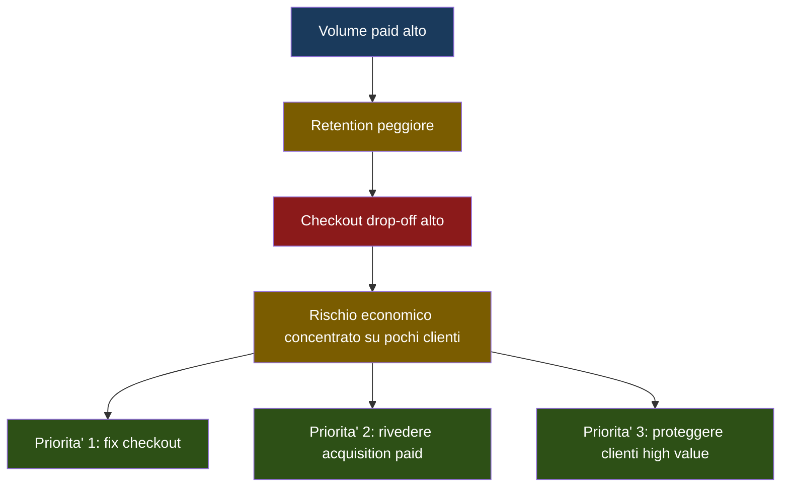

import { Aside } from '@astrojs/starlight/components'

Un ecommerce con componente SaaS B2B nota un problema ambiguo: il traffico sembra stabile, la revenue totale non crolla, ma il team commerciale segnala che la qualita' dei nuovi clienti e' peggiorata. Il board vuole una risposta in 48 ore, non una collezione di query scollegate.

Questo e' esattamente il tipo di situazione in cui il SQL avanzato fa la differenza. Non si tratta di trovare la query perfetta: si tratta di costruire una catena di analisi in cui ogni risultato riduce l'ambiguita' della domanda successiva. Il valore non e' tecnico. E' che alla fine hai una narrativa che il board puo' usare per prendere una decisione, non una slide con numeri isolati.

## Obiettivo del caso

Costruire una lettura end-to-end che risponda a quattro domande:

1. il trend revenue e' davvero stabile o maschera buchi temporali?
2. le nuove coorti stanno trattenendo meno valore?
3. dove si rompe il funnel?
4. quali clienti o prodotti meritano attenzione immediata?


## Dataset condiviso

```sql
users(user_id, signup_at, country, acquisition_channel, plan)
events(user_id, event_time, event_name, session_id, page, product_id)
orders(order_id, user_id, order_time, amount, country, channel, status)
order_items(order_id, product_id, category, quantity, net_revenue, margin)
```

## Step 1: rendere affidabile la serie temporale

Prima di tutto costruiamo una serie revenue continua.

```sql
WITH
    toDate('2025-01-01') AS start_date,
    toDate('2025-03-31') AS end_date,
    date_spine AS (
        SELECT start_date + number AS day
        FROM numbers(dateDiff('day', start_date, end_date) + 1)
    ),
    daily_orders AS (
        SELECT
            toDate(order_time) AS day,
            sum(amount) AS revenue
        FROM orders
        WHERE status = 'completed'
          AND order_time >= toDateTime(start_date)
          AND order_time < toDateTime(end_date + 1)
        GROUP BY day
    ),
    daily_series AS (
        SELECT
            d.day,
            coalesce(o.revenue, 0) AS revenue
        FROM date_spine d
        LEFT JOIN daily_orders o USING (day)
    )
SELECT
    day,
    revenue,
    avg(revenue) OVER (
        ORDER BY day
        ROWS BETWEEN 6 PRECEDING AND CURRENT ROW
    ) AS revenue_ma_7d
FROM daily_series
ORDER BY day;
```

Primo insight atteso: il trend sembra stabile solo perche' i giorni a zero erano nascosti. Dopo la date spine emerge un pattern di buchi operativi nei weekend.

Questo primo passaggio e' importante anche politicamente: dimostra subito che il team non sta "facendo analisi creativa", ma sta correggendo una base dati che altrimenti porterebbe a conclusioni sbagliate.

## Step 2: verificare se il problema e' di retention

Ora guardiamo la qualita' delle coorti, non solo il volume totale.

```sql
WITH
    signup_cohort AS (
        SELECT
            user_id,
            toStartOfMonth(signup_at) AS cohort_month,
            acquisition_channel
        FROM users
    ),
    monthly_revenue AS (
        SELECT
            user_id,
            toStartOfMonth(order_time) AS revenue_month,
            sum(amount) AS revenue
        FROM orders
        WHERE status = 'completed'
        GROUP BY user_id, revenue_month
    ),
    cohort_revenue AS (
        SELECT
            c.cohort_month,
            c.acquisition_channel,
            dateDiff('month', c.cohort_month, r.revenue_month) AS month_number,
            sum(r.revenue) AS cohort_revenue
        FROM signup_cohort c
        INNER JOIN monthly_revenue r USING (user_id)
        WHERE r.revenue_month >= c.cohort_month
        GROUP BY c.cohort_month, c.acquisition_channel, month_number
    )
SELECT
    cohort_month,
    acquisition_channel,
    month_number,
    cohort_revenue
FROM cohort_revenue
ORDER BY cohort_month, acquisition_channel, month_number;
```

Secondo insight atteso: le coorti piu' recenti da canale paid portano volume, ma revenue retention peggiore rispetto a referral e organic.

Qui la decisione implicita cambia: il problema non e' "generare piu' lead", ma "migliorare la qualita' dei lead acquisiti".

## Step 3: localizzare il drop-off nel funnel

```sql
WITH funnel_flags AS (
    SELECT
        user_id,
        max(if(event_name = 'landing', 1, 0)) AS s1_landing,
        max(if(event_name = 'product_view', 1, 0)) AS s2_product_view,
        max(if(event_name = 'add_to_cart', 1, 0)) AS s3_add_to_cart,
        max(if(event_name = 'checkout_start', 1, 0)) AS s4_checkout_start,
        max(if(event_name = 'purchase', 1, 0)) AS s5_purchase
    FROM events
    WHERE event_time >= toDateTime('2025-03-01 00:00:00')
      AND event_time < toDateTime('2025-04-01 00:00:00')
    GROUP BY user_id
)
SELECT
    sum(s1_landing) AS landing_users,
    sum(s2_product_view) AS product_users,
    sum(s3_add_to_cart) AS cart_users,
    sum(s4_checkout_start) AS checkout_users,
    sum(s5_purchase) AS purchase_users,
    round(sum(s5_purchase) / nullIf(sum(s1_landing), 0), 4) AS overall_cvr
FROM funnel_flags;
```

Poi andiamo sul punto di abbandono.

```sql
WITH session_outcomes AS (
    SELECT
        session_id,
        argMax(event_name, event_time) AS last_event,
        argMax(page, event_time) AS last_page,
        max(if(event_name = 'purchase', 1, 0)) AS has_purchase
    FROM events
    WHERE event_time >= toDateTime('2025-03-01 00:00:00')
      AND event_time < toDateTime('2025-04-01 00:00:00')
    GROUP BY session_id
)
SELECT
    last_event,
    last_page,
    count() AS abandoned_sessions
FROM session_outcomes
WHERE has_purchase = 0
GROUP BY last_event, last_page
ORDER BY abandoned_sessions DESC
LIMIT 10;
```

Terzo insight atteso: il problema principale non e' l'entry nel funnel, ma il passaggio `checkout_start -> purchase`, concentrato su poche pagine finali.

Quando un problema e' cosi' concentrato, il team puo' intervenire con una priorita' chiara: checkout UX, errori di pagamento o frizione finale, non top-of-funnel.

## Step 4: costruire una KPI table executive

Il board non vuole cinque query separate. Vuole una tabella che unisca volume, efficienza e trend.

```sql
WITH monthly_summary AS (
    SELECT
        toStartOfMonth(order_time) AS month,
        country,
        channel,
        sum(amount) AS revenue,
        count() AS orders_count,
        countDistinct(user_id) AS customers
    FROM orders
    WHERE status = 'completed'
      AND order_time >= toDateTime('2025-01-01 00:00:00')
    GROUP BY month, country, channel
)
SELECT
    month,
    country,
    channel,
    revenue,
    orders_count,
    customers,
    round(revenue / nullIf(orders_count, 0), 2) AS avg_order_value,
    round(revenue / nullIf(customers, 0), 2) AS revenue_per_customer
FROM monthly_summary
ORDER BY month DESC, revenue DESC;
```

Questa e' la tabella che sintetizza il business layer.

## Esempio di executive summary in tabella

Se dovessi consegnare una pagina sola al board, la struttura minima dovrebbe essere questa:

| Blocco | Cosa mostra | Perche' serve |
|---|---|---|
| Trend | revenue continua + MA7 | evita falsi segnali da giorni mancanti |
| Coorti | revenue retention per canale | distingue volume da qualita' |
| Funnel | step e drop-off finale | localizza l'attrito |
| KPI | paese, canale, AOV, revenue/customer | traduce l'analisi in management reporting |
| Pareto | top clienti e quota cumulata | misura il rischio di concentrazione |

## Step 5: shortlist di anomalie e segmenti

Per passare da reporting a decisione, aggiungiamo una vista Pareto clienti.

```sql
WITH customer_revenue AS (
    SELECT
        user_id,
        sum(amount) AS total_revenue
    FROM orders
    WHERE status = 'completed'
    GROUP BY user_id
),
ordered AS (
    SELECT
        user_id,
        total_revenue,
        sum(total_revenue) OVER (
            ORDER BY total_revenue DESC
            ROWS BETWEEN UNBOUNDED PRECEDING AND CURRENT ROW
        ) AS cumulative_revenue,
        sum(total_revenue) OVER () AS grand_total
    FROM customer_revenue
)
SELECT
    user_id,
    total_revenue,
    round(cumulative_revenue / nullIf(grand_total, 0), 4) AS cumulative_share
FROM ordered
WHERE cumulative_revenue / nullIf(grand_total, 0) <= 0.8
ORDER BY total_revenue DESC;
```

Quarto insight atteso: una quota piccola di clienti regge gran parte della revenue. Se la loro retention peggiora, il rischio economico e' molto piu' alto di quanto sembri dalla media.

## Come trasformare i risultati in priorita'



## Sintesi decisionale finale

Da queste analisi il management puo' arrivare a una narrativa chiara:

- la revenue totale non segnala subito il problema perche' il volume paid compensa temporaneamente
- le coorti recenti hanno retention peggiore, soprattutto nei canali a pagamento
- il funnel perde conversione soprattutto in checkout
- il business dipende troppo da un segmento ristretto di clienti high value

## Come presentare i risultati

L'analisi e' pronta. Il rischio a questo punto non e' tecnico: e' che il board non capisca cosa deve fare. Una query complessa non parla da sola.

La struttura narrativa che funziona meglio con l'executive:

**1. Il problema originale**: "il team commerciale segnalava peggioramento della qualita' dei nuovi clienti."

**2. La verifica del dato**: "la serie temporale mostrava giorni a zero nascosti dalla media mobile. Il trend stabile era un artefatto."

**3. La causa strutturale**: "le coorti acquired da paid negli ultimi due mesi hanno revenue retention 23% inferiore rispetto a organic e referral."

**4. Il punto di frizione operativo**: "il 67% del drop-off nel funnel e' concentrato nel passaggio `checkout_start` → `purchase`, su tre pagine specifiche."

**5. Il rischio economico**: "l'80% della revenue dipende dal 12% dei clienti. Se questi deteriorano, l'impatto e' sproporzionato rispetto ai volumi."

**6. Le priorita'**: checkout UX come urgenza immediata, revisione della qualita' dei canali paid come priorita' strategica, piano di retention per i clienti high value.

Questa struttura non richiede che il board capisca le query. Richiede che capisca la logica causale: ogni punto porta al successivo.

### Quanto tempo ci vuole?

Con dataset preparati e comprensione del dominio, le query di questo caso richiedono 2-4 ore. La preparazione della narrativa puo' richiedere altrettanto. Non e' una debolezza del SQL: e' la natura dell'analisi investigativa. Il valore non e' nella velocita' di esecuzione delle query, ma nella capacita' di costruire una catena causale che regge a domande di follow-up.

---

## Output finale da consegnare

Il deliverable corretto non e' "la query piu' bella". E' un pacchetto di tabelle interpretabili:

- tabella serie temporale continua con media mobile
- tabella cohort revenue retention (per canale e per mese)
- tabella funnel e drop-off (con percentuali di conversione passo-passo)
- tabella KPI executive per paese e canale (con variazioni MoM)
- shortlist top clienti o segmenti a rischio (con soglie Pareto)

Il formato migliore per ogni tabella dipende dal pubblico:

| Audience | Formato preferito |
|---|---|
| Board / CEO | slide con una metrica chiave + trend |
| CMO / Growth | tabella pivot con canali e coorti |
| Product | funnel con percentuali di step |
| Engineering | SQL esportabile e riproducibile |
| Analytics | tabella completa con tutti i breakdown |

Non preparare un'unica tabella per tutti. Prepara la stessa analisi in formati diversi.

<Aside type="caution">
Il valore del caso studio non sta nel numero di query. Sta nel fatto che ogni query riduce l'ambiguita' della decisione successiva.
</Aside>

## Riepilogo operativo

- Parti dalla qualita' del dato temporale: senza date spine, le serie storiche mentono per omissione.
- Controlla se il problema e' di volume o di qualita' delle coorti: spesso i due si confondono.
- Localizza il drop-off nel funnel prima di proporre soluzioni.
- La KPI table executive sintetizza il business layer in modo navigabile da audience non tecniche.
- Il Pareto clienti trasforma l'analisi in gestione del rischio economico.
- Chiudi sempre con una narrativa causale: perche' questo numero e' diverso da quello, e cosa fare.

## Mini esercizio

Replica il caso su un perimetro piu' piccolo:

1. un solo paese
2. due canali acquisition (organic vs paid)
3. un funnel a 4 step (landing → product → cart → purchase)
4. tre coorti mensili consecutive
5. una shortlist Pareto clienti con soglia 80%

Poi scrivi in cinque frasi la narrativa decisionale che presenteresti al board: problema, causa, punto di frizione, rischio economico, priorita'.
