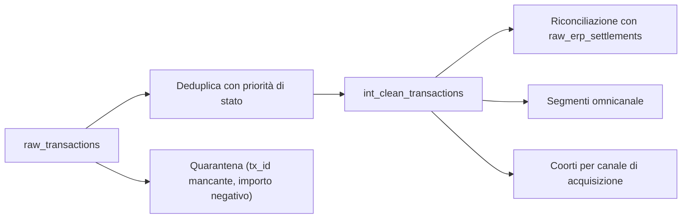

Scenario costruito con numeri di esempio: un retailer con un negozio online e alcuni punti vendita fisici riceve due tabelle grezze. La prima, `raw_transactions`, contiene eventi di pagamento arrivati da webhook, con duplicati, stati fuori ordine e scontrini del punto cassa senza cliente. La seconda, `raw_erp_settlements`, contiene gli incassi netti registrati dall'ERP. La direzione pone tre domande sullo stesso insieme di dati: quanto vale il fatturato netto riconciliato con l'ERP, quale quota di clienti torna il mese dopo il primo acquisto per ciascun canale, e chi compra sia online sia in negozio. Marketing, prodotto e finanza rispondono ciascuno con una query diversa direttamente sulle tabelle grezze, e ottengono tre numeri discordanti.

> **Idea chiave:** le tre domande hanno una sola causa comune di errore, i dati sporchi; si costruisce una volta un layer pulito, deduplicato e testato, e tutte le analisi leggono da lì, così le risposte dipendono dalle regole di business e non dal filtro che ciascun analista ha scritto.

## Una pipeline, quattro passi

Il lavoro si divide in una bonifica e tre analisi. La bonifica produce un layer intermedio con una riga per transazione; le analisi sono viste che leggono soltanto da quel layer. Il confine è netto: nessuna analisi pulisce i dati per conto proprio.



| Passo | Input | Regola | Output garantito |
| :--- | :--- | :--- | :--- |
| Deduplica | `raw_transactions` | `row_number()` per `tx_id` con priorità di stato | Una riga per `tx_id` |
| Quarantena | `raw_transactions` | `tx_id` vuoto o importo negativo | Vista con motivo dello scarto |
| Riconciliazione | layer pulito e ERP | `FULL OUTER JOIN` su `tx_id` | Elenco degli scarti in euro |
| Analisi | layer pulito | Filtro per cliente solo qui | Segmenti e coorti |

La scelta di un layer condiviso al posto di query ad hoc ha un motivo pratico. Tre analisti che puliscono i dati ognuno a modo suo producono tre fatturati diversi, e il tempo della riunione si consuma a capire quale sia giusto. Se la pulizia vive in un solo modello, un cambio di regola, per esempio un nuovo stato `chargeback`, si fa in un posto e si propaga a tutte le analisi.

## Le tabelle di partenza

Le tabelle contengono 16 eventi e 10 incassi, abbastanza poco da seguire ogni riga. Gli eventi 1 e 2 sono lo stesso pagamento (`pending` poi `paid`). Gli eventi 4 e 5 sono un rimborso arrivato prima di un retry `paid`. Gli eventi 6 e 7 sono un webhook duplicato identico. L'evento 8 è uno scontrino senza cliente, il 13 non ha `tx_id` e il 14 ha un importo negativo.

```sql
-- Eventi grezzi di pagamento: duplicati, stati fuori ordine, chiavi mancanti
CREATE TABLE raw_transactions
(
    event_id UInt32, tx_id String, customer_id String, channel String,
    status String, amount_eur Decimal(10,2), updated_at DateTime
) ENGINE = MergeTree ORDER BY event_id;

INSERT INTO raw_transactions VALUES
(1, 'T1', 'C1', 'web', 'pending', 50.00, '2026-01-10 10:00:00'),
(2, 'T1', 'C1', 'web', 'paid', 50.00, '2026-01-10 10:01:00'),
(3, 'T2', 'C1', 'pos', 'paid', 30.00, '2026-02-12 17:30:00'),
(4, 'T3', 'C7', 'web', 'refunded', 60.00, '2026-01-18 11:00:00'),
(5, 'T3', 'C7', 'web', 'paid', 60.00, '2026-01-18 11:05:00'),
(6, 'T4', 'C6', 'web', 'paid', 45.00, '2026-01-15 09:00:00'),
(7, 'T4', 'C6', 'web', 'paid', 45.00, '2026-01-15 09:00:00'),
(8, 'T5', '', 'pos', 'paid', 20.00, '2026-02-05 12:10:00'),
(9, 'T6', 'C2', 'pos', 'paid', 80.00, '2026-01-20 15:00:00'),
(10, 'T7', 'C2', 'web', 'paid', 60.00, '2026-02-03 20:15:00'),
(11, 'T8', 'C3', 'web', 'paid', 40.00, '2026-01-25 08:40:00'),
(12, 'T9', 'C3', 'web', 'paid', 25.00, '2026-01-30 19:05:00'),
(13, '', 'C8', 'web', 'paid', 35.00, '2026-02-01 10:00:00'),
(14, 'T11', 'C8', 'web', 'paid', -15.00, '2026-02-02 10:00:00'),
(15, 'T12', 'C4', 'web', 'paid', 90.00, '2026-01-08 14:00:00'),
(16, 'T14', 'C5', 'web', 'paid', 35.00, '2026-02-02 09:30:00');

-- Incassi netti registrati dall'ERP
CREATE TABLE raw_erp_settlements (tx_id String, settled_eur Decimal(10,2)) ENGINE = MergeTree ORDER BY tx_id;
INSERT INTO raw_erp_settlements VALUES
('T1', 50.00), ('T2', 30.00), ('T4', 45.00), ('T5', 20.00), ('T6', 80.00), ('T7', 60.00),
('T8', 40.00), ('T9', 25.00), ('T12', 85.00), ('T13', 70.00);
```

## Deduplica con priorità di stato

In un sistema distribuito i messaggi arrivano fuori ordine. Se ordini solo per `updated_at` decrescente, il retry `paid` dell'evento 5, arrivato 5 minuti dopo il rimborso, vince sul `refunded` e il rimborso sparisce dal fatturato. Per questo la regola ha una priorità esplicita: uno stato terminale come `refunded` vale di più di `paid`, che vale di più di `pending`, e solo a parità di stato decide il timestamp. L'ultimo criterio, `event_id`, spezza i pareggi identici come i due webhook duplicati.

```sql
-- Layer pulito: una riga per tx_id, stato terminale prevalente, importo netto incassato
CREATE VIEW int_clean_transactions AS
WITH ranked AS (
    SELECT
        tx_id, customer_id, channel, status, amount_eur, updated_at,
        row_number() OVER (
            PARTITION BY tx_id
            ORDER BY multiIf(status = 'refunded', 3, status = 'paid', 2, 1) DESC,
                     updated_at DESC, event_id DESC
        ) AS rn
    FROM raw_transactions
    WHERE tx_id != '' AND amount_eur >= 0
)
SELECT tx_id, customer_id, channel, status, updated_at,
       if(status = 'paid', amount_eur, toDecimal64(0, 2)) AS net_paid_eur
FROM ranked
WHERE rn = 1;
```

Esempio numerico svolto: i 16 eventi grezzi, tolti i 2 scarti in quarantena, sono 14 righe valide; la deduplica elimina `T1 pending`, `T3 paid` e un `T4` duplicato, quindi 14 - 3 = 11 transazioni distinte. Il fatturato netto è la somma di `net_paid_eur`: T1 50 + T12 90 + T14 35 + T2 30 + T3 0 + T4 45 + T5 20 + T6 80 + T7 60 + T8 40 + T9 25 = 475 euro. T3 contribuisce zero perché è stato rimborsato, e se avessi lasciato vincere il retry `paid` il totale sarebbe 535 euro, cioè 60 euro di fatturato inesistente.

Si noti che lo scontrino T5, senza cliente, compare nel fatturato: l'assenza del cliente riguarda le analisi per persona, e non il denaro incassato.

## Quarantena invece di scarto silenzioso

Le righe con `tx_id` vuoto o con importo negativo non possono entrare nel layer pulito, perché non si possono identificare né sommare senza ambiguità. Scartarle in silenzio è peggio: nessuno scopre mai che una fonte ha un problema. La soluzione è una vista di quarantena che conserva la riga e il motivo dello scarto.

```sql
-- Quarantena: righe escluse dal layer pulito, con il motivo
CREATE VIEW quarantine_transactions AS
SELECT event_id, tx_id, customer_id, amount_eur,
       multiIf(tx_id = '', 'tx_id mancante', 'importo negativo') AS reason
FROM raw_transactions
WHERE tx_id = '' OR amount_eur < 0;
```

Le righe restituite sono due: l'evento 13 da 35 euro del cliente C8 con `tx_id` mancante, e l'evento 14 da -15 euro con importo negativo. Un test a zero righe sul layer pulito, che cerca `tx_id = ''` o `net_paid_eur < 0`, deve passare; la vista di quarantena, invece, va monitorata nel tempo: se cresce da 2 a 200 righe in una notte, c'è un guasto nella sorgente.

## Riconciliazione con l'ERP

Il confronto con la contabilità si fa con una `FULL OUTER JOIN`, perché devi vedere gli orfani di entrambi i lati: transazioni presenti solo nel warehouse, presenti solo nell'ERP o presenti in entrambi con importi diversi. Una `INNER JOIN` farebbe sparire proprio i casi più gravi. In ClickHouse bisogna aggiungere `join_use_nulls = 1`: senza questa impostazione le colonne mancanti di un lato valgono la stringa vuota o zero, e il `coalesce` non distingue un valore assente da un valore reale.

```sql
-- Riconciliazione warehouse - ERP: restituisce solo le transazioni con scarto
SELECT
    coalesce(w.tx_id, e.tx_id) AS tx_id,
    ifNull(w.net_paid_eur, 0) AS warehouse_eur,
    ifNull(e.settled_eur, 0) AS erp_eur,
    warehouse_eur - erp_eur AS delta_eur
FROM int_clean_transactions AS w
FULL OUTER JOIN raw_erp_settlements AS e ON w.tx_id = e.tx_id
WHERE abs(warehouse_eur - erp_eur) > 0.01
ORDER BY tx_id
SETTINGS join_use_nulls = 1;
```

L'output ha tre righe: `T12` con 90 euro nel warehouse e 85 euro nell'ERP (scarto di 5 euro), `T13` presente solo nell'ERP per 70 euro (scarto di -70 euro) e `T14` presente solo nel warehouse per 35 euro (scarto di 35 euro). La quadratura globale conferma il risultato: il warehouse vale 475 euro, l'ERP vale 50 + 30 + 45 + 20 + 80 + 60 + 40 + 25 + 85 + 70 = 505 euro, e 475 - 505 = -30 euro, che coincide con 5 - 70 + 35 = -30 euro. Ogni euro di differenza è spiegato da una riga, ed è questa la proprietà da pretendere da una riconciliazione.

Le tre righe suggeriscono tre indagini diverse: T12 è un errore di importo (una commissione o un arrotondamento), T13 è un incasso che il warehouse non ha mai ricevuto, T14 è una vendita non ancora accreditata. La query non risolve i casi, li rende cercabili.

## Segmenti omnicanale e coorti per canale

Ora il filtro sul cliente è lecito, perché le domande riguardano persone. Un cliente è `web_only`, `pos_only` oppure `omnicanale` a seconda dei canali in cui ha almeno un pagamento riuscito.

```sql
-- Segmenti omnicanale sui soli clienti identificati con almeno un pagamento riuscito
SELECT
    customer_segment,
    count() AS customers,
    sum(customer_net_eur) AS segment_net_eur
FROM (
    SELECT
        customer_id,
        countIf(channel = 'web') AS web_orders,
        countIf(channel = 'pos') AS pos_orders,
        sum(net_paid_eur) AS customer_net_eur,
        multiIf(web_orders > 0 AND pos_orders > 0, 'omnicanale',
                web_orders > 0, 'web_only', 'pos_only') AS customer_segment
    FROM int_clean_transactions
    WHERE customer_id != '' AND status = 'paid'
    GROUP BY customer_id
)
GROUP BY customer_segment
ORDER BY segment_net_eur DESC;
```

Il risultato è `web_only` con 4 clienti e 235 euro, e `omnicanale` con 2 clienti e 220 euro. I due clienti omnicanale (C1 con 50 + 30 = 80 euro e C2 con 80 + 60 = 140 euro) valgono 110 euro a testa contro 58,75 euro dei clienti `web_only`: 235 / 4 = 58,75 euro. Il controllo di quadratura è 235 + 220 = 455 euro, più 20 euro dello scontrino anonimo T5 fa 475 euro, esattamente il fatturato del layer pulito. Il cliente C7 non compare perché il suo unico pagamento è rimborsato.

Le coorti per canale usano lo stesso layer. La coorte di un cliente è il mese del primo pagamento riuscito, e il canale di acquisizione è quello di quel pagamento, ottenuto con `argMin(channel, updated_at)`.

```sql
-- Coorti per canale di acquisizione: clienti a M0 e clienti che tornano a M1
WITH first_orders AS (
    SELECT
        customer_id,
        toStartOfMonth(min(updated_at)) AS cohort_month,
        argMin(channel, updated_at) AS acquisition_channel
    FROM int_clean_transactions
    WHERE customer_id != '' AND status = 'paid'
    GROUP BY customer_id
)
SELECT
    f.acquisition_channel AS acquisition_channel,
    f.cohort_month AS cohort_month,
    uniqExact(f.customer_id) AS m0,
    uniqExactIf(f.customer_id, toStartOfMonth(t.updated_at) = addMonths(f.cohort_month, 1)) AS m1
FROM first_orders AS f
INNER JOIN int_clean_transactions AS t ON t.customer_id = f.customer_id AND t.status = 'paid'
GROUP BY acquisition_channel, cohort_month
ORDER BY acquisition_channel, cohort_month;
```

Le righe sono tre: `pos` di gennaio con 1 cliente a M0 e 1 a M1, `web` di gennaio con 4 a M0 e 1 a M1, `web` di febbraio con 1 a M0 e 0 a M1. Il calcolo dà 100% per il punto vendita e 1 / 4 = 25% per il web, ma il campione è di cinque clienti e la coorte di febbraio non ha ancora un mese di storia, quindi la differenza non è un risultato: serve soltanto a provare che la pipeline funziona. Sui dati reali la stessa query, con migliaia di clienti, dà percentuali leggibili.

Per il tempo fino al secondo acquisto, cioè una curva di sopravvivenza semplice, si usa lo stesso layer: la differenza in giorni tra il primo e il secondo pagamento, con i clienti che non hanno ancora riacquistato trattati come osservazioni censurate, cioè con durata nota solo fino alla data di estrazione.

## Tre errori su dati sporchi

### Filtrare i clienti anonimi prima del fatturato

Sintomo: il fatturato del warehouse è più basso di quello dell'ERP di un importo stabile. Succede perché nel punto vendita molti pagano senza carta fedeltà e un filtro `customer_id != ''` messo nella pulizia iniziale cancella quegli scontrini. Si evita applicando il filtro solo nelle analisi per cliente, come negli esempi sopra, dove lo scontrino T5 da 20 euro resta nel totale di 475 euro.

### Deduplicare per timestamp senza gerarchia di stato

Sintomo: rimborsi che scompaiono e ricavi gonfiati. Succede perché il retry di un webhook può arrivare dopo l'evento terminale, e ordinando per `updated_at` il pagamento successivo prevale. Si evita con una priorità esplicita di stato, come `multiIf` nella vista pulita, e con un test che cerca transazioni con uno stato `paid` e un `refunded` nei dati grezzi ma `paid` nel layer.

### INNER JOIN nella riconciliazione

Sintomo: il confronto con l'ERP risulta pulito, ma i totali non quadrano. Succede perché una `INNER JOIN` conserva solo le transazioni presenti in entrambe le fonti e nasconde T13 e T14, che sono gli scarti più importanti. Si evita con una `FULL OUTER JOIN`, accompagnata dal controllo che la somma dei delta spieghi la differenza dei totali, nel nostro caso -30 euro.

## Controlli prima di consegnare il caso

1. La deduplica scarta 3 righe dalle 14 valide e conserva `T3` come `refunded`. Che fatturato otterresti lasciando vincere il retry `paid`?

<details>
<summary>Mostra risposta</summary>

Il fatturato sarebbe 475 + 60 = 535 euro, perché T3 passerebbe da 0 a 60 euro. La differenza di 60 euro è un ricavo inesistente creato dall'ordinamento solo per timestamp.

</details>

2. La somma dei delta della riconciliazione è 5 - 70 + 35 = -30 euro. Quale altra verifica conferma che nessuno scarto sia stato omesso?

<details>
<summary>Mostra risposta</summary>

La differenza tra i totali: il warehouse vale 475 euro, l'ERP 505 euro, e 475 - 505 = -30 euro. Se i due numeri non coincidessero, almeno una transazione sarebbe stata esclusa dal filtro sul delta o dalla join.

</details>

3. Un collega propone di mettere `WHERE customer_id != ''` nella vista pulita per semplificare le analisi per cliente. Quale effetto avrebbe sul fatturato?

<details>
<summary>Mostra risposta</summary>

Il fatturato scenderebbe da 475 euro a 455 euro, perché lo scontrino anonimo T5 da 20 euro uscirebbe dal layer. Il totale non quadrerebbe più con l'ERP, che registra quell'incasso. Il filtro va applicato solo nelle query per cliente.

</details>

4. Perché una `FULL OUTER JOIN` in ClickHouse richiede `join_use_nulls = 1` per questa riconciliazione?

<details>
<summary>Mostra risposta</summary>

Senza l'impostazione i valori mancanti di un lato non sono `NULL` ma stringhe vuote o zero, quindi `coalesce(w.tx_id, e.tx_id)` restituisce una stringa vuota per T13 e l'identificativo della transazione va perso. Con `join_use_nulls = 1` le colonne assenti sono `NULL` e `coalesce` e `ifNull` funzionano come previsto.

</details>
