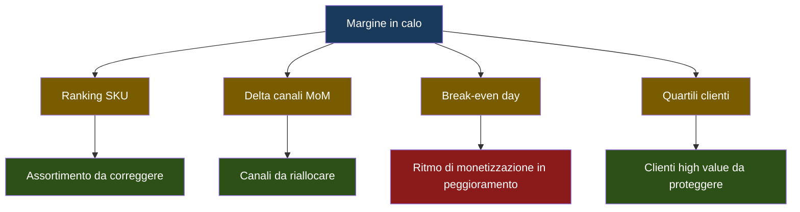

import { Aside } from '@astrojs/starlight/components'

Un retailer omnicanale vende online e in negozio, con tre canali digitali principali: `paid-search`, `email` e `organic`. Il management vede una revenue mensile stabile, ma il margine operativo scende da tre mesi. La domanda non e' "quale query usiamo?", ma: **dove si sta deteriorando l'economia del business e cosa va corretto per primo?**

Per rispondere in modo serio usiamo una catena corta di analisi tutta centrata sulle window functions.

## Domande a cui dobbiamo rispondere

1. quali prodotti stanno perdendo peso nel mix?
2. quali canali stanno rallentando rispetto al mese precedente?
3. in che punto del mese viene coperto il costo fisso?
4. quali clienti reggono davvero il margine?

## Dataset del caso

```sql
orders(
    order_id        bigint,
    customer_id     bigint,
    order_time      timestamp,
    channel         varchar,
    country         varchar,
    status          varchar,
    amount          numeric(12, 2)
)

order_items(
    order_id        bigint,
    product_id      bigint,
    category        varchar,
    quantity        integer,
    net_revenue     numeric(12, 2),
    margin          numeric(12, 2)
)
```

## Step 1: ranking dei prodotti che stanno davvero pesando sul business

La prima cosa da fare non e' guardare la media. E' vedere come si distribuisce il margine per categoria.

```sql
WITH product_margin AS (
    SELECT
        oi.category,
        oi.product_id,
        sum(oi.margin) AS total_margin
    FROM order_items oi
    INNER JOIN orders o
        ON o.order_id = oi.order_id
    WHERE o.status = 'completed'
      AND o.order_time >= DATE '2025-01-01'
    GROUP BY oi.category, oi.product_id
),
ranked AS (
    SELECT
        category,
        product_id,
        total_margin,
        row_number() OVER (
            PARTITION BY category
            ORDER BY total_margin ASC, product_id
        ) AS weakest_rank,
        row_number() OVER (
            PARTITION BY category
            ORDER BY total_margin DESC, product_id
        ) AS strongest_rank
    FROM product_margin
)
SELECT
    category,
    product_id,
    total_margin,
    weakest_rank,
    strongest_rank
FROM ranked
WHERE weakest_rank <= 3 OR strongest_rank <= 3
ORDER BY category, total_margin DESC;
```

Insight atteso:

- pochi SKU ad alto volume ma basso margine stanno comprimendo la redditivita'
- il problema non e' distribuito uniformemente sul catalogo

Qui il ranking serve per fare shortlist. Il management non ha bisogno di vedere 500 SKU: ha bisogno di vedere i 3 peggiori e i 3 migliori per categoria.

### Output executive esempio: shortlist SKU

| Categoria | SKU critico | Margine totale | Posizione |
|---|---|---:|---|
| Home | 1184 | 3.420 | weakest #1 |
| Home | 1051 | 4.015 | weakest #2 |
| Beauty | 772 | 2.980 | weakest #1 |
| Beauty | 811 | 28.640 | strongest #1 |

Una tabella cosi' e' immediatamente azionabile per merchandising e pricing.

## Step 2: benchmark del canale contro se stesso

La revenue assoluta da sola non basta. Serve il delta rispetto alla storia recente del canale.

```sql
WITH monthly_channel AS (
    SELECT
        DATE_TRUNC('month', order_time) AS month,
        channel,
        sum(amount) AS revenue
    FROM orders
    WHERE status = 'completed'
      AND order_time >= DATE '2024-10-01'
    GROUP BY DATE_TRUNC('month', order_time), channel
)
SELECT
    month,
    channel,
    revenue,
    lag(revenue) OVER (
        PARTITION BY channel
        ORDER BY month
    ) AS prev_month_revenue,
    round(
        (
            revenue
            - lag(revenue) OVER (
                PARTITION BY channel
                ORDER BY month
            )
        )
        / nullif(
            lag(revenue) OVER (
                PARTITION BY channel
                ORDER BY month
            ),
            0
        ),
        4
    ) AS mom_growth_pct
FROM monthly_channel
ORDER BY channel, month;
```

Insight atteso:

- `paid-search` tiene il volume ma rallenta mese su mese
- `email` cresce meno in revenue ma con maggiore stabilita'

La finestra qui non serve per "abbellire" la query. Serve per confrontare ogni mese con il precedente dentro la stessa storia del canale.

### Output executive esempio: performance canali

| Mese | Canale | Revenue | Revenue mese precedente | MoM |
|---|---|---:|---:|---:|
| 2025-01 | paid-search | 412000 | 398000 | 3.5% |
| 2025-02 | paid-search | 401500 | 412000 | -2.5% |
| 2025-03 | paid-search | 386900 | 401500 | -3.6% |
| 2025-03 | email | 142300 | 139100 | 2.3% |

Per il board questa tabella vale piu' di un grafico isolato: mostra direzione, ampiezza del cambiamento e canale da approfondire.

## Step 3: il giorno del mese in cui il business copre i costi fissi

Il CFO non ragiona solo in percentuali. Vuole sapere quando il mese va in pareggio operativo.

Assumiamo un costo fisso mensile di `180000`.

```sql
WITH daily_revenue AS (
    SELECT
        DATE_TRUNC('month', order_time) AS month,
        CAST(order_time AS date) AS day,
        sum(amount) AS revenue
    FROM orders
    WHERE status = 'completed'
    GROUP BY DATE_TRUNC('month', order_time), CAST(order_time AS date)
),
with_running AS (
    SELECT
        month,
        day,
        revenue,
        sum(revenue) OVER (
            PARTITION BY month
            ORDER BY day
            ROWS BETWEEN UNBOUNDED PRECEDING AND CURRENT ROW
        ) AS cumulative_revenue
    FROM daily_revenue
),
crossed AS (
    SELECT
        month,
        day,
        row_number() OVER (
            PARTITION BY month
            ORDER BY day
        ) AS rn
    FROM with_running
    WHERE cumulative_revenue >= 180000
)
SELECT
    month,
    day AS break_even_day
FROM crossed
WHERE rn = 1
ORDER BY month;
```

Insight atteso:

- il break-even day si sta spostando piu' avanti nel mese
- la stabilita' della revenue totale nasconde un peggioramento del ritmo di incasso

### Output executive esempio: ritmo di monetizzazione

| Mese | Break-even day | Giorni vs mese precedente |
|---|---|---:|
| 2025-01 | 2025-01-18 | - |
| 2025-02 | 2025-02-20 | +2 |
| 2025-03 | 2025-03-23 | +3 |

Quando il pareggio operativo slitta avanti di settimana in settimana, il management vede subito che il problema non e' solo di volume, ma di velocita' con cui il mese si costruisce.

## Step 4: quartili clienti per capire chi regge il margine

Ora passiamo dal lato prodotto al lato cliente.

```sql
WITH customer_margin AS (
    SELECT
        o.customer_id,
        sum(oi.margin) AS total_margin,
        sum(oi.net_revenue) AS total_revenue
    FROM orders o
    INNER JOIN order_items oi
        ON oi.order_id = o.order_id
    WHERE o.status = 'completed'
      AND o.order_time >= DATE '2025-01-01'
    GROUP BY o.customer_id
),
bucketed AS (
    SELECT
        customer_id,
        total_margin,
        total_revenue,
        ntile(4) OVER (
            ORDER BY total_margin DESC, customer_id
        ) AS margin_quartile
    FROM customer_margin
)
SELECT
    margin_quartile,
    count(*) AS customers,
    round(avg(total_margin), 2) AS avg_margin,
    round(avg(total_revenue), 2) AS avg_revenue,
    round(sum(total_margin), 2) AS margin_sum
FROM bucketed
GROUP BY margin_quartile
ORDER BY margin_quartile;
```

Insight atteso:

- il primo quartile concentra una quota sproporzionata del margine
- l'erosione di pochi clienti ad alto valore avrebbe un impatto molto piu' forte di quanto suggerisca la media

### Output executive esempio: concentrazione del margine

| Quartile | Clienti | Margine medio | Margine totale |
|---|---:|---:|---:|
| Q1 | 1.250 | 482 | 602500 |
| Q2 | 1.250 | 176 | 220000 |
| Q3 | 1.250 | 74 | 92500 |
| Q4 | 1.250 | 18 | 22500 |

Questa tabella rende evidente il rischio di concentrazione molto meglio di una media complessiva clienti.

## Step 5: una KPI table che il management possa leggere

A questo punto conviene riunire il quadro in una tabella mensile per canale.

```sql
WITH monthly_channel AS (
    SELECT
        DATE_TRUNC('month', order_time) AS month,
        channel,
        count(*) AS orders_count,
        count(DISTINCT customer_id) AS unique_customers,
        sum(amount) AS revenue
    FROM orders
    WHERE status = 'completed'
      AND order_time >= DATE '2025-01-01'
    GROUP BY DATE_TRUNC('month', order_time), channel
)
SELECT
    month,
    channel,
    orders_count,
    unique_customers,
    revenue,
    round(revenue / nullif(orders_count, 0), 2) AS aov,
    round(revenue / sum(revenue) OVER (PARTITION BY month), 4) AS monthly_share,
    rank() OVER (
        PARTITION BY month
        ORDER BY revenue DESC
    ) AS rank_in_month
FROM monthly_channel
ORDER BY month, rank_in_month;
```

Questa tabella mette insieme quattro elementi chiave:

- volume
- valore medio
- quota sul mese
- posizione competitiva del canale

### Scorecard finale per il board

| Tema | Segnale | Evidenza tabellare | Decisione |
|---|---|---|---|
| Assortimento | margine compresso | SKU deboli concentrati in poche categorie | revisione pricing e promo |
| Canali | paid in rallentamento | 2 mesi consecutivi di MoM negativo | riallocazione budget |
| Finanza operativa | break-even piu' tardivo | slittamento da giorno 18 a giorno 23 | monitoraggio cash pace |
| Clienti | margine concentrato | Q1 clienti regge gran parte del margine | piano retention high value |

<Aside type="tip" title="Perche' questa tabella funziona">
Non obbliga il board a ricostruire i rapporti tra tabelle separate. Ogni riga contiene gia' contesto, confronto e priorita'.
</Aside>

## Come leggere il caso nel suo insieme



## Decisioni che emergono dal caso

- ridurre esposizione sugli SKU a basso margine ma alto peso commerciale
- rivedere l'allocazione di budget su `paid-search`
- monitorare ogni mese lo spostamento del break-even day
- creare una retention list per i clienti del primo quartile

## Riepilogo

Questo caso mostra perche' le window functions contano davvero: non sono solo tecniche di query, ma meccanismi per costruire **confronto, priorita' e contesto**. Ranking, lag, cumulata e quartili non rispondono a quattro domande scollegate. Insieme costruiscono una lettura manageriale che porta a decisioni molto piu' difendibili.
