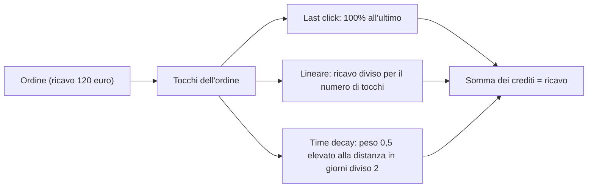

Scenario costruito con numeri di esempio: un team marketing somma le conversioni dichiarate da Meta Ads, Google Ads e dal proprio modello di attribuzione multi-touch, e ottiene 185.000 euro di fatturato attribuito ai canali. Nello stesso mese l'ERP ha incassato 112.000 euro. La differenza è di 73.000 euro, pari al 65% dell'incassato: ogni piattaforma si assegna il 100% di un ordine quando l'utente ha toccato il suo annuncio, e lo stesso ordine viene contato più volte. Anche il modello interno cade nello stesso errore se assegna l'intero ricavo a ogni touchpoint della sessione.

> **Idea chiave:** un modello di attribuzione è corretto quando, per ogni ordine, la somma dei crediti assegnati ai canali è uguale al ricavo dell'ordine; i modelli differiscono solo nel modo di dividere quel ricavo, mai nella quantità da dividere.

## Dati di partenza: ordini e touchpoint

Per vedere ogni passaggio usiamo quattro ordini, per un ricavo totale di 360 euro, e nove touchpoint ordinati nel tempo. Il cliente 1 compie due acquisti (ordini 1 e 4), e questo ci servirà per la coorte. Le date dei tocchi sono scelte in modo che la distanza dall'acquisto sia di 0, 2 o 4 giorni.

```sql
-- Ordini (1 riga per ordine) e tocchi pubblicitari (1 riga per tocco prima dell'acquisto)
CREATE TABLE orders (order_id UInt32, customer_id UInt32, order_date Date, revenue_eur Decimal(10,2)) ENGINE = MergeTree ORDER BY order_id;
INSERT INTO orders VALUES (1, 1, '2026-10-05', 120.00), (2, 2, '2026-10-02', 80.00), (3, 3, '2026-10-10', 100.00), (4, 1, '2026-10-14', 60.00);

CREATE TABLE touchpoints (order_id UInt32, touch_date Date, channel String) ENGINE = MergeTree ORDER BY (order_id, touch_date);
INSERT INTO touchpoints VALUES
(1, '2026-10-01', 'Meta'), (1, '2026-10-03', 'Google'), (1, '2026-10-05', 'Email'),
(2, '2026-10-02', 'Google'),
(3, '2026-10-06', 'Meta'), (3, '2026-10-08', 'Meta'), (3, '2026-10-10', 'Google'),
(4, '2026-10-12', 'Email'), (4, '2026-10-14', 'Google');
```

Il grain della tabella `touchpoints` è una riga per tocco, mentre quello di `orders` è una riga per ordine.

Prima di scrivere una sola query conviene dichiarare questa asimmetria, perché da lei derivano tutti gli errori della lezione. Unire le due tabelle moltiplica le righe di `orders` per il numero di tocchi, ed è proprio la fonte del doppio conteggio: i crediti devono nascere da una divisione del ricavo, non da una somma di righe duplicate.



## Posizione e peso di ogni tocco con le funzioni di finestra

Le tre regole di attribuzione richiedono tre informazioni su ogni tocco: la sua posizione nel percorso, il numero totale di tocchi dell'ordine e la sua distanza in giorni dall'acquisto. Le prime due vengono da `row_number()` e `count()` con `PARTITION BY order_id`; la terza da `dateDiff`. Il peso time decay è `pow(0.5, giorni / 2)`: un tocco al momento dell'acquisto pesa 1, uno di 2 giorni prima pesa 0,5, uno di 4 giorni prima 0,25. Dividendo il peso del tocco per la somma dei pesi dello stesso ordine si ottiene la quota di ricavo.

```sql
-- Righe intermedie: posizione, numero di tocchi, distanza, peso e quota time decay
SELECT
    t.order_id AS order_id, t.channel AS channel, t.touch_date AS touch_date,
    row_number() OVER (PARTITION BY t.order_id ORDER BY t.touch_date) AS pos,
    count() OVER (PARTITION BY t.order_id) AS touches,
    dateDiff('day', t.touch_date, o.order_date) AS days_before,
    pow(0.5, days_before / 2) AS w,
    round(w / sum(w) OVER (PARTITION BY t.order_id), 4) AS share,
    o.revenue_eur AS revenue_eur
FROM touchpoints AS t INNER JOIN orders AS o ON t.order_id = o.order_id
ORDER BY order_id, pos;
```

Le nove righe restituite, in forma abbreviata per gli ordini 1, 3 e 4, sono queste.

| Ordine | Canale | Posizione | Tocchi | Giorni prima | Peso | Quota |
| ---: | :--- | ---: | ---: | ---: | ---: | ---: |
| 1 | Meta | 1 | 3 | 4 | 0,25 | 0,1429 |
| 1 | Google | 2 | 3 | 2 | 0,50 | 0,2857 |
| 1 | Email | 3 | 3 | 0 | 1,00 | 0,5714 |
| 3 | Meta | 1 | 3 | 4 | 0,25 | 0,1429 |
| 3 | Meta | 2 | 3 | 2 | 0,50 | 0,2857 |
| 3 | Google | 3 | 3 | 0 | 1,00 | 0,5714 |
| 4 | Email | 1 | 2 | 2 | 0,50 | 0,3333 |
| 4 | Google | 2 | 2 | 0 | 1,00 | 0,6667 |

Esempio numerico svolto per l'ordine 1: i pesi sono 0,25 + 0,50 + 1,00 = 1,75, quindi la quota di Meta è 0,25 / 1,75 = 0,1429, quella di Google 0,50 / 1,75 = 0,2857 e quella di Email 1,00 / 1,75 = 0,5714. Moltiplicate per il ricavo di 120 euro danno 17,14 euro, 34,29 euro e 68,57 euro, che sommati fanno 120,00 euro.

Lo stesso conto per l'ordine 4, che ha due tocchi con pesi 0,50 e 1,00, dà una somma di 1,50: Email prende 0,50 / 1,50 = 33,33% del ricavo, cioè 20,00 euro, e Google il restante 66,67%, cioè 40,00 euro, per un totale di 60,00 euro.

La scelta della semivita di 2 giorni è una decisione di business, non una proprietà dei dati. Un prodotto con ciclo di acquisto di una settimana userà una semivita più lunga, e conviene dichiarare il parametro in testa alla query così che chiunque possa cambiarlo e rileggere i crediti.

## Last click, lineare e time decay a confronto

Con le tre colonne di supporto, i tre modelli si calcolano in un solo passaggio. Il last click assegna l'intero ricavo al tocco con posizione 1 contando dalla fine, e per questo la finestra ordina in modo decrescente. Il modello lineare divide il ricavo per il numero di tocchi. Il time decay moltiplica il ricavo per la quota calcolata sopra. I ricavi sono convertiti in `Float64`: perché lo facciamo lo spiega la sezione successiva.

```sql
-- Crediti per canale con tre modelli di attribuzione
WITH credited AS (
    SELECT
        t.order_id AS order_id, t.channel AS channel, toFloat64(o.revenue_eur) AS revenue_eur,
        row_number() OVER (PARTITION BY t.order_id ORDER BY t.touch_date DESC) AS pos_from_end,
        count() OVER (PARTITION BY t.order_id) AS touches,
        pow(0.5, dateDiff('day', t.touch_date, o.order_date) / 2) AS w,
        w / sum(w) OVER (PARTITION BY t.order_id) AS decay_share
    FROM touchpoints AS t INNER JOIN orders AS o ON t.order_id = o.order_id
)
SELECT
    channel,
    round(sumIf(revenue_eur, pos_from_end = 1), 2) AS last_click_eur,
    round(sum(revenue_eur / touches), 2) AS linear_eur,
    round(sum(revenue_eur * decay_share), 2) AS time_decay_eur
FROM credited
GROUP BY channel
ORDER BY channel;
```

| Canale | Last click | Lineare | Time decay |
| :--- | ---: | ---: | ---: |
| Email | 120,00 | 70,00 | 88,57 |
| Google | 240,00 | 183,33 | 211,43 |
| Meta | 0,00 | 106,67 | 60,00 |
| Totale | 360,00 | 360,00 | 360,00 |

Ogni colonna somma a 360 euro, cioè al ricavo reale dei quattro ordini: è il segno che la divisione è corretta.

Le differenze tra colonne sono invece informazione, e la prima cosa da guardare è chi guadagna e chi perde passando da un modello all'altro. Meta apre due percorsi ma non chiude mai un acquisto, quindi per il last click vale 0 euro; il modello lineare gli assegna 106,67 euro, di cui 40 dall'ordine 1 e 66,67 dall'ordine 3 (100 / 3 per due tocchi); il time decay lo porta a 60 euro, perché i suoi tocchi sono lontani dall'acquisto. Chi decidesse il budget con il solo last click spegnerebbe Meta, e nessuna delle tre colonne dice se le vendite sparirebbero davvero: per quello servirebbe un esperimento con gruppo di controllo.

## Il test di quadratura sui crediti

Il controllo che trasforma una tabella di attribuzione in un dato affidabile è un test a zero righe: per ogni ordine, il ricavo meno la somma dei crediti deve essere nullo entro un centesimo. La query restituisce solo gli ordini che violano la regola.

```sql
-- Test a zero righe: i crediti di ogni ordine devono sommare al ricavo dell'ordine
WITH credited AS (
    SELECT
        t.order_id AS order_id, toFloat64(o.revenue_eur) AS revenue_eur,
        pow(0.5, dateDiff('day', t.touch_date, o.order_date) / 2) AS w,
        revenue_eur * w / sum(w) OVER (PARTITION BY t.order_id) AS credit_eur
    FROM touchpoints AS t INNER JOIN orders AS o ON t.order_id = o.order_id
)
SELECT order_id, any(revenue_eur) AS order_revenue_eur, round(sum(credit_eur), 2) AS credited_eur
FROM credited
GROUP BY order_id
HAVING abs(order_revenue_eur - sum(credit_eur)) > 0.01;
```

Sui dati dell'esempio la query restituisce zero righe.

Zero righe, qui, è il risultato desiderato: significa che per tutti e quattro gli ordini il ricavo e la somma dei crediti coincidono entro un centesimo. Il test ha una storia istruttiva: con i ricavi in `Decimal(10,2)` il modello lineare dava 106,66 euro a Meta, perché la divisione tronca 100 / 3 a 33,33, e la somma dei tre canali risultava 359,99 euro invece di 360,00. Un centesimo mancante, che nessun occhio nota in una tabella e che un test con soglia a 0,01 euro rileva solo se la tolleranza è stretta. La soluzione adottata qui è calcolare in virgola mobile e arrotondare solo in uscita; in un libro contabile si preferisce assegnare il residuo di arrotondamento al credito più grande dell'ordine, così i centesimi sommano esattamente.

## Percorsi di conversione

Oltre alla quota per canale, spesso serve sapere quali sequenze di tocchi portano a un acquisto. Per costruire il percorso di ogni ordine si raccolgono le coppie data e canale con `groupArray`, si ordinano per data con `arraySort` e si uniscono in una stringa. L'ordine dentro `groupArray` non è garantito, per cui l'ordinamento esplicito è indispensabile. Il raggruppamento per percorso avviene in una query esterna: farlo nella stessa query dei tocchi ripeterebbe il ricavo per ogni tocco, cioè lo stesso fan-out di prima.

```sql
-- Percorsi di conversione: una riga per ordine, poi raggruppamento per sequenza
SELECT
    path,
    count() AS orders,
    sum(revenue_eur) AS revenue_eur
FROM (
    SELECT
        t.order_id AS order_id,
        arrayStringConcat(arrayMap(x -> x.2, arraySort(x -> x.1, groupArray((t.touch_date, t.channel)))), ' > ') AS path,
        any(o.revenue_eur) AS revenue_eur
    FROM touchpoints AS t INNER JOIN orders AS o ON t.order_id = o.order_id
    GROUP BY t.order_id
)
GROUP BY path
ORDER BY revenue_eur DESC, path;
```

Il numero di righe cambia molto da un caso all'altro, ma la struttura del risultato resta la stessa.

Il risultato elenca quattro percorsi, ciascuno con un ordine: `Meta > Google > Email` con 120 euro, `Meta > Meta > Google` con 100 euro, `Google` con 80 euro ed `Email > Google` con 60 euro. La somma è 360 euro, ancora la quadratura. In un caso reale i percorsi frequenti sono centinaia e si raggruppano per lunghezza o per primo e ultimo canale, ma il metodo è identico. Si noti anche che due tocchi consecutivi dello stesso canale, come `Meta > Meta`, sono un segnale da valutare: il lineare li premia due volte, il last click per nulla.

## La coorte stabile e il canale di acquisizione

Per collegare l'attribuzione alle coorti serve un'assegnazione che non cambi con il filtro. La coorte di un cliente è il mese del suo primo ordine e il canale di acquisizione è il canale del primo tocco di quell'ordine, ottenuto con `argMin` ordinato per data ordine e data tocco. Il cliente 1 ha due ordini: il secondo, chiuso da Google, non cambia il suo canale di acquisizione, che resta Meta.

```sql
-- Coorte stabile: mese del primo ordine e canale del primo tocco di quell'ordine
WITH first_touch AS (
    SELECT
        o.customer_id AS customer_id,
        toStartOfMonth(min(o.order_date)) AS cohort_month,
        argMin(t.channel, (o.order_date, t.touch_date)) AS acquisition_channel
    FROM orders AS o INNER JOIN touchpoints AS t ON o.order_id = t.order_id
    GROUP BY o.customer_id
)
SELECT * FROM first_touch ORDER BY customer_id;
```

Il risultato è una tabella piccola, ma è quella che rende confrontabili tutte le altre.

Le tre righe assegnano il cliente 1 a ottobre con canale Meta, il cliente 2 a ottobre con Google e il cliente 3 a ottobre con Meta. Da qui la matrice di retention per canale di acquisizione si costruisce come nella lezione sulla matrice di coorte: la coorte è `(cohort_month, acquisition_channel)`, il denominatore è la sua dimensione a M0 e le celle future sono escluse. Il vantaggio è confrontare la tenuta di clienti nati da canali diversi, non solo da mesi diversi.

## Tre errori da riconoscere

### Il ricavo assegnato per intero a ogni tocco

Sintomo: il fatturato attribuito supera quello incassato, come nei 185.000 euro contro 112.000 euro. Succede perché la join tra ordini e tocchi ripete il ricavo su ogni riga e una somma per canale lo conta una volta per tocco. Si corregge dividendo il ricavo per una quota normalizzata dentro una finestra partizionata per ordine, e confermando con il test a zero righe che i crediti sommano al ricavo.

### Pesi non normalizzati

Il secondo errore è più silenzioso, perché il risultato è comunque un numero con due decimali.

Sintomo: i crediti time decay di un ordine sommano a più o meno del ricavo, per esempio 210 euro su 120 euro. Succede quando si moltiplica il ricavo per il solo peso `pow(0.5, giorni / 2)` senza dividere per la somma dei pesi dell'ordine. Si corregge con `w / sum(w) OVER (PARTITION BY order_id)`, che garantisce quote con somma 1.

### Coorte che cambia con il filtro

Il terzo errore riguarda il collegamento con la retention e si manifesta nei confronti tra periodi.

Sintomo: lo stesso cliente appare con canali di acquisizione diversi in report diversi. Succede quando il primo tocco è calcolato dopo un filtro sulle date, e un cliente storico viene scambiato per nuovo. Si corregge calcolando coorte e canale sull'intera storia e filtrando le coorti solo nel risultato.

## Verifica prima di pubblicare il modello

Le domande seguenti si risolvono con i numeri dell'estratto, senza eseguire query.

1. Un ordine da 120 euro ha tre tocchi con pesi 0,25, 0,50 e 1,00. Quanto vale il credito del tocco più recente?

<details>
<summary>Mostra risposta</summary>

La somma dei pesi è 1,75, quindi la quota del tocco più recente è 1,00 / 1,75 = 0,5714 e il credito è 120 × 0,5714 = 68,57 euro.

</details>

2. Con il last click Meta ottiene 0 euro e con il lineare 106,67 euro. Che cosa puoi concludere sulla decisione di spegnere Meta?

<details>
<summary>Mostra risposta</summary>

Nulla di definitivo: i due modelli sono regole di ripartizione dello stesso ricavo, non misure di causalità. Il confronto indica che Meta compare spesso all'inizio dei percorsi; per sapere se le vendite scomparirebbero serve un test con gruppo di controllo o un'analisi incrementale.

</details>

3. Un test di quadratura restituisce l'ordine 3 con ricavo 100 euro e crediti 133,33 euro. Quale errore cerchi per primo?

<details>
<summary>Mostra risposta</summary>

Cerchi un doppio conteggio: i crediti superano il ricavo di 33,33 euro, cioè un terzo, e il percorso ha 3 tocchi. È probabile che un tocco sia duplicato nella tabella dei touchpoint, oppure che la quota non sia normalizzata sulla partizione dell'ordine.

</details>

4. Perché i percorsi si raggruppano in una query esterna e non nella query che costruisce la stringa del percorso?

<details>
<summary>Mostra risposta</summary>

Nella query interna c'è una riga per tocco, e il ricavo dell'ordine verrebbe sommato una volta per tocco. Con una riga per ordine nella query interna, il raggruppamento esterno somma ogni ricavo una sola volta e la somma torna a 360 euro.

</details>
