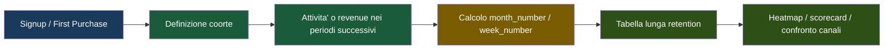

import { Aside } from '@astrojs/starlight/components'

Nel 2021 il team di crescita di Duolingo stava cercando un'unica metrica predittiva del lifetime value. Avevano D1, D7, D30, DAU/MAU, streak length, numero di lezioni completate. Dopo mesi di analisi su milioni di utenti scoprirono che la **D7 retention** — la percentuale di utenti che tornava sull'app esattamente al settimo giorno — era il predittore più forte del LTV a sei mesi, più affidabile persino del D1 o del numero di lezioni completate nel primo giorno. Quella scoperta ridefinì le priorità del team: ogni esperimento di prodotto veniva giudicato prima di tutto sul suo effetto sul D7.

Questo è il tipo di insight che diventa possibile solo quando smetti di leggere la retention come una singola percentuale aggregata e inizi a leggerla come una struttura nel tempo, per coorti omogenee, su comportamenti specifici e con impatto economico tracciabile. Le coorti servono a questo: trasformare una media ingannevole in una lettura strutturata del ciclo di vita cliente.

Dire che "la retention è al 28%" non basta. La domanda utile è: retention di quali utenti, acquisiti quando, su quale comportamento e con quale valore economico nel tempo?

## Perché la cohort analysis cambia la qualità della lettura

Una media aggregata confonde periodi diversi e utenti diversi. Immagina di avere tre coorti mensili con retention D30 rispettivamente al 35%, 28% e 12%. La media aritmetica è circa 25%. Ma quella media non ti dice che hai un problema grave di recente acquisizione, né che le coorti più vecchie potrebbero avere pattern completamente diversi da quelle nuove.

Le coorti, invece, separano gli utenti in base alla loro data di ingresso e misurano cosa succede nel tempo. Questo permette di confrontare periodi diversi su base omogenea e di isolare l'effetto di cambiamenti di prodotto, campagne marketing, o variazioni stagionali.

Con le coorti puoi rispondere a domande come:

- i clienti acquisiti a gennaio tornano meglio di quelli di febbraio?
- il nuovo onboarding ha migliorato la retention dopo 30 giorni?
- i clienti paid hanno revenue retention migliore degli organic?
- un cambio di pricing ha impattato la qualità degli utenti acquisiti?



## Schema minimo per questa lezione

```sql
users(
    user_id UInt64,
    signup_at DateTime,
    country LowCardinality(String),
    acquisition_channel LowCardinality(String),
    plan LowCardinality(String)
)

orders(
    order_id UInt64,
    user_id UInt64,
    order_time DateTime,
    amount Float64,
    country LowCardinality(String),
    channel LowCardinality(String),
    status LowCardinality(String)
)

order_items(
    order_id UInt64,
    product_id UInt64,
    category LowCardinality(String),
    quantity UInt32,
    net_revenue Float64,
    margin Float64
)
```

## Tre concetti spesso confusi: retention rate, churn rate, survival rate

Prima di scrivere una sola riga di SQL è necessario chiarire tre termini che vengono usati in modo intercambiabile ma che misurano cose diverse con implicazioni diverse.

**Retention rate** misura la quota di utenti (o di revenue) che rimane attiva in un dato periodo, rispetto alla dimensione iniziale della coorte o rispetto al periodo precedente. Può essere calcolata in due modi:

- **Retention classica (bounded)**: quanti utenti della coorte del mese M sono ancora attivi al mese M+3? La base è sempre la dimensione della coorte originale.
- **Rolling retention**: quanti utenti del mese M sono stati attivi *almeno una volta* dal giorno N in poi? La distinzione è sottile ma importante: un utente che scompare per tre mesi e poi torna viene contato come "retained" nella rolling retention ma non nella bounded retention.

**Churn rate** è il complemento della retention: se la retention mensile è al 70%, il churn mensile è al 30%. Però attenzione: il churn calcolato su base coorte è diverso dal churn aggregato calcolato su tutti gli utenti attivi in un dato periodo. Il primo è più preciso perché non contamina coorti nuove con coorti vecchie.

**Survival rate** è un concetto preso dall'analisi di sopravvivenza statistica (Kaplan-Meier). Misura la probabilità che un utente sia ancora attivo dopo N unità di tempo, tenendo conto della censura (utenti che non abbiamo ancora potuto osservare per l'intero periodo). Nelle analisi di prodotto viene usata meno frequentemente, ma è utile quando si vuole confrontare coorti di diverse dimensioni con diversi periodi di osservazione disponibili.

Per la maggior parte delle analisi operative su ClickHouse userai retention rate con base coorte. Le distinzioni diventano critiche quando presenti i risultati: un PM che chiede "qual è la nostra retention?" si aspetta un numero specifico, e devi sapere quale numero stai calcolando.

<Aside type="note">
La formula base della bounded retention è: `utenti_attivi_al_periodo_N / utenti_nella_coorte_al_periodo_0`. Il denominatore è fisso. Nella rolling retention il denominatore è lo stesso, ma il numeratore include utenti attivi in qualsiasi momento dal periodo N in poi.
</Aside>

## Costruire la cohort month

```sql
WITH signup_cohort AS (
    SELECT
        user_id,
        toStartOfMonth(signup_at) AS cohort_month,
        acquisition_channel,
        plan
    FROM users
)
SELECT *
FROM signup_cohort
ORDER BY cohort_month, user_id
LIMIT 20;
```

La `cohort_month` è la chiave logica che porteremo poi su eventi e ordini. `toStartOfMonth()` in ClickHouse è equivalente a `DATE_TRUNC('month', ...)` in PostgreSQL — tronca la data al primo giorno del mese, permettendo di raggruppare tutti gli utenti registrati nello stesso mese sotto la stessa chiave.

## Due letture diverse: SaaS signup cohort vs repeat-purchase cohort

Nel SaaS la coorte è spesso la data di signup. Nell'ecommerce, invece, può avere più senso costruire la coorte sul **primo acquisto**.

```sql
WITH first_purchase_cohort AS (
    SELECT
        user_id,
        toStartOfMonth(min(order_time)) AS first_purchase_month
    FROM orders
    WHERE status = 'completed'
    GROUP BY user_id
)
SELECT
    first_purchase_month,
    count() AS customers_in_cohort
FROM first_purchase_cohort
GROUP BY first_purchase_month
ORDER BY first_purchase_month;
```

Questa variante è utile quando la registrazione non ha ancora un valore economico chiaro e vuoi misurare la qualità delle coorti paganti. In un business B2C con trial gratuiti, la coorte di signup include utenti che non convertiranno mai: misurare la retention su quella base inquina la lettura con un denominatore troppo largo.

La scelta tra signup cohort e first-purchase cohort non è tecnica: è una scelta di definizione del business. Deve essere presa con il product manager o il responsabile revenue prima di costruire qualsiasi dashboard.

## Rolling retention vs N-day retention: quando usare quale

La distinzione tra rolling e N-day (bounded) retention cambia significativamente l'interpretazione dei numeri, specialmente per prodotti con uso discontinuo.

**N-day retention** (o bounded retention) risponde a: "quanti utenti acquisiti il giorno 0 erano attivi esattamente al giorno N (o nel periodo N)?". È la metrica giusta per prodotti con uso quotidiano atteso — app di fitness, social network, tool di produttività. Se un utente di Duolingo non apre l'app al D7, è un segnale forte di disimpegno.

**Rolling retention** risponde a: "quanti utenti acquisiti il giorno 0 hanno fatto almeno un'azione dal giorno N in poi?". È la metrica giusta per prodotti con uso discontinuo ma ad alto valore — ecommerce, servizi di prenotazione viaggi, software B2B enterprise. Un utente che acquista ogni 45 giorni su un sito di elettronica ha retention eccellente ma apparirebbe come churned in una bounded D30 retention.

In ClickHouse, la differenza si traduce nel predicato della JOIN:

```sql
-- N-day retention: attivo ESATTAMENTE nella settimana N
WHERE toStartOfWeek(o.order_time) = addWeeks(toStartOfWeek(u.signup_at), N)

-- Rolling retention: attivo IN QUALSIASI MOMENTO dalla settimana N in poi
WHERE toStartOfWeek(o.order_time) >= addWeeks(toStartOfWeek(u.signup_at), N)
```

<Aside type="tip">
Per decidere quale usare, chiedi: "Con quale frequenza un utente sano usa questo prodotto?". Se la risposta è "ogni giorno o ogni settimana", usa N-day retention. Se la risposta è "quando ne ha bisogno", usa rolling retention.
</Aside>

## Logo retention: utenti attivi per mese dalla coorte

```sql
WITH
    signup_cohort AS (
        SELECT
            user_id,
            toStartOfMonth(signup_at) AS cohort_month
        FROM users
    ),
    monthly_activity AS (
        SELECT DISTINCT
            user_id,
            toStartOfMonth(order_time) AS activity_month
        FROM orders
        WHERE status = 'completed'
    ),
    cohort_activity AS (
        SELECT
            c.cohort_month,
            a.activity_month,
            dateDiff('month', c.cohort_month, a.activity_month) AS month_number,
            countDistinct(c.user_id) AS active_users
        FROM signup_cohort c
        INNER JOIN monthly_activity a USING (user_id)
        WHERE a.activity_month >= c.cohort_month
        GROUP BY c.cohort_month, a.activity_month, month_number
    )
SELECT
    cohort_month,
    month_number,
    active_users,
    first_value(active_users) OVER (
        PARTITION BY cohort_month
        ORDER BY month_number
        ROWS BETWEEN UNBOUNDED PRECEDING AND UNBOUNDED FOLLOWING
    ) AS cohort_size,
    round(
        active_users
        / nullIf(first_value(active_users) OVER (
            PARTITION BY cohort_month
            ORDER BY month_number
            ROWS BETWEEN UNBOUNDED PRECEDING AND UNBOUNDED FOLLOWING
        ), 0),
        4
    ) AS retention_pct
FROM cohort_activity
ORDER BY cohort_month, month_number;
```

Questa è la tabella lunga classica, perfetta per heatmap e line chart per coorte. Nota: qui ho sostituito la tabella `events` con `orders` per allinearsi allo schema disponibile in questa lezione. Il principio è identico: selezionare attività distinte per utente e per periodo.

### Come leggere l'output

- `cohort_month`: il mese di ingresso dell'utente
- `month_number = 0`: il mese di ingresso (per definizione sempre 100%)
- `month_number = 1`: il mese successivo
- `retention_pct`: quota di utenti ancora attivi rispetto alla dimensione iniziale della coorte

## Revenue retention vs user retention: due KPI, due conclusioni diverse

La **logo retention** (o user retention) misura quanti utenti tornano. La **revenue retention** misura quanto valore economico torna. Sono KPI diversi che possono raccontare storie opposte, e leggere solo uno dei due è un errore che porta a decisioni sbagliate.

Considera questo scenario: una coorte acquisita a gennaio ha dopo 6 mesi il 18% di logo retention — sembra bassa. Ma quella stessa coorte ha il 140% di revenue retention, perché il 18% di utenti rimasto ha fatto upsell significativi. Questo pattern è tipico di prodotti SaaS con espansione del contratto: pochi clienti rimangono ma spendono molto di più nel tempo.

Il caso opposto è altrettanto insidioso: logo retention alta (42% a M6) con revenue retention bassa (31%). Stai tenendo molti utenti ma i migliori stanno churning. Forse il piano premium non offre abbastanza valore per essere rinnovato.

### Calcolo della revenue retention

```sql
WITH
    signup_cohort AS (
        SELECT
            user_id,
            toStartOfMonth(signup_at) AS cohort_month
        FROM users
    ),
    monthly_revenue AS (
        SELECT
            user_id,
            toStartOfMonth(order_time) AS revenue_month,
            sum(amount) AS revenue
        FROM orders
        WHERE status = 'completed'
        GROUP BY user_id, revenue_month
    ),
    cohort_revenue AS (
        SELECT
            c.cohort_month,
            r.revenue_month,
            dateDiff('month', c.cohort_month, r.revenue_month) AS month_number,
            sum(r.revenue) AS cohort_revenue
        FROM signup_cohort c
        INNER JOIN monthly_revenue r USING (user_id)
        WHERE r.revenue_month >= c.cohort_month
        GROUP BY c.cohort_month, r.revenue_month, month_number
    )
SELECT
    cohort_month,
    month_number,
    cohort_revenue,
    first_value(cohort_revenue) OVER (
        PARTITION BY cohort_month
        ORDER BY month_number
        ROWS BETWEEN UNBOUNDED PRECEDING AND UNBOUNDED FOLLOWING
    ) AS month_zero_revenue,
    round(
        cohort_revenue
        / nullIf(first_value(cohort_revenue) OVER (
            PARTITION BY cohort_month
            ORDER BY month_number
            ROWS BETWEEN UNBOUNDED PRECEDING AND UNBOUNDED FOLLOWING
        ), 0),
        4
    ) AS revenue_retention_pct
FROM cohort_revenue
ORDER BY cohort_month, month_number;
```

Ora hai due letture complementari:

- **logo retention**: quanti utenti restano
- **revenue retention**: quanto valore economico resta

Se logo retention e revenue retention divergono molto, il messaggio è forte:

- pochi utenti ma ad alto valore possono reggere la revenue
- tanti utenti retained ma con revenue bassa possono creare un'illusione di salute

La revenue retention superiore al 100% (net revenue retention positiva) è il segnale più forte di un business SaaS sano: vuol dire che l'espansione nei clienti esistenti compensa il churn.

## Il triangolo delle coorti: query per la matrice completa

La rappresentazione visiva più efficace per la cohort analysis è la **triangolo delle coorti** (cohort triangle): una matrice dove le righe sono le coorti (mesi di acquisizione), le colonne sono i periodi (M0, M1, M2...) e le celle contengono la retention percentuale. Si chiama triangolo perché le coorti più recenti hanno meno periodi osservabili — l'angolo in basso a destra è sempre vuoto.

Ecco la query completa per costruire questa matrice in ClickHouse, con granularità settimanale per avere dati più densi:

```sql
WITH
    signup_cohort AS (
        SELECT
            user_id,
            toStartOfWeek(signup_at) AS cohort_week
        FROM users
    ),
    weekly_activity AS (
        SELECT DISTINCT
            user_id,
            toStartOfWeek(order_time) AS activity_week
        FROM orders
        WHERE status = 'completed'
    ),
    cohort_activity AS (
        SELECT
            c.cohort_week,
            dateDiff('week', c.cohort_week, a.activity_week) AS week_number,
            countDistinct(c.user_id) AS active_users
        FROM signup_cohort c
        INNER JOIN weekly_activity a USING (user_id)
        WHERE a.activity_week >= c.cohort_week
        GROUP BY c.cohort_week, week_number
    ),
    retention_pct_table AS (
        SELECT
            cohort_week,
            week_number,
            active_users,
            first_value(active_users) OVER (
                PARTITION BY cohort_week
                ORDER BY week_number
                ROWS BETWEEN UNBOUNDED PRECEDING AND UNBOUNDED FOLLOWING
            ) AS cohort_size,
            round(
                active_users / nullIf(
                    first_value(active_users) OVER (
                        PARTITION BY cohort_week
                        ORDER BY week_number
                        ROWS BETWEEN UNBOUNDED PRECEDING AND UNBOUNDED FOLLOWING
                    ), 0
                ), 4
            ) AS retention_pct
        FROM cohort_activity
    )
SELECT
    cohort_week,
    cohort_size,
    maxIf(retention_pct, week_number = 0)  AS w0,
    maxIf(retention_pct, week_number = 1)  AS w1,
    maxIf(retention_pct, week_number = 2)  AS w2,
    maxIf(retention_pct, week_number = 3)  AS w3,
    maxIf(retention_pct, week_number = 4)  AS w4,
    maxIf(retention_pct, week_number = 5)  AS w5,
    maxIf(retention_pct, week_number = 6)  AS w6,
    maxIf(retention_pct, week_number = 7)  AS w7,
    maxIf(retention_pct, week_number = 8)  AS w8,
    maxIf(retention_pct, week_number = 12) AS w12
FROM retention_pct_table
GROUP BY cohort_week, cohort_size
ORDER BY cohort_week;
```

Questa query produce direttamente la matrice pivot. La tecnica `maxIf(valore, condizione)` è il modo idiomatico ClickHouse per fare pivot senza subquery o CASE WHEN annidati — più leggibile e più efficiente.

<Aside type="note">
`maxIf` restituisce 0 (non NULL) quando la condizione non è mai vera per una coorte. Se vuoi NULL per le celle non ancora osservabili (parte triangolare), sostituisci con `if(count() FILTER (WHERE week_number = N) > 0, maxIf(...), NULL)` oppure gestisci la visualizzazione nel layer BI.
</Aside>

## La funzione `retention()` di ClickHouse

ClickHouse ha una funzione aggregata nativa chiamata `retention()` che calcola array di retention in modo molto compatto. La funzione prende una serie di condizioni booleane e restituisce un array: il primo elemento è 1 se l'utente soddisfa la condizione base, gli elementi successivi sono 1 se soddisfano le condizioni secondarie *e* la condizione base.

```sql
SELECT
    toStartOfMonth(signup_at)                          AS cohort_month,
    sum(r[1])                                          AS cohort_size,
    sum(r[2])                                          AS retained_m1,
    sum(r[3])                                          AS retained_m2,
    sum(r[4])                                          AS retained_m3,
    round(sum(r[2]) / nullIf(sum(r[1]), 0), 4)        AS ret_m1,
    round(sum(r[3]) / nullIf(sum(r[1]), 0), 4)        AS ret_m2,
    round(sum(r[4]) / nullIf(sum(r[1]), 0), 4)        AS ret_m3
FROM (
    SELECT
        u.user_id,
        u.signup_at,
        retention(
            toStartOfMonth(o.order_time) = toStartOfMonth(u.signup_at),
            toStartOfMonth(o.order_time) = toStartOfMonth(addMonths(u.signup_at, 1)),
            toStartOfMonth(o.order_time) = toStartOfMonth(addMonths(u.signup_at, 2)),
            toStartOfMonth(o.order_time) = toStartOfMonth(addMonths(u.signup_at, 3))
        ) AS r
    FROM users u
    LEFT JOIN orders o ON u.user_id = o.user_id AND o.status = 'completed'
    GROUP BY u.user_id, u.signup_at
)
GROUP BY cohort_month
ORDER BY cohort_month;
```

La funzione `retention()` è potente per report veloci e per analisi su finestre temporali fisse. Ha però un limite: le condizioni devono essere definite staticamente nella query. Se vuoi una matrice dinamica fino a M+N dove N non è noto in anticipo, la struttura con tabella lunga e pivot è più flessibile.

<Aside type="tip">
Usa `retention()` per report operativi veloci e dashboard fisse (es. "mostrami sempre M0/M1/M3/M6"). Usa la struttura con tabella lunga quando costruisci una pipeline che deve gestire un numero variabile di periodi o quando alimenta un tool BI che fa il pivot da solo.
</Aside>

## Long table vs matrice per heatmap

La forma più robusta da calcolare è la tabella lunga. Ma per una heatmap o un export spesso serve una matrice.

```sql
WITH retention_long AS (
    SELECT
        cohort_month,
        month_number,
        round(
            active_users
            / nullIf(first_value(active_users) OVER (
                PARTITION BY cohort_month
                ORDER BY month_number
                ROWS BETWEEN UNBOUNDED PRECEDING AND UNBOUNDED FOLLOWING
            ), 0),
            4
        ) AS retention_pct
    FROM (
        WITH
            signup_cohort AS (
                SELECT user_id, toStartOfMonth(signup_at) AS cohort_month
                FROM users
            ),
            monthly_activity AS (
                SELECT DISTINCT
                    user_id,
                    toStartOfMonth(order_time) AS activity_month
                FROM orders
                WHERE status = 'completed'
            )
        SELECT
            c.cohort_month,
            dateDiff('month', c.cohort_month, a.activity_month) AS month_number,
            countDistinct(c.user_id) AS active_users
        FROM signup_cohort c
        INNER JOIN monthly_activity a USING (user_id)
        WHERE a.activity_month >= c.cohort_month
        GROUP BY c.cohort_month, month_number
    )
)
SELECT
    cohort_month,
    maxIf(retention_pct, month_number = 0) AS m0,
    maxIf(retention_pct, month_number = 1) AS m1,
    maxIf(retention_pct, month_number = 2) AS m2,
    maxIf(retention_pct, month_number = 3) AS m3,
    maxIf(retention_pct, month_number = 4) AS m4
FROM retention_long
GROUP BY cohort_month
ORDER BY cohort_month;
```

## Come leggere il triangolo: smile curves e L-curves

Il triangolo delle coorti non si legge solo guardando i numeri: la **forma** della curva di retention racconta il tipo di problema o di forza del prodotto.

**L-curve (curva a L)**: la retention crolla drasticamente tra M0 e M1, poi si stabilizza su un valore basso ma relativamente stabile. Questo pattern indica un problema di onboarding o di product-market fit: molti utenti provano il prodotto, non trovano abbastanza valore nel primo mese, e se ne vanno. Chi resta, però, ha trovato un motivo forte e continua. L'intervento giusto è sul primo periodo: migliorare l'attivazione, il time-to-value, il primo acquisto.

**Smile curve**: la retention scende nei primi mesi, tocca un minimo, poi risale. Questo pattern è raro ma reale in business stagionali o in prodotti con cicli d'uso discontinui (es. servizi di preparazione fiscale, e-commerce di regali). Un'analisi di retention standard che non tiene conto della stagionalità può interpretare erroneamente una smile curve come un segnale positivo quando invece è solo un effetto calendario.

**Flat curve**: la retention rimane relativamente costante dal mese 1 in poi. È il pattern più sano: indica che una volta superata la soglia di attivazione, gli utenti trovano valore continuativo. Tipico di prodotti con alto switching cost o con meccaniche di abitudine consolidate.

**Step-down curve**: la retention ha cali bruschi in corrispondenza di punti specifici — M3, M6, M12 — che spesso corrispondono a scadenze contrattuali, fine di trial, o rinnovi. Questo pattern richiede analisi dedicate su quei momenti critici.

<Aside type="caution">
Quando vedi una coorte con retention M1 superiore a M0, verifica subito la definizione di "attivo". Spesso indica un bug nel calcolo: utenti registrati a fine mese vengono contati nel mese successivo come "nuovi attivi" ma il loro primo mese completo è il mese 1, non il mese 0.
</Aside>

## Benchmark di retention: cosa è normale

Senza un benchmark, un numero di retention è privo di contesto. Ecco riferimenti reali per prodotti digitali:

**SaaS B2C**:
- D1 retention: 25–45% (ritorno il giorno dopo il signup)
- D7 retention: 15–30%
- D30 retention: 10–20%
- M3 retention: 8–15%

**SaaS B2B**:
- M1 retention: 70–85% (il churn mensile è 15–30%)
- M6 retention: 55–75%
- M12 retention: 50–70%
- Net revenue retention (con upsell): 100–130% per prodotti sani, oltre 130% per prodotti in forte espansione

**Ecommerce repeat-purchase**:
- 30-day repurchase rate: 15–30% per commodity, 8–18% per categoria specializzata
- 90-day repurchase rate: 25–45%
- La seconda transazione è il momento critico: se un cliente fa un secondo acquisto, la probabilità di un terzo sale significativamente

**Consumer app (non-gaming)**:
- D1: 40–60%
- D7: 20–40%
- D30: 10–25%

<Aside type="note">
Questi benchmark sono orientativi e variano enormemente per vertical, modello di pricing, e paese. L'unico benchmark davvero utile per il tuo prodotto specifico è il confronto tra coorti successive nel tempo — la tua curva di retention di luglio vs quella di gennaio.
</Aside>

## Slice utile: coorti per acquisition channel

```sql
WITH
    signup_cohort AS (
        SELECT
            user_id,
            toStartOfMonth(signup_at) AS cohort_month,
            acquisition_channel
        FROM users
    ),
    monthly_activity AS (
        SELECT DISTINCT
            user_id,
            toStartOfMonth(order_time) AS activity_month
        FROM orders
        WHERE status = 'completed'
    )
SELECT
    cohort_month,
    acquisition_channel,
    dateDiff('month', cohort_month, activity_month) AS month_number,
    countDistinct(signup_cohort.user_id) AS active_users
FROM signup_cohort
INNER JOIN monthly_activity USING (user_id)
WHERE activity_month >= cohort_month
GROUP BY cohort_month, acquisition_channel, month_number
ORDER BY cohort_month, acquisition_channel, month_number;
```

Questa slice è quasi sempre il punto in cui compare il vero insight operativo: non tutte le coorti peggiorano allo stesso modo, e spesso il problema è concentrato in un canale o in un piano specifico. Utenti acquisiti tramite referral organico hanno tipicamente una retention M6 del 20–40% superiore a quelli acquisiti tramite paid search — ma questo varia enormemente per prodotto e mercato. Misuralo sul tuo dataset, non assumere il benchmark altrui.

## Partitioning e performance in produzione

Le tabelle di cohort analysis tendono a diventare grandi rapidamente. Se hai 500.000 utenti acquisiti ogni mese con 24 mesi di storico e granularità settimanale, stai già ragionando su decine di milioni di righe nella tabella lunga di retention.

**Strategia di partitioning per le tabelle intermedie**: se materializzi la tabella lunga (strategia raccomandata per dashboard in produzione), usa `PARTITION BY toYYYYMM(cohort_month)`. ClickHouse può così saltare le partizioni non rilevanti quando filtri per un range di coorti.

```sql
CREATE TABLE cohort_retention_weekly
(
    cohort_week     Date,
    week_number     UInt16,
    plan            LowCardinality(String),
    channel         LowCardinality(String),
    cohort_size     UInt32,
    active_users    UInt32,
    retention_pct   Float32
)
ENGINE = MergeTree()
PARTITION BY toYYYYMM(cohort_week)
ORDER BY (cohort_week, week_number, plan, channel);
```

**Aggiornamento incrementale**: non ricalcolare l'intera tabella ogni giorno. Le coorti passate sono immutabili dopo una finestra di grazia (tipicamente 7–14 giorni per gestire eventi in ritardo). Usa `INSERT INTO ... SELECT` solo per le coorti delle ultime N settimane, dopo aver fatto `ALTER TABLE ... DROP PARTITION` per i periodi da aggiornare.

**Sampling per prototipi**: durante lo sviluppo, usa `SAMPLE 0.1` nella CTE di signup per lavorare sul 10% degli utenti e ridurre i tempi di query da minuti a secondi:

```sql
SELECT user_id, toStartOfMonth(signup_at) AS cohort_month
FROM users
SAMPLE 0.1
```

<Aside type="caution">
Il sampling in ClickHouse richiede che la tabella sia stata creata con `SAMPLE BY` nella clausola `ORDER BY`. Su tabelle senza questa opzione, `SAMPLE` viene ignorato silenziosamente. Verifica sempre con `EXPLAIN` che il sampling sia effettivo.
</Aside>

## Errori comuni e anti-pattern

### Non fare `DISTINCT` sulle attività

Se un utente fa 18 ordini nello stesso mese, per la logo retention va contato una sola volta. `countDistinct(user_id)` è la funzione corretta, non `count()`.

### Calcolare il mese zero nel modo sbagliato

Se la coorte è mensile, anche l'attività va troncata al mese. Mescolare granularità diverse (coorte mensile con attività giornaliera) produce `month_number` non interi e rompe il pivot.

### Guardare solo la retention percentuale

Una coorte piccola può avere percentuali ottime ma impatto economico minimo. Guarda sempre anche `cohort_size` o `cohort_revenue`. Una coorte di 50 utenti con 60% di M3 retention è statisticamente rumorosa e operativamente irrilevante rispetto a una coorte di 5.000 utenti con 30%.

### Mescolare signup e first activity senza una definizione condivisa

Per alcuni business la coorte corretta è `signup_at`, per altri è il primo acquisto o la prima attivazione reale. Questa decisione deve essere documentata e condivisa, non decisa implicitamente nella query.

### Includere ordini con status non completato

In questo schema, filtrare sempre per `status = 'completed'` prima di usare `orders` per la retention. Un ordine cancelled o refunded non è attività economica reale e gonfia artificialmente i conteggi.

<Aside type="tip">
Prima di scrivere la query, definisci con il team una frase semplice: "Un utente è retained se...". Senza questa frase, la query può essere formalmente corretta ma concettualmente sbagliata. La definizione di "attivo" è una decisione di business, non di SQL.
</Aside>

## Mini esercizio

Costruisci una cohort retention settimanale segmentata per `plan` usando solo la tabella `orders` (con la coorte basata sul primo ordine completato, non sul signup) e la tabella `users` per il campo `plan`. La query deve produrre:

1. `cohort_week`: settimana del primo ordine completato
2. `plan`: piano dell'utente (dalla tabella `users`)
3. `week_number`: settimane trascorse dal primo ordine
4. `cohort_size`: numero di utenti nella coorte per quel plan
5. `active_users`: utenti con almeno un ordine completato nella settimana `week_number`
6. `retention_pct`: percentuale arrotondata a 4 decimali

Bonus: aggiungi una colonna `avg_order_value` calcolata come la media di `amount` per gli utenti active in quella settimana. Confronta `avg_order_value` a `week_number = 0` vs `week_number = 4` per verificare se i clienti retained spendono di più o di meno nel tempo.

La soluzione richiede: una CTE per la coorte basata sul primo ordine, una JOIN con `users` per il `plan`, un aggregato distinto per settimana di attività, e la window function `first_value` per normalizzare sulla dimensione della coorte.

## Riepilogo operativo

- Le coorti separano utenti entrati in momenti diversi — la media aggregata nasconde pattern critici di acquisizione e prodotto.
- Retention rate, churn rate e survival rate non sono sinonimi: scegli la definizione prima di costruire la query e documentala in modo esplicito.
- Rolling retention e N-day retention danno risposte a domande diverse: usa N-day per prodotti ad uso frequente, rolling per prodotti ad uso discontinuo.
- Logo retention misura quanti utenti restano; revenue retention misura quanto valore economico resta. Leggere solo una delle due porta a conclusioni parziali o errate.
- Il triangolo delle coorti si legge per forma (L-curve, smile, flat, step-down) oltre che per numeri: la forma indica dove intervenire.
- D7 SaaS benchmark: 15–30%; D30: 10–20%. Net revenue retention sana per SaaS B2B: 100–130%.
- In produzione: materializza la tabella lunga con partitioning per coorte, aggiorna incrementalmente solo le coorti recenti.
- La funzione `retention()` nativa di ClickHouse è efficiente per report fissi; la struttura con tabella lunga è più flessibile per pipeline dinamiche.
- La decisione più importante non è la sintassi SQL, ma la definizione corretta di "attivo", di "coorte" e della metrica di riferimento — logo o revenue.
