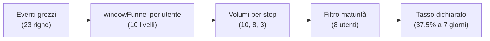

Scenario costruito, con numeri di esempio: un prodotto SaaS misura l'onboarding in tre passi, `signup_started`, `workspace_created` e `first_report_exported`. Il team conta gli utenti distinti per ciascun evento nel mese: 1.000 allo step 1, 620 allo step 2 e 710 allo step 3. Il tasso di passaggio tra secondo e terzo passo risulta 710 / 620 = 114,5%, un valore impossibile per un funnel. Nessun conteggio è sbagliato: il difetto è aver contato tre insiemi di utenti indipendenti e averli letti come tre tappe dello stesso percorso.

> **Idea chiave:** un funnel non è tre conteggi affiancati ma una catena per utente; un utente avanza allo step successivo solo se l'evento arriva dopo il precedente e dentro una finestra dichiarata.

La lezione parte da dieci utenti per poter verificare a mano ogni numero, poi mostra come la stessa logica scala su milioni di eventi con una sola funzione aggregata.

## Contare eventi non è seguire un percorso

I dati sono 23 eventi di dieci utenti nella tabella `fct_product_events`. Alcuni utenti completano il percorso in giorni diversi, uno lo percorre in ordine invertito, altri si fermano a metà.

```sql
-- Eventi di onboarding di 10 utenti (numeri di esempio)
CREATE TABLE fct_product_events
(
    user_id String,
    event_name String,
    occurred_at DateTime
) ENGINE = Memory;

INSERT INTO fct_product_events VALUES
('u1', 'signup_started', '2026-11-01 09:00:00'), ('u1', 'workspace_created', '2026-11-01 09:10:00'),
('u1', 'first_report_exported', '2026-11-02 10:00:00'),
('u2', 'signup_started', '2026-11-01 10:00:00'), ('u2', 'workspace_created', '2026-11-01 10:30:00'),
('u3', 'signup_started', '2026-11-02 08:00:00'), ('u3', 'workspace_created', '2026-11-02 08:05:00'),
('u3', 'first_report_exported', '2026-11-12 08:00:00'),
('u4', 'first_report_exported', '2026-11-03 11:00:00'), ('u4', 'signup_started', '2026-11-03 11:30:00'),
('u4', 'workspace_created', '2026-11-03 11:40:00'),
('u5', 'signup_started', '2026-11-04 12:00:00'),
('u6', 'signup_started', '2026-11-05 12:00:00'), ('u6', 'workspace_created', '2026-11-06 12:00:00'),
('u6', 'first_report_exported', '2026-11-07 12:00:00'),
('u7', 'signup_started', '2026-11-17 12:00:00'), ('u7', 'workspace_created', '2026-11-17 12:20:00'),
('u8', 'signup_started', '2026-11-18 09:00:00'),
('u9', 'signup_started', '2026-11-08 09:00:00'), ('u9', 'workspace_created', '2026-11-08 09:30:00'),
('u9', 'first_report_exported', '2026-11-09 09:00:00'),
('u10', 'signup_started', '2026-11-09 09:00:00'), ('u10', 'workspace_created', '2026-11-09 10:00:00');
```

Il funnel lasco conta, per ogni evento, gli utenti distinti che l'hanno generato almeno una volta.

```sql
-- Funnel lasco: tre conteggi indipendenti, nessun ordine, nessuna finestra
SELECT
    countIf(event_name = 'signup_started') AS step1,
    countIf(event_name = 'workspace_created') AS step2,
    countIf(event_name = 'first_report_exported') AS step3
FROM (SELECT DISTINCT user_id, event_name FROM fct_product_events);
```

Il risultato è 10, 8 e 5. Questa volta i volumi sono monotoni, ma il 5 nasconde due difetti: l'utente `u4` ha esportato il report prima di iscriversi, e l'utente `u3` l'ha esportato dieci giorni dopo l'iscrizione. Il funnel lasco li conta entrambi come convertiti. Per scegliere che cosa contare serve distinguere tre definizioni.

| Tipo di funnel | Vincolo | Denominatore | Quando usarlo |
| :--- | :--- | :--- | :--- |
| Lasco | Nessun ordine | Utenti con l'evento 1 | Stima grossolana, mai per decisioni di flusso |
| Ordinato a finestra aperta | `t1 < t2 < t3` | Utenti con lo step 1 | Onboarding con tempi lunghi e variabili |
| Ordinato a finestra chiusa | Ordine e conclusione entro N giorni da `t1` | Utenti con finestra maturata | Confronti tra coorti e settimane |

## windowFunnel: l'ordine e la finestra in una funzione

ClickHouse offre `windowFunnel(finestra_in_secondi)(tempo, condizione1, condizione2, ...)`. Per ogni utente la funzione cerca la catena più lunga di eventi che soddisfano le condizioni nell'ordine dato, con ogni evento successivo entro la finestra dal primo, e restituisce il livello raggiunto: 0 se nemmeno il primo passo è presente, poi 1, 2, 3. Gli eventi intermedi non elencati vengono tollerati, esattamente ciò che serve nei funnel di prodotto, dove tra due passi l'utente compie altre azioni.

```sql
-- Livello massimo raggiunto per utente con finestra di 7 giorni (604800 secondi)
SELECT
    user_id,
    windowFunnel(604800)(
        occurred_at,
        event_name = 'signup_started',
        event_name = 'workspace_created',
        event_name = 'first_report_exported'
    ) AS level
FROM fct_product_events
GROUP BY user_id
ORDER BY toUInt32(replaceOne(user_id, 'u', ''));
```

```text
user  level
u1    3
u2    2
u3    2
u4    2
u5    1
u6    3
u7    2
u8    1
u9    3
u10   2
```

Leggi i casi uno per uno. `u1` completa i tre passi in 25 ore: livello 3. `u3` raggiunge il secondo passo ma esporta dopo dieci giorni, fuori dalla finestra di sette: livello 2. `u4` ha l'esportazione prima dell'iscrizione: la catena parte da `signup_started`, trova `workspace_created` ma non un'esportazione successiva, quindi livello 2. `u6` impiega due giorni per ciascun passo ma resta dentro i sette giorni complessivi: livello 3.

## Dai livelli ai tassi di conversione

Il livello per utente è un dato intermedio. Il funnel si ottiene contando gli utenti con livello almeno pari allo step.

```sql
-- Volumi per step: un utente a livello 3 conta anche negli step 1 e 2
SELECT
    countIf(level >= 1) AS step1,
    countIf(level >= 2) AS step2,
    countIf(level >= 3) AS step3
FROM
(
    SELECT
        user_id,
        windowFunnel(604800)(
            occurred_at,
            event_name = 'signup_started',
            event_name = 'workspace_created',
            event_name = 'first_report_exported'
        ) AS level
    FROM fct_product_events
    GROUP BY user_id
);
```

Il risultato è 10, 8 e 3, contro il 10, 8 e 5 del funnel lasco. Il tasso step 1 → step 2 è 8 / 10 = 80%; il tasso step 2 → step 3 è 3 / 8 = 37,5%; la conversione complessiva è 3 / 10 = 30%. I due utenti che il funnel lasco contava in più, `u3` e `u4`, uscivano uno dalla finestra e l'altro dall'ordine: la sovrastima dello step finale era di 2 utenti su 3, cioè il 67%.

Un controllo che non richiede dati esterni è la monotonia: `step1 >= step2 >= step3` deve valere sempre, per costruzione, con `windowFunnel`. Se vedi un tasso sopra il 100% hai quasi certamente un conteggio non sequenziale, come quello del caso d'apertura.

## La finestra cambia la risposta

La finestra non è un dettaglio tecnico: è una definizione di business. Rilancia la stessa query con 86.400 secondi, un solo giorno. I livelli cambiano: `u1`, che esporta 25 ore dopo l'iscrizione, scende al livello 2; resta al livello 3 solo `u9`, che esporta esattamente dopo 24 ore. I volumi diventano 10, 8 e 1, e la conversione complessiva da 30% scende a 10%. Con una finestra di 14 giorni salirebbe a 4 utenti su 10, perché rientrerebbe anche `u3` (10 giorni).

Per questo ogni numero di funnel andrebbe scritto con la sua finestra, per esempio "conversione a 7 giorni: 30%". Una cifra senza finestra è un'opinione, perché due team con finestre diverse possono analizzare lo stesso prodotto e riportare conversioni lontane.

La scelta della finestra segue il comportamento reale: guarda la distribuzione dei tempi tra il primo e l'ultimo passo degli utenti convertiti e scegli un valore che ne catturi la gran parte, per esempio il 90° percentile. In un e-commerce può bastare un'ora, in un prodotto B2B con prova gratuita servono settimane.

## Il denominatore: utenti con finestra non matura

Il dato più ingannevole è la lettura del funnel sugli utenti più recenti. Oggi è il 20 novembre 2026 e la finestra è di 7 giorni. L'utente `u7` si è iscritto il 17 novembre e `u8` il 18: non hanno ancora avuto sette giorni per esportare il report. Contarli al denominatore trasforma un "non ancora" in un "mai".

```sql
-- Solo utenti con iscrizione di almeno 7 giorni prima di data_lettura (20 novembre 2026)
SELECT
    countIf(level >= 1) AS step1,
    countIf(level >= 2) AS step2,
    countIf(level >= 3) AS step3
FROM
(
    SELECT
        user_id,
        minIf(occurred_at, event_name = 'signup_started') AS signup_at,
        windowFunnel(604800)(
            occurred_at,
            event_name = 'signup_started',
            event_name = 'workspace_created',
            event_name = 'first_report_exported'
        ) AS level
    FROM fct_product_events
    GROUP BY user_id
    HAVING signup_at > toDateTime(0)
       AND signup_at <= toDateTime('2026-11-20 00:00:00') - INTERVAL 7 DAY
);
```

Restano 8 utenti allo step 1, 7 allo step 2 e 3 allo step 3. La conversione complessiva sale da 3 / 10 = 30% a 3 / 8 = 37,5%: sette punti e mezzo di differenza provocati solo da due utenti che non avevano ancora avuto il tempo di convertire. Il passaggio da 8 a 7 allo step 2 mostra che `u8` usciva già dal conteggio; `u7` era uno dei due casi che avrebbero potuto ancora arrivare allo step 3.

Il funnel settimanale di una dashboard che include sempre l'ultima settimana mostra quindi un calo apparente ogni lunedì: gli utenti del periodo corrente pesano sul denominatore e non hanno ancora convertito. La regola operativa è mostrare le settimane con finestra completa come dati definitivi e marcare l'ultima come provvisoria.

## Errori che producono tassi impossibili

### Conteggi indipendenti presentati come funnel

Sintomo: tassi di passaggio sopra il 100% o volumi non monotoni. Succede perché `count(DISTINCT user_id)` per ciascun evento è facile da scrivere e dà tre numeri plausibili. Correzione: calcola il livello per utente con `windowFunnel` oppure con la catena dei `minIf` ordinati, e conta dopo.

### Finestra implicita

Sintomo: due dashboard dello stesso funnel riportano conversioni diverse. Succede perché uno dei due calcoli usa tutta la storia dell'utente, l'altro sette giorni. Correzione: scrivi la finestra nel nome della metrica e nella documentazione del modello, e passala come parametro unico.

### Coorte recente nel denominatore

Sintomo: la conversione dell'ultima settimana è sempre la più bassa e si recupera da sola la settimana dopo. Succede perché gli utenti non hanno finito la finestra. Correzione: includi nel denominatore solo gli utenti con `signup_at <= data_lettura - finestra`, come nella query precedente, o presenta la settimana come provvisoria.

## Esempio numerico svolto: dal log grezzo al tasso dichiarato

Rifacciamo il calcolo come lo faresti su carta, partendo dai 10 utenti della tabella. Primo passo, i livelli a 7 giorni: tre utenti a livello 3 (`u1`, `u6`, `u9`), cinque a livello 2 (`u2`, `u3`, `u4`, `u7`, `u10`), due a livello 1 (`u5`, `u8`). Secondo passo, i volumi cumulati: step 1 = 3 + 5 + 2 = 10 utenti; step 2 = 3 + 5 = 8 utenti; step 3 = 3 utenti. Terzo passo, i tassi: 8 / 10 = 80% e 3 / 8 = 37,5%, quindi la conversione complessiva è 80% × 37,5% = 30%.

Quarto passo, la maturità. Tra i 10 utenti, 2 si sono iscritti negli ultimi 3 giorni e non hanno completato la finestra: restano 8 utenti, di cui 7 allo step 2 e 3 allo step 3. Il tasso diventa 3 / 8 = 37,5%, con una differenza di 7,5 punti percentuali rispetto al 30% grezzo. Quinto passo, la sensibilità alla finestra: con 1 giorno la conversione scende a 1 / 10 = 10%, con 7 giorni è 30%, con 14 giorni è 4 / 10 = 40%. Tre finestre, tre risposte, tutte corrette: la metrica va sempre pubblicata con la sua finestra.



## Dal funnel alla sessione

Il funnel lavora sull'utente, ma in molti prodotti la domanda è per visita: quanti accessi arrivano al carrello. Per cambiare l'unità basta ridefinire la chiave di raggruppamento. Prima ricostruisci la sessione con la tecnica del gap, cioè `lagInFrame` sul timestamp per utente, un flag che vale 1 quando l'inattività supera 30 minuti e una somma cumulata del flag che numera le sessioni. Poi esegui `windowFunnel` raggruppando per `(user_id, session_id)` e con una finestra pari alla durata massima di una sessione. L'unità cambia il significato del tasso: con le visite al denominatore un utente che torna tre volte conta tre volte, con gli utenti conta una volta sola.

Questa scelta va dichiarata come la finestra. Un funnel per utente misura quanti utenti arrivano all'obiettivo nel periodo, un funnel per sessione misura l'efficienza di una singola visita. Il primo è la lente giusta per onboarding e attivazione, il secondo per le pagine di acquisto e per i test sulle interfacce, dove ogni visita è un tentativo indipendente.

## Controllo prima di pubblicare un funnel

1. Un funnel mostra 1.000, 620 e 710 utenti. Che cosa indica il passaggio da 620 a 710?

<details>
<summary>Mostra risposta</summary>

Indica conteggi indipendenti. Un funnel sequenziale ha volumi monotoni decrescenti, quindi 710 allo step 3 con 620 allo step 2 significa che molti utenti sono contati senza aver superato il passo precedente, per esempio perché l'evento è arrivato prima o da un altro percorso.

</details>

2. Con 10 utenti allo step 1, 8 allo step 2 e 3 allo step 3, quali sono i tassi di passaggio e la conversione complessiva?

<details>
<summary>Mostra risposta</summary>

Step 1 → 2: 8 / 10 = 80%. Step 2 → 3: 3 / 8 = 37,5%. Complessiva: 3 / 10 = 30%. Il prodotto dei due tassi, 0,8 × 0,375, dà lo stesso 0,30.

</details>

3. Perché togliere dal denominatore gli utenti iscritti da meno di 7 giorni cambia la conversione da 30% a 37,5%?

<details>
<summary>Mostra risposta</summary>

Perché quegli utenti, 2 su 10, non hanno ancora avuto l'intera finestra per completare l'esportazione e nel conteggio compaiono come non convertiti. Rimossi, il rapporto diventa 3 / 8 = 37,5%, che confronta solo utenti con la stessa opportunità di convertire.

</details>

4. Quale finestra scegli e come la giustifichi per un prodotto con prova gratuita di 14 giorni?

<details>
<summary>Mostra risposta</summary>

Una finestra almeno pari alla prova, 14 giorni, oppure il 90° percentile osservato dei tempi di conversione, se più basso. La scelta va dichiarata accanto alla metrica, perché con 1 giorno la stessa tabella darebbe 10% invece del 30% a 7 giorni.

</details>
