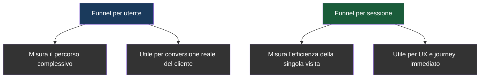

import { Aside } from '@astrojs/starlight/components'

Molti funnel sono poco piu' di una colonna di percentuali. Sembrano precisi, ma non spiegano il comportamento. Un funnel utile deve dirti dove si rompe il percorso, in quanto tempo succede, se il drop-off avviene tra utenti o tra sessioni e quale pagina precede l'abbandono.

## Perche' funnel e sessioni vanno letti insieme

Il funnel riassume il percorso. La sessionizzazione spiega il contesto del percorso.

- senza funnel non sai dove perdi conversione
- senza sessioni non sai se il drop-off avviene in una singola visita o lungo piu' visite


## Schema dati di riferimento

```sql
events(
    user_id UInt64,
    event_time DateTime,
    event_name LowCardinality(String),
    session_id String,
    page String,
    product_id UInt64
)
```

Per questa lezione immaginiamo questi eventi:

- `landing`
- `product_view`
- `add_to_cart`
- `checkout_start`
- `purchase`

## Funnel base per utente

```sql
WITH funnel_flags AS (
    SELECT
        user_id,
        max(if(event_name = 'landing', 1, 0)) AS s1_landing,
        max(if(event_name = 'product_view', 1, 0)) AS s2_product_view,
        max(if(event_name = 'add_to_cart', 1, 0)) AS s3_add_to_cart,
        max(if(event_name = 'checkout_start', 1, 0)) AS s4_checkout_start,
        max(if(event_name = 'purchase', 1, 0)) AS s5_purchase
    FROM events
    WHERE event_time >= toDateTime('2025-01-01 00:00:00')
      AND event_time < toDateTime('2025-02-01 00:00:00')
    GROUP BY user_id
)
SELECT
    sum(s1_landing) AS landing_users,
    sum(s2_product_view) AS product_view_users,
    sum(s3_add_to_cart) AS add_to_cart_users,
    sum(s4_checkout_start) AS checkout_users,
    sum(s5_purchase) AS purchase_users,
    round(sum(s5_purchase) / nullIf(sum(s1_landing), 0), 4) AS landing_to_purchase_cvr,
    round(sum(s3_add_to_cart) / nullIf(sum(s2_product_view), 0), 4) AS product_to_cart_cvr,
    round(sum(s5_purchase) / nullIf(sum(s4_checkout_start), 0), 4) AS checkout_to_purchase_cvr
FROM funnel_flags;
```

Questo e' il funnel management-ready: semplice, chiaro, spiegabile.

### Quando basta il funnel base

Il funnel base e' sufficiente quando:

- vuoi una vista executive
- il periodo analizzato e' breve
- il team deve localizzare rapidamente il macro-step critico

## Funnel temporale: rispettare la sequenza degli step

Il funnel sopra dice se un utente ha fatto o meno gli step nel periodo. Ma non garantisce che li abbia fatti nell'ordine corretto.

```sql
WITH first_steps AS (
    SELECT
        user_id,
        minIf(event_time, event_name = 'landing') AS ts_landing,
        minIf(event_time, event_name = 'product_view') AS ts_product_view,
        minIf(event_time, event_name = 'add_to_cart') AS ts_add_to_cart,
        minIf(event_time, event_name = 'checkout_start') AS ts_checkout_start,
        minIf(event_time, event_name = 'purchase') AS ts_purchase
    FROM events
    WHERE event_time >= toDateTime('2025-01-01 00:00:00')
      AND event_time < toDateTime('2025-02-01 00:00:00')
    GROUP BY user_id
)
SELECT
    countIf(ts_landing > toDateTime('1970-01-01 00:00:00')) AS landing_users,
    countIf(ts_product_view > ts_landing AND ts_landing > toDateTime('1970-01-01 00:00:00')) AS product_after_landing,
    countIf(ts_add_to_cart > ts_product_view AND ts_product_view > ts_landing) AS cart_after_product,
    countIf(ts_checkout_start > ts_add_to_cart AND ts_add_to_cart > ts_product_view) AS checkout_after_cart,
    countIf(ts_purchase > ts_checkout_start AND ts_checkout_start > ts_add_to_cart) AS purchase_after_checkout
FROM first_steps;
```

## Sessionizzazione via gap temporale

Molti dataset non hanno un `session_id` affidabile. In quel caso bisogna costruirlo con un gap, ad esempio 30 minuti.

```sql
WITH ordered_events AS (
    SELECT
        user_id,
        event_time,
        event_name,
        page,
        dateDiff(
            'minute',
            lagInFrame(event_time) OVER (
                PARTITION BY user_id
                ORDER BY event_time
            ),
            event_time
        ) AS minutes_since_prev
    FROM events
),
session_markers AS (
    SELECT
        *,
        if(minutes_since_prev IS NULL OR minutes_since_prev > 30, 1, 0) AS is_new_session
    FROM ordered_events
),
sessionized AS (
    SELECT
        *,
        sum(is_new_session) OVER (
            PARTITION BY user_id
            ORDER BY event_time
            ROWS BETWEEN UNBOUNDED PRECEDING AND CURRENT ROW
        ) AS session_num
    FROM session_markers
)
SELECT
    user_id,
    session_num,
    min(event_time) AS session_start,
    max(event_time) AS session_end,
    count() AS events_in_session,
    groupArray(event_name) AS event_path
FROM sessionized
GROUP BY user_id, session_num
ORDER BY user_id, session_num;
```

## Misurare il tempo tra gli step del funnel

Un funnel puo' perdere conversione non solo per attrito, ma per lentezza del percorso. Se tra `product_view` e `add_to_cart` passano ore o giorni, spesso hai un problema di rilevanza o di UX.

```sql
WITH step_times AS (
    SELECT
        user_id,
        minIf(event_time, event_name = 'product_view') AS ts_product_view,
        minIf(event_time, event_name = 'add_to_cart') AS ts_add_to_cart,
        minIf(event_time, event_name = 'purchase') AS ts_purchase
    FROM events
    GROUP BY user_id
)
SELECT
    countIf(ts_add_to_cart > ts_product_view) AS users_reaching_cart,
    avgIf(
        dateDiff('minute', ts_product_view, ts_add_to_cart),
        ts_add_to_cart > ts_product_view
    ) AS avg_minutes_product_to_cart,
    avgIf(
        dateDiff('minute', ts_add_to_cart, ts_purchase),
        ts_purchase > ts_add_to_cart
    ) AS avg_minutes_cart_to_purchase
FROM step_times;
```

Questa query non sostituisce il funnel. Lo rende piu' leggibile sul piano comportamentale.

## Funnel per sessione invece che per utente

```sql
WITH sessionized AS (
    SELECT
        user_id,
        session_id,
        max(if(event_name = 'landing', 1, 0)) AS s1_landing,
        max(if(event_name = 'product_view', 1, 0)) AS s2_product_view,
        max(if(event_name = 'add_to_cart', 1, 0)) AS s3_add_to_cart,
        max(if(event_name = 'checkout_start', 1, 0)) AS s4_checkout_start,
        max(if(event_name = 'purchase', 1, 0)) AS s5_purchase
    FROM events
    GROUP BY user_id, session_id
)
SELECT
    sum(s1_landing) AS landing_sessions,
    sum(s2_product_view) AS product_sessions,
    sum(s3_add_to_cart) AS cart_sessions,
    sum(s4_checkout_start) AS checkout_sessions,
    sum(s5_purchase) AS purchase_sessions
FROM sessionized;
```

Differenza pratica:

- funnel per utente: misura il percorso complessivo della persona
- funnel per sessione: misura l'efficienza delle singole visite



## Trovare il punto di abbandono

```sql
WITH session_outcomes AS (
    SELECT
        user_id,
        session_id,
        argMax(event_name, event_time) AS last_event,
        argMax(page, event_time) AS last_page,
        max(if(event_name = 'purchase', 1, 0)) AS has_purchase,
        count() AS events_in_session
    FROM events
    GROUP BY user_id, session_id
)
SELECT
    last_event,
    last_page,
    count() AS abandoned_sessions,
    avg(events_in_session) AS avg_events_before_drop
FROM session_outcomes
WHERE has_purchase = 0
GROUP BY last_event, last_page
ORDER BY abandoned_sessions DESC
LIMIT 20;
```

Questa vista spesso produce insight piu' utili del funnel stesso.

Se vedi una concentrazione forte su poche `last_page`, hai gia' una priorita' UX concreta su cui lavorare.

## Bonus ClickHouse: `windowFunnel`

```sql
SELECT
    level,
    count() AS users
FROM (
    SELECT
        user_id,
        windowFunnel(48 * 3600)(
            event_time,
            event_name = 'landing',
            event_name = 'product_view',
            event_name = 'add_to_cart',
            event_name = 'checkout_start',
            event_name = 'purchase'
        ) AS level
    FROM events
    GROUP BY user_id
)
GROUP BY level
ORDER BY level;
```

`windowFunnel` e' ottimo quando vuoi imporre anche un limite temporale tra step, ma e' bene saper costruire prima il funnel manualmente.

<Aside type="tip">
Se non sai spiegare a parole la differenza tra funnel per utente, funnel per sessione e funnel temporale, non hai ancora finito di modellare il problema.
</Aside>

## Errori comuni e anti-pattern

### Mescolare eventi di mesi diversi nello stesso funnel

Se il periodo e' troppo largo, il funnel diventa poco interpretabile.

### Contare gli step senza imporre ordine

Il funnel viene gonfiato e smette di essere un percorso.

### Non distinguere sessione e utente

Il funnel puo' sembrare sano a livello utente ma pessimo a livello sessione, o viceversa.

### Ignorare l'ultimo evento prima dell'abbandono

La percentuale da sola non ti dice dove intervenire.

## Output atteso

Dovresti poter generare:

- funnel utenti
- funnel sessioni
- session table con durata ed event path
- tabella drop-off per ultima pagina o ultimo evento

## Riepilogo operativo

- Il funnel base e' un riassunto; la sessionizzazione spiega il comportamento.
- Il modello corretto dipende dalla domanda: utente, sessione o sequenza temporale.
- `windowFunnel` e' potente, ma prima va compresa la logica del funnel manuale.
- Il vero valore operativo emerge quando colleghi conversione e punto di abbandono.

## Mini esercizio

Partendo da `events`, costruisci:

1. un funnel utenti a 4 step
2. una sessionizzazione con gap 45 minuti
3. una tabella che mostri l'ultimo `page` visto nelle sessioni senza `purchase`
