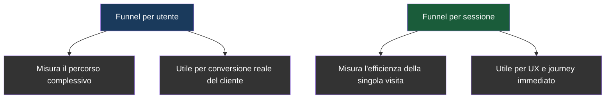

import { Aside, Steps } from '@astrojs/starlight/components'

Un team di Booking.com calcolò che ogni step del funnel di checkout con conversion rate sotto l'85% valeva milioni di euro di perdita mensile. Non era un esercizio accademico: era il numero che giustificava l'allocazione degli ingegneri. Ogni punto percentuale recuperato su uno step critico si traduceva in fatturato misurabile, non stimato. Il funnel non era uno strumento di reporting — era uno strumento di prioritizzazione del lavoro tecnico.

Molti funnel sono poco più di una colonna di percentuali. Sembrano precisi, ma non spiegano il comportamento. Un funnel utile deve dirti dove si rompe il percorso, in quanto tempo succede, se il drop-off avviene tra utenti o tra sessioni e quale pagina precede l'abbandono.

## Perché funnel e sessioni vanno letti insieme

Il funnel riassume il percorso. La sessionizzazione spiega il contesto del percorso.

- senza funnel non sai dove perdi conversione
- senza sessioni non sai se il drop-off avviene in una singola visita o lungo più visite

Un utente che abbandona il checkout non è uguale a un utente che non ha mai avviato il checkout. Il primo ha mostrato intenzione forte e poi è sparito — forse per un problema di UX, di pagamento, di caricamento della pagina. Il secondo non è ancora pronto. Trattarli allo stesso modo nel funnel porta a decisioni sbagliate.


## Schema dati di riferimento

Per questa lezione usiamo la tabella `events` del data warehouse:

```sql
events(
    user_id      UInt64,
    event_name   LowCardinality(String),
    event_time   DateTime,
    properties   Map(String, String)
)
```

Gli eventi che modellano il funnel di checkout sono:

- `landing`
- `product_view`
- `add_to_cart`
- `checkout_start`
- `purchase`

I campi `properties['page']`, `properties['country']`, `properties['channel']` contengono i metadati contestuali associati a ogni evento.

## Funnel vs Flow: due concetti distinti

Prima di costruire query, vale la pena chiarire una distinzione che molti analisti confondono.

**Un funnel** è una sequenza ordinata di step che l'utente deve percorrere in un certo ordine per raggiungere un obiettivo. C'è una direzione, c'è una sequenza, c'è un punto di ingresso e un punto di uscita. Il funnel di checkout è un funnel: non puoi acquistare senza aver avviato il checkout, non puoi avviare il checkout senza aver visto un prodotto. L'ordine conta.

**Un flow** è l'esplorazione non ordinata di un prodotto. L'utente può navigare tra sezioni, tornare indietro, saltare step, visitare pagine in ordine arbitrario. Non c'è una sequenza corretta. Analizzare un flow con la logica del funnel produce numeri privi di senso, perché impone una struttura che il comportamento non rispetta.

La differenza pratica:

| Caratteristica | Funnel | Flow |
|---|---|---|
| Ordine degli step | Obbligatorio | Non rilevante |
| Metrica principale | Conversion rate per step | Frequenza e distribuzione dei path |
| Quando usarlo | Checkout, onboarding, form | Navigazione prodotto, esplorazione |
| SQL appropriato | `minIf` + confronto timestamp | `groupArray` + path analysis |

Quando un product manager ti chiede "dov'è il drop-off?", la prima domanda da fare è: "Stiamo analizzando un funnel o un flow?" La risposta cambia il modello SQL e cambia l'interpretazione.

<Aside type="caution">
Applicare la logica del funnel a una sezione del prodotto con navigazione libera produce conversion rate artificialmente bassi. L'utente non ha "abbandonato" — stava semplicemente esplorando in modo non lineare.
</Aside>

## Funnel base per utente

Il punto di partenza è il funnel unordered per utente: verifica se un utente ha toccato ogni step nel periodo analizzato, senza imporre la sequenza.

```sql
WITH funnel_flags AS (
    SELECT
        user_id,
        max(if(event_name = 'landing', 1, 0))         AS s1_landing,
        max(if(event_name = 'product_view', 1, 0))    AS s2_product_view,
        max(if(event_name = 'add_to_cart', 1, 0))     AS s3_add_to_cart,
        max(if(event_name = 'checkout_start', 1, 0))  AS s4_checkout_start,
        max(if(event_name = 'purchase', 1, 0))        AS s5_purchase
    FROM events
    WHERE event_time >= toDateTime('2025-01-01 00:00:00')
      AND event_time < toDateTime('2025-02-01 00:00:00')
    GROUP BY user_id
)
SELECT
    sum(s1_landing)        AS landing_users,
    sum(s2_product_view)   AS product_view_users,
    sum(s3_add_to_cart)    AS add_to_cart_users,
    sum(s4_checkout_start) AS checkout_users,
    sum(s5_purchase)       AS purchase_users,
    round(sum(s5_purchase) / nullIf(sum(s1_landing), 0), 4)        AS landing_to_purchase_cvr,
    round(sum(s3_add_to_cart) / nullIf(sum(s2_product_view), 0), 4) AS product_to_cart_cvr,
    round(sum(s5_purchase) / nullIf(sum(s4_checkout_start), 0), 4)  AS checkout_to_purchase_cvr
FROM funnel_flags;
```

Questo è il funnel management-ready: semplice, chiaro, spiegabile.

### Quando basta il funnel base

Il funnel base è sufficiente quando:

- vuoi una vista executive
- il periodo analizzato è breve
- il team deve localizzare rapidamente il macro-step critico

## Funnel ordinato: rispettare la sequenza degli step

Il funnel sopra dice se un utente ha fatto o meno gli step nel periodo. Ma non garantisce che li abbia fatti nell'ordine corretto. Un utente che ha fatto `purchase` prima ancora di `landing` — per un bug di tracking o per un accesso diretto all'URL di conferma — gonfia il funnel in modo non reale.

La soluzione è usare `minIf` per catturare il primo timestamp di ogni step, poi confrontare i timestamp per verificare che la sequenza sia rispettata.

```sql
WITH first_steps AS (
    SELECT
        user_id,
        minIf(event_time, event_name = 'landing')         AS ts_landing,
        minIf(event_time, event_name = 'product_view')    AS ts_product_view,
        minIf(event_time, event_name = 'add_to_cart')     AS ts_add_to_cart,
        minIf(event_time, event_name = 'checkout_start')  AS ts_checkout_start,
        minIf(event_time, event_name = 'purchase')        AS ts_purchase
    FROM events
    WHERE event_time >= toDateTime('2025-01-01 00:00:00')
      AND event_time < toDateTime('2025-02-01 00:00:00')
    GROUP BY user_id
)
SELECT
    countIf(ts_landing > toDateTime('1970-01-01 00:00:00'))                                             AS landing_users,
    countIf(ts_product_view > ts_landing AND ts_landing > toDateTime('1970-01-01 00:00:00'))            AS product_after_landing,
    countIf(ts_add_to_cart > ts_product_view AND ts_product_view > ts_landing)                         AS cart_after_product,
    countIf(ts_checkout_start > ts_add_to_cart AND ts_add_to_cart > ts_product_view)                   AS checkout_after_cart,
    countIf(ts_purchase > ts_checkout_start AND ts_checkout_start > ts_add_to_cart)                    AS purchase_after_checkout
FROM first_steps;
```

Il confronto `ts_purchase > ts_checkout_start` elimina i casi patologici in cui il purchase è registrato prima del checkout — situazioni che capitano più spesso di quanto si pensi in sistemi con integrazioni di tracking non atomiche.

## Funnel con conversion rate per step

Il risultato sopra mostra i conteggi assoluti. Per un'analisi operativa è più utile calcolare il conversion rate di ogni step rispetto al precedente e rispetto al top of funnel, tutto nello stesso risultato.

```sql
WITH first_steps AS (
    SELECT
        user_id,
        minIf(event_time, event_name = 'landing')        AS ts_landing,
        minIf(event_time, event_name = 'product_view')   AS ts_product_view,
        minIf(event_time, event_name = 'add_to_cart')    AS ts_add_to_cart,
        minIf(event_time, event_name = 'checkout_start') AS ts_checkout_start,
        minIf(event_time, event_name = 'purchase')       AS ts_purchase
    FROM events
    WHERE event_time >= toDateTime('2025-01-01 00:00:00')
      AND event_time < toDateTime('2025-02-01 00:00:00')
    GROUP BY user_id
),
step_counts AS (
    SELECT
        countIf(ts_landing > toDateTime('1970-01-01'))                               AS n1,
        countIf(ts_product_view > ts_landing)                                        AS n2,
        countIf(ts_add_to_cart > ts_product_view AND ts_product_view > ts_landing)   AS n3,
        countIf(ts_checkout_start > ts_add_to_cart AND ts_add_to_cart > ts_product_view) AS n4,
        countIf(ts_purchase > ts_checkout_start AND ts_checkout_start > ts_add_to_cart)  AS n5
    FROM first_steps
)
SELECT
    'landing'        AS step, n1 AS users,
    1.0              AS step_cvr,
    1.0              AS funnel_cvr
FROM step_counts
UNION ALL SELECT 'product_view',   n2, round(n2 / nullIf(n1, 0), 4), round(n2 / nullIf(n1, 0), 4) FROM step_counts
UNION ALL SELECT 'add_to_cart',    n3, round(n3 / nullIf(n2, 0), 4), round(n3 / nullIf(n1, 0), 4) FROM step_counts
UNION ALL SELECT 'checkout_start', n4, round(n4 / nullIf(n3, 0), 4), round(n4 / nullIf(n1, 0), 4) FROM step_counts
UNION ALL SELECT 'purchase',       n5, round(n5 / nullIf(n4, 0), 4), round(n5 / nullIf(n1, 0), 4) FROM step_counts
ORDER BY step_cvr DESC;
```

Il campo `step_cvr` misura la conversione rispetto allo step precedente. Il campo `funnel_cvr` misura la conversione rispetto al top of funnel. Entrambi servono: il primo individua lo step più critico, il secondo mostra l'impatto reale sul business se quell'anomalia venisse corretta.

## Sessionizzazione via gap temporale

Molti dataset non hanno un `session_id` affidabile. In quel caso bisogna costruirlo con un gap — tipicamente 30 minuti di inattività tra eventi consecutivi dello stesso utente.

La logica è a tre passi:

1. calcolare il tempo trascorso dall'evento precedente dello stesso utente
2. marcare come inizio di nuova sessione ogni evento dove il gap supera 30 minuti (o dove non esiste evento precedente)
3. usare una somma cumulativa per generare un numero di sessione progressivo per utente

```sql
WITH ordered_events AS (
    SELECT
        user_id,
        event_time,
        event_name,
        properties['page']    AS page,
        properties['country'] AS country,
        dateDiff(
            'minute',
            lagInFrame(event_time) OVER (
                PARTITION BY user_id
                ORDER BY event_time
            ),
            event_time
        ) AS minutes_since_prev
    FROM events
),
session_markers AS (
    SELECT
        *,
        if(minutes_since_prev IS NULL OR minutes_since_prev > 30, 1, 0) AS is_new_session
    FROM ordered_events
),
sessionized AS (
    SELECT
        *,
        sum(is_new_session) OVER (
            PARTITION BY user_id
            ORDER BY event_time
            ROWS BETWEEN UNBOUNDED PRECEDING AND CURRENT ROW
        ) AS session_num
    FROM session_markers
)
SELECT
    user_id,
    session_num,
    min(event_time)          AS session_start,
    max(event_time)          AS session_end,
    dateDiff('minute', min(event_time), max(event_time)) AS session_duration_min,
    count()                  AS events_in_session,
    groupArray(event_name)   AS event_path,
    any(country)             AS country
FROM sessionized
GROUP BY user_id, session_num
ORDER BY user_id, session_num;
```

### Come leggere il risultato della sessionizzazione

Il campo `event_path` contiene la sequenza ordinata degli eventi nella sessione — `['landing','product_view','add_to_cart']`. Con questo campo puoi:

- trovare le sessioni che si interrompono a `checkout_start` senza `purchase`
- contare le sessioni con più di un `product_view` senza `add_to_cart`
- identificare sessioni molto brevi (1-2 eventi) che indicano rimbalzo

```sql
SELECT
    event_path,
    count() AS session_count,
    round(count() / sum(count()) OVER (), 4) AS share
FROM (
    SELECT
        user_id,
        session_num,
        groupArray(event_name) AS event_path
    FROM sessionized
    GROUP BY user_id, session_num
)
GROUP BY event_path
ORDER BY session_count DESC
LIMIT 20;
```

Questo produce una classifica dei path più frequenti — spesso i primi 5-10 path coprono il 60-70% di tutte le sessioni, il che rende l'analisi gestibile anche su dataset grandi.

<Aside type="tip">
Il timeout di 30 minuti è una convenzione industriale, non una legge. Per app mobile con sessioni brevi (gaming, news) un timeout di 10-15 minuti è più corretto. Per tool B2B dove l'utente lascia la scheda aperta ore, potresti usare 60-120 minuti. Calibra il timeout in base alla mediana del tempo tra eventi nella tua base utenti.
</Aside>

## Funnel segmentato per paese e canale

Un funnel aggregato nasconde differenze enormi tra segmenti. Il checkout rate di utenti italiani può essere ottimo mentre quello di utenti tedeschi è sotto la soglia di allerta — e il numero aggregato non lo mostra.

```sql
WITH first_steps AS (
    SELECT
        user_id,
        properties['country']  AS country,
        properties['channel']  AS channel,
        minIf(event_time, event_name = 'landing')        AS ts_landing,
        minIf(event_time, event_name = 'product_view')   AS ts_product_view,
        minIf(event_time, event_name = 'add_to_cart')    AS ts_add_to_cart,
        minIf(event_time, event_name = 'checkout_start') AS ts_checkout_start,
        minIf(event_time, event_name = 'purchase')       AS ts_purchase
    FROM events
    WHERE event_time >= toDateTime('2025-01-01 00:00:00')
      AND event_time < toDateTime('2025-02-01 00:00:00')
    GROUP BY user_id, country, channel
)
SELECT
    country,
    channel,
    countIf(ts_landing > toDateTime('1970-01-01'))                                                          AS landing_users,
    countIf(ts_add_to_cart > ts_product_view AND ts_product_view > ts_landing)                             AS cart_users,
    countIf(ts_purchase > ts_checkout_start AND ts_checkout_start > ts_add_to_cart)                        AS purchase_users,
    round(countIf(ts_purchase > ts_checkout_start) / nullIf(countIf(ts_landing > toDateTime('1970-01-01')), 0), 4) AS overall_cvr,
    round(countIf(ts_purchase > ts_checkout_start) / nullIf(countIf(ts_checkout_start > ts_add_to_cart), 0), 4)   AS checkout_to_purchase_cvr
FROM first_steps
GROUP BY country, channel
HAVING landing_users >= 100
ORDER BY overall_cvr DESC;
```

Il filtro `HAVING landing_users >= 100` evita di mostrare segmenti con pochi utenti in cui il conversion rate oscilla in modo non statisticamente significativo.

### Quando la segmentazione cambia tutto

Immagina di trovare questi numeri:

| Paese | Checkout-to-purchase CVR |
|---|---|
| Italia | 91% |
| Germania | 67% |
| Francia | 84% |
| Spagna | 88% |

La Germania a 67% non è un problema di prodotto generico — è un problema localizzato. Potrebbe essere un metodo di pagamento mancante (Sofort, SEPA), un problema con la traduzione tedesca del checkout, o un errore JavaScript specifico su una versione browser comune in Germania. Senza la segmentazione non sapresti mai dove guardare.

## ClickHouse `windowFunnel`: quando usarlo

ClickHouse ha una funzione nativa per l'analisi del funnel che è significativamente più veloce del SQL manuale su dataset grandi. La sintassi è compatta e gestisce automaticamente la logica di ordinamento temporale.

```sql
SELECT
    level,
    count()                                       AS users,
    round(count() / sum(count()) OVER (), 4)      AS share
FROM (
    SELECT
        user_id,
        windowFunnel(48 * 3600)(
            event_time,
            event_name = 'landing',
            event_name = 'product_view',
            event_name = 'add_to_cart',
            event_name = 'checkout_start',
            event_name = 'purchase'
        ) AS level
    FROM events
    WHERE event_time >= toDateTime('2025-01-01 00:00:00')
      AND event_time < toDateTime('2025-02-01 00:00:00')
    GROUP BY user_id
)
GROUP BY level
ORDER BY level;
```

Il primo argomento di `windowFunnel` è la finestra temporale in secondi entro cui devono avvenire tutti gli step. `48 * 3600` significa 48 ore: se un utente completa i primi 3 step ma ci impiega più di 48 ore per arrivare al purchase, viene contato solo fino al livello raggiunto entro la finestra.

Il risultato è una distribuzione degli utenti per livello massimo raggiunto:

| level | users | share |
|---|---|---|
| 0 | 1.200 | 8.1% |
| 1 | 4.300 | 29% |
| 2 | 5.100 | 34.5% |
| 3 | 1.800 | 12.2% |
| 4 | 850 | 5.7% |
| 5 | 1.550 | 10.5% |

Level 0 = nessuno step completato, level 5 = funnel completato. Gli utenti che si fermano a level 2 (`product_view`) sono il gruppo più grande — segnale che il passaggio da product view ad add to cart è lo step più problematico.

### `windowFunnel` vs SQL manuale: confronto

| Criterio | `windowFunnel` | SQL manuale |
|---|---|---|
| Performance su 100M+ eventi | Molto più veloce | Più lento (più join/sort) |
| Flessibilità | Limitata (solo modalità strict) | Alta (puoi personalizzare ogni step) |
| Funnel con finestra temporale per step | No (finestra globale) | Sì (puoi imporre gap diversi tra step) |
| Debug | Difficile (black box) | Facile (puoi ispezionare ogni CTE) |
| Segmentazione nel risultato | Richiede GROUP BY esterno | Integrata nella query |

<Aside type="tip">
Usa `windowFunnel` in produzione per dashboard ad alta frequenza dove la velocità è prioritaria. Usa il SQL manuale per analisi esplorative dove hai bisogno di capire esattamente cosa sta succedendo. Impara prima il SQL manuale — solo così saprai interpretare il risultato di `windowFunnel` quando produce numeri inaspettati.
</Aside>

## Funnel ordinato vs non ordinato

Nella sezione precedente abbiamo già distinto funnel e flow. Ma esiste un caso intermedio: il funnel parzialmente ordinato, in cui solo alcuni step devono seguire una sequenza, mentre altri possono avvenire in qualsiasi momento.

Considera questo scenario: vuoi misurare quanti utenti completano la registrazione. I step sono:

1. `signup_start`
2. `email_confirmed`
3. `profile_completed`
4. `first_login`

L'ordine `signup_start → email_confirmed → profile_completed → first_login` sembra ovvio. Ma nella realtà, molti utenti completano il profilo prima di confermare l'email (perché il servizio lo permette), e fanno `first_login` in parallelo con `profile_completed`. Imporre l'ordine stretto sottostima il funnel.

La soluzione è usare `windowFunnel` con la modalità `mode = 'strict_order'` oppure `mode = 'strict_dedup'`, o costruire il funnel manuale con vincoli selettivi:

```sql
-- Funnel con ordine obbligatorio solo su signup_start e email_confirmed
-- Gli altri step possono avvenire in qualsiasi ordine dopo signup_start
WITH first_steps AS (
    SELECT
        user_id,
        minIf(event_time, event_name = 'signup_start')      AS ts_start,
        minIf(event_time, event_name = 'email_confirmed')   AS ts_email,
        minIf(event_time, event_name = 'profile_completed') AS ts_profile,
        minIf(event_time, event_name = 'first_login')       AS ts_login
    FROM events
    GROUP BY user_id
)
SELECT
    countIf(ts_start > toDateTime('1970-01-01'))             AS started_registration,
    -- email_confirmed deve venire dopo signup_start (ordine obbligatorio)
    countIf(ts_email > ts_start)                            AS email_confirmed,
    -- profile_completed deve venire dopo signup_start (ordine permissivo: può precedere email)
    countIf(ts_profile > ts_start)                          AS profile_completed,
    -- first_login deve venire dopo signup_start
    countIf(ts_login > ts_start)                            AS first_login,
    -- completamento completo: tutti gli step avvenuti dopo signup
    countIf(ts_email > ts_start AND ts_profile > ts_start AND ts_login > ts_start) AS full_completion
FROM first_steps;
```

La scelta di imporre o non imporre l'ordine tra due step specifici è una decisione di business, non tecnica. Chiedila sempre al product manager prima di costruire il modello.

## Misurare la velocità del funnel

Un funnel può perdere conversione non solo per attrito, ma per lentezza del percorso. Se tra `product_view` e `add_to_cart` passano ore o giorni, spesso hai un problema di rilevanza o di UX — il prodotto non ha convinto abbastanza da generare un'azione immediata.

```sql
WITH step_times AS (
    SELECT
        user_id,
        minIf(event_time, event_name = 'product_view')   AS ts_product_view,
        minIf(event_time, event_name = 'add_to_cart')    AS ts_add_to_cart,
        minIf(event_time, event_name = 'checkout_start') AS ts_checkout_start,
        minIf(event_time, event_name = 'purchase')       AS ts_purchase
    FROM events
    WHERE event_time >= toDateTime('2025-01-01 00:00:00')
      AND event_time < toDateTime('2025-02-01 00:00:00')
    GROUP BY user_id
)
SELECT
    countIf(ts_add_to_cart > ts_product_view)    AS users_reaching_cart,
    avgIf(
        dateDiff('minute', ts_product_view, ts_add_to_cart),
        ts_add_to_cart > ts_product_view
    )                                            AS avg_min_product_to_cart,
    medianIf(
        dateDiff('minute', ts_product_view, ts_add_to_cart),
        ts_add_to_cart > ts_product_view
    )                                            AS median_min_product_to_cart,
    countIf(ts_purchase > ts_checkout_start)     AS users_reaching_purchase,
    avgIf(
        dateDiff('minute', ts_checkout_start, ts_purchase),
        ts_purchase > ts_checkout_start
    )                                            AS avg_min_checkout_to_purchase,
    medianIf(
        dateDiff('minute', ts_checkout_start, ts_purchase),
        ts_purchase > ts_checkout_start
    )                                            AS median_min_checkout_to_purchase
FROM step_times;
```

La mediana è più informativa della media in questo contesto perché il tempo tra step ha una distribuzione fortemente asimmetrica: molti utenti agiscono in pochi minuti, pochi utenti ritornano dopo giorni e trascinano la media verso l'alto.

### Distribuzione del tempo tra step

Se vuoi capire non solo il valore centrale ma la forma della distribuzione:

```sql
WITH step_times AS (
    SELECT
        user_id,
        minIf(event_time, event_name = 'product_view')  AS ts_pv,
        minIf(event_time, event_name = 'add_to_cart')   AS ts_cart
    FROM events
    GROUP BY user_id
),
gaps AS (
    SELECT
        dateDiff('minute', ts_pv, ts_cart) AS minutes_gap
    FROM step_times
    WHERE ts_cart > ts_pv
)
SELECT
    multiIf(
        minutes_gap < 5,   '0-5 min',
        minutes_gap < 30,  '5-30 min',
        minutes_gap < 120, '30-120 min',
        minutes_gap < 1440,'2-24 ore',
        '> 24 ore'
    ) AS bucket,
    count() AS users,
    round(count() / sum(count()) OVER (), 4) AS share
FROM gaps
GROUP BY bucket
ORDER BY min(minutes_gap);
```

Se il 70% degli utenti che aggiungono al carrello lo fa entro 5 minuti dalla product view, e il restante 30% ci impiega più di 24 ore, hai due comportamenti distinti che probabilmente corrispondono a due tipologie di utente: il compratore impulsivo e il compratore razionale. Segmentare il funnel su questa dimensione temporale può rivelare pattern che una singola metrica media nasconde.

## Funnel per sessione invece che per utente

```sql
WITH session_funnel AS (
    SELECT
        user_id,
        properties['session_id']                           AS session_id,
        max(if(event_name = 'landing', 1, 0))              AS s1_landing,
        max(if(event_name = 'product_view', 1, 0))         AS s2_product_view,
        max(if(event_name = 'add_to_cart', 1, 0))          AS s3_add_to_cart,
        max(if(event_name = 'checkout_start', 1, 0))       AS s4_checkout_start,
        max(if(event_name = 'purchase', 1, 0))             AS s5_purchase
    FROM events
    GROUP BY user_id, session_id
)
SELECT
    sum(s1_landing)        AS landing_sessions,
    sum(s2_product_view)   AS product_sessions,
    sum(s3_add_to_cart)    AS cart_sessions,
    sum(s4_checkout_start) AS checkout_sessions,
    sum(s5_purchase)       AS purchase_sessions,
    round(sum(s5_purchase) / nullIf(sum(s4_checkout_start), 0), 4) AS checkout_to_purchase_session_cvr
FROM session_funnel;
```

Differenza pratica:

- funnel per utente: misura il percorso complessivo della persona
- funnel per sessione: misura l'efficienza delle singole visite



Un utente può avere 10 sessioni nel mese. Solo una di quelle sessioni si conclude con un acquisto. Il funnel per utente dirà che quell'utente ha convertito. Il funnel per sessione dirà che il 90% delle sue sessioni non ha prodotto conversione — e probabilmente molte di quelle sessioni contenevano un `checkout_start` senza `purchase`, segnale di abbandono ripetuto.

## Trovare il punto di abbandono

```sql
WITH session_outcomes AS (
    SELECT
        user_id,
        properties['session_id']                     AS session_id,
        argMax(event_name, event_time)               AS last_event,
        argMax(properties['page'], event_time)       AS last_page,
        max(if(event_name = 'purchase', 1, 0))       AS has_purchase,
        count()                                      AS events_in_session
    FROM events
    GROUP BY user_id, session_id
)
SELECT
    last_event,
    last_page,
    count()                   AS abandoned_sessions,
    avg(events_in_session)    AS avg_events_before_drop
FROM session_outcomes
WHERE has_purchase = 0
GROUP BY last_event, last_page
ORDER BY abandoned_sessions DESC
LIMIT 20;
```

Questa vista spesso produce insight più utili del funnel stesso.

Se vedi una concentrazione forte su poche `last_page`, hai già una priorità UX concreta su cui lavorare. Esempio tipico: se `checkout_payment` compare come `last_page` nel 35% delle sessioni abbandonate, il problema è probabilmente il metodo di pagamento o un errore in quella specifica pagina — non il prodotto o il prezzo.

La combinazione `last_event = 'checkout_start'` + `last_page = 'checkout_payment'` è il segnale più forte: l'utente ha avviato il checkout, ha raggiunto la pagina di pagamento, e poi ha abbandonato. Qualcosa in quella pagina specifica blocca la conversione.

## Errori comuni e anti-pattern

### Mescolare eventi di mesi diversi nello stesso funnel

Se il periodo è troppo largo, il funnel diventa poco interpretabile. Un utente che ha fatto `landing` a gennaio e `purchase` a marzo non è lo stesso comportamento di un utente che ha completato il funnel in un giorno. Tieni i periodi di analisi coerenti con il ciclo di acquisto del prodotto.

### Contare gli step senza imporre ordine

Il funnel viene gonfiato e smette di essere un percorso. Se un utente fa `purchase` prima di `landing` (per bug di tracking o accesso diretto), viene contato come convertito in ogni step — il funnel sale a 100% ovunque.

### Non distinguere sessione e utente

Il funnel può sembrare sano a livello utente ma pessimo a livello sessione, o viceversa. Un conversion rate del 4% per utente può nascondere che il 40% degli utenti che iniziano il checkout lo abbandona sistematicamente ogni volta che ci prova.

### Ignorare l'ultimo evento prima dell'abbandono

La percentuale da sola non ti dice dove intervenire. Due funnel con lo stesso checkout-to-purchase del 65% possono avere cause completamente diverse: uno ha il problema su mobile, l'altro su desktop; uno perde sulla pagina di pagamento, l'altro sulla selezione dell'indirizzo di spedizione.

### Usare `windowFunnel` senza aver capito il funnel manuale

`windowFunnel` è una scatola nera. Se produce numeri che non capisci, non hai strumenti per debuggarla. Costruisci sempre il funnel manuale prima — almeno una volta, su un campione — per avere un riferimento con cui confrontare il risultato di `windowFunnel`.

## Output atteso

Dovresti poter generare:

- funnel utenti con conversion rate per step e overall
- funnel sessioni con conversion rate per sessione
- session table con durata, numero eventi ed event path
- tabella drop-off per ultima pagina o ultimo evento nelle sessioni senza purchase
- funnel segmentato per paese e canale di acquisizione
- distribuzione del tempo tra step (bucketing)

## Mini esercizio

Partendo dalla tabella `events`, costruisci:

1. Un funnel utenti a 5 step con conversion rate per step e overall CVR, filtrato sul mese corrente
2. Una sessionizzazione con gap di 45 minuti che produca una tabella con `user_id`, `session_num`, `session_duration_min`, `events_in_session`, `event_path`
3. Una tabella che mostri l'ultimo `page` visto nelle sessioni senza `purchase`, ordinata per frequenza decrescente
4. Il funnel segmentato per `country` con almeno 50 utenti per segmento, ordinato per `overall_cvr` decrescente
5. La distribuzione del tempo tra `checkout_start` e `purchase` in bucket da 5 minuti fino a "più di 1 ora"

## Riepilogo operativo

- Il funnel base è un riassunto; la sessionizzazione spiega il comportamento sottostante.
- Funnel e flow sono due modelli distinti: imporre la logica del funnel a una navigazione libera produce numeri senza senso.
- Il modello corretto dipende dalla domanda: analisi per utente, per sessione o per sequenza temporale.
- Il funnel ordinato con `minIf` + confronto timestamp è più affidabile del funnel unordered: elimina i casi patologici di eventi registrati fuori sequenza.
- La sessionizzazione via gap temporale è necessaria quando il dataset non ha un `session_id` affidabile; il timeout standard è 30 minuti, ma va calibrato sul prodotto.
- La segmentazione per paese e canale è quasi sempre obbligatoria: un funnel aggregato nasconde differenze che possono valere milioni.
- `windowFunnel` è molto più veloce del SQL manuale su dataset grandi ed è la scelta giusta per dashboard in produzione. Va studiato dopo aver padroneggiato il SQL manuale.
- Il vero valore operativo emerge quando colleghi conversion rate, punto di abbandono e tempo tra step — non quando guardi solo le percentuali aggregate.
