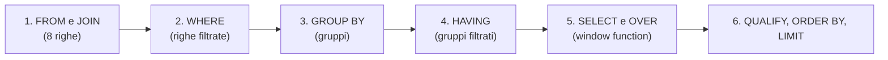

Scenario costruito, con numeri di esempio: in una dashboard di ottobre il reparto Elettronica risulta pesare il 100% del fatturato aziendale. Il responsabile del reparto è contento per cinque minuti, poi qualcuno confronta il dato con il bilancio, dove Elettronica vale poco più della metà dei ricavi. La query dell'analista è sintatticamente perfetta, gira senza errori e restituisce quote che sommano esattamente a 100. Il numero è sbagliato perché il filtro `WHERE category = 'Elettronica'` è stato scritto nella stessa `SELECT` che calcola il denominatore con `sum(revenue_eur) OVER ()`.

> **Idea chiave:** una window function non vede mai le righe che `WHERE` ha già scartato, e un `WHERE` non può mai filtrare il risultato di una window function; prima di scrivere `OVER`, chiediti quali righe sono sopravvissute.

Questa lezione apre la mini-serie sulle window functions del modulo. Ti dà la mappa mentale che serve per tutte le altre: l'ordine in cui il motore valuta le clausole, che non coincide con l'ordine in cui le scrivi.

## Il denominatore che si restringe senza avvisare

Il caso d'apertura si riproduce con otto ordini. La tabella `fct_orders` ha una riga per ordine pagato, con categoria e importo.

| order_id | category | revenue_eur |
| ---: | :--- | ---: |
| 1 | Elettronica | 400 |
| 2 | Elettronica | 300 |
| 3 | Casa | 200 |
| 4 | Casa | 150 |
| 5 | Libri | 50 |
| 6 | Elettronica | 100 |
| 7 | Casa | 250 |
| 8 | Libri | 100 |

Per riprodurre i numeri, crea la tabella con gli stessi otto ordini.

```sql
-- Tabella di esempio con gli otto ordini della tabella precedente
CREATE TABLE fct_orders
(
    order_id UInt32,
    category String,
    revenue_eur Decimal(10, 2),
    status String
) ENGINE = Memory;

INSERT INTO fct_orders VALUES
(1, 'Elettronica', 400, 'paid'), (2, 'Elettronica', 300, 'paid'), (3, 'Casa', 200, 'paid'),
(4, 'Casa', 150, 'paid'), (5, 'Libri', 50, 'paid'), (6, 'Elettronica', 100, 'paid'),
(7, 'Casa', 250, 'paid'), (8, 'Libri', 100, 'paid');
```

Il fatturato totale è 400 + 300 + 200 + 150 + 50 + 100 + 250 + 100 = 1.550 euro, di cui 800 euro in Elettronica. Il peso vero del reparto è quindi 800 / 1.550 = 51,6%. La query dell'analista, invece, produce questo.

```sql
-- Query sbagliata: WHERE gira prima di OVER, quindi il totale "aziendale" è il totale di Elettronica
SELECT
    order_id,
    category,
    revenue_eur,
    sum(revenue_eur) OVER () AS total_company_eur,
    round(revenue_eur * 100 / sum(revenue_eur) OVER (), 1) AS share_pct
FROM fct_orders
WHERE category = 'Elettronica'
ORDER BY order_id;
```

```text
order_id  category     revenue_eur  total_company_eur  share_pct
1         Elettronica  400          800                50
2         Elettronica  300          800                37.5
6         Elettronica  100          800                12.5
```

Le tre quote sommano a 100, e proprio questa quadratura perfetta dovrebbe insospettire: un reparto che pesa il 100% dell'azienda non esiste. Il denominatore è 800 e non 1.550, perché alla fase in cui `sum() OVER ()` viene calcolata le cinque righe di Casa e Libri non esistono più.

## Le sei fasi, nell'ordine in cui il motore le valuta

Leggere una `SELECT` dall'alto verso il basso è comodo per scriverla e fuorviante per prevederla. Il motore ragiona in una sequenza logica fissa, e ogni fase riceve in ingresso solo l'uscita della precedente. Il diagramma la riassume.



Ogni freccia è un passaggio di consegne: la fase successiva non può recuperare ciò che quella precedente ha eliminato. Per questo l'ordine non è una convenzione di stile ma una proprietà del linguaggio.

Due conseguenze discendono direttamente dal disegno. La prima: `OVER (...)` sta alla fase 5, quindi lavora solo su ciò che è sopravvissuto alle fasi 1-4. La seconda: `WHERE` e `HAVING` stanno prima della fase 5, quindi non possono riferirsi al risultato di una window function. Per filtrare su `row_number() = 1` serve un'altra strada, che vediamo più avanti.

Un dettaglio per ClickHouse: il motore è più permissivo di altri sugli alias. Puoi scrivere `HAVING category_eur > 200` usando l'alias definito nella `SELECT`, ed è comodo. Non confondere però la comodità sintattica con l'ordine logico: l'alias viene risolto, ma il filtro agisce sempre alla fase 4 sui gruppi, mai sulle window function.

| Fase | Clausola | Cosa vede | Effetto su `OVER` |
| :--- | :--- | :--- | :--- |
| 1 | `FROM`, `JOIN` | Tutte le righe delle tabelle | Una join uno-a-molti gonfia le righe prima di ogni calcolo |
| 2 | `WHERE` | Righe singole | Le righe scartate non esistono più per la finestra |
| 3 | `GROUP BY` | Righe filtrate | Dopo il raggruppamento resta una riga per gruppo |
| 4 | `HAVING` | Gruppi | Taglia i gruppi prima della proiezione |
| 5 | `SELECT`, `OVER` | Righe o gruppi sopravvissuti | Qui si calcolano le window function |
| 6 | `QUALIFY`, `ORDER BY`, `LIMIT` | Risultato finale | `QUALIFY` filtra dopo `OVER` |

## Calcolare la quota giusta, riga per riga

Riprendiamo il calcolo con la query corretta, cioè quella che lascia tutte le righe alla finestra e filtra solo dopo. Per prima cosa guarda la fase 5 senza alcun filtro: ogni riga porta con sé il totale aziendale, 1.550 euro.

```sql
-- Calcolo della quota sul totale aziendale con tutte le 8 righe visibili alla finestra
SELECT
    order_id,
    category,
    revenue_eur,
    sum(revenue_eur) OVER () AS total_company_eur,
    round(revenue_eur * 100 / sum(revenue_eur) OVER (), 1) AS share_pct
FROM fct_orders
ORDER BY order_id;
```

```text
order_id  category     revenue_eur  total_company_eur  share_pct
1         Elettronica  400          1550               25.8
2         Elettronica  300          1550               19.4
3         Casa         200          1550               12.9
4         Casa         150          1550               9.7
5         Libri        50           1550               3.2
6         Elettronica  100          1550               6.5
7         Casa         250          1550               16.1
8         Libri        100          1550               6.5
```

Ora il calcolo a mano. L'ordine 1 pesa 400 / 1.550 = 25,8%; l'ordine 2 pesa 300 / 1.550 = 19,4%; l'ordine 6 pesa 100 / 1.550 = 6,5%. Sommando le tre quote di Elettronica si ottiene 25,8 + 19,4 + 6,5 = 51,7%, che differisce di un decimo dal 51,6% esatto solo per l'arrotondamento di ogni singola riga. Il confronto con la versione sbagliata è netto: l'ordine 1 passa dal 50% al 25,8%, perché il denominatore sale da 800 a 1.550 euro, cioè quasi il doppio.

Per mostrare solo Elettronica senza toccare il denominatore, il filtro si sposta fuori, in una CTE che calcola prima e filtra dopo.

```sql
-- Prima calcola (fase 5 nella CTE), poi filtra il segmento nella SELECT esterna
WITH shares AS (
    SELECT
        order_id,
        category,
        revenue_eur,
        sum(revenue_eur) OVER () AS total_company_eur,
        round(revenue_eur * 100 / sum(revenue_eur) OVER (), 1) AS share_pct
    FROM fct_orders
)
SELECT *
FROM shares
WHERE category = 'Elettronica'
ORDER BY order_id;
```

La differenza con la query sbagliata sta tutta nella posizione del filtro, e il costo è una CTE in più.

Il risultato mostra le stesse tre righe di Elettronica, con quote 25,8, 19,4 e 6,5 e un denominatore di 1.550 euro. Il filtro di segmento ora agisce su una tabella già calcolata, e la finestra ha visto tutte e otto le righe.

## GROUP BY e OVER nella stessa query

Quando una query contiene sia `GROUP BY` sia una window function, la fase 3 viene prima della 5. Le aggregazioni collassano le righe in gruppi, e la finestra lavora poi sui gruppi. È per questo che `rank() OVER (ORDER BY sum(revenue_eur) DESC)` è valida: il `sum` esiste già quando la finestra parte. Al contrario, annidare una window function dentro un aggregato, come `sum(rank() OVER (...))`, non ha senso logico, perché l'aggregato appartiene alla fase 3 e la finestra alla 5.

```sql
-- GROUP BY (fase 3) crea 3 gruppi, poi OVER (fase 5) li classifica e calcola la quota
SELECT
    category,
    sum(revenue_eur) AS category_eur,
    rank() OVER (ORDER BY sum(revenue_eur) DESC) AS rnk,
    round(sum(revenue_eur) * 100 / sum(sum(revenue_eur)) OVER (), 1) AS share_pct
FROM fct_orders
GROUP BY category
ORDER BY rnk;
```

```text
category     category_eur  rnk  share_pct
Elettronica  800           1    51.6
Casa         600           2    38.7
Libri        150           3    9.7
```

La finestra qui vede tre righe, non otto. Leggi il risultato come una tabella di sintesi, non come un elenco di ordini.

Il totale 800 + 600 + 150 = 1.550 euro quadra con il conto iniziale, e le tre quote sommano 51,6 + 38,7 + 9,7 = 100,0%. Il controllo di quadratura funziona anche come test: se la somma delle quote di tutte le categorie non fa 100, un filtro è finito nella fase sbagliata.

## Tre trappole di ordine che falsano i report

### Il filtro di segmento che restringe il denominatore

Il sintomo è quello del caso d'apertura: quote che sommano sempre a 100 dentro ogni filtro di reparto, o cumulati che ripartono da zero a ogni mese filtrato. Succede perché scrivere `WHERE` e `OVER` nella stessa `SELECT` sembra naturale, e il risultato è plausibile a occhio. La correzione è calcolare le metriche di contesto in una CTE senza il filtro di segmento e applicarlo solo nella `SELECT` finale.

### L'alias usato come se esistesse già

Scrivere `WHERE iva > 10` dopo aver definito `revenue_eur * 0.22 AS iva` fallisce in molti dialetti, perché `WHERE` gira prima che la `SELECT` crei l'alias. ClickHouse lo tollera, e proprio per questo la query funziona in sviluppo e si rompe quando la porti su PostgreSQL. Il sintomo è un errore di colonna sconosciuta dopo una migrazione; la correzione è ripetere l'espressione nel `WHERE` oppure spostarla in una CTE.

### LIMIT senza un ordine che lo renda deterministico

`LIMIT 1` per prendere l'ultimo evento, senza `ORDER BY` e senza una chiave di spareggio, restituisce una riga che dipende dall'ordine fisico dei blocchi e cambia tra un'esecuzione e l'altra. Il sintomo è un dato che ballerebbe tra due refresh consecutivi della stessa dashboard. La correzione è ordinare per tempo decrescente e aggiungere un identificativo univoco come ultima chiave, oppure usare `QUALIFY row_number() OVER (...) = 1`.

## CTE nominate o QUALIFY

Per filtrare il risultato di una window function hai due strade. `QUALIFY` è una clausola della fase 6 e la trovi in ClickHouse, DuckDB, BigQuery e Snowflake: scrivi la condizione direttamente accanto alla finestra, senza sottoquery.

```sql
-- QUALIFY filtra dopo OVER: l'ordine più grande di ogni categoria, spareggio su order_id
SELECT category, order_id, revenue_eur
FROM fct_orders
QUALIFY row_number() OVER (PARTITION BY category ORDER BY revenue_eur DESC, order_id) = 1
ORDER BY category;
```

Il risultato sono tre righe: l'ordine 7 per Casa (250 euro), l'ordine 1 per Elettronica (400 euro) e l'ordine 8 per Libri (100 euro). Il criterio di scelta è pratico. Usa `QUALIFY` per deduplicazioni e classifiche semplici, dove la query ha un solo livello di calcolo. Usa CTE nominate quando servono più livelli, come nel caso del denominatore globale calcolato prima del filtro di segmento, o quando la query deve restare portabile su motori che non supportano `QUALIFY`. Evita invece le sottoquery anonime annidate: una CTE con un nome racconta lo stadio della pipeline, tre `SELECT * FROM (...)` impilate no.

## Dove si colloca questa lezione nel modulo

Questa è la lezione di orientamento: i meccanismi che spiega tornano in tutte le altre. Il modulo procede in questo ordine di dipendenza. Prima vengono le basi: la logica insiemistica delle join, poi ranking e deduplicazione con `row_number`. Seguono le funzioni sequenziali (`lag`, `lead`, cumulati), le aggregazioni su finestra con la matrice di coorte e le funzioni di bordo con `first_value`, `last_value` e `ntile`. Poi arrivano gli esercizi di sessionizzazione, la date spine con le metriche temporali, i percorsi e le coorti, il funnel, e infine pivot, anomalie e il caso di studio.

Un criterio di navigazione utile: quando una query ti restituisce un numero plausibile ma diverso da quello atteso, risali alla fase in cui è nato il problema. Se è un denominatore sbagliato, rileggi questa lezione. Se è un valore di bordo che sembra la riga corrente, vai a quella sui frame. Se è un confronto con il periodo precedente spostato, ti serve la date spine.

Il modulo è pensato per essere percorso in ordine la prima volta e consultato a salti le volte successive. Ogni lezione parte da un guasto concreto, mostra la tabella di ingresso, le righe intermedie e il risultato, così puoi verificare a mano ogni passaggio.

## Controllo prima di eseguire una query analitica

1. Una query calcola `sum(revenue_eur) OVER ()` e ha `WHERE category = 'Casa'` nella stessa `SELECT`. A quale totale si riferisce il denominatore?

<details>
<summary>Mostra risposta</summary>

Al totale della sola categoria Casa. `WHERE` è alla fase 2 e la finestra alla fase 5, quindi le righe di Elettronica e Libri non esistono più quando `OVER` calcola. Con i dati della lezione il denominatore sarebbe 600 euro invece di 1.550.

</details>

2. Perché `HAVING category_eur > 200` non può filtrare un `rank() OVER (...)` calcolato nella stessa query?

<details>
<summary>Mostra risposta</summary>

Perché `HAVING` appartiene alla fase 4 e `rank() OVER` alla fase 5: quando il filtro agisce, il rango non è ancora stato calcolato. Per filtrare sul rango serve `QUALIFY` oppure una CTE esterna con `WHERE rnk <= N`.

</details>

3. La somma delle quote per categoria dà 100% in ogni singola query filtrata per reparto. Che cosa indica?

<details>
<summary>Mostra risposta</summary>

Indica che il filtro di reparto è nella stessa `SELECT` della finestra e restringe il denominatore. La quadratura corretta è la somma delle quote di tutte le categorie su un denominatore unico: 51,6 + 38,7 + 9,7 = 100,0% sui 1.550 euro aziendali.

</details>

4. In quale caso sceglieresti `QUALIFY` e in quale una CTE nominata?

<details>
<summary>Mostra risposta</summary>

`QUALIFY` per una deduplicazione o una classifica con un solo livello di calcolo, su un motore che lo supporta. CTE nominata quando devi calcolare denominatori globali prima dei filtri di segmento, quando la query ha più stadi o quando deve restare portabile su PostgreSQL.

</details>
