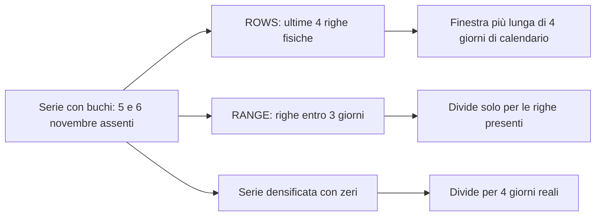

Scenario costruito, con numeri di esempio: il team prodotto di un negozio online guarda ogni mattina la media mobile del fatturato su 7 giorni, perché il weekend gonfia i numeri e il lunedì li smorza. Un giorno qualcuno scrive `avg(revenue) OVER (ORDER BY day ROWS BETWEEN 6 PRECEDING AND CURRENT ROW)` su una tabella giornaliera in cui i giorni senza vendite non compaiono affatto. Dopo un ponte festivo di due giorni la finestra da "7 giorni" copre in realtà nove giorni di calendario, la curva si appiattisce e il calo di conversione che il team cercava resta nascosto per una settimana.

> **Idea chiave:** una window function sequenziale lavora sulle righe, non sul calendario. `lagInFrame`, `leadInFrame` e ogni frame `ROWS` ragionano per posizione; solo `RANGE` o una serie densificata ragionano per giorni. Prima di scrivere `OVER`, decidi se la tua unità di misura è la riga o il tempo.

## Che cosa legge davvero una finestra ordinata

Una finestra è una partizione ordinata di righe, e ogni funzione che la usa guarda un sottoinsieme di quella sequenza. Il meccanismo è lo stesso per tutte, ma le unità cambiano. La tabella riassume le quattro costruzioni che incontrerai più spesso, con il comportamento che hanno quando nella serie mancano dei giorni.

`lagInFrame(col)` e `leadInFrame(col)` leggono la riga precedente o successiva della partizione, e con giorni mancanti saltano alla riga esistente più vicina, non al giorno prima. Un frame `ROWS BETWEEN 3 PRECEDING AND CURRENT ROW` legge le 3 righe fisiche prima della corrente, quindi con giorni mancanti torna indietro di più giorni di calendario. Un frame `RANGE BETWEEN 3 PRECEDING AND CURRENT ROW` legge le righe il cui valore di ordinamento è entro 3 unità dalla corrente: rispetta il calendario, ma conta solo le righe presenti. Infine `sum(col) OVER (ORDER BY k)` senza frame somma dall'inizio della partizione fino a tutte le righe con la stessa chiave `k`, e i pari merito vengono sommati insieme.

L'ultima costruzione merita attenzione perché è il punto in cui molte query corrette in apparenza producono numeri sbagliati. Quando l'`ORDER BY` della finestra non contiene una chiave univoca e manca un frame esplicito, il frame implicito è `RANGE BETWEEN UNBOUNDED PRECEDING AND CURRENT ROW`. Due righe con la stessa data risultano pari merito, e ciascuna vede la somma di entrambe. Più avanti lo misuriamo su dati veri.

In ClickHouse esiste una particolarità che conta per `LAG` e `LEAD`. Le funzioni si chiamano `lagInFrame` e `leadInFrame` e operano sul frame della finestra, non sull'intera partizione. Se non dichiari un frame che arrivi fino in fondo alla partizione, una `leadInFrame` può non vedere la riga successiva. Per questo gli esempi di questa lezione dichiarano sempre `ROWS BETWEEN UNBOUNDED PRECEDING AND UNBOUNDED FOLLOWING` per le funzioni di spostamento e `ROWS BETWEEN UNBOUNDED PRECEDING AND CURRENT ROW` per i progressivi.

## Gap tra ordini con lagInFrame: input, passi intermedi e output

Partiamo da una tabella piccola, abbastanza da seguire a mano ogni riga. Contiene sei ordini di due clienti, con un caso volutamente scomodo: il cliente C1 ha due ordini nello stesso giorno.

```sql
-- Tabella di input: sei ordini pagati di due clienti (numeri di esempio)
SELECT * FROM values(
    'customer_id String, order_id UInt32, order_date Date, revenue_eur Float64',
    ('C1', 1, '2026-09-03',  80),
    ('C1', 2, '2026-09-20', 120),
    ('C1', 3, '2026-09-20',  40),
    ('C1', 4, '2026-10-15', 150),
    ('C2', 5, '2026-09-10',  60),
    ('C2', 6, '2026-10-02',  90)
);
```

Vogliamo, per ogni ordine, la data dell'ordine precedente dello stesso cliente, i giorni trascorsi e la variazione di importo. L'ordinamento usa `(order_date, order_id)`: l'identificativo serve a spezzare il pari merito del 20 settembre in modo ripetibile.

```sql
-- Gap in giorni e delta di importo rispetto all'ordine precedente dello stesso cliente
SELECT
    customer_id,
    order_id,
    order_date,
    lagInFrame(toNullable(order_date)) OVER w AS prev_date,
    dateDiff('day', prev_date, order_date)      AS gap_days,
    revenue_eur - lagInFrame(revenue_eur, 1, 0) OVER w AS delta_eur
FROM orders
WINDOW w AS (
    PARTITION BY customer_id
    ORDER BY order_date, order_id
    ROWS BETWEEN UNBOUNDED PRECEDING AND UNBOUNDED FOLLOWING
)
ORDER BY customer_id, order_id;
```

Il risultato, eseguito su ClickHouse 26.11, è questo.

| customer_id | order_id | order_date | prev_date | gap_days | delta_eur |
| :--- | ---: | :--- | :--- | ---: | ---: |
| C1 | 1 | 2026-09-03 | NULL | NULL | 80 |
| C1 | 2 | 2026-09-20 | 2026-09-03 | 17 | 40 |
| C1 | 3 | 2026-09-20 | 2026-09-20 | 0 | -80 |
| C1 | 4 | 2026-10-15 | 2026-09-20 | 25 | 110 |
| C2 | 5 | 2026-09-10 | NULL | NULL | 60 |
| C2 | 6 | 2026-10-02 | 2026-09-10 | 22 | 30 |

Leggiamo i passaggi uno alla volta. Per l'ordine 2 il precedente è l'ordine 1 del 3 settembre, quindi il gap è da 3 a 20 settembre, cioè 17 giorni, e il delta è 120 - 80 = 40 euro. Per l'ordine 3 il precedente è l'ordine 2, stessa data, quindi gap = 0 giorni e delta = 40 - 120 = -80 euro. Per l'ordine 4 il precedente è l'ordine 3: dal 20 settembre al 15 ottobre passano 10 giorni di settembre più 15 di ottobre, cioè 25 giorni, e il delta è 150 - 40 = 110 euro. Il cliente C2 ricomincia da capo: la partizione isola le sue due righe.

Due dettagli di dialetto non sono ovvi. Il primo è `toNullable`: senza di esso, `lagInFrame` su una colonna `Date` non nullable restituisce il valore predefinito del tipo, cioè `1970-01-01`, e `dateDiff` produce 20.699 giorni sulla prima riga di ogni cliente. Il secondo è il terzo argomento: `lagInFrame(revenue_eur, 1, 0)` sostituisce il mancante con 0, quindi il delta della prima riga coincide con l'importo stesso. Se vuoi invece lasciare il delta vuoto sul primo ordine, passa anche lì `toNullable`.

## Progressivi e pari merito: perché il frame di default inganna

Con la stessa tabella calcoliamo il progressivo di spesa per cliente in due modi. Nel primo lasciamo il frame implicito e ordiniamo per sola data. Nel secondo dichiariamo `ROWS` e aggiungiamo `order_id` come spareggio.

```sql
-- Progressivo con frame implicito (RANGE) contro progressivo con ROWS e spareggio
SELECT
    customer_id, order_id, order_date, revenue_eur,
    sum(revenue_eur) OVER (PARTITION BY customer_id ORDER BY order_date) AS cum_default,
    sum(revenue_eur) OVER (
        PARTITION BY customer_id
        ORDER BY order_date, order_id
        ROWS BETWEEN UNBOUNDED PRECEDING AND CURRENT ROW
    ) AS cum_rows
FROM orders
ORDER BY customer_id, order_id;
```

| customer_id | order_id | order_date | revenue_eur | cum_default | cum_rows |
| :--- | ---: | :--- | ---: | ---: | ---: |
| C1 | 1 | 2026-09-03 | 80 | 80 | 80 |
| C1 | 2 | 2026-09-20 | 120 | 240 | 200 |
| C1 | 3 | 2026-09-20 | 40 | 240 | 240 |
| C1 | 4 | 2026-10-15 | 150 | 390 | 390 |
| C2 | 5 | 2026-09-10 | 60 | 60 | 60 |
| C2 | 6 | 2026-10-02 | 90 | 150 | 150 |

Sull'ordine 2 il progressivo di default dice 240 euro, mentre al momento di quell'ordine il cliente aveva speso soltanto 80 + 120 = 200 euro. Il default `RANGE` considera pari merito le due righe del 20 settembre e le somma entrambe: 80 + 120 + 40 = 240. La versione con `ROWS` produce 200 sull'ordine 2 e 240 sull'ordine 3, ed è l'unica che rappresenta una storia in cui gli ordini avvengono uno dopo l'altro. Alla fine i due progressivi coincidono (390 euro per C1, 150 per C2), ed è per questo che l'errore sopravvive ai controlli di quadratura sul totale: sbaglia solo nei punti intermedi, quelli che finiscono in un grafico.

La regola pratica è breve. Per un progressivo scrivi sempre `ROWS BETWEEN UNBOUNDED PRECEDING AND CURRENT ROW` e fai finire l'`ORDER BY` con una chiave univoca. Il controllo di quadratura è altrettanto breve: per ogni cliente, il progressivo dell'ultima riga deve essere uguale a `sum(revenue_eur)` calcolata con `GROUP BY customer_id`. Qui 390 = 80 + 120 + 40 + 150 e 150 = 60 + 90, quindi il controllo passa.

## Media mobile su una serie con buchi: ROWS, RANGE e serie densa

Torniamo al problema dell'apertura con una finestra più corta, per poter fare i conti a mano: 4 giorni, cioè la riga corrente più 3 precedenti. I ricavi giornalieri sono 120, 100 e 90 euro il 2, 3 e 4 novembre; il 5 e il 6 non ci sono vendite e la tabella non ha righe; il 7, 8 e 9 novembre i ricavi sono 110, 130 e 95 euro.



Calcoliamo la media sull'8 novembre in tre modi, tutti verificati su ClickHouse.

Con `ROWS BETWEEN 3 PRECEDING AND CURRENT ROW` le quattro righe fisiche sono il 3, 4, 7 e 8 novembre, quindi (100 + 90 + 110 + 130) / 4 = 107,50 euro, su una finestra lunga in realtà sei giorni di calendario. Con `RANGE BETWEEN 3 PRECEDING AND CURRENT ROW` entrano le righe con data compresa tra il 5 e l'8 novembre, cioè solo il 7 e l'8: (110 + 130) / 2 = 120 euro, un calendario rispettato ma una divisione per 2 righe e non per 4 giorni. Con la serie densificata il 5 e il 6 novembre valgono 0 euro e la finestra contiene 0, 0, 110, 130: (0 + 0 + 110 + 130) / 4 = 60 euro.

Tre risposte diverse a una stessa domanda, e ciascuna è giusta rispetto a una definizione diversa di "media di 4 giorni". Se i giorni senza ordini sono davvero giorni a ricavo zero, la definizione corretta è la terza. `RANGE` rappresenta invece la media dei giorni in cui è successo qualcosa, che è un'altra metrica. Sul 7 novembre la differenza si vede ancora meglio: ROWS dà 105, RANGE dà 100, la serie densa dà (90 + 0 + 0 + 110) / 4 = 50 euro.

Per densificare in ClickHouse puoi unire la serie reale a un asse di date generato con `numbers`, oppure usare `ORDER BY day WITH FILL` sull'output di una subquery; la lezione sulla date spine mostra le due varianti. L'importante è scegliere in modo esplicito, perché il motore non ti avvisa: tutte e tre le query girano senza errori.

## Cambi di stato e sessioni: flag di rottura più somma cumulata

Il terzo uso di `lagInFrame` è la ricostruzione di episodi. Dato un flusso di eventi di un utente, vogliamo assegnare a ogni evento un numero di sessione, con la regola che un'inattività oltre 30 minuti apre una nuova sessione. Il metodo ha due passi: un flag che vale 1 quando un evento inizia una sessione, poi una somma cumulata del flag.

```sql
-- Sessionizzazione: flag di rottura con lagInFrame, poi somma cumulata
WITH flagged AS (
    SELECT
        user_id, event_id, ts,
        lagInFrame(toNullable(ts)) OVER w AS prev_ts,
        -- il primo evento ha prev_ts NULL: apre la prima sessione
        if(prev_ts IS NULL OR dateDiff('minute', prev_ts, ts) > 30, 1, 0) AS is_new_session
    FROM events
    WINDOW w AS (
        PARTITION BY user_id
        ORDER BY ts, event_id
        ROWS BETWEEN UNBOUNDED PRECEDING AND UNBOUNDED FOLLOWING
    )
)
SELECT
    user_id, event_id, ts, prev_ts, is_new_session,
    sum(is_new_session) OVER (
        PARTITION BY user_id ORDER BY ts, event_id
        ROWS BETWEEN UNBOUNDED PRECEDING AND CURRENT ROW
    ) AS session_idx
FROM flagged
ORDER BY event_id;
```

L'utente u1 genera sei eventi il 10 novembre 2026 alle 09:00, 09:10, 09:25, 10:05, 10:20 e 14:00. L'output intermedio e finale, riga per riga, è il seguente.

| event_id | ts | prev_ts | gap (min) | is_new_session | session_idx |
| ---: | :--- | :--- | ---: | ---: | ---: |
| 1 | 09:00 | NULL | non definito | 1 | 1 |
| 2 | 09:10 | 09:00 | 10 | 0 | 1 |
| 3 | 09:25 | 09:10 | 15 | 0 | 1 |
| 4 | 10:05 | 09:25 | 40 | 1 | 2 |
| 5 | 10:20 | 10:05 | 15 | 0 | 2 |
| 6 | 14:00 | 10:20 | 220 | 1 | 3 |

Il flag vale 1 sugli eventi 1, 4 e 6, quindi la somma cumulata passa da 1 a 2 a 3 e produce tre sessioni: gli eventi 1-3, gli eventi 4-5 e l'evento 6 da solo. Per controllare, sommiamo i gap interni: 10 + 15 = 25 minuti nella prima sessione e 15 nella seconda, entrambi sotto la soglia di 30. Il gap di 40 minuti tra le 09:25 e le 10:05 e quello di 220 minuti superano la soglia, ed è lì che nascono le rotture. Il trucco funziona perché la somma cumulata trasforma una sequenza di marcatori in un'etichetta di gruppo, e lo stesso schema vale per episodi di inattività, periodi con piano attivo o serie di giorni consecutivi.

`leadInFrame` è lo specchio di `lagInFrame`: guarda in avanti. Serve a misurare quanto dura uno stato (la data del cambio successivo meno la data corrente) e a individuare l'ultima riga di una sequenza, perché il valore successivo è nullo se dichiari `toNullable`. Sulla stessa tabella di eventi, l'evento 6 non ha un successore, e senza `toNullable` il motore restituirebbe `1970-01-01 00:00:00` invece di un vuoto.

## Tre errori che producono numeri plausibili ma sbagliati

### Dimenticare PARTITION BY nello spostamento

Il sintomo è un tempo di riacquisto negativo o assurdo sulla prima riga di ciascun cliente. Succede perché senza `PARTITION BY customer_id` la partizione è l'intera tabella e l'ordine 5 del cliente C2 si trova subito dopo l'ordine 4 del cliente C1: il suo "ordine precedente" risulta il 15 ottobre, e il gap con il 10 settembre vale -35 giorni. La query gira senza errori e il numero sembra un semplice outlier. Si evita mettendo sempre nella finestra la chiave dell'entità che analizzi, e verificando con un conteggio che le righe con `prev_date IS NULL` siano esattamente una per cliente: qui due righe per due clienti.

### Lasciare il valore predefinito al posto del vuoto

Il sintomo è un picco di valori enormi in un istogramma dei gap, per esempio 20.699 giorni. Succede perché in ClickHouse `lagInFrame` su un tipo non nullable restituisce il valore predefinito del tipo, e per `Date` è il 1° gennaio 1970. Nessun errore, solo una media dei gap rovinata. Si corregge con `toNullable` sulla colonna spostata, e poi con una scelta consapevole sul primo elemento: per un delta di importo è ragionevole il valore 0 come terzo argomento, per un tempo di riacquisto è corretto lasciare il vuoto e far ignorare la riga a `avg`.

### Affidarsi al frame implicito e a un ordinamento senza chiave univoca

Il sintomo è un progressivo a gradini, con due righe consecutive che mostrano lo stesso totale, oppure un risultato che cambia tra due esecuzioni perché l'ordine dei pari merito dipende da come il motore legge i blocchi. Succede perché il frame predefinito è `RANGE` e una data non univoca crea pari merito. Nel nostro caso il progressivo sull'ordine 2 passa da 200 a 240 euro. Si evita con la coppia `ROWS` esplicito più `ORDER BY data, id`, e con la quadratura sull'ultima riga di ciascuna partizione.

## Quando preferire una finestra a una self-join

Per confrontare un ordine con il precedente puoi scrivere una self-join su un numero d'ordine progressivo, oppure una window function. Con le finestre il motore ordina la partizione una volta e legge i vicini in sequenza, con costo praticamente lineare. Con la self-join devi prima numerare le righe, poi unire la tabella a sé stessa con `seq = seq + 1`, e il risultato dipende da un'altra window function che hai già dovuto scrivere. La self-join ha senso solo quando devi confrontare una riga con un insieme di righe non adiacenti, per esempio con tutti gli ordini dei 30 giorni precedenti, e a quel punto un frame `RANGE` spesso risolve comunque.

Una nota sui costi: su tabelle grandi la window function ordina ogni partizione in memoria. Filtra prima per un intervallo di date o per i clienti che ti servono, poi apri la finestra, e passa alla stessa finestra con nome (`WINDOW w AS (...)`) tutte le funzioni che hanno la stessa definizione, così il motore la costruisce una volta sola.

## Verifica sulle tue query sequenziali

1. Una tabella di eventi ha 120.000 righe e 8.000 utenti distinti, e hai calcolato un gap con `lagInFrame(toNullable(ts))` e `PARTITION BY user_id`. Quante righe con `prev_ts IS NULL` devi trovare, e che cosa significa se ne trovi 8.050?

<details>
<summary>Mostra risposta</summary>

Devi trovarne esattamente 8.000, una per utente, perché la prima riga di ogni partizione non ha precedente. Con 8.050 righe vuote ci sono 50 righe in più, cioè 50 punti in cui `prev_ts` è nullo senza essere un primo evento: tipicamente eventi con `ts` nullo, oppure una partizione spezzata da una chiave che varia (per esempio un `user_id` scritto in modo diverso). Si indaga contando i `ts` nulli e confrontando `uniqExact(user_id)` con `count()` sulle righe vuote.

</details>

2. Un cliente ha tre ordini da 50, 70 e 30 euro, i primi due nello stesso giorno, e lo ordini solo per data senza frame. Quali progressivi vedi sulle tre righe, e quali dovresti vedere?

<details>
<summary>Mostra risposta</summary>

Il frame implicito è `RANGE`, quindi le due righe dello stesso giorno vedono entrambe 50 + 70 = 120 euro, e la terza vede 120 + 30 = 150 euro: la sequenza è 120, 120, 150. Con `ROWS` e spareggio per identificativo vedresti 50, 120, 150. Il totale finale è lo stesso (150 euro), ma il progressivo intermedio sulla prima riga è sbagliato di 70 euro.

</details>

3. Hai una serie giornaliera con i giorni vuoti omessi. La media mobile a 4 giorni sull'ultimo giorno vale 120 euro con `RANGE` e 60 euro con serie densificata, a partire dagli stessi due ordini da 110 e 130 euro. Quale delle due devi mostrare al direttore commerciale, che chiede "quanto vendiamo in media al giorno"?

<details>
<summary>Mostra risposta</summary>

Devi mostrare 60 euro. La domanda è sul ricavo medio per giorno di calendario, e due dei quattro giorni sono stati a zero: (0 + 0 + 110 + 130) / 4 = 60 euro. Il valore di 120 euro è la media sui soli giorni con vendite, utile per misurare il carrello medio giornaliero quando c'è attività, ma sovrastima il ritmo di vendita di un fattore 2.

</details>

4. In una sessionizzazione con soglia a 30 minuti ottieni tre sessioni da eventi alle 09:00, 09:10, 09:25, 10:05, 10:20 e 14:00. Che cosa cambia se alzi la soglia a 45 minuti?

<details>
<summary>Mostra risposta</summary>

Il gap di 40 minuti tra le 09:25 e le 10:05 scende sotto la nuova soglia, quindi l'evento 4 non apre più una sessione. Restano due rotture: l'evento 1 e il gap di 220 minuti dell'evento 6. Le sessioni diventano 2: gli eventi 1-5 e l'evento 6. La soglia è un parametro di prodotto, non un fatto, ed è bene mostrare quante sessioni cambiano al variare del valore prima di fissarlo.

</details>
