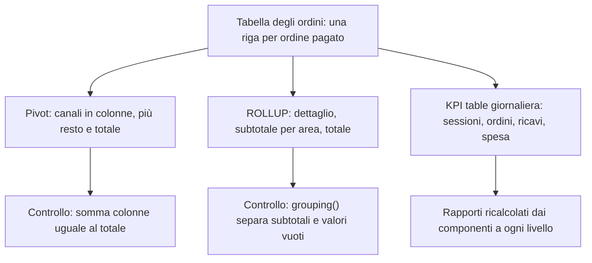

Scenario costruito, con numeri di esempio: ogni lunedì un analista esporta le vendite per area e canale verso un foglio condiviso, e la direzione confronta la somma delle colonne di canale con il totale aziendale. Il totale dice 4.300 euro, la somma delle colonne dice 3.750 euro, e mancano 550 euro. Nessuna query ha dato errore. Il pivot elencava soltanto quattro canali, e due canali minori, `referral` e il traffico diretto, sono semplicemente scomparsi dalla tabella.

> **Idea chiave:** un report che ruota o raggruppa i dati deve poter dimostrare di essere completo. Il pivot si porta dietro una colonna residuale e una colonna totale, il `ROLLUP` etichetta i subtotali con `grouping()`, e la KPI table conserva numeratori e denominatori, perché i rapporti si ricalcolano e non si sommano.

## Dove spariscono i 550 euro: i tre meccanismi del reporting

Il reporting aziendale ruota attorno a tre operazioni, e ciascuna ha un modo caratteristico di fallire in silenzio. Il pivot sposta valori di una dimensione dalle righe alle colonne; fallisce quando la lista di colonne è incompleta, perché il motore ignora ciò che non è elencato. Il `ROLLUP` aggiunge subtotali e totale generale alle righe di dettaglio; fallisce quando il subtotale si confonde con un valore vuoto vero. La KPI table congela le metriche in un solo posto; fallisce quando salva rapporti già calcolati, che poi qualcuno somma o media.



Il filo comune è la quadratura: ogni operazione produce un numero che si può confrontare con un altro ottenuto per una strada diversa. Nelle sezioni successive costruiamo i tre meccanismi su una stessa tabella di otto righe, in modo da poter fare ogni controllo a mano.

## La tabella di partenza e il pivot con colonna di quadratura

Gli ordini pagati di un mese, già aggregati per area e canale, sono questi. Una riga ha area vuota (ordini senza indirizzo valido) e una ha canale vuoto (traffico diretto, senza attribuzione).

```sql
-- Input: ricavi pagati per area e canale (numeri di esempio)
SELECT * FROM values(
    'region String, channel String, revenue_eur Float64',
    ('Nord', 'paid_search', 1200),
    ('Nord', 'meta_ads',     800),
    ('Nord', 'organic',      500),
    ('Nord', 'referral',     300),
    ('Sud',  'paid_search',  700),
    ('Sud',  'meta_ads',     400),
    ('Sud',  '',             250),
    ('',     'organic',      150)
);
```

La somma delle otto righe è 1.200 + 800 + 500 + 300 + 700 + 400 + 250 + 150 = 4.300 euro. È il numero che il pivot dovrà riprodurre. Il pivot parziale dell'apertura elenca `paid_search`, `meta_ads`, `organic` ed `email`; sommando le colonne per area si ottiene Nord 2.500 euro, Sud 1.100 euro e area vuota 150 euro, per un totale di 3.750 euro. La differenza rispetto a 4.300 è di 550 euro, che corrispondono a 300 euro di `referral` al Nord e 250 euro di traffico diretto al Sud. Il canale `email` compare con valore 0 in ogni area, ed è un'altra spia: una colonna sempre vuota è una colonna che nessuno ha guardato.

La versione corretta aggiunge una colonna residuale, che raccoglie tutto ciò che non è esplicitato, e una colonna totale calcolata senza filtri.

```sql
-- Pivot con colonna residuale e totale di quadratura
SELECT
    region,
    sumIf(revenue_eur, channel = 'paid_search') AS rev_paid_search_eur,
    sumIf(revenue_eur, channel = 'meta_ads')    AS rev_meta_ads_eur,
    sumIf(revenue_eur, channel NOT IN ('paid_search', 'meta_ads')) AS rev_other_eur,
    sum(revenue_eur) AS rev_total_eur,
    -- controllo orizzontale: deve valere 0 su ogni riga
    rev_total_eur - (rev_paid_search_eur + rev_meta_ads_eur + rev_other_eur) AS check_eur
FROM monthly_revenue
GROUP BY region
ORDER BY region;
```

Sul Nord otteniamo 1.200 per `paid_search`, 800 per `meta_ads`, 500 + 300 = 800 nel residuo e 2.800 di totale, con controllo 2.800 - (1.200 + 800 + 800) = 0. Sul Sud i valori sono 700, 400, 250 e 1.350, con controllo 1.350 - 1.350 = 0. L'area vuota ha 0, 0, 150 e 150. In ClickHouse la funzione condizionale è `sumIf`; in PostgreSQL o DuckDB l'equivalente standard è `SUM(revenue_eur) FILTER (WHERE channel = 'meta_ads')`, che si legge meglio e si porta ovunque.

La colonna residuale ha un secondo vantaggio, meno ovvio. Quando il marketing attiva un nuovo canale, il pivot non perde il ricavo: finisce nel residuo, la colonna cresce e qualcuno se ne accorge. Con una lista chiusa e nessun residuo, il nuovo canale sparirebbe fino alla prossima riconciliazione.

## ROLLUP e grouping(): subtotali che non si confondono con i vuoti

Il `ROLLUP` produce in una sola scansione le righe di dettaglio, un subtotale per ogni livello della gerarchia e il totale generale. Con `GROUP BY ROLLUP(region, channel)` si ottengono i gruppi `(region, channel)`, `(region)` e il gruppo vuoto: quindi, con N colonne, N + 1 livelli. Il punto delicato è come il motore rappresenta la colonna aggregata. In ClickHouse, per impostazione predefinita, la colonna di un subtotale non diventa `NULL` ma assume il valore predefinito del tipo, cioè la stringa vuota. Dato che nei nostri dati esistono stringhe vuote vere, la riga "area vuota, canale organic" e il subtotale dell'area vuota hanno entrambe la chiave vuota.

La funzione `grouping(col)` risolve l'ambiguità: vale 1 quando la colonna è stata aggregata dal subtotale e 0 quando è un valore reale.

```sql
-- ROLLUP con grouping() per etichettare dettaglio, subtotali e totale
SELECT
    multiIf(grouping(region) = 1, 'TOTALE', region = '', 'Non assegnata', region) AS region_label,
    multiIf(grouping(channel) = 1, 'SUBTOTALE', channel = '', '(direct)', channel) AS channel_label,
    count() AS rows_count,
    sum(revenue_eur) AS rev_total_eur
FROM monthly_revenue
GROUP BY ROLLUP (region, channel)
-- prima il dettaglio, poi i subtotali, infine il totale generale
ORDER BY grouping(region), region, grouping(channel), channel;
```

Il risultato su ClickHouse 26.11 ha dodici righe: otto di dettaglio, tre subtotali di area e un totale generale.

| region_label | channel_label | righe | rev_total_eur |
| :--- | :--- | ---: | ---: |
| Non assegnata | organic | 1 | 150 |
| Non assegnata | SUBTOTALE | 1 | 150 |
| Nord | meta_ads | 1 | 800 |
| Nord | organic | 1 | 500 |
| Nord | paid_search | 1 | 1.200 |
| Nord | referral | 1 | 300 |
| Nord | SUBTOTALE | 4 | 2.800 |
| Sud | (direct) | 1 | 250 |
| Sud | meta_ads | 1 | 400 |
| Sud | paid_search | 1 | 700 |
| Sud | SUBTOTALE | 3 | 1.350 |
| TOTALE | SUBTOTALE | 8 | 4.300 |

La quadratura verticale si fa sommando i tre subtotali: 150 + 2.800 + 1.350 = 4.300 euro, uguale alla riga del totale generale. Il conteggio delle righe segue la stessa logica: 1 + 4 + 3 = 8. Se vuoi che il subtotale mostri `NULL` e non la stringa vuota, ClickHouse offre l'impostazione `group_by_use_nulls = 1`; è una buona scelta per l'export verso strumenti che distinguono i nulli, ma non elimina la necessità di `grouping()`, perché un valore mancante vero resta mancante e deve restare distinguibile da un subtotale.

Una nota sul costo: `CUBE(region, channel)` genera tutte le combinazioni, quindi 2 elevato al numero di colonne. Sui nostri dati produce 17 righe contro le 12 del `ROLLUP`, perché aggiunge anche i subtotali per canale. Con quattro dimensioni sarebbero 16 combinazioni di raggruppamento invece di 5. Per gerarchie naturali (area, paese, canale oppure anno, trimestre, mese) il `ROLLUP` basta, e usare `CUBE` serve solo quando i subtotali per ogni singola dimensione hanno davvero un lettore.

## KPI table: componenti additivi e rapporti ricalcolati

Una KPI table giornaliera ha una riga per giorno e contiene le grandezze elementari che servono a ricostruire ogni indicatore: sessioni, ordini, ricavi e spesa pubblicitaria. I rapporti (tasso di conversione, valore medio d'ordine, ritorno sulla spesa) si calcolano a partire da quelle grandezze e non vengono memorizzati come colonne da aggregare. La ragione è aritmetica, e si vede su due soli giorni.

```sql
-- KPI table: due giorni di componenti additivi (numeri di esempio)
SELECT * FROM values(
    'kpi_date Date, sessions_count UInt32, orders_count UInt32, revenue_eur Float64, ad_spend_eur Float64',
    ('2026-11-01', 100,  5,  400, 150),
    ('2026-11-02', 900, 18, 1620, 450)
);
```

Il primo giorno ha un tasso di conversione di 5 / 100 = 5 %, un valore medio d'ordine di 400 / 5 = 80 euro e un ritorno sulla spesa di 400 / 150 = 2,67. Il secondo giorno ha 18 / 900 = 2 %, 1.620 / 18 = 90 euro e 1.620 / 450 = 3,60. Chi salva queste tre colonne e le media sul periodo ottiene una conversione di (5 + 2) / 2 = 3,5 %. Il valore giusto si calcola dai componenti: gli ordini del periodo sono 5 + 18 = 23, le sessioni 100 + 900 = 1.000, quindi 23 / 1.000 = 2,3 %. Lo scarto è di 1,2 punti percentuali, e dipende dal fatto che il primo giorno, con un decimo del traffico, pesa quanto il secondo nella media semplice.

```sql
-- Riaggregazione mensile: si sommano i componenti, poi si dividono
SELECT
    toStartOfMonth(kpi_date) AS month,
    sum(sessions_count) AS sessions,
    sum(orders_count)   AS orders,
    sum(revenue_eur)    AS revenue_eur,
    sum(ad_spend_eur)   AS ad_spend_eur,
    round(100 * orders / sessions, 2)   AS conversion_pct,
    round(revenue_eur / orders, 2)      AS aov_eur,
    round(revenue_eur / ad_spend_eur, 2) AS roas
FROM mart_kpi_daily
GROUP BY month;
```

Sul periodo di due giorni la query restituisce 1.000 sessioni, 23 ordini, 2.020 euro di ricavi e 600 euro di spesa. Il valore medio d'ordine è 2.020 / 23 = 87,83 euro, mentre la media dei due valori giornalieri darebbe (80 + 90) / 2 = 85 euro. Il ritorno sulla spesa è 2.020 / 600 = 3,37, contro (2,67 + 3,60) / 2 = 3,13 della media semplice. Tre indicatori, tre scarti: nessuno di essi è un arrotondamento, sono tutti conseguenze di aver pesato in modo uguale giorni di dimensioni diverse.

Per questo la KPI table distingue due famiglie di colonne e le documenta. Le colonne additive (`sessions_count`, `orders_count`, `revenue_eur`, `ad_spend_eur`) si possono sommare su qualunque dimensione e su qualunque intervallo. I rapporti non additivi (conversione, valore medio d'ordine, ritorno sulla spesa) si derivano al momento della lettura, su un livello di aggregazione qualsiasi. Nello schema del modello è utile annotare la natura di ciascuna colonna, così che chi collega uno strumento di BI non debba indovinare.

## Tre errori che producono report plausibili ma sbagliati

### Pivot senza residuo né totale

Il sintomo è una somma delle colonne di canale inferiore al totale aziendale, spesso scoperta da qualcuno della finanza e non dall'analista. Succede perché una lista di canali scritta a mano è una fotografia di un momento, e il motore non segnala i valori che non corrispondono a nessuna colonna. Nel nostro caso mancavano 550 euro, cioè il 12,8 % del totale (550 / 4.300). Si corregge aggiungendo la colonna residuale e il totale, e trasformando il controllo `rev_total_eur - somma delle colonne = 0` in un test automatico che fallisce quando compare un canale nuovo.

### Subtotali confusi con i valori vuoti

Il sintomo è un report in cui la riga "area vuota" sembra il totale, oppure in cui i subtotali vengono filtrati insieme ai dati mancanti. Succede perché, di base, ClickHouse rappresenta la colonna aggregata con il valore predefinito del tipo e nei dati reali esistono stringhe vuote vere. Si evita con `grouping()` su ogni colonna del `ROLLUP`, e con etichette esplicite come `TOTALE`, `SUBTOTALE` e `Non assegnata`. Un controllo rapido: il numero di righe con `grouping(region) = 1` deve essere esattamente 1.

### Rapporti salvati e poi mediati

Il sintomo è un indicatore mensile che non coincide con quello ricalcolato dai dati grezzi, con scarti che crescono quando il traffico è irregolare. Come visto, la conversione scende da 3,5 % a 2,3 % non appena si pesano i giorni per il traffico. Succede perché salvare `conversion_pct` sembra comodo, e dopo qualche mese qualcuno lo media. Si corregge salvando numeratore e denominatore e calcolando il rapporto in lettura, in un'unica vista condivisa.

## Un modello atomico e un modello per l'export direzionale

Le righe di subtotale e totale sono utili per un report letto da una persona, ma dannose per uno strumento di BI che calcola da solo i propri totali: se carichi in un grafico una tabella che contiene già `SUBTOTALE` e `TOTALE`, il motore grafico somma tre volte lo stesso importo. La soluzione è tenere due oggetti separati: `mart_kpi_daily` come tabella atomica, senza subtotali, e `rpt_executive_rollup` come vista che applica `ROLLUP` e `grouping()` per l'export mensile alla direzione.

La scelta tra calcolare pivot e subtotali in SQL oppure lasciarli allo strumento di BI segue un criterio pratico. Se il numero deve essere congelato (un export per il responsabile finanziario, con regole di arrotondamento, etichette fisse e quadratura garantita), conviene calcolarlo in SQL e metterlo sotto test. Se il lettore vuole esplorare liberamente, il pivot interattivo dello strumento di BI è più adatto, a condizione che si alimenti dalla tabella atomica. Mescolare le due cose, cioè far esplorare una tabella già raggruppata, produce il doppio conteggio descritto sopra.

Le definizioni di stato appartengono a monte. Se `status = 'paid'`, l'esclusione dei resi e la valuta netta sono scritte in un solo modello, il pivot, il `ROLLUP` e la KPI table ereditano la stessa regola. Se invece ogni report le riscrive, prima o poi due dashboard mostrano due totali diversi per lo stesso mese, e la discussione che segue riguarda i filtri e non l'attività commerciale.

## Verifica sulle tue query di reporting

1. Un pivot per canale mostra ricavi per 9.400 euro sulla somma delle colonne e il totale aziendale è 10.000 euro. Qual è la prima verifica da fare, e quale intervento strutturale evita che il problema si ripresenti?

<details>
<summary>Mostra risposta</summary>

Mancano 10.000 - 9.400 = 600 euro, pari al 6 % del totale. La prima verifica è un `GROUP BY channel` senza filtri, per confrontare l'elenco dei canali reali con le colonne del pivot e trovare quello non elencato. L'intervento strutturale è aggiungere una colonna residuale con `NOT IN` sui canali elencati e un test che fallisca quando `rev_total_eur` differisce dalla somma delle colonne.

</details>

2. Un `ROLLUP(region, channel)` su 3 aree e 4 canali ciascuna produce quante righe, se ogni combinazione esiste nei dati? E quante ne produrrebbe un `CUBE`?

<details>
<summary>Mostra risposta</summary>

Il `ROLLUP` produce 3 x 4 = 12 righe di dettaglio, più 3 subtotali di area e 1 totale generale: 16 righe. Il `CUBE` aggiunge anche i 4 subtotali per canale, quindi 20 righe. La differenza cresce con il numero di dimensioni, ed è il motivo per cui si usa il `ROLLUP` sulle gerarchie.

</details>

3. Una KPI table salva `conversion_pct` per giorno. Il lunedì ha 200 sessioni e 10 ordini, il martedì 800 sessioni e 16 ordini. Che cosa mostra la media dei due tassi e che cosa mostra il ricalcolo dai componenti?

<details>
<summary>Mostra risposta</summary>

I tassi giornalieri sono 10 / 200 = 5 % e 16 / 800 = 2 %, quindi la media semplice è 3,5 %. Dai componenti: ordini 10 + 16 = 26, sessioni 200 + 800 = 1.000, tasso 26 / 1.000 = 2,6 %. Il valore corretto è 2,6 %, perché il martedì pesa quattro volte il lunedì. Va quindi salvato il numeratore con il denominatore, mai il rapporto.

</details>

4. Come distingui, in un risultato di `ROLLUP`, il subtotale dell'area dalla riga di dettaglio di un canale con nome vuoto?

<details>
<summary>Mostra risposta</summary>

Con `grouping(channel)`: vale 1 sul subtotale, perché la colonna è stata aggregata, e 0 sulla riga di dettaglio, anche se il valore del canale è la stringa vuota. Controllare il testo della colonna non basta, dato che il motore usa il valore predefinito del tipo per le colonne aggregate.

</details>
