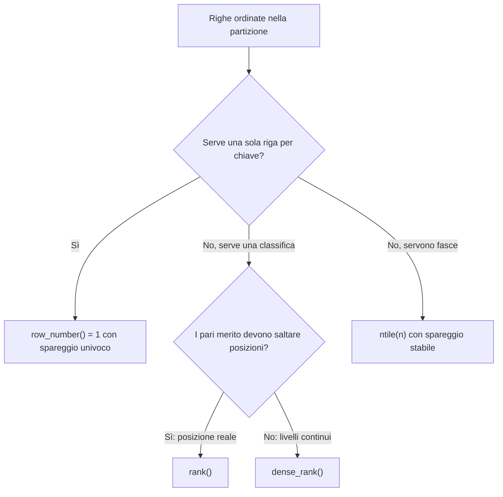

Scenario costruito, con numeri di esempio: un gateway di pagamento ritenta l'invio dei webhook in caso di timeout, e nella tabella grezza degli eventi l'ordine A100 compare tre volte con lo stesso istante `2026-11-03 10:00:00`, una volta come `pending` e due come `paid`. L'analista tiene una riga per ordine con `row_number() OVER (PARTITION BY order_id ORDER BY updated_at DESC) = 1`. Poiché l'istante è identico, il motore sceglie la riga che legge per prima: oggi l'ordine risulta pagato, dopo un riavvio del job risulta in attesa, e il fatturato del giorno oscilla senza che nessun cliente abbia pagato niente.

> **Idea chiave:** deduplicare significa scegliere una riga per chiave secondo una regola che dia sempre la stessa risposta. L'`ORDER BY` della finestra deve quindi finire con una chiave univoca, e deve esprimere la priorità di business tra gli stati, altrimenti il risultato dipende dall'ordine fisico di lettura.

## Otto righe, quattro ordini: la tabella da deduplicare

Per vedere ogni passaggio usiamo una tabella di otto eventi relativi a quattro ordini. Due ordini hanno duplicati identici (A100 e A103), uno ha una transizione legittima da pagato a rimborsato (A101) e uno è pulito (A102).

```sql
-- Input: eventi di stato ordine dal webhook, con ritentativi duplicati (numeri di esempio)
SELECT * FROM values(
    'event_id UInt32, order_id String, customer_id String, status String, updated_at DateTime, amount_eur Float64',
    (1, 'A100', 'C1', 'pending',  '2026-11-03 10:00:00',  90),
    (2, 'A100', 'C1', 'paid',     '2026-11-03 10:00:00',  90),
    (3, 'A100', 'C1', 'paid',     '2026-11-03 10:00:00',  90),
    (4, 'A101', 'C2', 'paid',     '2026-11-03 11:00:00', 150),
    (5, 'A101', 'C2', 'refunded', '2026-11-04 09:00:00', 150),
    (6, 'A102', 'C1', 'paid',     '2026-11-03 12:30:00',  60),
    (7, 'A103', 'C3', 'paid',     '2026-11-04 08:00:00', 210),
    (8, 'A103', 'C3', 'paid',     '2026-11-04 08:00:00', 210)
);
```

Le righe sono 8 e gli ordini distinti 4, quindi ci aspettiamo 4 righe dopo la deduplicazione, con 4 righe in eccesso da eliminare. Questo confronto tra `count()` e `uniqExact(order_id)` è anche il controllo finale: dopo la pulizia lo scarto deve valere 0.

Se sommiamo i soli eventi `paid` senza deduplicare otteniamo 90 + 90 + 150 + 60 + 210 + 210 = 810 euro. Gli ordini effettivamente pagati e non rimborsati sono A100 (90 euro), A102 (60 euro) e A103 (210 euro), cioè 360 euro. Lo scarto di 450 euro nasce da due fonti: 90 + 210 = 300 euro di ritentativi duplicati, più 150 euro dell'ordine A101, che compare come pagato ma poi è stato rimborsato.

## Le quattro funzioni di ranking e che cosa fanno sui pari merito

`row_number()` assegna numeri tutti diversi, anche a righe uguali sul criterio di ordinamento: è la funzione della deduplicazione, perché garantisce una sola riga con valore 1 per partizione. `rank()` assegna lo stesso numero ai pari merito e poi salta: con due secondi posti la sequenza è 1, 2, 2, 4. `dense_rank()` assegna lo stesso numero ai pari merito senza saltare: 1, 2, 2, 3. `ntile(n)` non numera le posizioni ma divide le righe ordinate in `n` gruppi di dimensione quasi uguale.



La differenza tra `rank()` e `row_number()` è proprio quella che rompe le deduplicazioni. Sull'ordine A100 la query con `rank()` e l'ordinamento per sola data assegna rango 1 a tutte e tre le righe, perché hanno lo stesso `updated_at`. Filtrando `rnk = 1` passano tutte e tre, e la tabella finale ha 3 righe per A100 e 2 per A103 (7 righe in tutto, con A101 e A102 a una riga ciascuna) invece di 4.

## Deduplicazione deterministica con row_number e QUALIFY

La regola che usiamo ha tre livelli. Prima l'istante più recente, perché l'ultimo stato prevale su quelli precedenti. Poi, a parità di istante, una priorità di business esplicita: `paid` prima di `refunded`, `refunded` prima di `pending`, ogni altro stato dopo. Infine una chiave tecnica univoca, `event_id DESC`, che rende impossibile qualunque pari merito residuo.

```sql
-- Deduplicazione: una riga per order_id, regola deterministica
SELECT
    order_id, customer_id, status, updated_at, amount_eur, event_id
FROM order_events
QUALIFY row_number() OVER (
    PARTITION BY order_id
    ORDER BY
        updated_at DESC,
        multiIf(status = 'paid', 1, status = 'refunded', 2, status = 'pending', 3, 4) ASC,
        event_id DESC
) = 1
ORDER BY order_id;
```

`QUALIFY` filtra sul risultato di una window function senza dover scrivere una subquery. Il risultato, eseguito su ClickHouse 26.11, ha quattro righe.

Le righe restituite sono A100 con stato `paid` ed evento 3, A101 `refunded` con evento 5, A102 `paid` con evento 6 e A103 `paid` con evento 8.

Seguiamo le due partizioni critiche. Per A100 le tre righe hanno lo stesso istante, quindi decide la priorità di stato: le due `paid` valgono 1, la `pending` vale 3. Tra le due `paid` decide `event_id DESC`: vince l'evento 3. Per A101 l'istante decide da solo, perché il rimborso del 4 novembre è successivo al pagamento del 3 novembre, e vince l'evento 5 con stato `refunded`. Il controllo finale conferma il lavoro: 4 righe e 4 ordini distinti, scarto 0. Ora il fatturato pagato è 90 + 60 + 210 = 360 euro, il valore atteso, perché A101 è uscito dal conteggio quando il suo ultimo stato è diventato `refunded`.

Nota sulla priorità: l'ordine tra stati dipende dal significato di business. Mettere `paid` prima di `pending` a parità di istante è ragionevole per un ritentativo; per transizioni con istanti diversi, come il rimborso, è l'istante a comandare. Se due stati contraddittori hanno lo stesso istante (un pagato e un rimborsato nello stesso secondo) serve una decisione esplicita con il team di prodotto, da scrivere nel modello e non lasciare al caso.

## Classifiche e fasce: rank, dense_rank e ntile su una tabella con pari merito

Una volta puliti gli ordini si passa alle classifiche di clienti. Prendiamo otto clienti con la spesa complessiva, tre dei quali hanno valori ripetuti: C2 e C4 con 150 euro, C7 e C8 con 60 euro.

```sql
-- Classifica clienti: posizione reale, livelli continui e quartili di spesa
SELECT
    customer_id,
    total_spent_eur,
    rank()       OVER (ORDER BY total_spent_eur DESC) AS spend_rank,
    dense_rank() OVER (ORDER BY total_spent_eur DESC) AS spend_dense_rank,
    ntile(4)     OVER (ORDER BY total_spent_eur DESC) AS spend_quartile
FROM customer_totals
ORDER BY spend_rank, customer_id;
```

| customer_id | total_spent_eur | spend_rank | spend_dense_rank | spend_quartile |
| :--- | ---: | ---: | ---: | ---: |
| C3 | 300 | 1 | 1 | 1 |
| C1 | 210 | 2 | 2 | 1 |
| C2 | 150 | 3 | 3 | 2 |
| C4 | 150 | 3 | 3 | 2 |
| C5 | 100 | 5 | 4 | 3 |
| C6 | 80 | 6 | 5 | 3 |
| C7 | 60 | 7 | 6 | 4 |
| C8 | 60 | 7 | 6 | 4 |

Dopo i due clienti a pari merito in terza posizione, `rank()` salta direttamente a 5, mentre `dense_rank()` prosegue con 4. Se il business chiede "i clienti nelle prime tre posizioni", la risposta con `rank() <= 3` è C3, C1, C2 e C4, cioè 4 clienti; con `dense_rank() <= 3` sono gli stessi 4, ma con `dense_rank() <= 4` entra anche C5. Va dichiarato nella specifica quale delle due semantiche serve, perché cambiano la cardinalità del risultato.

`ntile(4)` divide 8 righe in 4 gruppi da 2: i primi due clienti nel quartile 1, i successivi due nel 2 e così via. Nel nostro caso i confini cadono tra valori diversi (210 e 150, 150 e 100, 80 e 60), quindi il risultato è stabile. Se il confine tagliasse un pari merito, per esempio tra C2 e C4, il motore li assegnerebbe a quartili diversi in modo arbitrario, e due esecuzioni potrebbero scambiarli. Aggiungere `customer_id` in coda all'`ORDER BY` della finestra rende l'assegnazione ripetibile, a patto che si accetti che due clienti con la stessa spesa finiscano in fasce diverse.

## Tre errori di deduplicazione e classifica

### Deduplicare con rank invece che con row_number

Il sintomo è una tabella "deduplicata" che contiene ancora più righe per la stessa chiave, e un conteggio degli ordini maggiore di quello atteso: nel nostro esempio 7 righe contro 4. Succede perché `rank()` assegna 1 a tutti i pari merito, e `WHERE rnk = 1` li lascia passare. Si evita usando `row_number()` per ogni deduplicazione e riservando `rank()` alle classifiche. Il controllo è quello già visto: `count()` uguale a `uniqExact(chiave)`.

### Ordinare solo per timestamp senza chiave di spareggio

Il sintomo è un modello incrementale che cambia valore a ogni esecuzione, con oscillazioni nel fatturato giornaliero. Succede perché lo stesso istante compare su più righe (tipico dei ritentativi e dei batch) e l'ordine fisico non è garantito. Si evita chiudendo sempre l'`ORDER BY` con una chiave univoca come `event_id DESC` e, quando serve, con una priorità di stato esplicita. Il costo è una riga di codice, il beneficio è un risultato riproducibile.

### Aggregare prima di deduplicare

Il sintomo è un cliente nel quartile sbagliato o un totale gonfiato. Con le righe grezze, C1 vale 90 + 90 + 60 = 240 euro, mentre il valore corretto è 90 + 60 = 150 euro, e C3 passa da 210 a 420 euro. Succede perché `sum()` e `ntile()` lavorano su ciò che ricevono: se un ordine ritentato tre volte entra tre volte, il cliente sale artificialmente in classifica e sposta le soglie di tutti gli altri. Si evita separando le fasi: prima la deduplicazione, poi l'aggregazione, poi il ranking.

## row_number con QUALIFY contro argMax e ReplacingMergeTree

In ClickHouse per prendere l'ultimo valore per chiave esistono due strade. `row_number() ... QUALIFY = 1` conserva l'intera riga coerente e funziona in modo molto simile in altri motori, quindi il modello è portabile. `argMax(colonna, criterio)` è un'aggregazione, più rapida su miliardi di righe, ma restituisce una colonna alla volta.

```sql
-- Equivalente con argMax: la stessa tupla di ordinamento su ogni colonna
SELECT
    order_id,
    argMax(status,   (updated_at, -multiIf(status = 'paid', 1, status = 'refunded', 2, status = 'pending', 3, 4), event_id)) AS status,
    argMax(event_id, (updated_at, -multiIf(status = 'paid', 1, status = 'refunded', 2, status = 'pending', 3, 4), event_id)) AS event_id
FROM order_events
GROUP BY order_id
ORDER BY order_id;
```

Sul nostro input restituisce A100 paid con evento 3, A101 refunded con evento 5, A102 paid con evento 6 e A103 paid con evento 8, lo stesso risultato della finestra. Il segno meno davanti alla priorità serve perché `argMax` cerca il massimo e noi vogliamo la priorità numericamente più bassa. L'errore tipico è usare criteri diversi su colonne diverse, prendendo lo stato da una riga e l'importo da un'altra: tieni sempre la stessa tupla.

Un'avvertenza su `ReplacingMergeTree`: deduplica soltanto durante i merge in background, quindi una lettura immediata può restituire ancora righe duplicate. Per un report finanziario si applica `FINAL` oppure la finestra nella query di staging, senza affidarsi a una pulizia asincrona. Sulle tabelle grandi, infine, filtra prima per intervallo di date: la finestra deve ordinare solo ciò che serve.

## Verifica sulle tue query di ranking

1. Dopo aver deduplicato una tabella di 12.000 eventi ottieni 9.500 righe, ma gli ordini distinti sono 9.400. Che cosa è andato storto e come lo trovi?

<details>
<summary>Mostra risposta</summary>

Restano 9.500 - 9.400 = 100 righe in eccesso, quindi per 100 chiavi hai più di una riga. Le cause tipiche sono l'uso di `rank()` al posto di `row_number()` oppure una finestra con una chiave di partizione diversa dalla chiave logica. Per trovarle raggruppi per chiave, con `HAVING count() > 1`, e guardi le righe di quelle chiavi.

</details>

2. Quattro clienti hanno spesa 500, 300, 300 e 100 euro. Quali valori producono `rank()` e `dense_rank()`, e quanti clienti restituisce `rank() <= 3` rispetto a `dense_rank() <= 3`?

<details>
<summary>Mostra risposta</summary>

`rank()` dà 1, 2, 2, 4 e `dense_rank()` dà 1, 2, 2, 3. Il filtro `rank() <= 3` restituisce 3 clienti (500, 300, 300), perché il cliente da 100 euro ha rango 4. Il filtro `dense_rank() <= 3` ne restituisce 4, perché il cliente da 100 euro ha rango 3. La scelta dipende dalla domanda: posizioni reali oppure livelli distinti di spesa.

</details>

3. Un ordine ha due eventi con lo stesso istante, uno `paid` da 80 euro e uno `refunded` da 80 euro. La tua regola mette `paid` prima di `refunded`. Che numero finisce nel fatturato e perché è una decisione da non lasciare al codice?

<details>
<summary>Mostra risposta</summary>

L'ordine risulta pagato e porta 80 euro nel fatturato. Ma un pagamento e un rimborso nello stesso secondo sono quasi certamente una sequenza reale in cui il rimborso è successivo, e il risultato giusto potrebbe essere 0 euro. La priorità di stato è una regola di business: va concordata con chi conosce il processo di pagamento e documentata nel modello, per esempio con un timestamp di ingestione più preciso da usare come criterio.

</details>

4. Hai 10 clienti ordinati per spesa e applichi `ntile(4)`. Quante righe ha ciascun quartile?

<details>
<summary>Mostra risposta</summary>

Dieci righe non si dividono in quattro gruppi uguali: 10 = 4 x 2 + 2, quindi i primi due quartili ricevono 3 righe e gli altri due ne ricevono 2, per un totale di 3 + 3 + 2 + 2 = 10. Il motore distribuisce l'avanzo sui primi gruppi, ed è un altro motivo per non interpretare i quartili come percentili esatti quando i numeri sono piccoli.

</details>
