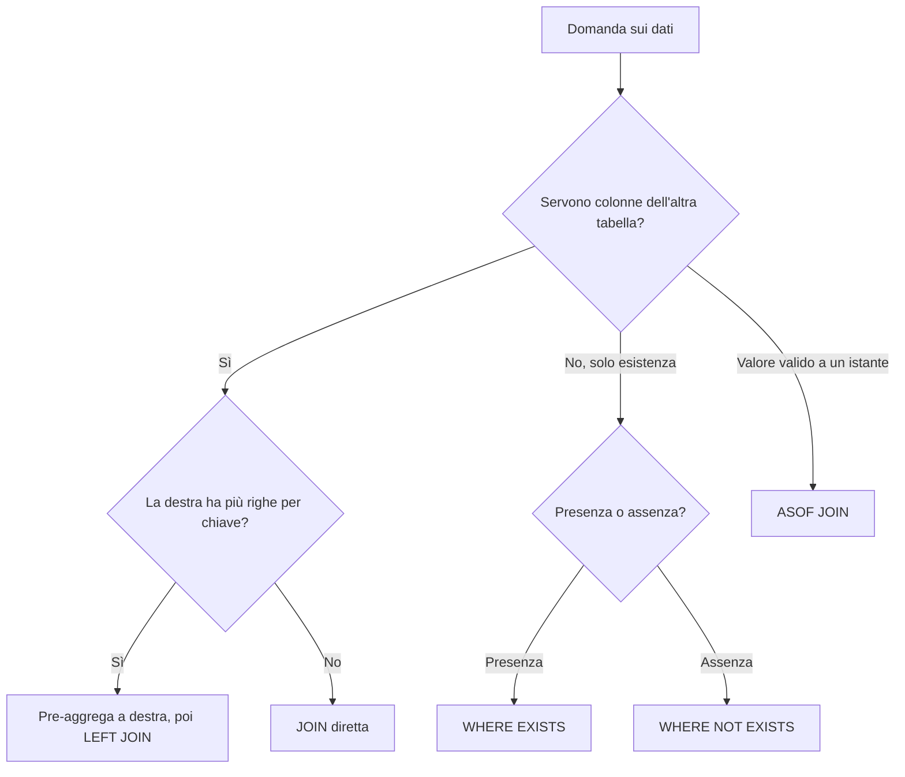

Scenario costruito, con numeri di esempio: un analista deve contare quanti clienti hanno acquistato almeno una volta nel mese e scrive `count(c.customer_id)` su una `INNER JOIN` tra anagrafica e ordini. Un cliente fedele ha fatto cinque ordini, quindi la sua riga compare cinque volte. Il report mostra 4.200 clienti acquirenti quando i clienti distinti sono 1.150: un aumento di (4.200 - 1.150) / 1.150 = 265 %, che gonfia il tasso di conversione e nessuno nota perché la query non dà errore.

> **Idea chiave:** una `JOIN` risponde alla domanda "arricchisci ogni riga con colonne dell'altra tabella" e può moltiplicare le righe; una domanda di esistenza ("chi ha almeno un ordine", "chi non ne ha nessuno") si esprime con `EXISTS` e `NOT EXISTS`, che mantengono la granularità della tabella di sinistra.

## Quale domanda stai facendo: arricchire o verificare l'esistenza

Prima di scrivere la `JOIN` si dichiara la granularità del risultato: una riga per cliente, una riga per ordine, una riga per giorno. Poi si controlla che l'operazione scelta la mantenga. Una `INNER JOIN` o una `LEFT JOIN` verso una tabella con più righe per chiave moltiplica le righe di sinistra, e ogni conteggio o somma di una colonna di sinistra viene moltiplicato con loro. Un `EXISTS` non moltiplica mai: si ferma al primo ordine trovato per ciascun cliente. Un `NOT EXISTS` trova i clienti per cui l'insieme degli ordini è vuoto.



Le sezioni seguenti usano due tabelle piccole, cinque clienti e sette ordini, in modo da poter controllare a mano ogni numero. Tutti i risultati sono stati eseguiti su ClickHouse 26.11.

## Le tabelle di partenza e il conteggio gonfiato da una JOIN 1:N

L'anagrafica ha cinque clienti con il relativo limite di credito. Gli ordini sono sette: C1 ne ha tre pagati a ottobre, C2 uno pagato, C3 uno rimborsato a ottobre e uno pagato a settembre, e un ordine ha il cliente nullo, tipico di un errore di tracciamento.

```sql
-- Input: dim_customers (5 righe) e fct_orders (7 righe), numeri di esempio
SELECT * FROM values('customer_id String, credit_limit_eur UInt32',
    ('C1', 1000), ('C2', 500), ('C3', 800), ('C4', 600), ('C5', 400));

SELECT * FROM values(
    'order_id UInt32, customer_id Nullable(String), order_date Date, status String, amount_eur Float64',
    (1, 'C1',  '2026-10-03', 'paid',     100),
    (2, 'C1',  '2026-10-10', 'paid',      80),
    (3, 'C1',  '2026-10-21', 'paid',     120),
    (4, 'C2',  '2026-10-05', 'paid',      60),
    (5, 'C3',  '2026-10-07', 'refunded',  90),
    (6, 'C3',  '2026-09-28', 'paid',      50),
    (7, NULL,  '2026-10-12', 'paid',      70)
);
```

Gli ordini pagati a ottobre sono quattro: gli ordini 1, 2, 3 e 4. I clienti con almeno un ordine pagato a ottobre sono due, C1 e C2. Questo è il risultato atteso, e il resto della sezione serve a verificare che le query lo producano.

```sql
-- JOIN 1:N usata per una domanda di esistenza: conta le righe, non i clienti
SELECT
    count(c.customer_id)        AS rows_after_join,
    uniqExact(c.customer_id)    AS distinct_customers,
    sum(c.credit_limit_eur)     AS credit_limit_sum_eur
FROM dim_customers AS c
INNER JOIN fct_orders AS o ON c.customer_id = o.customer_id
WHERE o.order_date >= '2026-10-01' AND o.status = 'paid';
```

L'esito è 4 righe, 2 clienti distinti e 3.500 euro di limiti di credito. Il conto si segue facilmente: C1 compare tre volte e C2 una, quindi `count` vale 3 + 1 = 4; la somma dei limiti vale 3 x 1.000 + 1 x 500 = 3.500 euro, contro il valore corretto di 1.000 + 500 = 1.500 euro. Il fattore di moltiplicazione, cioè righe dopo la join diviso righe di sinistra attese, è 4 / 2 = 2,0 sui conteggi e 3.500 / 1.500 = 2,33 sulle somme. Il valore di un arricchimento corretto è 1,00, ed è una metrica che conviene calcolare ogni volta che unisci due tabelle.

La toppa più comune è `SELECT DISTINCT c.customer_id` o `count(DISTINCT ...)` dopo la join. Funziona per il conteggio, ma non ripara le somme di colonne di sinistra e fa lavorare il motore su righe che sarebbe stato meglio non generare.

## Semi-join e anti-join: EXISTS, NOT EXISTS e quadratura dei complementari

La stessa domanda, scritta con `EXISTS`, non moltiplica nulla.

```sql
-- Semi-join e anti-join: una riga per cliente, sempre
SELECT c.customer_id
FROM dim_customers AS c
WHERE EXISTS (
    SELECT 1 FROM fct_orders AS o
    WHERE o.customer_id = c.customer_id
      AND o.order_date >= '2026-10-01'
      AND o.status = 'paid'
);
-- per gli inattivi basta sostituire EXISTS con NOT EXISTS
```

Con `EXISTS` il risultato è C1 e C2. Con `NOT EXISTS` il risultato è C3, C4 e C5. C3 compare tra gli inattivi perché il suo ordine di ottobre è stato rimborsato e quello pagato è di settembre: nessun ordine soddisfa la condizione completa. Le due liste sono complementari, e questa proprietà dà un controllo aritmetico: 2 clienti con acquisti più 3 senza acquisti fanno 5, cioè tutta l'anagrafica. La differenza `total_customers - (matched + unmatched)` deve valere 0, e se non vale 0 qualche cliente è stato duplicato o perso.

```sql
-- Quadratura dei complementari: deve restituire reconciliation_diff = 0
SELECT
    (SELECT count() FROM dim_customers) AS total_customers,
    (SELECT count() FROM dim_customers AS c WHERE EXISTS (
        SELECT 1 FROM fct_orders AS o
        WHERE o.customer_id = c.customer_id AND o.order_date >= '2026-10-01' AND o.status = 'paid')) AS with_orders,
    (SELECT count() FROM dim_customers AS c WHERE NOT EXISTS (
        SELECT 1 FROM fct_orders AS o
        WHERE o.customer_id = c.customer_id AND o.order_date >= '2026-10-01' AND o.status = 'paid')) AS without_orders,
    total_customers - (with_orders + without_orders) AS reconciliation_diff;
```

Su questi dati la query restituisce 5, 2, 3 e 0. Prima di inviare una lista di clienti inattivi a un sistema di email marketing, un controllo come questo evita di escludere persone per un valore nullo o di scrivere a chi ha appena acquistato. Su tabelle grandi, `EXISTS` ha anche un vantaggio di costo: il motore non ha bisogno di materializzare tutte le coppie cliente-ordine.

## NULL, NOT IN e il comportamento di ClickHouse

Nello standard SQL, `x NOT IN (1, 2, NULL)` equivale a `x <> 1 AND x <> 2 AND x <> NULL`, e l'ultimo termine è `UNKNOWN` per ogni valore di `x`. Quindi in PostgreSQL e in molti altri motori basta una riga con chiave nulla nella subquery perché `NOT IN` restituisca zero righe, senza alcun errore. Il nostro ordine 7 ha proprio il cliente nullo.

ClickHouse però si comporta diversamente per impostazione predefinita. Con `transform_null_in = 0` i `NULL` nell'insieme di destra vengono ignorati, e la query `SELECT count() FROM dim_customers WHERE customer_id NOT IN (SELECT customer_id FROM fct_orders WHERE order_date >= '2026-10-01' AND status = 'paid')` restituisce 3 anche in presenza dell'ordine nullo, lo stesso risultato di `NOT EXISTS`. È un buon motivo per non fidarsi di una verifica fatta su un solo motore: il codice che oggi funziona in ClickHouse può restituire 0 righe quando viene portato in un motore standard, o in un modello dbt che gira su un altro warehouse. Scrivere `NOT EXISTS` rende il significato indipendente dal motore e dalla configurazione.

Il valore nullo ha un secondo effetto, silenzioso, nelle `JOIN`: l'ordine 7 non trova mai un cliente, quindi finisce fuori da ogni `INNER JOIN`. Ricavi per 70 euro spariscono dalla somma per cliente. Un controllo sensato confronta la somma degli importi per cliente con il totale degli ordini: qui 100 + 80 + 120 + 60 + 90 + 50 = 500 euro attribuiti contro 570 euro di ordini, e la differenza di 70 euro corrisponde esattamente all'ordine senza cliente.

## ASOF JOIN: il valore valido in quell'istante

Un terzo caso di confronto tra tabelle è l'associazione di un evento al valore valido nel momento in cui è avvenuto, tipicamente un tasso di cambio o un listino. Una join con `BETWEEN valid_from AND valid_to` richiede intervalli senza sovrapposizioni né buchi, e se non lo sono produce righe doppie o mancanti. In ClickHouse `ASOF JOIN` associa a ogni riga di sinistra la riga di destra più recente con istante minore o uguale, restando al massimo su una riga per evento.

```sql
-- Conversione in euro con il tasso valido all'istante dell'ordine
SELECT
    o.order_id, o.currency, o.order_time,
    r.rate_time, r.eur_per_unit,
    o.amount * r.eur_per_unit AS amount_eur
FROM fct_orders_fx AS o
ASOF LEFT JOIN fx_rates AS r
    ON o.currency = r.currency AND o.order_time >= r.rate_time
ORDER BY o.order_id;
```

Con tassi USD di 0,90 dal 1° ottobre e 0,80 dal 15 ottobre e un tasso GBP di 1,20 dal 1° ottobre, un ordine in dollari da 100 il 3 ottobre vale 100 x 0,90 = 90 euro, un ordine da 200 il 20 ottobre vale 200 x 0,80 = 160 euro e un ordine in sterline da 50 il 4 ottobre vale 50 x 1,20 = 60 euro. Un ordine in dollari del 30 settembre, precedente al primo tasso, non trova alcuna riga: con le impostazioni predefinite riceve il valore 0, quindi un importo convertito di 0 euro che sembra legittimo. Con `join_use_nulls = 1` il tasso diventa nullo e l'anomalia è visibile. Aggiungi sempre un controllo sulle righe senza corrispondenza.

## Tre errori con JOIN, LEFT JOIN e NOT IN

### Contare entità dopo una JOIN 1:N

Il sintomo è un conteggio o una somma maggiori del dovuto, come i 4 clienti contro 2 e i 3.500 euro contro 1.500 euro visti sopra. Succede perché l'unione ripete la riga di sinistra per ogni riga di destra, e le funzioni di aggregazione non lo sanno. Si evita con `EXISTS` se serve solo l'esistenza, oppure pre-aggregando la tabella di destra alla chiave di join in una CTE (`GROUP BY customer_id`) quando servono anche numeri, come il totale speso o la data dell'ultimo acquisto.

### Filtrare la tabella di destra nel WHERE di una LEFT JOIN

Il sintomo è una `LEFT JOIN` che perde i clienti senza ordini. Con `LEFT JOIN fct_orders o ON c.customer_id = o.customer_id WHERE o.status = 'paid'` i clienti C4 e C5, senza ordini, escono dal risultato: restano solo C1, C2 e C3, cioè 3 clienti su 5, perché il filtro sullo stato elimina le righe in cui la tabella di destra è vuota. Spostando la condizione nella clausola `ON`, i clienti tornano a 5, con 0 ordini per C4 e C5. In ClickHouse, con `join_use_nulls = 0`, le colonne mancanti non sono nulle ma valgono il valore predefinito, e conviene contare con `countIf(o.order_id > 0)` oppure attivare l'impostazione per avere `NULL` veri.

### Fidarsi di NOT IN su colonne che possono essere nulle

Il sintomo è un report di clienti inattivi che si svuota quando entra un record sporco con chiave nulla, oppure che funziona in ClickHouse e fallisce dopo una migrazione. Succede per la logica a tre valori dello standard SQL descritta sopra. Si evita con `NOT EXISTS`, che valuta solo l'esistenza della corrispondenza, e con un test sulla chiave che segnali i valori nulli: nel nostro caso un conteggio di `customer_id IS NULL` su `fct_orders` restituirebbe 1.

## Quando EXISTS e quando una CTE pre-aggregata

Con due tabelle in relazione 1:N la scelta si riduce a una regola. Usa `EXISTS` o `NOT EXISTS` quando la domanda è booleana e non servono numeri dalla destra: chi ha convertito, chi non ha mai acquistato. Usa una CTE pre-aggregata seguita da `LEFT JOIN` quando servono anche metriche, come il numero di ordini, il totale speso o la data dell'ultimo acquisto; in quel caso la CTE ha una riga per cliente e la join non moltiplica più.

Il costo si valuta senza teorie. Una `LEFT JOIN` con pre-aggregazione legge la tabella ordini una volta e produce un risultato di dimensione pari ai clienti; `EXISTS` può fermarsi al primo ordine utile per cliente. In entrambi i casi il risultato mantiene la granularità, ed è questo che si verifica prima della pubblicazione, con un test di unicità sulla chiave del risultato e il rapporto di moltiplicazione pari a 1,00.

## Verifica sulle tue join

1. Una tabella clienti ha 2.000 righe, la tabella ordini ne ha 9.000, e una `INNER JOIN` su `customer_id` restituisce 9.000 righe. Qual è il rapporto di moltiplicazione rispetto ai clienti, e come ottieni il numero di clienti acquirenti senza `DISTINCT`?

<details>
<summary>Mostra risposta</summary>

Il rapporto è 9.000 / 2.000 = 4,5 righe per cliente. Questo non è un errore in sé, perché la relazione è 1:N, ma significa che ogni conteggio di colonne dei clienti viene moltiplicato per 4,5 in media. Per contare i clienti acquirenti si usa `WHERE EXISTS` sugli ordini, che restituisce una riga per cliente, oppure una CTE `GROUP BY customer_id` con `LEFT JOIN`.

</details>

2. Una query restituisce 1.200 clienti con acquisti e 750 clienti senza acquisti, su un'anagrafica di 2.000 clienti. Che cosa indica la quadratura dei complementari e dove cerchi?

<details>
<summary>Mostra risposta</summary>

La differenza è 2.000 - (1.200 + 750) = 50, quindi 50 clienti non appartengono a nessuno dei due insiemi. Le cause tipiche sono condizioni diverse nelle due subquery (un filtro su `status` presente in una sola) oppure un operatore come `NOT IN` che scarta righe per effetto dei valori nulli. Si confrontano le due subquery riga per riga e si estrae l'elenco dei 50 clienti mancanti.

</details>

3. Perché `LEFT JOIN ... WHERE o.status = 'paid'` equivale a una `INNER JOIN`, e dove va spostata la condizione se vuoi mantenere tutti i clienti?

<details>
<summary>Mostra risposta</summary>

Per i clienti senza ordini le colonne di destra sono vuote (nulle, oppure valore predefinito in ClickHouse), quindi la condizione `o.status = 'paid'` è falsa e il cliente viene scartato dal `WHERE`, che si applica dopo la join. La condizione va nella clausola `ON`, accanto alla chiave: `ON c.customer_id = o.customer_id AND o.status = 'paid'`. Così il filtro agisce prima della join e i clienti senza ordini pagati restano con 0 ordini.

</details>

4. Un ordine in dollari è del 30 settembre e il primo tasso disponibile è del 1° ottobre. Che cosa restituisce `ASOF LEFT JOIN` con le impostazioni predefinite di ClickHouse e perché è pericoloso?

<details>
<summary>Mostra risposta</summary>

Restituisce un tasso pari a 0, perché le colonne non nullable della riga senza corrispondenza assumono il valore predefinito del tipo. L'importo convertito diventa 0 euro e il risultato sembra valido, con un totale più basso del reale. Si previene con `join_use_nulls = 1` e con un controllo che conti le righe senza tasso, da risolvere con un tasso di default documentato oppure escludendo gli ordini precedenti alla serie.

</details>
