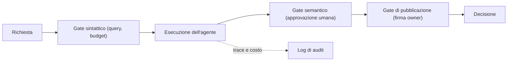

Scenario costruito, con numeri di esempio: un team analytics ha un agente che ogni notte scompone il calo di conversione, scrive una query e prepara un memo. Una mattina il memo attribuisce il calo del 12 per cento alla campagna `X`. Nessuno sa su quali definizioni sia stato prodotto, quanto abbia scansionato il warehouse e chi lo abbia approvato. Il problema non è la singola risposta sbagliata, è che il lavoro non si può ricostruire.

Questa cheat sheet condensa il modulo in criteri che si applicano in pochi minuti: cosa delegare, come vincolarlo, come misurarlo e quando fermarlo.

> **Idea chiave:** l'agente genera, le persone giudicano. Un workflow si approva solo se ogni passo ha un permesso, un budget, un controllo e un owner scritti in anticipo; dove manca una riga, si resta allo stadio precedente.



## Quando delegare e quando restare umani

Un passo agentico rende quando il lavoro si scompone in verifiche rapide e lascia una traccia: profilare una tabella nuova, generare venti ipotesi di segmentazione e scartarne diciotto, scrivere la prima bozza di una query, documentare una pipeline. Diventa pericoloso quando l'output sembra una risposta ma è una decisione travestita, come un'attribuzione causale che sposta budget o una scrittura su una tabella di produzione.

Il confine più pulito separa generazione e giudizio, come nella tabella seguente.

| Area di lavoro | L'agente propone | La persona decide |
|---|---|---|
| Analisi esplorativa | Ipotesi, query, grafici | Quale lettura regge |
| SQL e trasformazioni | Bozza, test di qualità | Merge su ramo protetto |
| Data engineering | Diagnosi, patch candidate | Approvazione e rollback |
| AutoML | Feature, benchmark | Modello e soglia in produzione |
| Reporting | Sintesi e memo | Firma sul numero esterno |

Per decidere in modo non ideologico si stima il valore atteso di un passo: tempo risparmiato valorizzato al costo orario, meno probabilità di errore per costo dell'errore, meno costo di esecuzione. Due esempi con un costo orario di 50 euro:

1. Report esterno: l'agente risparmia 2 ore, cioè 2 × 50 = 100 euro. Con probabilità di errore dell'8 per cento e costo dell'errore di 3.000 euro, il rischio atteso è 0,08 × 3.000 = 240 euro. Con 3 euro di esecuzione, il valore atteso è 100 − 240 − 3 = −143 euro: il passo resta umano.
2. Documentazione di una pipeline: risparmio di 1,5 ore, cioè 75 euro. Probabilità di errore del 10 per cento su un costo di 40 euro, rischio atteso 4 euro. Con 2 euro di esecuzione, il valore atteso è 75 − 4 − 2 = +69 euro: si delega.

Le tre grandezze si stimano a spanne prima di automatizzare, e questo basta per evitare quasi tutte le discussioni sul fidarsi del modello. Il calcolo non serve a decidere con precisione: serve a rendere esplicito quale dei due addendi, tempo risparmiato o rischio atteso, domina nel caso concreto, e quindi dove mettere il controllo umano.

## Contesto, tool e permessi

Un agente senza contesto lo inventa. Ogni richiesta porta un pacchetto minimo: definizione della metrica con formula e filtri, grain della tabella, periodo, segmenti ammessi, fonti autorizzate. Conversion rate non significa nulla finché non è scritto come ordini su sessioni con consenso, bot esclusi, rimborsi entro 14 giorni trattati come non ordini. Quel file è versionato e il prompt di sistema lo richiama, così l'agente non risponde alla domanda giusta con la metrica sbagliata.

Ogni tool esposto si classifica per pericolosità e finisce in uno di tre insiemi. Sono sempre permessi la lettura del catalogo e la profilazione su campioni. Richiedono approvazione le query oltre una soglia di costo e la scrittura su schema di staging. Sono vietati i comandi distruttivi, la modifica di pipeline schedulate e l'invio di comunicazioni esterne, perché producono effetti che nessun rollback sistema del tutto.

I permessi si chiudono con limiti quantitativi nel file di configurazione: per esempio sola lettura sui mart, 500 GB scansionati per run, al massimo 15 passi, stop se tocca tabelle con dati personali fuori lista. Solo ciò che è configurato è verificabile in audit.

## Gate e output revisionabile

Il modello minimo ha tre gate. Il gate sintattico blocca query distruttive e accessi fuori scope prima dell'esecuzione. Il gate semantico richiede l'approvazione umana per azioni con effetti esterni. Il gate di pubblicazione fa firmare il numero che esce verso gli stakeholder. Ogni gate registra chi ha approvato, cosa e su quali evidenze.

Il frammento seguente mostra la guardia sintattica da mettere davanti a ogni query generata.

```python
# Guardia minimale prima di eseguire query generate dall'agente
BLOCCATI = ["drop ", "delete ", "truncate ", "grant ", "revoke "]  # comandi mai ammessi
TABELLE_APPROVATE = {"marts.orders", "marts.sessions", "marts.refunds"}  # allowlist esplicita

def approva_query(sql: str, byte_stimati: int, budget_byte: int) -> tuple[bool, str]:
    # Normalizza per un controllo case-insensitive
    testo = sql.lower()
    # Rifiuta comandi distruttivi o amministrativi
    for vietato in BLOCCATI:
        if vietato in testo:
            return False, f"comando vietato trovato: {vietato.strip()}"
    # Accetta solo tabelle nella lista approvata (euristica: cerca i nomi nel testo)
    if not any(tab in testo for tab in TABELLE_APPROVATE):
        return False, "nessuna tabella approvata rilevata nella query"
    # Blocca esecuzioni sopra budget prima ancora di toccare il warehouse
    if byte_stimati > budget_byte:
        return False, f"stima {byte_stimati} byte sopra il budget {budget_byte}"
    return True, "ok"
```

Non è un sistema di sicurezza completo, ma sposta la protezione dal prompt alla pipeline, dove si può testare.

L'output revisionabile ha tre strati separati: cosa sappiamo con evidenza, cosa non sappiamo per limiti dei dati, cosa proponiamo. Un memo che dichiara il calo concentrato su `Android` dal 12 marzo, ammette di non sapere se dipenda dal tracking e propone due controlli prima di spostare budget si può rivedere. Un paragrafo che conclude che il calo è dovuto all'aggiornamento dell'app non si può rivedere, per quanto ben scritto.

## Leakage, drift e costo: tre guasti da conoscere per nome

### Leakage temporale

Il sintomo è un punteggio brillante in validazione e un modello inutile in produzione. Succede perché un agente libero di costruire feature su uno storico ordini usa timestamp di spedizione o flag di rimborso per predire il reso, informazioni che al momento della previsione non esistono. Si evita dichiarando un cutoff per ogni esperimento, costruendo le feature solo con dati antecedenti e ripetendo il test spostando il cutoff indietro di un mese: se le performance crollano, c'era leakage.

### Drift silenzioso

Il sintomo è un workflow che continua a produrre output ben formattati con qualità in calo. Succede perché il mondo cambia, per esempio dopo il lancio di una nuova linea di prodotto, mentre il classificatore è tarato sui ticket precedenti. Si misura con l'indice di stabilità della popolazione, la somma su ogni classe di (quota corrente − quota di riferimento) × ln(quota corrente / quota di riferimento). Con riferimento 70/30 e corrente 50/50: (0,5 − 0,7) × ln(0,5/0,7) = 0,067 e (0,5 − 0,3) × ln(0,5/0,3) = 0,102, quindi indice pari a 0,067 + 0,102 = 0,17. Sopra la soglia concordata di 0,10 si indaga; sopra 0,25, tipicamente, il workflow si ferma.

### Costo fuori controllo

Il sintomo è una fattura del warehouse che nessuno aveva previsto. Succede perché un agente che itera su query full-scan moltiplica i passi. Con numeri di esempio: 40 passi da 25 GB sono 1.000 GB, circa 1 TB a 5 euro per TB, cioè 5 euro; più 40 chiamate al modello da 0,05 euro, cioè 2 euro, per un totale di 7 euro per run. Se un loop ripete 30 run a notte, il costo è 30 × 7 = 210 euro a notte, 6.300 euro in 30 notti. Si evita con campionamento obbligatorio nelle prime iterazioni, filtri di partizione imposti dal gate e dry-run prima dell'esecuzione reale.

## Eval, trace e monitoraggio

Un workflow senza eval set è un'opinione eseguibile. L'eval set contiene casi con risposta nota e criterio automatico: dieci domande SQL con risultato atteso su uno snapshot congelato, cinque diagnosi di pipeline con causa radice nota, tre task di feature engineering con vincolo di cutoff. Ogni modifica al prompt, ai tool o al modello rilancia la suite e il deploy avviene solo se il punteggio non regredisce.

```python
# Mini-harness di eval per un agente SQL: riesegue i casi noti su snapshot congelato
import sqlite3  # database locale per l'eval, nessun warehouse toccato

def esegui_eval(casi: list[dict], db_path: str) -> dict:
    # Apre lo snapshot congelato in sola lettura
    conn = sqlite3.connect(f"file:{db_path}?mode=ro", uri=True)
    esiti = []  # raccoglie pass/fail per ogni caso
    for caso in casi:
        # Esegue la query generata dall'agente sul caso corrente
        righe = conn.execute(caso["sql_generata"]).fetchall()
        # Confronta con il risultato atteso registrato nell'eval set
        esiti.append({"id": caso["id"], "ok": righe == caso["atteso"]})
    conn.close()
    # Sintetizza il tasso di successo per decidere il deploy
    tasso = sum(1 for e in esiti if e["ok"]) / max(len(esiti), 1)
    return {"tasso_successo": tasso, "dettagli": esiti}
```

Accanto alle eval servono trace complete: input, contesto fornito, chiamate ai tool con argomenti e risultati, approvazioni. Si campionano cinque run a settimana per una revisione umana con griglia fissa: definizioni congelate usate, controlli sul grain passati, inferenze marcate come tali, azioni vietate non tentate. Il monitoraggio in produzione guarda tre assi, qualità dei dati in ingresso, qualità delle decisioni su campioni e salute operativa (latenza, costo per run, tasso di rifiuti dei gate). Se due assi peggiorano insieme, la causa è quasi sempre a monte dell'agente, e fermare il workflow è il comportamento progettato.

## Rollout, owner e checklist di approvazione

Il rollout procede a stadi. Stadio uno: snapshot storici, nessuna azione. Stadio due: dati freschi in lettura, azioni solo su staging con approvazione. Stadio tre: autonomia limitata su casi a basso rischio con monitoraggio stretto. Il passaggio richiede eval superate, trace revisionate e firma dell'owner. L'owner non è chi ha scritto il prompt: è chi ha l'autorità di spegnere il workflow un venerdì pomeriggio senza chiedere permesso.

La griglia seguente si usa prima di ogni attivazione e a ogni revisione periodica.

| Domanda | Risposta minima accettabile | Se manca |
|---|---|---|
| Quale decisione migliora? | Verbo operativo, owner, scadenza | Snapshot storici |
| Quali dati tocca? | Allowlist di tabelle, grain, periodo | Solo lettura su staging |
| Cosa non può fare mai? | Azioni vietate configurate | Nessuna esecuzione autonoma |
| Quanto spende per run? | Budget byte e chiamate, stop automatico | Dry-run obbligatorio |
| Come si accorge di sbagliare? | Test grain, baseline, guard su PII | Revisione umana di ogni output |
| Come si valuta? | Eval set versionato, soglia di deploy | Nessun passaggio di stadio |
| Chi lo ferma? | Owner nominativo, soglie di stop | Spento fino a nomina |

Le soglie di stop vanno scritte prima: freschezza oltre sei ore, indice di stabilità sopra soglia per due finestre consecutive, tasso di rifiuti dei gate raddoppiato in una settimana. Vale anche il divieto di auto-modifica: l'agente non aggiorna il proprio prompt di sistema, non allarga i permessi, non disattiva i gate. Per i pattern di tool-use e handoff si può consultare la documentazione sugli agenti di OpenAI (https://developers.openai.com/api/docs/guides/agents) e la panoramica di LangGraph (https://docs.langchain.com/oss/python/langgraph/overview): cambiano in fretta, ma stato esplicito e punti di intervento umano restano i principi stabili.

Verdetto: approva solo il workflow che risponde a ogni riga della griglia, limita a staging ed eval ciò che non ne supera una, ferma tutto dove mancano owner, budget o stop automatico.

## Controllo rapido sulla griglia

1. Un passo farebbe risparmiare 3 ore a 50 euro l'ora, con probabilità di errore del 5 per cento e costo dell'errore di 4.000 euro, più 4 euro di esecuzione. Lo deleghi?

<details>
<summary>Mostra risposta</summary>

Risparmio 3 × 50 = 150 euro. Rischio atteso 0,05 × 4.000 = 200 euro. Valore atteso 150 − 200 − 4 = −54 euro, quindi il passo resta umano, oppure si riduce l'errore con un gate di approvazione e si ricalcola.

</details>

2. Quale riga della griglia blocca un workflow senza owner nominato?

<details>
<summary>Mostra risposta</summary>

La riga "Chi lo ferma?": se manca un owner con soglie di stop, il workflow resta spento fino a nomina, perché alla prima anomalia nessuno avrebbe l'autorità di intervenire.

</details>

3. Come distingui un calo di performance dovuto a leakage da uno dovuto a drift?

<details>
<summary>Mostra risposta</summary>

Il leakage si vede in validazione: spostando il cutoff indietro di un mese le performance crollano. Il drift si vede in produzione: la distribuzione degli input diverge dal riferimento e l'indice di stabilità supera la soglia, mentre in validazione tutto appariva corretto.

</details>

4. Cosa serve per passare da snapshot storici a dati freschi in lettura?

<details>
<summary>Mostra risposta</summary>

Eval superate sul set versionato, trace campionate e revisionate con la griglia fissa e la firma dell'owner nominativo sul passaggio di stadio.

</details>
